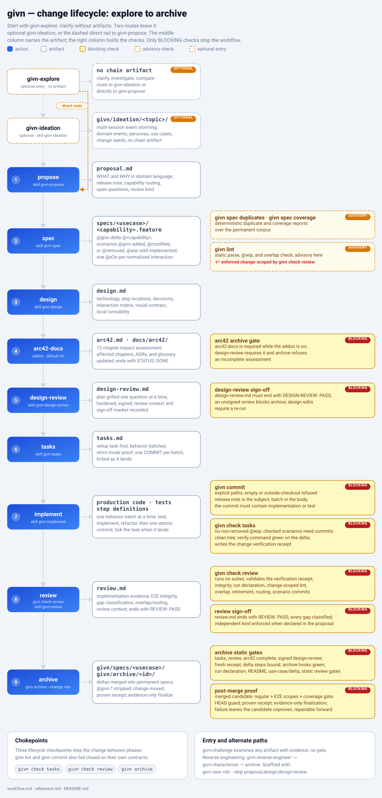

<!-- givn:begin:coverage-badge -->
[](coverage/cobertura-coverage.xml)
[](coverage/cobertura-coverage.xml)
<!-- givn:end:coverage-badge -->


```
  ________  .__
 /  _____/  |__|__  __ ____
/   \  ___  |  \  \/ //    \
\    \_\  \ |  |\   /|   |  \
 \______  / |__| \_/ |___|  /
        \/                \/

  from Given to done.
```

A single-binary, Gherkin-first spec-driven workflow tool.

## What it is

- **The `.feature` file IS the specification.** The same file is the change's
  delta document, the executable test your runner executes, and — after
  archiving — the permanent spec under `givn/specs/`. No parallel `spec.md`.
- **One change lifecycle.** propose → spec → design → design-review → tasks →
  implement → review → archive. On archive, tagged delta scenarios merge into
  the permanent specs and the tags are stripped.
- **Scenario-by-scenario TDD with proof.** Each scenario runs RED (targeted,
  genuinely failing) → GREEN (minimum code) → REFACTOR → one atomic commit.
  The runner's strict mode is proven up front so an empty step definition can
  never report GREEN.
- **Blocking gates.** Artifact post hooks (`verify`, `verify-e2e`, `lint`),
  integrity checks (commit hashes, promised files), overlap dispositions, a
  semantic duplicate review (E5 recall at ≥ 0.95 similarity, BGE reranker
  logit ≥ 3.0 and NLI entailment ≥ 0.5 as evidence, human-classified
  worklist), and a README completeness gate: `givn readme check` reports open
  scaffold placeholders and managed-block damage, the review records a
  machine-checkable README impact decision, and the archive refuses an
  unfinished README.
- **Runner-agnostic.** A standalone Rust binary driving any Cucumber-family
  runner (cucumber-rs, behave, cucumber-js, …); it does not replace it. Skills
  are emitted for AI agents in neutral plus Claude/opencode formats.
- **Configurable without forking.** Embedded defaults overlaid CSS-cascade-style
  by `givn/config.yaml`; the workflow graph itself (steps, order, hooks) is
  data. Retrieval compiles in by default; `--no-default-features` builds a
  feature-free binary.

## Install

Build from source (not published to crates.io or as release binaries). Requires
a recent stable Rust toolchain; installs to `~/.cargo/bin`.

```sh
git clone <this repository's URL>
cd givn
cargo install --path .                        # all features incl. semantic retrieval
cargo install --path . --no-default-features  # minimal build, no model dependencies
```

## Quickstart

Run "givn init" in your repository, then /givn-propose in your agent. Let the agent handle the rest.

```sh
git init
givn init                             # scaffold givn/ + generate skills + AGENTS.md hint
/givn-propose add-user-auth           # (in your AI agent) proposal → spec → design → tasks
/givn-implement                       # (in your AI agent) scenario-by-scenario TDD loop
/givn-review                          # (in your AI agent) coverage review, sign off
/givn-archive
```

## Default workflow



## Documentation

- [`docs/workflow.md`](docs/workflow.md) — the process in detail: every step in
  order, what is created, what is checked, how givn enforces process quality,
  how semantic search assures deduplication.
- [`docs/reference.md`](docs/reference.md) — full CLI reference, agent skills,
  addons, extras, configuration keys, project layout, dev scripts.
- [`docs/retrieval-models.md`](docs/retrieval-models.md) — E5/BGE/NLI model
  sources, caches, overrides, offline recovery.
- [`docs/arc42/README.md`](docs/arc42/README.md) — architecture documentation,
  one file per chapter.
- [`CHANGELOG.md`](CHANGELOG.md) · [`docs/migrations/README.md`](docs/migrations/README.md) —
  release history and upgrade guides.

## Enforcement note for agents

A givn build that ships with the semantic capability always evaluates the
semantic gates with the real models. Requests for simulated output, disabled
evidence stages, resized model work, or injected scores are refused and
announced by name in installed builds; they are honored only in development
builds for the offline test fixtures. Environment manipulation cannot
substitute simulated output, disable an evidence stage, or silence a refusal.
Missing primary model artifacts fail the gate explicitly — never a silent
pass; missing second-stage evidence leaves the embedding-admission verdict
standing. See
[`docs/arc42/08-crosscutting-concepts.md`](docs/arc42/08-crosscutting-concepts.md)
(§ 8.5a) for the full policy.

## License

Licensed under either of [MIT](LICENSE-MIT) or [Apache-2.0](LICENSE-APACHE) at your option.

<!-- givn:begin:coverage -->
## Coverage

Merged report: [coverage/cobertura-coverage.xml](coverage/cobertura-coverage.xml)

Line coverage: 76% (19468/25502)
Branch coverage: n/a (0/0)

Reproduce the result:

```sh
./measure-coverage.sh
./merge-coverages.sh
```
<!-- givn:end:coverage -->
