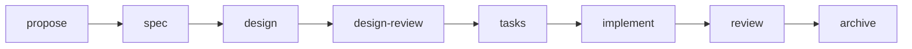
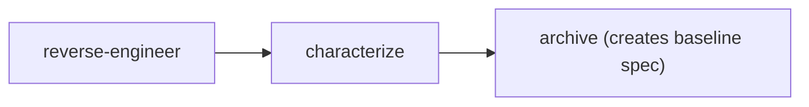

```
  ________  .__
 /  _____/  |__|__  __ ____
/   \  ___  |  \  \/ //    \
\    \_\  \ |  |\   /|   |  \
 \______  / |__| \_/ |___|  /
        \/                \/

  from Given to done.
```

<!-- givn:begin:coverage-badge -->
[](coverage/cobertura-coverage.xml)
[](coverage/cobertura-coverage.xml)
<!-- givn:end:coverage-badge -->

> A single-binary, Gherkin-first spec-driven workflow tool.

`givn` manages a change lifecycle where **the `.feature` file IS the
specification** — the delta document, the executable test, and the permanent
archived record, all in one. No parallel `spec.md`, no drift between what was
planned and what runs.

It packages a Gherkin-first workflow into a standalone, configurable Rust
binary: delta lifecycle → scenario-by-scenario TDD → completeness-based
coverage review → automatic delta merge on archive. Language- and
test-runner-agnostic — it drives Cucumber-family runners in any stack, it
does not replace them.

---

## Table of contents

- [Why givn](#why-givn)
- [Core ideas](#core-ideas)
- [Install](#install)
- [Quickstart](#quickstart)
- [The workflow](#the-workflow)
- [Reverse-engineering an existing codebase](#reverse-engineering-an-existing-codebase)
- [Commands](#commands)
- [Skills (AI agent workflow)](#skills-ai-agent-workflow)
- [Addons](#addons)
- [Extras](#extras)
- [Configuration](#configuration)
- [What the tool creates in your project](#what-the-tool-creates-in-your-project)
- [Documentation](#documentation)
- [License](#license)

---

## Why givn

Existing spec-driven tools have pain points this project fixes deliberately:

| Pain point (in prior tools) | How givn fixes it |
| --- | --- |
| Too much hardcoded behaviour | Everything customisable via override files (CSS cascade) |
| npm + root/sudo install | Single static binary; no npm, no root, no runtime |
| Schema customisation requires forking TS source | Eject any facet into your project dir; edit freely |
| Skill templates hardcoded; overwritten on update | Templates are ejectable override files; updates touch only the embedded fallback |
| Config scattered across 3 layers | One visible `givn/` directory holds all project config |
| Opaque config; unclear what's changeable | `givn/config.yaml` is fully commented with documented defaults for every key |
| No upgrade path when the tool evolves | Config is versioned; `givn upgrade` refreshes it, with `git diff` as the merge surface |
| Silent/guessed test running | Default runner is a sentinel that prints setup guidance and fails until configured |
| A parallel `spec.md` format duplicating the `.feature` | The `.feature` file **is** the spec — nothing duplicated |
| Coverage gated on an arbitrary percentage | Gate is **completeness of gap classification**, not a number |
| E2E scenarios silently downgraded to DB-only checks when the UI is hard to drive | Design must document local runnability + digital twins; review audits every `@e2e` scenario for a real-interface assertion |
| Empty/no-op step definitions silently reported as passing | Runner must be proven **strict** before implementation starts; review greps for empty step bodies |
| No fixed point for "what do I do next?" | `givn instructions` inspects actual project state and names the next command |

## Core ideas

- **The `.feature` file is the single source of truth.** No `spec.md`. The same
  file is the delta you write, the cucumber test you run, and (after archive) the
  permanent spec. `verify.command` MUST execute these `.feature` files via a
  Gherkin/Cucumber runner — never a parallel hand-maintained test file.
- **Delta lifecycle with tags.** Deltas are tagged `@givn.delta` (Feature) and
  `@givn.added` / `@givn.modified` / `@givn.removed` (Scenario). On archive they
  are merged into the permanent spec and the tags are stripped, leaving clean,
  runnable Gherkin.
- **Scenario-by-scenario TDD, with proof.** The implement loop runs one
  scenario at a time: RED (a genuinely failing assertion, targeted, output
  captured) → GREEN (minimum production code, files listed) → REFACTOR → one
  atomic COMMIT. The runner's strict mode is proven once, up front, so an
  empty/no-op step can never silently report GREEN.
- **End-to-end smoke tests that assert on the real interface.** Every
  capability needs at least one `@e2e` scenario that drives the real
  interface — browser, CLI, or API — and asserts primarily on what that
  interface returned. A database-only check wearing an `@e2e` tag is
  treated as unfinished work, not a coverage gap.
- **Local runnability is a design requirement.** The design for a change must
  name a single command that starts the whole system plus a digital twin
  (fake/stub/emulator) for every external dependency, in an isolated network —
  and a concrete fix for any foreseeable obstacle to driving the real
  interface. "The UI had a cookie problem so we only checked the database" is
  a design gap, not an acceptable outcome.
- **Version freshness in design.** Technology choices in `design.md` must
  either say "latest"/"LTS" explicitly or record a version that was actually
  looked up — never a number recalled from a model's training data.
- **Completeness-based coverage gate.** Every uncovered line is classified as
  dead code (delete), missing test (add scenario / fix steps), or
  legitimately-hard-to-test (justify). There is no percentage threshold.
- **CSS-style cascade config.** The binary ships sensible embedded defaults.
  Your project's `givn/` directory overrides any facet (template, instructions,
  deps, skill templates) — and only the facets you eject. Binary updates never
  clobber your files.
- **Standards-aligned agent integration.** Invokable skills are emitted to the
  neutral `.agents/skills/<name>/SKILL.md` path, with mirrors for Claude Code
  and opencode. `AGENTS.md` at the repo root is otherwise left for the user to
  author. The one exception: `givn init` and `givn skills sync` maintain a
  short, fenced `<!-- givn:begin:givn-project -->` block at the **top** of it —
  a pointer telling any agent that this project uses givn and to run
  `givn instructions` for what to do next. Nothing outside that block is ever
  touched. Opt-in addons (e.g. `absolute_mode`) manage their own separate
  fenced blocks the same way, appended below.
- **Context-aware entry point.** `givn instructions` (no arguments) inspects
  the project's current state — no `givn/` yet, no active changes, one
  change mid-workflow, several active changes — and tells you exactly which
  command or skill to run next. `givn instructions <artifact>` is unchanged:
  it prints that artifact's writing instructions.
- **Self-documenting, versioned config.** `givn init` writes `givn/config.yaml`
  with every key present-but-commented, documented inline (description, default,
  allowed values). It carries `givn_config_version`; `givn upgrade` provides a
  version-to-version upgrade path that preserves your overrides.
- **Lint and test are separate, by design.** `givn lint` is a built-in command
  that statically checks your `.feature` files (syntax, `@wip`, delta tags) and
  **runs no tests**. Running the actual tests is a separate command you configure
  as `verify.command` in `givn/config.yaml`. That command MUST be a
  Gherkin/Cucumber runner that executes the `.feature` files (e.g.
  `cargo test --test features_runner` with `cucumber-rs`, `behave`, or
  `npx cucumber-js "givn/specs/**/*.feature"`) — a bare unit-test runner
  (`cargo test` alone, bare `pytest`) is not sufficient, because the
  `.feature` file is the executable spec.
- **Self-contained gates via hooks.** Artifacts can declare `post` hooks; by
  default `tasks` and `review` run `verify.command` after they complete. `givn
  check <artifact>` runs those hooks, and `givn archive` runs the hooks of every
  required artifact as the gate — so a change can only archive when the suite is
  green. Hooks are fully configurable (add `lint`, `verify-e2e`, custom shell
  commands, or `allow_failure`).
- **No silent test running.** The default `verify.command` is the sentinel
  `givn missing-testrunner`, which prints per-language setup guidance and exits
  non-zero until you configure a real runner — so nothing ever falsely reports green.
- **Configurable workflow (artifacts are data).** Add, remove, reorder, or make
  optional any lifecycle step purely via `givn/config.yaml` — e.g. drop the review
  gate or add a dedicated refactor step after implementation. No fork required.
- **Spec/implementation separation.** Proposals and `.feature` files describe
  *what* and *why* (implementation-independent, domain language); *how* lives in
  design and tasks. The default instructions enforce the boundary.
- **Opt-in addons.** Enable via `addons:` in `givn/config.yaml` or `givn addons
  enable <name>` — e.g. `arc42` for durable architecture documentation,
  `absolute_mode` for a blunt, no-filler communication policy in AGENTS.md.

## Install

Not yet published to crates.io, Homebrew, or as release binaries — the only
way to install it today is to build from source. No npm, no root, no
runtime beyond a Rust toolchain.

```sh
git clone <this repository's URL>
cd givn
cargo install --path .
```

This installs the `givn` binary to `~/.cargo/bin` (make sure that's on your
`PATH`). Requires a recent stable Rust toolchain (`rustup install stable`).

## Quickstart

```sh
givn init                             # scaffold givn/ + generate skills + AGENTS.md hint
givn instructions                     # what to do next, given the project's current state
givn new add-user-auth                # create a change scaffold
/givn-propose add-user-auth           # (in your AI agent) plan proposal → spec → design → tasks
/givn-implement                       # (in your AI agent) run the scenario-by-scenario TDD loop
/givn-review                          # (in your AI agent) coverage review, sign off
givn archive --change add-user-auth   # merge deltas into givn/specs/, move to archive/
```

The rest of the CLI, for reference:

```sh
givn status                                 # lifecycle state for every active change
givn status --change add-user-auth --json   # machine-readable state for commands/scripts
givn instructions specs --change add-user-auth       # writing instructions for one artifact
givn instructions specs --change add-user-auth --json
givn lint                                   # static .feature check (0 clean / 1 parse err / 2 @wip) — NO tests
givn lint --change add-user-auth
givn check tasks                            # run an artifact's post hooks (e.g. verify.command)
givn status --change add-user-auth           # lifecycle state (includes task progress & pending tasks)
givn new reverse-cap --skip proposal,design,design-review   # reverse-engineering change scaffold
givn eject design:template                  # pull an embedded default into your project to edit
givn eject review:instruction
givn eject skill:givn-propose
givn eject manifest                         # reference copy of the embedded artifact graph
givn skills sync                            # regenerate skills/commands after a binary update
givn upgrade                                # refresh documented config.yaml to the new givn version
givn addons list                            # show available addons and their enabled/disabled status
givn addons enable arc42
givn addons enable absolute_mode
givn addons disable absolute_mode
givn extras install                         # enable + sync extras skills/commands (default: on)
givn extras uninstall
givn completions bash                       # print bash completion script (eval in ~/.bashrc)
givn completions zsh                        # print zsh completion script  (eval in ~/.zshrc)
givn completions fish                       # print fish completion script (source or save to completions/)
```

> **First thing after `init`:** set `verify.command` in `givn/config.yaml` to a
> Gherkin/Cucumber runner that executes your `.feature` files (e.g.
> `cargo test --test features_runner` with `cucumber-rs`, `behave`,
> `npx cucumber-js "givn/specs/**/*.feature"`). A bare unit-test runner
> (`cargo test` alone, `pytest`) is NOT sufficient — the `.feature` file is the
> executable spec, so the runner must consume it. Until you configure a real
> runner, the default is the sentinel `givn missing-testrunner`, which prints
> setup guidance and fails on purpose so nothing falsely reports green. If the
> change has `@e2e` scenarios, also set `verify.e2e_command` to a runner
> filtered to that tag.

> `givn/config.yaml` ships **fully commented** — every option is documented inline
> with its default and allowed values. It is **versioned** (`givn_config_version`);
> `givn upgrade` refreshes the documentation scaffold to a newer givn release while
> preserving your overrides, with `git diff` as the review/merge surface.

## Development

The repository keeps its usual test and coverage commands in scripts. The same
scripts are referenced by `givn/commands.yaml`:

```sh
./run-tests.sh
./run-tests.sh --e2e
./measure-coverage.sh
./merge-coverages.sh
```

`measure-coverage.sh` writes the non-E2E and E2E Cobertura reports.
`merge-coverages.sh` writes the merged report used by the two badges and the
managed coverage summary below.

## The workflow



`archive` is gated: requires `tasks.md` and `review.md` (configured in manifest).

| Step | Artifact | What happens |
| --- | --- | --- |
| **propose** | `proposal.md` | WHAT and WHY, in domain language. No implementation detail. |
| **spec** | `specs/<cap>/<cap>.feature` | Delta Gherkin scenarios, tagged `@givn.added` while `@wip`. Every capability needs at least one `@e2e` scenario driving the real interface. |
| **design** | `design.md` | The HOW layer: tech decisions (with looked-up or "latest/LTS" versions), architecture, step-def locations, strict-mode config, local-runnability + digital-twin plan, e2e infrastructure. |
| **design-review** | `design-review.md` | A grilling subagent reads the full plan and returns ranked questions with recommended answers; the orchestrator presents them one at a time; a hardening subagent applies decisions. Gate: `DESIGN-REVIEW: PASS`. |
| **tasks** | `tasks.md` | Scenario-by-scenario RED→GREEN→REFACTOR→COMMIT breakdown, including the proof-of-strictness setup task and the e2e environment bring-up task. |
| **implement** | (code) | The TDD loop itself. Every scenario ends in one atomic commit. Independent verification (not just the coding subagent's own report) confirms each GREEN before moving on. |
| **review** | `review.md` | Coverage review: run the suite, measure coverage, classify every gap. First step is a mandatory fabrication audit (empty step bodies, missing commits, downgraded `@e2e` scenarios, promised-but-missing components). Gate: `REVIEW: PASS`. |
| **archive** | — | Merge delta `.feature` files into `givn/specs/`, strip `@givn.*` tags, move the change to `givn/archive/<id>/`. |

## Reverse-engineering an existing codebase

When a codebase has no givn specs yet (e.g. for the first dogfood),
`/givn-reverse-engineer` creates the **initial baseline spec** by
characterizing observed behaviour. Reverse-engineering is a **peer flow** to
the normal change lifecycle — it does not produce proposals or designs, only
descriptive Gherkin specs and characterization tasks:



- **reverse-engineer** discovers a capability and its black-box boundary
  interactively, then writes descriptive `.feature` scenarios (AS-IS behaviour)
  and characterization tasks. No proposal, no design, no design-review — the
  boundary and suspected bugs go in the Feature: description block; seam
  strategy goes per-task in tasks.md. `givn new --skip proposal,design,design-review`
  skips the unneeded artifacts so `givn status` shows them as ⊘ skipped.
- **characterize** executes the RED/GREEN/REFACTOR loop (shared mechanics via
  the `givn-steps` skill): writes step definitions matching observed behaviour,
  diagnoses spec/implementation mismatches (corrects the spec, never the code),
  applies testability seams, and runs a reverse review (no dead-code deletion,
  bugs flagged not fixed). Suspected bugs and code smells are marked in
  production code as `TODO: REVERSE-ENGINEERING NOTE:` comments for IDE
  discoverability.
- On archive, the all-`@givn.added` delta merges into an empty permanent spec,
  creating the initial `givn/specs/<cap>/<cap>.feature` baseline.

After the baseline exists, future changes use the normal workflow
(`/givn-propose` with deltas against the baseline).

## Commands

Every `givn` subcommand:

| Command | Purpose |
| --- | --- |
| `givn init [--force] [--no-extras] [--no-addons]` | Scaffold `givn/{specs,changes,archive}`, write `givn/config.yaml`, generate skills/commands, add the AGENTS.md hint block. Enables all addons and extras by default. |
| `givn new <id> [--skip a,b,c]` | Create a new change scaffold under `givn/changes/<id>/`. `--skip` marks artifacts as intentionally not produced (reverse-engineering). |
| `givn instructions [<artifact>] [--change <id>] [--json]` | No artifact: context-aware guidance on what to do next. With an artifact id: that artifact's writing instructions. |
| `givn lint [--change <id>] [paths...]` | Static Gherkin check only (syntax, `@wip`, delta tags). Exit 0 clean / 1 parse error / 2 `@wip` present. **Runs no tests.** |
| `givn check [<artifact>] [--change <id>]` | Run an artifact's `post` hooks on demand (e.g. `verify`, `verify-e2e`, `lint`). |
| `givn status [--change <id>] [--json]` | Lifecycle state: artifact checklist, current stage, task progress with pending task descriptions, next required/optional steps. Filesystem-derived, no separate state file. |
| `givn graph [--change <id>] [--json]` | Show the artifact workflow graph: nodes, `requires` dependency edges, optional/gates-archive flags, post hooks. Without `--change`, prints the general workflow from the manifest. With `--change`, overlays live status per artifact. |
| `givn archive --change <id>` | Archive a completed change. Gated: `apply.requires` artifacts must exist, `REVIEW: PASS` present, all their hooks pass. |
| `givn eject <target> [--force]` | Write an embedded default facet into the project for editing (`design:template`, `review:instruction`, `skill:givn-propose`, `manifest`). |
| `givn addons list` / `enable <name>` / `disable <name>` | Manage opt-in addon artifact/policy sets. |
| `givn extras install` / `uninstall` | Enable/disable the curated extras skill+command bundle. |
| `givn skills sync` | Regenerate all skills, commands, and the AGENTS.md blocks from the current templates. |
| `givn upgrade` | Re-render the managed `config.yaml` documentation scaffold, preserve user overrides, bump `givn_config_version`. |
| `givn completions <bash\|zsh\|fish>` | Print a shell completion script. |

## Skills (AI agent workflow)

`givn init` / `givn skills sync` emit these as invokable skills to
`.agents/skills/<name>/SKILL.md` (neutral), with mirrors for Claude Code
(`.claude/skills/`) and opencode (`.opencode/skills/` + `.opencode/commands/`
slash commands):

| Skill | When to use it |
| --- | --- |
| `givn-explore` | Think through ideas, investigate problems, clarify requirements before proposing a change. |
| `givn-propose` | Write the proposal — WHAT and WHY, in domain language, no implementation detail. |
| `givn-spec` | Write the Gherkin `.feature` delta — observable behaviour, no implementation detail. |
| `givn-design` | Write the technical design — the HOW layer: tech decisions, architecture, step-def locations. |
| `givn-design-review` | Stress-test the plan one question at a time before tasks are written; harden the artifacts; sign off. |
| `givn-tasks` | Break the design down into a scenario-by-scenario RED/GREEN/REFACTOR/COMMIT task list. |
| `givn-implement` | Execute the TDD loop, one scenario at a time, ending in an atomic commit per scenario. |
| `givn-steps` | Shared step-writing mechanics (step reuse, the RED/GREEN/REFACTOR loop, never-empty-step rule) — referenced by `givn-implement` and `givn-characterize`, not run standalone. |
| `givn-review` | Complete the coverage review: fabrication audit, gap classification, sign-off. |
| `givn-archive` | Archive a completed change: gate hooks, merge deltas, move to `archive/`. |
| `givn-reverse-engineer` | Discover an existing capability's black-box boundary and write descriptive baseline specs. |
| `givn-characterize` | Execute the characterization loop against existing behaviour, with testability seams and a reverse review. |

## Addons

Opt-in, pre-packaged artifact or policy sets. Enable with `givn addons enable
<name>` or `addons: { <name>: true }` in `givn/config.yaml`.

| Addon | What it does |
| --- | --- |
| `arc42` | Adds an `arc42-docs` artifact (after `design`) that creates and maintains durable, project-level arc42 architecture documentation under `docs/arc42/`. |
| `absolute_mode` | Manages a fenced `<!-- givn:begin:absolute-mode -->` block in `AGENTS.md` with a blunt, no-filler, no-hype communication policy for all work in the project. |

## Extras

A curated, opt-in bundle of project-level skills and commands, independent of
the change lifecycle. Enabled by default on `givn init` (disable with
`--no-extras`); toggle later with `givn extras install` / `uninstall`.

| Extra | Kind | Purpose |
| --- | --- | --- |
| `givn-domain-modeling` | skill | Model a change's domain before designing — ubiquitous language, aggregates, invariants. |
| `givn-dev-principles` | skill | Apply the team's engineering principles while implementing — correctness first, boring when called for, no unnecessary abstractions. |
| `/grill-me` | command | Socratically grill the current plan or design, one hard question at a time. |
| `/grill-with-docs` | command | Grill the plan or design against the project's own docs and specs, citing the source for every challenge. |

## Configuration

`givn/config.yaml` is generated fully-commented by `givn init`. Commented
lines are the managed documentation scaffold (refreshed by `givn upgrade`);
uncommented key/value lines are yours and are never touched by an upgrade.
The only value you *must* set for a working project is `verify.command`.

Key sections:

- `verify.command` / `verify.e2e_command` — the test runner(s). Must be a
  Gherkin/Cucumber runner, not a bare unit-test command. This repository keeps
  them in `givn/commands.yaml` as `./run-tests.sh` and
  `./run-tests.sh --e2e`.
- `coverage.measure_command` / `coverage.merge_command` — project-owned
  scripts. The measurement script writes the non-E2E and E2E Cobertura inputs;
  the merge script writes the report used by both README badges and the
  summary. This repository uses `./measure-coverage.sh` and
  `./merge-coverages.sh`.
- `verify.features_path` — where the runner reads `.feature` files from
  (default `givn/specs`).
- `artifacts:` — patch the embedded artifact graph: remove a step, make one
  optional, add a custom step (e.g. a dedicated refactor step) with its own
  template and instruction.
- `apply.requires` — which artifacts gate `givn archive` (default
  `[tasks, review]`).
- Hooks (`post:` on an artifact) — built-ins `verify`, `verify-e2e`, `lint`,
  or any shell command; object form adds `allow_failure` and a display `name`.
- `addons:` — `arc42`, `absolute_mode` (see [Addons](#addons)).
- `extras:` — the extras bundle toggle (see [Extras](#extras)).

## What the tool creates in your project

```
givn/
├── config.yaml                       # documented + versioned: overlay + verify.command
├── commands.yaml                     # project-owned test and coverage scripts
├── specs/<cap>/<cap>.feature         # permanent merged spec (source of truth)
├── changes/<id>/                     # active change (state = which files exist)
│   ├── proposal.md
│   ├── specs/<cap>/<cap>.feature     # delta: @givn.delta + added|modified|removed
│   ├── design.md  tasks.md  design-review.md  review.md
│   └── arc42.md                      # optional: arc42-docs addon marker (STATUS: DONE)
├── archive/<id>/                     # archived changes
└── (ejected overrides, on demand)
    artifacts/<id>/template.*
    artifacts/<id>/instructions.md
    skills/<name>/SKILL.md.tmpl

.agents/skills/<name>/SKILL.md        # neutral skills (primary)
.claude/skills/<name>/SKILL.md        # mirror for Claude Code
.opencode/skills/<name>/SKILL.md      # mirror for opencode
.opencode/commands/<name>.md          # opencode slash commands

AGENTS.md                             # user-owned; givn only maintains its own
                                       #   fenced blocks, always at the top:
                                       #   <!-- givn:begin:givn-project -->
                                       #   (+ <!-- givn:begin:absolute-mode -->
                                       #    if that addon is enabled)
```

Project command scripts belong in the README and are referenced by
`givn/commands.yaml`. The conventional names are `run-tests.sh`,
`measure-coverage.sh`, and `merge-coverages.sh`.

## Documentation

- [`docs/arc42/`](docs/arc42/README.md) — full architecture documentation
  (arc42), one file per chapter. Start with the index.
  - [Introduction & Goals](docs/arc42/01-introduction-and-goals.md)
  - [Solution Strategy](docs/arc42/04-solution-strategy.md)
  - [Cross-cutting Concepts](docs/arc42/08-crosscutting-concepts.md) — the core mechanics.
  - [Architecture Decisions](docs/arc42/09-architecture-decisions.md) — every decision, with rationale.
- [`docs/TASKS.md`](docs/TASKS.md) — phase-by-phase implementation task breakdown.

## License

Licensed under either of [MIT](LICENSE-MIT) or [Apache-2.0](LICENSE-APACHE) at your option.

<!-- givn:begin:coverage -->
## Coverage

Merged report: [coverage/cobertura-coverage.xml](coverage/cobertura-coverage.xml)

Line coverage: 57% (3664/6416)
Branch coverage: n/a (0/0)

Reproduce the result:

```sh
./measure-coverage.sh
./merge-coverages.sh
```
<!-- givn:end:coverage -->
