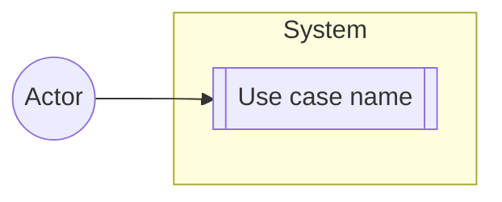

# Tasks: retire the semantic gate, group specs by use case, fix routing

Read `PLAN.md` first — it explains *why* each phase exists. This file is
the executable checklist. Work top to bottom within a phase; phases must
land in the order given (see `PLAN.md` §8) — do not skip ahead.

Conventions used below:
- File:line references are "as of this writing" — if a line has drifted,
  find the anchor by the quoted code/string instead of trusting the number.
- `[ ]` = not started, `[x]` = done. Update checkboxes as you go so the
  file always reflects real progress.
- Every task ends with a **Verify** line — a concrete command. Do not mark
  a task `[x]` until its Verify command actually passes.
- This is `givn`'s own repository — `givn` builds its own specs using
  itself. Any task that changes `givn/specs/**` or `givn/changes/**` must
  go through the real `givn` workflow (`givn new` → write artifacts →
  `givn check <artifact>` → `givn archive`), not by hand-editing
  `givn/specs/` directly, unless the task says otherwise.

---

## Phase 0 — Unblock the switch-off

### [x] 0.1 Make the disabled-`spec-retrieval` review gate a no-op

**File:** `src/cli/check.rs`

Find:
```rust
#[cfg(not(feature = "spec-retrieval"))]
fn run_retrieval_gate(project_root: &std::path::Path, change_id: &str) -> anyhow::Result<()> {
    crate::spec::retrieval::semantic_review(project_root, change_id)
}
```

Replace with:
```rust
#[cfg(not(feature = "spec-retrieval"))]
fn run_retrieval_gate(_project_root: &std::path::Path, _change_id: &str) -> anyhow::Result<()> {
    Ok(())
}
```

This mirrors the existing good pattern in `src/cli/archive.rs` (search for
`fn run_similarity_gate` — the `#[cfg(not(feature = "spec-retrieval"))]` arm
there is already `Ok(())`). Today `check.rs`'s arm instead calls
`crate::spec::retrieval::semantic_review`, which — regardless of which
build feature-gates its *body* — always `bail!`s in the branch compiled
when `spec-retrieval` is off (see `src/spec/retrieval.rs`, search for
`pub fn semantic_review`). That means `givn check review --change <id>`
can never pass in a `--no-default-features` build. Fix it at the call site
in `check.rs`, not inside `semantic_review` (other callers of
`semantic_review` may still want the bail — check for other call sites
with `grep -rn "retrieval::semantic_review\b" src/` before assuming it's
safe to change the shared function instead of the call site).

**Verify:**
```sh
cargo build --no-default-features 2>&1 | tail -30
```
Must compile (it may already compile — this task is about behavior, not
compilation). Full behavioral verification happens in Phase 1 task 1.5,
once the semantic capabilities are actually retired and a
`--no-default-features` build has nothing left that requires the feature.

---

### [x] 0.2 Add the capability-retirement primitive

**Files:** `src/gherkin/delta.rs`, `src/cli/archive.rs`

**Step A — `src/gherkin/delta.rs`.** Add near `is_delta_feature` (search for
`pub fn is_delta_feature`):

```rust
/// Returns true if the feature is a capability-retirement marker
/// (`@givn.retired`). A retirement delta has zero scenarios — it exists
/// only to tell `givn archive` to delete a whole capability directory
/// instead of merging.
pub fn is_retired_feature(feature: &Feature) -> bool {
    feature.tags.iter().any(|t| t == "givn.retired")
}
```

Add near the top of the file (the file currently has no `anyhow` import —
add one):

```rust
use anyhow::{Result, bail};
```

Add a capability-tag validator (put it right after `capability_tag`):

```rust
/// Reject a capability tag that is not a safe, unambiguous path segment.
/// `capability_tag` returns an arbitrary string taken from a feature tag;
/// `archive.rs` interpolates it into a filesystem path twice (merge target)
/// and now also uses it to select a directory to delete (retirement). A
/// tag containing `..`, `/`, or an empty string must never reach either.
pub fn validate_capability_tag(tag: &str) -> Result<()> {
    let ok = !tag.is_empty()
        && tag.chars().all(|c| c.is_ascii_lowercase() || c.is_ascii_digit() || c == '-')
        && !tag.starts_with('-')
        && !tag.ends_with('-');
    if !ok {
        bail!(
            "invalid capability tag '{tag}': must be non-empty lowercase \
             kebab-case ([a-z0-9-]+), no leading or trailing '-'"
        );
    }
    Ok(())
}
```

Add tests in the existing `#[cfg(test)] mod tests` block:
```rust
#[test]
fn detect_retired_feature() {
    let feature = parse_str(
        "@givn.delta @givn.retired @old-capability\nFeature: Old capability\n",
    )
    .unwrap();
    assert!(is_retired_feature(&feature));
}

#[test]
fn validate_capability_tag_rejects_traversal() {
    assert!(validate_capability_tag("../../etc").is_err());
    assert!(validate_capability_tag("foo/bar").is_err());
    assert!(validate_capability_tag("").is_err());
    assert!(validate_capability_tag("-leading").is_err());
}

#[test]
fn validate_capability_tag_accepts_kebab_case() {
    assert!(validate_capability_tag("semantic-review").is_ok());
    assert!(validate_capability_tag("abc123").is_ok());
}
```

**Step B — `src/cli/archive.rs`.** Find the merge loop (search for
`Merging {} delta feature file(s)`). Inside the `for delta_path in
&delta_files` loop, after the existing `cap` computation
(`let cap = crate::gherkin::delta::capability_tag(...)`) and before
`let permanent_dir = ...`, insert validation, then branch on retirement
right after computing `permanent_dir`/`permanent_path`:

```rust
crate::gherkin::delta::validate_capability_tag(&cap).map_err(|e| {
    anyhow::anyhow!("archive blocked: {e} (from '{}')", delta_path.display())
})?;

let permanent_dir = project_root.join("givn/specs").join(&cap);
let permanent_path = permanent_dir.join(format!("{cap}.feature"));

if crate::gherkin::delta::is_retired_feature(&delta_feature) {
    if !delta_feature.scenarios.is_empty() {
        bail!(
            "archive blocked: '{}' is tagged @givn.retired but contains {} \
             scenario(s) — a retirement delta must have zero scenarios",
            delta_path.display(),
            delta_feature.scenarios.len()
        );
    }
    if !permanent_dir.exists() {
        bail!(
            "archive blocked: '{}' retires capability '{cap}' but \
             givn/specs/{cap}/ does not exist",
            delta_path.display()
        );
    }
    std::fs::remove_dir_all(&permanent_dir)?;
    record_retirement(&project_root, &cap, change)?;
    println!(
        "[{}]   retired → {}",
        crate::subprocess::local_timestamp(),
        permanent_dir.display()
    );
    continue;
}

merge_file(&permanent_path, &delta_feature)?;
println!(
    "[{}]   merged → {}",
    crate::subprocess::local_timestamp(),
    permanent_path.display()
);
```

(Delete the old, now-duplicated `let permanent_dir = ...` / `let
permanent_path = ...` / `merge_file(...)` / `println!("merged...")` lines
that used to follow the `cap` computation — they're folded into the block
above.)

**Step C — tombstone.** Add this at the bottom of `src/cli/archive.rs`
(anywhere after the `use` statements, e.g. just above `copy_dir_all`):

```rust
#[derive(serde::Serialize, serde::Deserialize)]
struct RetiredEntry {
    capability: String,
    retired_date: String,
    retired_by_change: String,
}

/// Append a retirement record to `givn/specs/.retired.yaml`. This file
/// lives *inside* `givn/specs`, so it is covered by the same
/// backup/rollback as everything else the merge loop touches — a failed
/// archive after this call rolls the tombstone back along with the
/// deleted directory.
fn record_retirement(
    project_root: &std::path::Path,
    capability: &str,
    change_id: &str,
) -> Result<()> {
    let path = project_root.join("givn/specs/.retired.yaml");
    let mut entries: Vec<RetiredEntry> = if path.exists() {
        let text = std::fs::read_to_string(&path)?;
        serde_yaml_ng::from_str(&text).unwrap_or_default()
    } else {
        Vec::new()
    };
    let date_output = std::process::Command::new("date")
        .args(["-u", "+%Y-%m-%d"])
        .output();
    let retired_date = date_output
        .ok()
        .and_then(|o| String::from_utf8(o.stdout).ok())
        .map(|s| s.trim().to_string())
        .unwrap_or_else(|| "unknown".to_string());
    entries.push(RetiredEntry {
        capability: capability.to_string(),
        retired_date,
        retired_by_change: change_id.to_string(),
    });
    let yaml = serde_yaml_ng::to_string(&entries)?;
    std::fs::write(&path, yaml)?;
    Ok(())
}
```

`serde_yaml_ng` is already a dependency (see `Cargo.toml`); no new
dependency needed. `RetiredEntry` needs `Default` derived too if
`unwrap_or_default()` on `Vec<RetiredEntry>` is to compile — a `Vec` of
anything defaults to empty without the element implementing `Default`, so
no extra derive is actually required; if the compiler disagrees, add
`#[derive(Default)]` to `RetiredEntry` as well.

**Verify:**
```sh
cargo build 2>&1 | tail -40
cargo test --lib gherkin::delta 2>&1 | tail -20
```
Both must succeed with the new tests passing. Do not yet test the full
archive path — that needs a scratch fixture; see 0.2b.

### [x] 0.2b Integration test for retirement + rollback

Add a test (either in `src/cli/archive.rs`'s existing test module if one
exists, or a new `tests/` integration test if archive.rs has no
`#[cfg(test)]` block — check first with
`grep -n "cfg(test)" src/cli/archive.rs`) that:

1. Builds a temp project with `givn/specs/dead-cap/dead-cap.feature`
   containing one real scenario.
2. Builds a temp change with a delta feature tagged
   `@givn.delta @givn.retired @dead-cap` and zero scenarios.
3. Runs the archive retirement path (call the relevant function directly,
   or drive it through `cli::archive::run` against the temp project if
   that's easier to set up — check how existing archive tests, if any, set
   up their fixtures).
4. Asserts `givn/specs/dead-cap/` no longer exists.
5. Asserts `givn/specs/.retired.yaml` contains `dead-cap`.
6. **Rollback case:** repeat with a `verify.command` that fails after
   retirement runs. Assert `givn/specs/dead-cap/` is restored (rollback
   restores the whole `givn/specs` tree from backup, so this should work
   automatically — the test exists to prove it, not to implement new
   rollback logic).

**Verify:** the new test(s) pass: `cargo test archive 2>&1 | tail -30`

---

### [x] 0.3 Lint finding: `empty_feature`

**File:** `src/cli/lint.rs`

In the per-file loop (search for `for path in &feature_files`), after the
existing `result.errors` handling, add a check on `result.feature`:

```rust
if let Some(feature) = &result.feature
    && feature.scenarios.is_empty()
    && !crate::gherkin::delta::is_retired_feature(feature)
{
    has_empty_feature = true;
    total_errors += 1;
    findings.push(Finding {
        kind: "empty_feature".to_string(),
        level: "error".to_string(),
        files: vec![path.display().to_string()],
        titles: vec!["feature has zero scenarios".to_string()],
        contradiction: false,
    });
}
```

**Important:** the `!is_retired_feature(feature)` guard is required. A
`@givn.retired` delta is *supposed* to have zero scenarios (task 0.2) —
without this guard, every legitimate retirement delta would trip this new
lint finding.

Declare `let mut has_empty_feature = false;` alongside the existing
`has_parse_error` / `has_wip` / `has_duplicate` declarations near the top
of `run()`.

Update the exit-code logic (search for `let exit_code = if has_parse_error`):
```rust
let exit_code = if has_parse_error {
    1
} else if has_duplicate || has_empty_feature {
    3
} else if has_wip {
    2
} else {
    0
};
```

Optionally add a `render_prose` match arm for nicer text output (not
required — the `_ =>` fallback already prints something reasonable):
```rust
"empty_feature" => {
    eprintln!("[EMPTY] {location}  feature has zero scenarios");
}
```
(`level` variable at the top of `render_prose` will need an `"empty_feature"
=> "EMPTY"` arm too if you add this — check the existing `match
finding.kind.as_str()` there.)

**Verify:** add a unit/integration test with a zero-scenario, non-retired
`.feature` file and confirm `givn lint` exits 3 with an `empty_feature`
finding; confirm a `@givn.retired` zero-scenario file does **not** trigger
it. `cargo test lint 2>&1 | tail -30`

---

### [x] 0.4 Require retirement to be disclosed in `review.md`

**Files:** `src/cli/check.rs`, `assets/templates/review.md`

**Step A.** In `src/cli/check.rs`, inside `run_mandatory_checks`'s
`"review" =>` arm, after the existing block that calls
`run_review_overlap_gate` and `run_retrieval_gate` (inside the `if let
Some(id) = change { ... }`), add a call to a new function:

```rust
if let Some(id) = change {
    crate::overlap::analysis::run_review_overlap_gate(project_root, id)?;
    run_retrieval_gate(project_root, id)?;
    check_retirement_disclosed(project_root, id)?;
}
```

Add the function (anywhere in `check.rs` after `run_mandatory_checks`):

```rust
/// If this change's delta retires any capability (`@givn.retired`),
/// require review.md to contain a `RETIRE: <capability>` line for each
/// one. A plain substring check, not a table parser — deliberately
/// simple so there is no heading-name mismatch to get wrong (see the
/// disposition-table parser in overlap/disposition.rs for what that
/// class of bug looks like).
fn check_retirement_disclosed(
    project_root: &std::path::Path,
    change_id: &str,
) -> anyhow::Result<()> {
    let change_dir = crate::state::resolve_change_dir(project_root, change_id)?;
    let specs_dir = change_dir.join("specs");
    let retired_caps: Vec<String> = crate::gherkin::parse::collect_feature_files(&specs_dir)
        .into_iter()
        .filter_map(|path| {
            let feature =
                gherkin::Feature::parse_path(&path, gherkin::GherkinEnv::default()).ok()?;
            if crate::gherkin::delta::is_retired_feature(&feature) {
                crate::gherkin::delta::capability_tag(&feature).map(|c| c.to_string())
            } else {
                None
            }
        })
        .collect();
    if retired_caps.is_empty() {
        return Ok(());
    }
    let review_path = change_dir.join("review.md");
    let review_text = std::fs::read_to_string(&review_path).unwrap_or_default();
    let missing: Vec<&String> = retired_caps
        .iter()
        .filter(|cap| !review_text.contains(&format!("RETIRE: {cap}")))
        .collect();
    if !missing.is_empty() {
        anyhow::bail!(
            "review.md is missing a 'RETIRE: <capability>' line for: {}. \
             Retiring a capability must be disclosed and justified in review.md.",
            missing
                .iter()
                .map(|s| s.as_str())
                .collect::<Vec<_>>()
                .join(", ")
        );
    }
    Ok(())
}
```

**Step B.** Add a section to `assets/templates/review.md` (put it near the
top, e.g. right after the `## Fabrication Audit` section, since retirement
is a high-risk act like fabrication):

```markdown
## Retirements

For every capability retired by this change (a delta tagged
`@givn.retired`), one line naming it and why:

RETIRE: <capability-id> — <reason>

N/A if this change retires nothing.
```

**Verify:** write a test change (or unit test) with a `@givn.retired`
delta and a `review.md` missing the `RETIRE:` line — confirm `givn check
review --change <id>` fails with the new message. Add the line, confirm it
passes. `cargo test check 2>&1 | tail -30` plus a manual run if `check.rs`
has no existing test harness for this path.

---

## Phase 1 — Retire the dead corpus, then (later) drop the Cargo features

**Read this before starting.** Phase 1 has two parts with a hard ordering
constraint discovered while enumerating the exact list below (see `PLAN.md`
§8 for the full explanation): retiring the 15 capabilities below (1.1) and
deleting the `semantic-review.md` sections (1.3) can happen now. **Dropping
the Cargo feature flags (1.2) must wait until Phase 4 ships its
deterministic replacements** for `spec duplicates` / `spec explore` /
`spec progress-output`, because those capabilities are *not* in the
retirement list below and their specs currently only compile under
`spec-retrieval`. Do task 1.2 last, after Phase 4, even though it's
numbered here for narrative continuity with Phase 1.

### [x] 1.1 Retire the 15 dead capabilities

**Exact retirement list** (verified against `givn/specs/` at the time this
was written — re-run `ls givn/specs/` and diff against this list before
starting in case it has changed):

```
bge-reranking-evidence
nli-evidence
search-evidence
unified-semantic-rulebook
spec-retrieval
semantic-compact-serialization
semantic-e5-token-cap
semantic-model-download
semantic-remediation-log
semantic-reranker-budget
semantic-review
semantic-review-output
semantic-scoring-throughput
semantic-token-cap-review
ci-debuginfo-optimization
```

**Do NOT include these in the retirement list** — they describe other
`givn spec` subcommands that Phase 4 rebuilds deterministically rather
than deletes:
```
spec-duplicates
spec-explore-change
spec-explore-permanent
spec-progress-output
```

**How to do it:** this is a real `givn` change against `givn`'s own specs.
Follow the standard workflow:

```sh
givn new retire-semantic-capabilities
```

Write `proposal.md`: problem = "the semantic similarity gate (E5/BGE/NLI
embeddings) is being removed; these capabilities exist only to specify it
and become dead weight once it's gone." Solution = "delete these 15
capabilities from the permanent spec corpus." Out of scope = "the other
`givn spec` subcommands, rebuilt separately."

For **each** of the 15 capabilities, write one delta feature file at
`givn/changes/retire-semantic-capabilities/specs/<cap>/<cap>.feature`:

```gherkin
@givn.delta @givn.retired @<cap>
Feature: <whatever the original Feature line said — copy it>
```

(Zero scenarios, per task 0.2's requirement. The `@<cap>` tag must exactly
match the directory name being retired.)

`design.md` can be short — there is no new architecture, just deletion.
State plainly: no new components, no new step definitions, this change
only removes capability directories via the retirement mechanism built in
Phase 0.

`tasks.md`: one task per capability retired, `RED/GREEN/REFACTOR/COMMIT`
doesn't really apply to a pure deletion — adapt the template's intent
(each task = "delete capability X", verified by re-running the full suite
and confirming `givn/specs/X/` is gone).

`review.md`: include the `## Retirements` section (task 0.4) with 15
`RETIRE: <cap> — <reason>` lines, one per capability, plus the standard
fabrication audit and sign-off.

```sh
givn check review --change retire-semantic-capabilities
givn archive --change retire-semantic-capabilities
```

**Verify:**
```sh
ls givn/specs/ | grep -E '^(bge-reranking-evidence|nli-evidence|search-evidence|unified-semantic-rulebook|spec-retrieval|semantic-|ci-debuginfo-optimization)$'
```
Must print nothing (all 15 gone). Then:
```sh
cat givn/specs/.retired.yaml
```
Must list all 15 entries.
```sh
cargo test 2>&1 | tail -20
```
Full suite still green (the removed capabilities' step definitions still
compile at this point — the Cargo feature flags haven't been dropped yet,
that's 1.2).

### [ ] 1.2 Drop the Cargo feature flags — DO THIS LAST, AFTER PHASE 4

**File:** `Cargo.toml`

Find:
```toml
default = [
    "spec-retrieval",
    "spec-similarity-gate",
    "cross-encoder-reranker",
    "nli-evidence",
]
```

Replace with:
```toml
default = []
```

Leave the feature *definitions* themselves (`spec-retrieval = [...]`,
`spec-similarity-gate = [...]`, etc.) in place below — only remove them
from `default`. This keeps the embedding code available behind an
explicit opt-in flag for anyone who still wants it, without shipping it by
default.

Note `spec-similarity-gate` gates nothing on its own — grep confirms it's
consulted in exactly one place (`retrieval.rs`, an internal `cfg` import
gate), and the effective on/off switch for every blocking behavior is
`spec-retrieval`. Removing all four together is correct; don't try to keep
`spec-similarity-gate` "just in case" — it does nothing without
`spec-retrieval`.

**Before running this task**, confirm Phase 4 is actually done: `givn spec
tree`, `givn spec find`, `givn spec route` exist and work, and the four
surviving `spec-*` capabilities' specs (`spec-duplicates`,
`spec-explore-change`, `spec-explore-permanent`, `spec-progress-output`)
have been rewritten to describe only the deterministic behavior that
remains (Phase 4 tasks).

**Verify:**
```sh
cargo build --no-default-features 2>&1 | tail -40
```
Must compile. If the test binary (cucumber step definitions) fails to
compile because some step definition file unconditionally references
`crate::spec::retrieval` symbols that no longer exist without the feature,
find that step-definition file (likely under `tests/` — check
`grep -rln "spec::retrieval" tests/`) and guard the offending step
functions with `#[cfg(feature = "spec-retrieval")]`, or better, delete
them if the retired capabilities were the only thing driving them.

```sh
cargo test --no-default-features 2>&1 | tail -40
```
Full suite green with the embeddings compiled out entirely — this is the
actual proof that requirement 6 (semantic gate genuinely off) is met.

```sh
./run-tests.sh --e2e 2>&1 | tail -20   # or however this repo runs its e2e suite — check run-tests.sh exists first
```
Record scenario count, `@e2e` count, and wall-clock time. Compare against
a baseline captured *before* this task (see 1.5) — this is the only place
in the whole plan where an actual e2e-cost number gets measured, and
requirement 1 ("E2E cost is genuinely hurting") depends on this
comparison existing.

### [x] 1.3 Remove the `semantic-review.md` sections from the review flow

**Files:** `assets/instructions/review.md`, `assets/templates/review.md`

In `assets/instructions/review.md`, delete the `## Semantic review
classifications` and `## Semantic remediation verification` sections
(search for `## Semantic review classifications` — read from there to the
start of `## Sign-off checklist` and delete that whole span). Also remove
the semantic-related bullet points inside `## Sign-off checklist` itself
(e.g. anything mentioning `semantic-review.md`, `DUPLICATE`/`VARIANT`/
`VALID-BOUNDARY`, `UNCERTAIN`).

In `assets/templates/review.md`, delete the `## Semantic Review and
Remediation` section (search for that heading, delete through the blank
line before `## Sign-off`). Remove the semantic-related sign-off checklist
items too (search for "Fabrication audit: CLEAN" and read the surrounding
checklist — none of the listed items currently mention semantic review by
name in the sign-off block itself; the deletion target is specifically the
`## Semantic Review and Remediation` heading and its table).

**Do NOT touch** the `## Deterministic gate dispositions` section in
`assets/instructions/review.md` or the disposition/split-or-keep material
— that's a different, surviving mechanism (Phase 5 fixes it, doesn't
remove it).

**Verify:**
```sh
grep -n "Semantic Review and Remediation\|Semantic review classifications\|Semantic remediation verification" assets/instructions/review.md assets/templates/review.md
```
Must print nothing.
```sh
cargo build && cargo test 2>&1 | tail -30
```
Green (these are asset files embedded via `rust-embed`; a missing section
reference elsewhere would show up as a broken test, e.g. anything that
`grep`s the template/instruction for section headings).

### [x] 1.4 Also remove the now-dead `## Semantic review and retrieval
vocabulary` section from `assets/instructions/specs.md`

Same reasoning as 1.3 — this section only makes sense while the semantic
gate exists. Search for `## Semantic review and retrieval vocabulary` in
`assets/instructions/specs.md` and delete it (it runs from that heading
through the section just before `## Executable-spec invariant`). Leave the
`## User Interaction Inventory` and `## End-to-end smoke tests` sections
completely untouched — those are the canonical e2e policy Phase 3 re-homes
without rewriting.

**Verify:** `grep -n "Semantic review and retrieval vocabulary" assets/instructions/specs.md` prints nothing. `cargo build && cargo test`.

### [ ] 1.5 Measure, before and after

Before starting 1.2 (Cargo feature removal), capture:
```sh
cargo test 2>&1 | tail -5                 # baseline: full suite timing
./run-tests.sh --e2e 2>&1 | tail -10      # baseline: e2e-only timing + scenario count (adjust to whatever this repo's actual e2e runner invocation is — check givn/commands.yaml's verify.e2e_command)
```
Save both outputs somewhere durable (a comment in this file, a scratch
note, or a line in `review.md` for whichever change does 1.2) — after
1.2, re-run both and record the delta. This number is the actual answer to
"is e2e cost a real problem," which nobody in this whole initiative has
measured until this task runs.

**Baseline captured 2026-09-04 (post-1.1 retirement, pre-1.2), canonical
runner `run-tests.sh` (stubs the embedder/rerankers — no real model work):**

- `./run-tests.sh`: 35.0s wall — 400 scenarios (400 passed)
- `./run-tests.sh --e2e`: 32.6s wall — 75 @e2e scenarios (68 + 5 + 2 across tag-scoped runs)
- Full `cargo test` (lib tests) runs in <1s; note bare
  `cargo test --test features_runner` (default features, no stub env) is
  NOT the canonical entry point — fixture-spawning scenarios then do real
  debug-build E5/BGE/NLI inference, minutes per scenario. Use
  `./run-tests.sh` as measured in this baseline.

---

## Phase 2 — Use-case groups in the filesystem

Target layout: `givn/specs/<group>/<capability>.feature`, one `group.md`
per group (Actor, Goal, Main flow, Interactions, `«include»`, `«extend»`,
Out of scope, a Mermaid diagram).

### [x] 2.1 Split `capability` and `group` in the overlap analysis

**File:** `src/overlap/analysis.rs`

This is the single most important correctness fix in Phase 2 — skipping it
silently breaks `duplicate_title` detection once the directory layout
changes.

Find `ScenarioInfo` (near the top):
```rust
pub struct ScenarioInfo {
    pub title: String,
    pub file: PathBuf,
    pub capability: Option<String>,
    pub is_delta: bool,
    pub op: DeltaOp,
    pub fingerprint: Fingerprint,
    pub step_count: usize,
}
```
Add a `group` field:
```rust
pub struct ScenarioInfo {
    pub title: String,
    pub file: PathBuf,
    pub capability: Option<String>,
    pub group: Option<String>,
    pub is_delta: bool,
    pub op: DeltaOp,
    pub fingerprint: Fingerprint,
    pub step_count: usize,
}
```

Find `collect_from_file`:
```rust
let capability = file
    .parent()
    .filter(|p| p.parent() == Some(specs_root))
    .and_then(|p| p.file_name())
    .map(|n| n.to_string_lossy().into_owned());
```
This currently returns the directory one level under `specs_root` — under
the OLD flat layout (`givn/specs/<cap>/<cap>.feature`) that's the
capability; under the NEW layout
(`givn/specs/<group>/<cap>.feature`) it's the **group**, and every
downstream user of `.capability` silently starts meaning "group" instead —
which is exactly the bug this task exists to prevent. Replace with:

```rust
// The capability is the file stem — stable regardless of directory depth
// or grouping scheme.
let capability = file
    .file_stem()
    .map(|n| n.to_string_lossy().into_owned());
// The group is the immediate parent directory name, one level under
// specs_root. This used to be conflated with `capability` — see the
// duplicate_title exemption below for why that was a bug once grouping
// landed.
let group = file
    .parent()
    .filter(|p| p.parent() == Some(specs_root))
    .and_then(|p| p.file_name())
    .map(|n| n.to_string_lossy().into_owned());
```

Update the `ScenarioInfo` construction a few lines below to add `group:
group.clone(),`.

**Note on delta paths:** `collect_tree` also calls `collect_from_file` for
files under `givn/changes/<id>/specs/`, passing `specs_dir` (the change's
own `specs/` dir) as the `specs_root` argument for that call — check the
existing call site (search for `collect_from_file(&file, &specs_dir, true,
&mut out)`). Under the new grouped layout, a delta's own directory
structure should mirror `givn/specs/<group>/<cap>.feature` too
(`givn/changes/<id>/specs/<group>/<cap>.feature`), so this derivation
stays correct without further changes — verify this assumption against
whatever Phase 4/2.5 actually produces for delta file paths, and adjust
if delta authoring conventions differ.

Now find the `duplicate_title` exemption (search for `let exempt =`):
```rust
let exempt = modified.len() == 1
    && non_modified.len() == 1
    && modified[0].is_delta
    && !non_modified[0].is_delta
    && modified[0].capability.is_some()
    && modified[0].capability == non_modified[0].capability;
```
This already reads `.capability`, and after the fix above `.capability` is
correctly the file stem again (not the group) — **so this specific
comparison needs no code change**, only the upstream fix to what
`.capability` means. This is exactly the bug: before this task, two
different capabilities sharing a group would compare
`.capability == .capability` as true (because both were actually reading
the *group* name) and the exemption would wrongly apply, suppressing a
real `duplicate_title` error. After this task, that comparison correctly
requires the same *capability* (file stem), not just the same group.

**Verify — this is the regression test that proves the bug is fixed, write
it even though the plan doesn't hand you literal code for it:**

Add a test in `src/overlap/analysis.rs`'s test module (check if one exists
with `grep -n "cfg(test)" src/overlap/analysis.rs`; add one if not,
following the pattern in `src/overlap/fingerprint.rs`'s test module) that:
1. Creates two capability files in the *same group* directory:
   `givn/specs/example-group/cap-a/cap-a.feature` — wait, re-check: is the
   final layout `givn/specs/<group>/<cap>.feature` (flat, one file per
   capability directly under the group dir) or
   `givn/specs/<group>/<cap>/<cap>.feature` (capability keeps its own
   subdirectory)? **Resolve this before writing the test** — re-read
   `PLAN.md` §1 point 3 and task 2.2/2.3 below; the plan's stated target is
   `givn/specs/<group>/<capability>.feature` (flat — no extra capability
   subdirectory). Use that.
2. `givn/specs/example-group/cap-a.feature` has a scenario titled `"Same
   title"`.
3. `givn/specs/example-group/cap-b.feature` (different capability, same
   group) also has a scenario titled `"Same title"`.
4. Run `scan_tree` (or `title_duplicates` directly) over this fixture.
5. Assert a `duplicate_title` finding is produced for this pair. Before
   the fix in this task, it would have been wrongly exempted (both
   resolved to the same "capability" = the group name). After the fix, it
   is correctly flagged because `cap-a` != `cap-b`.

`cargo test overlap::analysis 2>&1 | tail -30`

### [x] 2.2 Merge target must resolve the group

**Note (implementation deviation, deliberate):** the bail for
"group not found" is replaced by a flat-layout fallback until task 2.5
migrates the corpus — bailing now would brick every archive of the
pre-migration flat tree. The grouped-layout merge path, the no-stray-flat-dir
assertion, and grouped retirement are covered by tests.

**File:** `src/cli/archive.rs`

Currently the merge/retire logic computes `permanent_dir =
project_root.join("givn/specs").join(&cap)` — flat, no group. Under the
new layout the delta only carries a capability tag (it doesn't know its
group), so archive needs to resolve `cap -> group` from the *existing*
permanent layout.

Add a helper (near `copy_dir_all` at the bottom of the file):
```rust
/// Resolve which group directory an existing capability lives in, by
/// scanning `givn/specs/*/<cap>.feature`. Returns None if the capability
/// doesn't exist yet anywhere (a genuinely new capability — the caller
/// must then know which group to put it in some other way; see the
/// `## Capability Routing` section in proposal.md, Phase 4).
fn resolve_capability_group(specs_root: &std::path::Path, cap: &str) -> Option<std::path::PathBuf> {
    let entries = std::fs::read_dir(specs_root).ok()?;
    for entry in entries.flatten() {
        let group_dir = entry.path();
        if !group_dir.is_dir() {
            continue;
        }
        let candidate = group_dir.join(format!("{cap}.feature"));
        if candidate.exists() {
            return Some(group_dir);
        }
    }
    None
}
```

Update the merge-target computation to use it, falling loudly rather than
silently creating an ungrouped directory:
```rust
let specs_root = project_root.join("givn/specs");
let group_dir = resolve_capability_group(&specs_root, &cap);
let permanent_dir = match group_dir {
    Some(dir) => dir,
    None => {
        bail!(
            "archive blocked: capability '{cap}' does not exist under any group in \
             givn/specs/ — a new capability's group must be declared before archive. \
             See the '## Capability Routing' section in proposal.md."
        );
    }
};
let permanent_path = permanent_dir.join(format!("{cap}.feature"));
```

This intentionally makes archive **fail** for a brand-new capability with
no prior group — task 4.x (routing) is what's supposed to have already
decided the group and created the empty file/directory ahead of archive
time. Cross-check against whatever Phase 4 actually implements for "how a
genuinely new capability gets its group directory created" — if Phase 4's
design instead has `spec route`/the propose flow pre-create an empty
`givn/specs/<group>/<cap>.feature` stub before the delta is ever written,
this bail path may never trigger for a properly-routed new capability, and
should only trigger as a safety net for a capability that skipped routing
entirely. Confirm this interaction when implementing Phase 4 and adjust
this bail message/behavior if needed — do not leave archive unable to
create any new capability ever, that would contradict the workflow's
ability to add new capabilities at all.

**Verify:** existing archive merge tests must still pass after adding a
group directory to their fixtures (`grep -rn "permanent_dir\|merge_file"
src/cli/archive.rs` to find any inline tests, or check
`tests/features_runner.rs`-driven specs that exercise archive). Add a
fixture test: existing capability inside `givn/specs/some-group/cap.feature`,
delta tagged `@cap`, confirm merge lands in `givn/specs/some-group/`, not
`givn/specs/cap/`.

### [x] 2.3 Lint finding: `singleton_group`

**Decision:** warning level, not blocking — a legitimately small existing
group must not fail every lint run forever, and until 2.5 the flat corpus
is structurally all singleton groups (every `givn/specs/<cap>/<cap>.feature`
matches the pattern). It becomes meaningful after the migration.

**File:** `src/overlap/analysis.rs` (add a new finding function, call it
from `scan_tree`) or `src/cli/lint.rs` — put it wherever `long_scenarios`
lives, since it's the same shape (a standalone whole-tree check, not a
pairwise one).

A "singleton group" is a group directory containing exactly one capability
file — i.e. `givn/specs/<name>/<name>.feature` where the group name equals
the (sole) capability name. This is functionally identical to today's flat
layout and, if left ungated, lets `spec regroup` (task 2.4b/2.5) satisfy
the entire grouping requirement by creating 53 one-capability groups
without moving anything meaningfully.

```rust
fn singleton_groups(root: &Path) -> Vec<Finding> {
    let specs_root = root.join("givn/specs");
    let mut findings = Vec::new();
    let Ok(entries) = std::fs::read_dir(&specs_root) else {
        return findings;
    };
    for entry in entries.flatten() {
        let group_dir = entry.path();
        if !group_dir.is_dir() {
            continue;
        }
        let feature_count = std::fs::read_dir(&group_dir)
            .map(|rd| rd.flatten().filter(|e| e.path().extension().is_some_and(|ext| ext == "feature")).count())
            .unwrap_or(0);
        if feature_count == 1 {
            findings.push(Finding {
                kind: "singleton_group".to_string(),
                level: "warning".to_string(),
                files: vec![group_dir.display().to_string()],
                titles: vec!["group contains only one capability".to_string()],
                contradiction: false,
            });
        }
    }
    findings
}
```

Wire it into `scan_tree` alongside the other finding collectors (add
`findings.extend(singleton_groups(root));` — note `scan_tree` takes
`root: &Path`, while the other finding functions take `scenarios:
&[ScenarioInfo]`; `singleton_groups` needs the raw filesystem instead, so
call it with `root` directly in `scan_tree`, not via the `scenarios`
Vec). Add `"singleton_group" => 4,` (or whatever the next free priority
number is) to `kind_order`.

**Decide before implementing:** is this `warning` (advisory, doesn't block
`givn lint`'s exit code) or `error` (bumps to exit 3 like
`duplicate_title`)? The plan text says "forbid," implying blocking — if you
want it blocking, add `has_singleton_group` to `lint.rs`'s exit-code logic
the same way `has_empty_feature` was added in task 0.3. Recommendation:
make it blocking only when triggered inside a change's *own* newly-created
groups (i.e. during `--change` scope), not for the whole permanent tree on
every `givn lint` — a legitimately small existing group shouldn't fail
every unrelated lint run forever. Use judgment here; this is a design
decision the plan intentionally left to implementation.

**Verify:** unit test with a specs tree containing one two-capability group
and one one-capability group; confirm exactly one `singleton_group` finding
for the latter.

### [x] 2.4 Design `group.md`'s format

This is a content-design task, not a pure code task — there is no existing
parser to imitate, so define the format carefully and write the parser
deliberately simple (regex/line-based, not a new grammar).

**Required sections** (as Markdown headings, parsed by prefix match like
`disposition.rs` does — but see the warning below about that exact
pattern's failure mode):

```markdown
# Group: <group-name>

## Actor

<one line: who performs this use case>

## Goal

<one or two sentences>

## Main flow

<short prose or numbered list>

## Interactions

<one bullet per distinct real user action this group's capabilities cover
 end-to-end — this is what Phase 3 checks @e2e scenarios against>
- <interaction 1>
- <interaction 2>

## Includes

<capability or group ids this group's behavior depends on / shares with —
 the `«include»` relationships from PLAN.md §5>
- <id> (or "none")

## Extends

<conditional/error-path relationships — the `«extend»` relationships>
- <id> (or "none")

## Out of scope

<what this group deliberately does not cover>

## Diagram


```

**Warning learned from Phase 5 (read that phase before implementing the
parser):** `src/overlap/disposition.rs`'s heading matcher does
`trimmed.trim_start_matches('#').trim().to_lowercase()` then
`.starts_with("overlap disposition")` — and the shipped instruction file
names the section something slightly different, so it silently parses zero
rows forever. **Do not repeat that failure mode here.** Whatever heading
strings the `group.md` parser matches against, put those *exact* strings,
copy-pasted, into any generator/scaffolding code (task 2.4b) and any
instruction text that tells an agent what headings to write. Write a test
that asserts the scaffolded template and the parser agree, the same way
task 4.4 below does for the routing table heading.

**Where the parser lives:** new module, e.g. `src/gherkin/group_md.rs`,
parallel to `src/overlap/disposition.rs`. Parse into a struct:
```rust
pub struct GroupDoc {
    pub actor: String,
    pub goal: String,
    pub interactions: Vec<String>,
    pub includes: Vec<String>,
    pub extends: Vec<String>,
    // main_flow, out_of_scope, diagram are read but not currently
    // machine-checked by anything in this plan — parse them anyway for
    // completeness and future use, or skip if you want the smallest
    // correct implementation; Interactions is the field Phase 3 actually
    // depends on.
}
```

**Verify:** unit tests: a well-formed `group.md` parses to the expected
struct; a `group.md` with a missing `## Interactions` heading either
errors clearly or returns an empty list (decide which and test for it —
Phase 3's gate needs to distinguish "no interactions declared" from "parse
failed", so prefer a `Result` return over silently defaulting).

### [x] 2.4a Deterministic command-surface clustering (for `spec regroup`)

**Corpus validation result (2026-09-04, post-retirement corpus):** clusters
match PLAN §5's expectations — `fix-uppercase-checkbox-parsing` → `status`
(status group of 4), `release-0-3-0` → `upgrade` (with `run-command`), no
false "givn project" cluster. Fragments (14): include the four expected
`spec-explore-*`/`config-overlay`-style `«include»` candidates. Counts
differ from PLAN §5's pre-retirement figures as expected.

**File:** new module, e.g. `src/spec/cluster.rs` (not under `src/overlap`
— this isn't an overlap-detection concern) or alongside wherever Phase 4's
`spec route` logic lives if you're implementing them together.

Purpose: given the current `givn/specs/` tree, propose a grouping by
clustering capabilities on which `givn <subcommand>` they invoke in their
own steps — the signal validated in `PLAN.md` §5.

```rust
/// The real subcommand list to match against — do not do a bare substring
/// match for "givn X"; that produces false positives (see PLAN.md §5's
/// "givn project" false-cluster warning, caused by matching the prose
/// phrase "Given a givn project with..." as if it were a command).
const KNOWN_SUBCOMMANDS: &[&str] = &[
    "init", "new", "instructions", "lint", "check", "status", "graph",
    "archive", "eject", "addons", "readme", "skills", "spec", "upgrade",
    "run",
];
```
(Keep this list in sync with `Commands` in `src/main.rs` — consider
deriving it from there instead of hand-maintaining a second list, if
`clap`'s `Command` introspection makes that easy; hand-maintained is fine
for a first version.)

For each capability file:
1. Parse it.
2. For each step whose keyword is `Given`/`When`/`Then`/`And`/`But`, look
   for the literal substring `` `givn `` (backtick-wrapped, matching how
   the existing corpus writes commands — check a few real examples with
   `grep -h '`givn ' givn/specs/*/*.feature | head -20` to confirm the
   actual convention before hardcoding a pattern) followed immediately by
   one of `KNOWN_SUBCOMMANDS`.
3. Count invocations per subcommand per capability.
4. A capability's "dominant surface" = the subcommand with the most
   invocations (tie-break: alphabetical, or flag as ambiguous and leave
   ungrouped for human judgment — prefer flagging over guessing).
5. Group capabilities by dominant surface. Capabilities with **zero**
   command invocations are `«include»`-fragment candidates, not use-case
   candidates — report them separately.

Output structure:
```rust
pub struct ClusterProposal {
    pub groups: Vec<(String, Vec<String>)>, // (dominant subcommand, capability ids)
    pub fragments: Vec<String>,             // capabilities with no command surface
}
```

**Verify:** run this against the *current* `givn/specs/` tree (after Phase
1 retirement, before Phase 2 migration) and manually compare the output
against the table in `PLAN.md` §5 (`givn spec` ← 7, `givn check` ← 5,
`givn archive` ← 4, `givn status` ← 4, `givn lint` ← 3, `givn new` ← 2,
`givn upgrade` ← 2, 10 fragments). Exact capability lists will have shifted
slightly since 15 were retired in Phase 1 — expect the numbers to be close
but not identical to `PLAN.md`'s figures (those were measured on the
pre-retirement 53-capability corpus). The important check is that
`fix-uppercase-checkbox-parsing` clusters toward `status` and
`release-0-3-0` clusters toward `upgrade`, and that nothing clusters into a
false "givn project" group — if it does, the substring matching is too
loose; tighten it.

### [x] 2.4b `givn spec regroup`: propose, never auto-apply

**Files:** `src/main.rs` (add `Regroup` to `SpecCommands`), `src/cli/spec.rs`
(dispatch), new logic module (can live in `src/spec/cluster.rs` from 2.4a
or a sibling file).

Add to `SpecCommands` enum in `src/main.rs`:
```rust
/// Propose a use-case grouping for the current spec tree from command-
/// surface clustering. Never modifies files — prints a proposal for a
/// human to review, confirm, and then apply via the migration step.
Regroup {
    /// Output format.
    #[arg(long, value_enum, default_value_t = SpecFormat::Text)]
    format: SpecFormat,
},
```
Add the dispatch arm in `main.rs`'s `dispatch()` function's `Commands::Spec
{ command } => match command { ... }` block:
```rust
SpecCommands::Regroup { format } => {
    cli::spec::run_regroup(matches!(format, SpecFormat::Json))
}
```
Add `pub fn run_regroup(json: bool) -> Result<()>` to `src/cli/spec.rs`,
following the existing thin-wrapper pattern in that file (each `run_*`
function there just calls into a `crate::spec::*` implementation and
handles CLI-level concerns).

The command prints the `ClusterProposal` from 2.4a as a human-readable
table (or JSON) — group name (dominant subcommand, or ask the human to
rename it to something more use-case-flavored than a raw CLI verb),
member capabilities, fragment list. **It must not write any files.** The
actual move (task 2.5) is a separate, explicit step a human confirms
first — this is the mechanism that prevents the false-positive clustering
problem (`PLAN.md` §5) from silently corrupting the real layout.

**Verify:** `givn spec regroup` runs against the current tree and prints a
proposal; confirm no files changed (`git status` clean before/after).

### [x] 2.5 Migration: apply the confirmed grouping

**Done 2026-09-04.** givn: 38 capabilities into 7 groups (authoring,
verification, status, spec-discovery, archival, maintenance, support),
7 group.md files with real prose, archived as change
`group-specs-by-use-case` (commit `3c2512b`). watn: 26 capabilities into
5 groups (model-setup, provider, interactive-setup, shell,
corpus-infra), empty `watn-consolidation/` deleted, suite green 155/155
(watn commit `e978c6c` on main). All moves are git renames; both suites
green post-migration; lint clean of singleton_group findings.

Once a human has reviewed `spec regroup`'s output and decided on final
group names (they do not have to be the raw subcommand names — "authoring
specs" reads better than "spec" as a group label, for instance), perform
the actual move:

1. For each group: `mkdir -p givn/specs/<group>/`, `git mv
   givn/specs/<old-flat-cap-dir>/<cap>.feature
   givn/specs/<group>/<cap>.feature`, then `git rm -r
   givn/specs/<old-flat-cap-dir>/` (should now be empty).
2. Scaffold `givn/specs/<group>/group.md` using the 2.4 template, filled in
   with the derived Actor/Goal/member list from 2.4a's proposal — a human
   still needs to write real prose for Main flow / Interactions / Out of
   scope; don't auto-generate placeholder prose and call it done.
3. Run this as an actual `givn` change against `givn`'s own repo, same as
   1.1 (propose → specs → design → design-review → tasks → review →
   archive) — this reorganization is itself dogfood for the new layout
   rules, so do it through the real workflow, not a raw script outside it.
4. Repeat for the `watn` project at `$HOME/projects/watn` (26
   files, 27 dirs, one of which — `watn-consolidation/` — is already
   empty and should just be deleted, not migrated).

**Verify:**
```sh
git status   # (inside the relevant repo, mid-migration)
```
Should show renames (`R`), not delete+add pairs — if `git mv` isn't used,
`git status` will show unrelated adds/deletes and history will be lost.
```sh
cargo test 2>&1 | tail -20
```
Full suite green after the move (this exercises 2.1's capability/group fix
and 2.2's merge-target resolution for real, not just in unit tests).
```sh
givn lint 2>&1 | tail -20
```
No `singleton_group` findings (task 2.3) unless deliberately accepted for
a specific small group.

### [ ] 2.6 Config wiring for grouping-related settings, if any turn out to be needed

Re-read `PLAN.md` and this file's Phase 2/3/4 tasks once they're actually
implemented — if none of them end up needing a new `givn/config.yaml` key
(the current design mostly doesn't — grouping lives in the filesystem and
`group.md`, not in config), **skip this task**. If one does turn out to be
needed (e.g. a per-project override for which subcommands count as
"known" for clustering purposes), follow the existing precedent exactly:

- Add the field to `OverlayDoc` in `src/config/overlay.rs` (search for
  `struct OverlayDoc`) as `Option<T>` or `#[serde(default)]`.
- **`OverlayDoc` deliberately has no `#[serde(deny_unknown_fields)]`** — a
  typo'd or unregistered key is silently ignored, not an error. This is a
  known sharp edge (the `arc42.output_dir`/`arc42.chapters` keys are
  already in this state — nothing in `src/` reads them). If you add a new
  key, write a test that constructs an `OverlayDoc` from YAML containing
  it and asserts the field is populated — that test is the only thing
  that would catch a future typo breaking silently.
- Follow the `skills:` block as the template for "a key that isn't part of
  `Manifest` itself, just consumed by a dedicated loader" (search for
  `struct Skills` and `pub fn load_skills_targets` in `overlay.rs`).

**Verify:** only applicable if this task ends up doing anything —
`cargo test config::overlay 2>&1 | tail -20`.

### [ ] 2.7 Documentation churn — update every place that says "one file per capability" without grouping

**Grep to find every occurrence first:**
```sh
grep -rln "one .feature file per capability\|one \.feature file per capability" assets/ docs/
```
Expected hits (confirm against the actual grep output, this list is from
the original investigation and file contents may have shifted):
`assets/instructions/design.md`, `assets/instructions/tasks.md`,
`assets/instructions/tasks-reverse.md`, `assets/instructions/review.md`,
`assets/templates/design.md`, `assets/templates/tasks.md`,
`assets/skills/givn-spec/SKILL.md.tmpl`,
`assets/skills/givn-design/SKILL.md.tmpl`,
`assets/skills/givn-tasks/SKILL.md.tmpl`,
`assets/skills/givn-steps/SKILL.md.tmpl`,
`assets/commands/givn-spec.md`, `assets/commands/givn-tasks.md`,
`assets/commands/givn-steps.md`, `assets/commands/givn-implement.md`,
`assets/commands/givn-characterize.md`, `assets/commands/givn-propose.md`,
`docs/workflow.md`.

For each: reword to something like "one `.feature` file per capability,
grouped under `givn/specs/<group>/`" — the invariant (one file per
capability) doesn't change, only the path shape does. Don't do a blind
find-and-replace; read each occurrence in context since some describe the
*change-side* delta path (`givn/changes/<id>/specs/<capability>/`) which
also needs the group segment added if Phase 2.5's delta convention
includes it (resolve this against whatever 2.1's note about delta paths
concluded).

Also regenerate `docs/workflow.svg`/`docs/workflow.html` if they're
generated from `docs/workflow.md` (check for a generation script,
`grep -rn "workflow.svg\|workflow.html" package.json Makefile *.sh 2>/dev/null`)
— don't hand-edit an SVG.

Update arc42 chapters 3 and 5 (`docs/arc42/03-*.md`, `docs/arc42/05-*.md`)
with the actual group names once 2.5 has run and they're known — this is
naturally a follow-up to 2.5, not something to do speculatively before the
groups exist.

**Verify:** `grep -rln "one .feature file per capability" assets/ docs/`
— every remaining hit should now also mention grouping; none should
describe the old flat layout as if it's still current.

### [ ] 2.8 Phrasing remediation pass, per group

Do this **after** Phase 5 lands (5.1/5.2 fix what `shape_match` even
detects — remediating phrasing before that would be working from a
partially-broken detector).

For each group, once its `group.md` narrative is being written (2.5):
read every scenario in the group, and for near-identical steps, converge
on one phrasing — prefer whichever phrasing is already dominant
corpus-wide (use `givn spec tree`'s reuse-ratio output, task 4.1, once it
exists, or compute it ad hoc with the same normalization approach as
`PLAN.md` §4: strip quoted spans → `"X"`, digits → `N`, collapse
whitespace, then count). Also normalize keyword spacing to a single
convention (the corpus is currently split 3,662 double-space to 333
single-space between the Gherkin keyword and the step text — pick one,
probably single-space, and apply it during this same pass).

**Do not gate on the reuse ratio.** This is a one-time cleanup pass with a
target (the pre-gate baseline: 4.46× pooled / 2.55× median-per-change from
`PLAN.md` §4), not a permanent rule. Report the per-group ratio in
`givn spec tree`'s output (task 4.1) once that command exists; never fail
a build or a lint check because of it.

**Verify:** re-run the same reuse-ratio measurement script style used to
produce the `PLAN.md` §4 table, scoped to each group, before and after its
remediation pass; record the delta. No automated test enforces this —
it's a quality pass with a numeric before/after, not a gate.

---

## Phase 3 — E2E as interface surface, made to survive the merge

Do this after Phase 2 (needs `group.md` to exist) and after Phase 5 (needs
correct overlap detection to sanity-check the result).

### [ ] 3.1 Move the interaction inventory into `group.md`

The `# User Interaction Inventory:` comment block currently lives at the
top of each delta `.feature` file and is destroyed by
`src/gherkin/merge.rs` (`extract_feature_header` explicitly strips
anything before `Feature:` when synthesizing the merged header — confirm
by reading that function; it keeps feature-level tags but not arbitrary
leading comments). Stop putting it there. Instead, the `## Interactions`
section of `group.md` (task 2.4) is now the canonical location — update
`assets/instructions/specs.md`'s `## User Interaction Inventory` section
to say the inventory is recorded in the group's `group.md`, not as a
comment block in the `.feature` file. **Do not rewrite the policy itself**
(what counts as a distinct interaction, the normalization rules) — only
the storage location.

**Verify:** `grep -n "User Interaction Inventory" assets/instructions/specs.md`
— confirm the updated wording says `group.md`, not "comment block at the
very top of the `.feature` file."

### [ ] 3.2 Lint finding: interaction/e2e mismatch

**File:** likely `src/overlap/analysis.rs` (a new whole-tree check, same
shape as `singleton_groups`) or a new module `src/gherkin/interaction.rs`
if it's cleaner to keep it separate from overlap detection.

For each group: parse `group.md`'s `## Interactions` list (task 2.4's
parser). Collect all `@e2e`-tagged scenario titles across every capability
file in that group. Compare counts and (best-effort) titles:
- More `@e2e` scenarios than declared interactions → over-coverage finding.
- Fewer → under-coverage finding (an interaction with no matching `@e2e`
  scenario).

Exact title matching is fragile (an interaction description won't be
word-for-word identical to a scenario title) — for a first version, gate
only on **count**, and print both lists side by side so a human can
eyeball the mapping; don't try to build fuzzy title matching, that
reintroduces exactly the kind of soft, gameable comparison this whole
initiative is moving away from.

**Verify:** unit test — a group with 2 declared interactions and 2 `@e2e`
scenarios passes; 2 declared and 3 `@e2e` scenarios fails (over);
2 declared and 1 `@e2e` scenario fails (under).

### [ ] 3.3 Docstring-aware counting, everywhere this plan counts scenarios

Any tool built in this plan that counts scenarios or `@e2e` tags (task
3.2, task 4.1's `spec tree`) must count from the **parsed AST**
(`feature.scenarios`, checking `scenario.tags`), never via a line-based
`grep`. The corpus is self-referential — several capability specs embed
literal Gherkin as docstring payload (they're specs *about* givn's own
spec-parsing behavior), so a naive `grep '^\s*Scenario:'` overcounts. The
`gherkin` crate already skips docstring content correctly when it parses
a `Scenario:`/`@e2e` tag inside a `"""..."""` block, because that content
is data (a step's docstring value), not parsed as Gherkin syntax — so
"docstring-aware" here just means "use the parser, not text search," which
every task in this plan that touches scenario counts already does by
virtue of using `gherkin::Feature::parse_path`. This task is really a
verification pass: audit tasks 3.2 and 4.1 once written, confirm neither
accidentally shells out to `grep`/`wc -l` for a scenario count instead of
using the parsed `Feature`.

**Verify:** `grep -n "Scenario:" src/**/*.rs` (looking for any code that
text-searches for the literal string "Scenario:" instead of using the
parsed AST) should turn up nothing outside of test fixtures/string
literals used to construct test input.

### [ ] 3.4 Decide and document: does a Scenario Outline's tag count once or N times (once per Examples row)?

This is a genuine open decision, not a coding task with a right answer
baked in. Pick one interpretation, write it into
`assets/instructions/specs.md` next to the e2e policy, and make task 3.2's
counting logic match. Recommendation: count once per Outline (the `@e2e`
tag marks *that the outline as a whole* is the e2e evidence for one
interaction; the Examples rows are input variation, not additional
distinct interactions) — but this is a judgment call the plan deliberately
leaves open; whichever you pick, the risk being guarded against is
"leaving it undefined so it becomes the cheapest way to dodge the
under/over-coverage check in 3.2" (e.g. tagging one Outline `@e2e` with 5
Examples rows to make 5 interactions look covered by editing a table
instead of writing 5 real scenarios).

**Verify:** a unit test in 3.2's test suite that exercises a tagged
Outline with multiple Examples rows and confirms the counting matches
whichever rule was documented.

---

## Phase 4 — Deterministic discovery + routing

Can be developed in parallel with Phase 2/3, but **Phase 1 task 1.2**
(dropping Cargo default features) is blocked on this phase finishing (see
the note at the top of Phase 1).

### [ ] 4.1 `givn spec tree`

**Files:** `src/main.rs` (`SpecCommands::Tree`), `src/cli/spec.rs`
(dispatch), new logic (e.g. `src/spec/tree.rs`).

Walk `givn/specs/<group>/<cap>.feature`, print (text or `--format json`,
matching the existing `SpecFormat` enum pattern used by every other `spec`
subcommand):
- Group name, its `group.md` Actor/Goal (if parseable).
- Per capability: scenario count, `@e2e` count.
- Per group: the phrasing reuse ratio from task 2.8's measurement approach
  (compute it live, don't require a pre-computed cache file).

No embeddings, no network, no score. This is the direct replacement for
whatever discovery value `givn spec explore`/`search` used to provide,
minus the semantic ranking.

**Verify:** run against the post-Phase-2 `givn/specs/` tree, confirm output
matches manual inspection of a couple of groups.

### [ ] 4.2 `givn spec find <query>`

Lexical (not semantic) search: substring/keyword match over scenario
titles and step text, docstring-aware (parsed AST, per 3.3). Print
matching scenarios with their file path and group. This is intentionally
dumb — no ranking model, no fuzzy matching beyond simple substring/keyword
overlap. It exists so an agent authoring a new spec can ask "does
something like this already exist" without embeddings.

**Verify:** search for a term known to appear in exactly one scenario
title; confirm exactly one result.

### [ ] 4.3 Salvage the deterministic half of `spec duplicates`

**File:** `src/spec/retrieval.rs` — search for `collect_duplicate_scenarios`.

This function walks `givn/specs` and finds exact/structural duplicate
scenarios with **no embeddings involved** — read it fully before touching
anything else in this file. Extract it (and only it) into a
`spec-retrieval`-independent location — either move it into the new
`src/spec/tree.rs`/`cluster.rs` module from earlier tasks, or leave it in
`retrieval.rs` but remove its `#[cfg(feature = "spec-retrieval")]` gate if
it currently has one (check — it's described in `PLAN.md` as already
embedding-free, so it may already be ungated; confirm before assuming
work is needed).

Rewrite the `givn spec duplicates` command (`SpecCommands::Duplicates` in
`main.rs`, `run_duplicates` in `cli/spec.rs`, and whatever calls
`collect_duplicate_scenarios` inside `retrieval.rs`) to use **only** this
deterministic path — drop every `semantic_candidate`/BGE/NLI code path
from its output. Do not build a replacement similarity score; exact and
structural (shape-based, reusing `Fingerprint` from
`src/overlap/fingerprint.rs`) matches only.

**Verify:** `cargo build --no-default-features && cargo run -- spec
duplicates` (once 1.2 has also landed) must work without the
`spec-retrieval` feature at all. Before 1.2 lands, verify with default
features that the deterministic output is unchanged by the refactor
(diff `givn spec duplicates`'s output before/after this task, restricted
to non-semantic rows).

### [ ] 4.4 Rewrite the specs for `spec-duplicates`, `spec-explore-change`, `spec-explore-permanent`, `spec-progress-output`

These four capabilities are **not retired** (Phase 1 explicitly excludes
them) — they need their `.feature` files rewritten to describe the new
deterministic behavior from 4.1–4.3, replacing scenarios that currently
assert semantic/embedding-specific behavior. Do this as its own `givn`
change (`givn new rebuild-deterministic-spec-discovery` or similar),
through the normal workflow. This is the task whose completion is the
actual precondition for Phase 1 task 1.2 — don't drop the Cargo feature
flags until this one is archived and green.

**Verify:** `cargo test --no-default-features` green with these four
capabilities' scenarios exercised and passing (this is effectively the
same verification as 1.2's, just scoped to confirm these four
specifically before 1.2 touches `Cargo.toml`).

### [ ] 4.5 `givn spec route`

**Files:** `src/main.rs` (`SpecCommands::Route`), `src/cli/spec.rs`, new
logic module (e.g. `src/spec/route.rs`, can reuse the clustering helpers
from 2.4a).

Input: a change's `proposal.md`, the current `givn/specs/**` tree, every
`group.md`.

Signal priority, strongest first (see `PLAN.md` §6 for what each one is
actually worth — none of them is authoritative, this is a narrowing tool):
1. **Command surface** — `givn <subcommand>` tokens appearing in the
   proposal text, matched against which capabilities' own scenario steps
   invoke the same subcommand (reuse 2.4a's extraction logic).
2. **Structural tokens** — backticked identifiers and file paths appearing
   in the proposal, matched against the same tokens appearing in existing
   scenario/step text.
3. **Exact/structural title matches** — reuse `collect_duplicate_scenarios`
   (4.3) scoped to the proposal's described behavior vs. existing titles.
4. **Lexical overlap** against each `group.md`'s Goal + Interactions text.

Combine into a ranked list per proposed capability:
`(candidate_capability, group, score, evidence_strings)`. Print as
`EXTEND <candidate>` for the top-ranked candidate above some low bar, or
`NEW in <group>` (best-matching group by the same signals, weighted
toward capabilities with no matching candidate) if nothing scores
meaningfully.

**Do not build a blocking threshold here.** This command only prints
candidates + evidence; task 4.6 is what actually gates anything, and it
gates on a recorded *decision*, never on this command's score.

**Verify:** run `givn spec route` against a handful of the capabilities
created since the semantic-gate era, using the pre-that-change
`givn/specs/` state where possible (or accept some drift since the corpus
has changed) — sanity check against `PLAN.md` §6's leave-one-out results:
should suggest `EXTEND semantic-token-cap-review`-shaped output for a
change resembling `semantic-e5-token-cap` (adjusted for whatever survives
post-retirement), and should score multiple `spec`-surface capabilities
closely for a `spec`-adjacent change (a tie is an acceptable, even
expected, output — the tool is allowed to say "I don't know, pick one of
these").

### [ ] 4.6 Add the `## Capability Routing` section to the proposal template

**Files:** `assets/templates/proposal.md`, `assets/commands/givn-propose.md`,
`assets/commands/givn-spec.md`

**Step A.** `assets/templates/proposal.md` currently has exactly four
sections: `## Problem / Opportunity`, `## Proposed Solution`, `## Out of
Scope`, `## Open Questions`. Add a new section (placement: after `##
Proposed Solution`, before `## Out of Scope` — routing follows naturally
from what's being proposed):

```markdown
## Capability Routing

> Run `givn spec route` and record its recommendation and your decision
> for every capability this change touches. Editing this table IS the
> declaration — `givn check review` compares what you write here against
> the delta you actually author, not against a re-run of `route`.

| Proposed capability | Route's recommendation | Decision | Rationale (if you deviated from route) |
|---|---|---|---|
| | | `EXTEND <cap>` / `NEW in <group>` | |
```

**Step B.** In `assets/commands/givn-spec.md`, find (search for "The
capabilities/features listed there"):
```markdown
### 3. Read the proposal

Read `givn/changes/<id>/proposal.md`. The capabilities/features listed there
determine how many `.feature` files to create (one per capability).

Also check permanent specs at `givn/specs/` — existing scenarios for a
capability are the baseline; delta scenarios extend or modify them.
```
Replace with:
```markdown
### 3. Read the proposal's Capability Routing table

Read `givn/changes/<id>/proposal.md`'s `## Capability Routing` table. Each
row's **Decision** column, not the proposal's free-text description,
determines what to write:
- `EXTEND <cap>`: add scenarios into the existing
  `givn/specs/<group>/<cap>.feature`'s delta (a `@givn.modified` or
  `@givn.added` delta targeting that capability, same group).
- `NEW in <group>`: create a new capability file inside that group:
  `givn/changes/<id>/specs/<group>/<capability>.feature`.

If the table is missing rows for a capability you're about to write specs
for, run `givn spec route` now and fill it in before proceeding — do not
invent a capability name from the proposal's prose without going through
routing first.
```

**Step C.** In `assets/commands/givn-propose.md`, add a step (in the
`## Steps` section, after proposal is drafted, before specs begin) that
tells the architect subagent to run `givn spec route` and fill in the
Capability Routing table before finishing its pass — search for where the
existing prompt template hands off from `proposal` to `specs` artifact
writing and insert the routing step there.

**Verify (task 4.7 below is the actual automated check for this, but do
this manually first):** create a test proposal, run `givn spec route`
against it, manually fill in the table, confirm the resulting
`proposal.md` renders sensibly and the table format matches exactly what
task 4.7's parser expects — write the parser and the template together,
or you'll reproduce the Phase-5 heading-mismatch bug in a new location.

### [ ] 4.7 Decision-consistency check at `givn check review`

**File:** `src/cli/check.rs` (parser can live in a new module, e.g.
`src/spec/routing_table.rs`, parallel to `src/overlap/disposition.rs`).

Parse the `## Capability Routing` table from `proposal.md` (simple
Markdown-table parsing — copy the row-parsing approach in
`src/overlap/disposition.rs`'s `parse_review_content`, but note that
function's specific heading-matching bug, task 5.4, before copying its
pattern verbatim; make sure whatever heading string this new parser
matches is copy-pasted identically into `assets/templates/proposal.md`
task 4.6's heading, and write the "do these two strings match" test
immediately, not as an afterthought).

For each row with a `Decision`:
- `EXTEND <cap>`: check the change's actual delta — does a
  `@<cap>`-tagged delta file exist, and does it land in the same group
  `<cap>` already lives in? If the delta instead creates a brand-new
  capability directory not matching `<cap>`, **fail**.
- `NEW in <group>`: check the delta creates a capability under
  `givn/specs/<group>/` (or `givn/changes/<id>/specs/<group>/` pre-archive)
  that doesn't already exist elsewhere. Also require that group's
  `group.md` `## Interactions` section (task 2.4/3.2) has an entry that
  plausibly covers this new capability — if `group.md` wasn't updated at
  all, fail with a message pointing at that specifically (this is the
  "every `NEW` capability must have a matching Interactions entry" rule
  from `PLAN.md` §4.7-equivalent design).

Wire this into `run_mandatory_checks`'s `"review" =>` arm in `check.rs`,
alongside the existing calls to `run_review_overlap_gate`,
`run_retrieval_gate`, and (task 0.4) `check_retirement_disclosed`:
```rust
if let Some(id) = change {
    crate::overlap::analysis::run_review_overlap_gate(project_root, id)?;
    run_retrieval_gate(project_root, id)?;
    check_retirement_disclosed(project_root, id)?;
    check_routing_consistency(project_root, id)?;
}
```

**Do not re-run `spec route` inside this check and compare against its
output.** The gate compares the *recorded* decision against the *built*
delta — never against a fresh `route` recommendation. `route`'s ranking
may legitimately differ from run to run as the corpus changes; the
decision a human wrote down at proposal time is the only thing that must
stay consistent with what got built.

**Verify (this is `PLAN.md`'s core claim about the whole Phase 4 design —
write this test carefully):**
1. Write a `proposal.md` with `EXTEND lint-command` recorded.
2. Write a delta that instead creates a brand-new capability directory.
3. Confirm `givn check review --change <id>` **fails**, naming the
   mismatch.
4. Edit the table to `NEW in <correct-group>`, add the matching
   `group.md` Interactions entry.
5. Confirm it now **passes**.

This is the regression test proving deviation is declarable (editing the
table) while drift is not (building something the table doesn't say).

---

## Phase 5 — Fix the bugs found during this work

Independent of everything above; can land any time, but land it *before*
Phase 2 task 2.8 (phrasing remediation needs correct overlap detection
first) and ideally before Phase 2 migration in general, since a correct
`shape_match`/`disposition` mechanism is more useful to have in place
before a large structural move than after.

### [ ] 5.1 Fix the `tty` substring bug

**File:** `src/overlap/fingerprint.rs`

Find (in `Facts::extract`):
```rust
for step in all_steps {
    if step.value.contains("TTY") || step.value.contains("tty") {
        facts.tty = true;
    }
}
```
Problem: `"pretty-printed JSON"` contains `"tty"` as a substring, wrongly
setting `facts.tty = true`. Fix with a word-boundary check:

```rust
for step in all_steps {
    let lower = step.value.to_lowercase();
    if lower.split(|c: char| !c.is_ascii_alphanumeric()).any(|word| word == "tty") {
        facts.tty = true;
    }
}
```

Also change `done`/`tty` from bare `bool` to `Option<bool>` so *absence*
of the marker never contradicts its absence on the other side (today,
`self.done != other.done` is an unconditional inequality trigger — unlike
every other fact in this struct, which follows a "missing key never
contradicts" rule per the file's own doc comment). Find the struct:
```rust
pub done: bool,
pub tty: bool,
```
Change to:
```rust
pub done: Option<bool>,
pub tty: Option<bool>,
```
Update `contradicts`:
```rust
if self.done != other.done || self.tty != other.tty {
    return true;
}
```
Replace with:
```rust
if let (Some(a), Some(b)) = (self.done, other.done) && a != b {
    return true;
}
if let (Some(a), Some(b)) = (self.tty, other.tty) && a != b {
    return true;
}
```
Update `Facts::extract`'s construction (`done: scenario_name.contains("[DONE]"),`)
and the `tty` loop above to assign `Some(true)` only when found — leave
`None` (the struct's `#[derive(Default)]` already gives `None` for
`Option<bool>` fields) when not found, rather than defaulting to `Some(false)`.
Concretely:
```rust
let mut facts = Facts {
    done: if scenario_name.contains("[DONE]") { Some(true) } else { None },
    ..Default::default()
};
for step in all_steps {
    let lower = step.value.to_lowercase();
    if lower.split(|c: char| !c.is_ascii_alphanumeric()).any(|word| word == "tty") {
        facts.tty = Some(true);
    }
}
```

**Verify:** the existing tests `exit_code_contradiction` and
`missing_fact_never_contradicts` must still pass. Add:
```rust
#[test]
fn pretty_does_not_trigger_tty() {
    let facts = Facts::extract(&[], "scenario", &[/* a Step whose value is "output is pretty-printed" */]);
    assert_eq!(facts.tty, None);
}
```
(Building a real `&Step` for this test requires the `gherkin` crate's
`Step` constructor or a parsed fixture — follow whatever pattern
`fingerprint.rs`'s other tests already use to construct test scenarios; if
none construct a bare `Step` directly, parse a tiny full scenario via
`crate::gherkin::parse::parse_str` and pull the step out of it instead.)
`cargo test overlap::fingerprint 2>&1 | tail -30`

### [ ] 5.2 Fix the apostrophe-eats-the-rest-of-the-line bug in `mask()`

**File:** `src/overlap/fingerprint.rs`, function `mask`

Find:
```rust
'\'' => {
    out.push('\'');
    for n in chars.by_ref() {
        if n == '\'' {
            break;
        }
    }
    out.push_str("*'");
}
```
Problem: `mask("Then the user's output is red")` treats the apostrophe in
`user's` as an opening quote and consumes every character until the next
`'` — since there isn't one, it consumes to end-of-string, discarding
"output is red" entirely. The masked result becomes `"Then the user'*'"`
with all the actual assertion content silently gone, which then falsely
matches any other scenario whose `mask()` output also degenerates this
way — a large false-collision surface for `shape_match`.

The real fix: **stop treating a bare `'` as a quote delimiter at all.**
Nothing in this codebase's Gherkin convention actually uses single quotes
to wrap an asserted value the way double quotes do (check
`givn/specs/**/*.feature` for any single-quoted assertion value to
confirm before removing this branch — `grep -n "'[^']*'" givn/specs/*/*.feature`
— if genuinely none exist, single-quote masking was solving a problem that
doesn't occur in this corpus). Remove the `'\''` match arm entirely so
apostrophes fall through to the default `c => out.push(c)` arm and are
preserved literally:

```rust
pub fn mask(value: &str) -> String {
    let mut out = String::with_capacity(value.len());
    let mut chars = value.chars().peekable();
    while let Some(c) = chars.next() {
        match c {
            '"' => {
                out.push('"');
                for n in chars.by_ref() {
                    if n == '"' {
                        break;
                    }
                }
                out.push_str("*\"");
            }
            c if c.is_ascii_digit() => {
                while chars.peek().is_some_and(|n| n.is_ascii_digit()) {
                    chars.next();
                }
                out.push('*');
            }
            c => out.push(c),
        }
    }
    out
}
```
(Only the `'\''` arm is deleted; `'"'` and digit-run handling are
unchanged.)

If the grep above *does* turn up genuine single-quoted assertion values in
the corpus, don't blindly delete the branch — instead fix it to only
consume up to the next `'` **on the same line/within a reasonable bound**
(e.g. cap consumption at the next whitespace-quote-whitespace boundary) —
but the simple deletion is very likely correct; the grep is there to
confirm before committing to that assumption.

**Verify:** add a test:
```rust
#[test]
fn apostrophe_does_not_eat_rest_of_line() {
    assert_eq!(mask("the user's output is red"), "the user's output is red");
}
```
`cargo test overlap::fingerprint 2>&1 | tail -30`

### [ ] 5.3 Make the disposition `decision` field actually mean something

**File:** `src/overlap/disposition.rs`

Today `DispositionRow.decision` (and `SplitOrKeepRow.decision`) is parsed
and stored but never read by `disposed()` or by
`src/overlap/analysis.rs`'s `run_review_overlap_gate` — any row, with any
value in that third column including empty, clears the finding. Confirm
this with `grep -rn "\.decision" src/` before changing anything — if it's
truly unread outside this file's own struct definition, proceed.

Add validation. Decide on an enum of acceptable decisions for a
shape-match disposition — a natural set mirroring the retired semantic
gate's classification vocabulary (which was a reasonable idea even though
the scoring system around it wasn't): `duplicate`, `variant`, `boundary`.
Update `disposed()` (rename conceptually to "validly disposed", keep the
function name if callers don't need to change) to require:
1. A matching title pair (existing logic, unchanged).
2. A non-empty `decision` value.
3. The `decision` value is one of the accepted set (case-insensitive
   compare).

```rust
const VALID_DECISIONS: &[&str] = &["duplicate", "variant", "boundary"];

pub fn disposed(rows: &[DispositionRow], title_a: &str, title_b: &str) -> bool {
    rows.iter().any(|r| {
        let title_match = (r.title_a == title_a && r.title_b == title_b)
            || (r.title_a == title_b && r.title_b == title_a);
        title_match
            && !r.decision.trim().is_empty()
            && VALID_DECISIONS.contains(&r.decision.trim().to_lowercase().as_str())
    })
}
```

Also add orphan-row detection (a disposition row naming a pair that
doesn't correspond to any current `shape_match` finding — e.g. because a
scenario was renamed after the row was written): in
`run_review_overlap_gate` (`src/overlap/analysis.rs`), after computing
`missing`, also compute which `rows` were never matched against any
current finding, and report them as a non-blocking warning (print, don't
bail) — this points a reviewer at stale disposition entries without
turning it into a new blocking condition (a stale row is a hygiene issue,
not a fabrication risk).

**Verify:** existing tests `parses_disposition_rows` and
`parses_split_or_keep_rows` still pass. Add:
```rust
#[test]
fn empty_decision_is_not_disposed() {
    let content = "## Overlap dispositions\n\n| Scenario A | Scenario B | Disposition |\n|---|---|---|\n| `One` | `Two` | |\n";
    let (rows, _) = parse_review_content(content);
    assert!(!disposed(&rows, "One", "Two"), "an empty decision must not clear the finding");
}

#[test]
fn invalid_decision_word_is_not_disposed() {
    let content = "## Overlap dispositions\n\n| Scenario A | Scenario B | Disposition |\n|---|---|---|\n| `One` | `Two` | x |\n";
    let (rows, _) = parse_review_content(content);
    assert!(!disposed(&rows, "One", "Two"), "'x' is not a valid decision word");
}
```
`cargo test overlap::disposition 2>&1 | tail -30`

**Update `assets/instructions/review.md` and `assets/templates/review.md`**
to tell the author which words are valid in the Disposition column
(`duplicate` / `variant` / `boundary`) — search both files for wherever
they currently describe the Overlap Dispositions table and add this.

### [ ] 5.4 Fix the missing/mismatched headings in `review.md`

**Files:** `assets/templates/review.md`, `assets/instructions/review.md`

This is the bug that motivated the "write the parser and the generator
together" warnings elsewhere in this file. Confirmed present as of this
writing:
- `src/overlap/disposition.rs`'s parser matches headings by
  `heading.starts_with("overlap disposition")` and
  `heading.starts_with("split-or-keep")` (lowercased).
- `assets/templates/review.md` contains **neither heading** — it only has
  `## Semantic Review and Remediation` (being deleted in task 1.3 anyway)
  and no disposition/split-or-keep section at all.
- `assets/instructions/review.md` names the section
  `## Deterministic gate dispositions` — a **third, different** string,
  which also doesn't match the parser and would parse zero rows even if an
  author copied that exact heading into `review.md`.

Fix: add both headings, verbatim, to `assets/templates/review.md`:
```markdown
## Overlap dispositions

For every shape-match finding involving this change's delta, one row.
Decision must be one of: `duplicate`, `variant`, `boundary`.

| Scenario A | Scenario B | Decision |
|---|---|---|
| | | |

## Split-or-keep

For every scenario longer than the lint threshold, one row: `split` or `keep`.

| Scenario | Decision |
|---|---|
| | |
```

Then fix `assets/instructions/review.md`'s `## Deterministic gate
dispositions` section (search for that exact heading) — rename the
heading it tells the author to write to match, or (cleaner) leave the
instruction's own top-level heading as descriptive prose but make sure the
text explicitly says "write these as `## Overlap dispositions` and
`## Split-or-keep` sections in review.md" rather than implying the
instruction's own heading name is what to copy.

**Verify — write this test, it's the one that would have caught the
original bug:**
```sh
grep -c "^## Overlap dispositions$" assets/templates/review.md   # must be 1
grep -c "^## Split-or-keep$" assets/templates/review.md          # must be 1
```
Add an actual `#[test]` (in `src/overlap/disposition.rs`'s test module, or
a new integration test) that loads the real embedded
`assets/templates/review.md` (via whatever the cascade/embed mechanism
exposes it — check `src/config/cascade.rs` for `resolve_template`) and
runs it through `parse_review_content`, asserting that a filled-in copy of
the template actually produces non-empty `rows`/`split_rows` when a table
row is added. This closes the exact gap that let the mismatch ship
undetected.

### [ ] 5.5 Run the overlap scan in `--change` scope, not just bare whole-tree mode

**File:** `src/cli/lint.rs`

Find:
```rust
// Tree-wide overlap scan (default whole-tree scope only; explicit paths
// and --change keep their existing scoped semantics).
if paths.is_empty() && change.is_none() {
    for finding in crate::overlap::analysis::scan_tree(&project_root) {
```
Today `givn lint --change <id>` never runs `scan_tree` at all — an agent's
normal authoring loop (`givn lint --change <id>`, used constantly while
writing specs) shows zero overlap findings, and they only surface as a
surprise batch at `givn check review`'s `run_review_overlap_gate` call.
Change the condition to also run (a possibly filtered) scan when `change`
is `Some`:

```rust
if paths.is_empty() {
    let all_findings = crate::overlap::analysis::scan_tree(&project_root);
    let scoped_findings: Vec<_> = if let Some(id) = change {
        let change_dir = crate::state::resolve_change_dir(&project_root, id)?;
        let delta_prefix = change_dir.join("specs").to_string_lossy().into_owned();
        all_findings
            .into_iter()
            .filter(|f| f.files.iter().any(|file| file.starts_with(&delta_prefix)))
            .collect()
    } else {
        all_findings
    };
    for finding in scoped_findings {
```
(Close the existing `}` appropriately — check the surrounding brace
structure carefully, this replaces the `if paths.is_empty() &&
change.is_none() { for finding in crate::overlap::analysis::scan_tree(&project_root) {`
two-line header with the block above, keeping the existing loop body
untouched.)

This reuses the exact same `delta_prefix` filtering pattern already
proven in `run_review_overlap_gate` (`src/overlap/analysis.rs`) — don't
invent a new filtering approach, copy that one so the two code paths stay
consistent.

**Verify:** a change with a delta scenario that shape-matches a permanent
scenario, run `givn lint --change <id>` (not `check review`) — confirm the
`shape_match` finding now appears. Confirm bare `givn lint` (no `--change`,
no paths) still scans the whole tree as before (regression check on
existing behavior). `cargo test lint 2>&1 | tail -30`

### [ ] 5.6 Protect `review` and `specs` artifacts from `overlay.rs`'s unguarded removal

**File:** `src/config/overlay.rs`

Find:
```rust
// Merge artifact patches.
for patch in overlay.artifacts {
    if patch.remove {
        result.artifacts.retain(|a| a.id != patch.id);
        continue;
    }
```
There is a passing test today (`overlay_can_remove_artifact`) proving
`review` itself can be removed via `givn/config.yaml`. `givn/config.yaml`
is a tracked, agent-writable file — every gate this whole plan builds is
three YAML lines away from being deleted by whoever (human or agent) edits
that file, deliberately or not.

Add a protected set:
```rust
const PROTECTED_ARTIFACTS: &[&str] = &["review"];

for patch in overlay.artifacts {
    if patch.remove {
        if PROTECTED_ARTIFACTS.contains(&patch.id.as_str()) {
            bail!(
                "cannot remove artifact '{}' via overlay — it is a protected \
                 gate. Use `optional: true` if you need to make it skippable, \
                 or edit apply.requires directly if you understand the \
                 consequences.",
                patch.id
            );
        }
        result.artifacts.retain(|a| a.id != patch.id);
        continue;
    }
```

**Scope this task to `review` only, not `specs`.** `specs` is not an
`Artifact` id that can be independently removed the same way in the
current manifest structure the same way (it's a normal pipeline artifact
like `design`/`tasks`) — re-check whether "protect specs too" makes sense
once you're looking at the actual `Artifact` list in
`assets/default-manifest.yaml`; if it does, add it to the same
`PROTECTED_ARTIFACTS` list, but don't assume it without checking (the
original plan's mention of "specs" being protected may have been
describing the `givn/specs/` *directory*, which isn't an `Artifact` id and
isn't governed by this removal path at all — don't protect the wrong
thing).

**Verify:** the existing test `overlay_can_remove_artifact`
(`src/config/overlay.rs`'s test module) currently asserts `review` CAN be
removed — that test's assertion is now wrong and must be updated to
assert the removal is **rejected**:
```rust
#[test]
fn overlay_cannot_remove_review_artifact() {
    let base = Manifest::load_embedded().unwrap();
    let overlay = r#"
artifacts:
  - id: review
    remove: true
apply:
  requires: [tasks]
"#;
    let err = apply(base, overlay).unwrap_err();
    assert!(err.to_string().contains("protected"));
}
```
Also add/keep a test proving some *other* (non-protected) artifact can
still be removed normally, so this doesn't overcorrect into "no artifact
can ever be removed" — `design-review` removal, or a custom
overlay-added artifact, is a reasonable one to test against, kept separate
from `review`/protected ones. `cargo test config::overlay 2>&1 | tail -30`

### [ ] 5.7 Warn when `givn check review` (no `--change`) silently skips the overlap gate

**File:** `src/cli/check.rs`

Find (inside `run_mandatory_checks`'s `"review" =>` arm):
```rust
if let Some(id) = change {
    crate::overlap::analysis::run_review_overlap_gate(project_root, id)?;
    run_retrieval_gate(project_root, id)?;
    check_retirement_disclosed(project_root, id)?;   // added in task 0.4
    check_routing_consistency(project_root, id)?;    // added in task 4.7
}
```
Add an `else` that warns (doesn't block — a bare `givn check review`
without `--change` is a legitimate whole-project health check, just one
that structurally cannot know which delta to scope the overlap/routing
checks to):
```rust
} else {
    println!(
        "  ⚠ no --change given — overlap, retirement, and routing checks were skipped \
         (they require a specific change to scope to)"
    );
}
```

**Verify:** run `givn check review` (no `--change`) in a project with an
active change that has an overlap finding — confirm the warning prints and
the command still exits 0 for the checks that *did* run (verify,
verify-e2e, integrity, run declaration) — this task only adds visibility,
it must not turn a previously-passing bare `check review` into a failure.
`cargo test check 2>&1 | tail -20`

### [ ] 5.8 Route the `long_scenario` threshold through one place, if Phase 2 ever needs a second threshold

**File:** `src/overlap/analysis.rs` (threshold), `src/cli/lint.rs` (message)

Currently `step_count > 14` is a literal in `long_scenarios()`
(`src/overlap/analysis.rs`) and the number `14` is independently repeated
in the human-readable message in `src/cli/lint.rs`'s `render_prose`
function (`"has more than 14 steps"`). This is a live duplication bug
(changing one without the other produces a wrong message), independent of
anything else in this plan.

Extract a single constant:
```rust
// in src/overlap/analysis.rs
pub const LONG_SCENARIO_STEP_THRESHOLD: usize = 14;
```
Use it in `long_scenarios()`'s filter (`s.step_count >
LONG_SCENARIO_STEP_THRESHOLD`) and reference it from `lint.rs`'s message:
```rust
format!(
    "long scenario: '{title}' has more than {} steps",
    crate::overlap::analysis::LONG_SCENARIO_STEP_THRESHOLD
)
```
(replacing the current hardcoded `"has more than 14 steps"` string).

**Do not add a config-file-driven threshold** unless Phase 2 actually ends
up needing a second, different threshold somewhere (it currently doesn't —
`PLAN.md` explicitly rejects a size-band gate). This task is purely
"un-duplicate the existing constant," not "make it configurable."

**Verify:** `grep -n "14" src/overlap/analysis.rs src/cli/lint.rs` should
show exactly one literal `14` (the constant definition) plus the derived
usages, no second independent literal. `cargo test 2>&1 | tail -20`

---

## Final full-repo verification (run once every phase above is checked off)

```sh
cargo build 2>&1 | tail -40
cargo build --no-default-features 2>&1 | tail -40
cargo test 2>&1 | tail -60
cargo test --no-default-features 2>&1 | tail -60
givn lint 2>&1 | tail -30
givn spec tree
./run-tests.sh --e2e 2>&1 | tail -20    # confirm against the Phase 1.5 baseline
```

All must pass. The `--no-default-features` runs are the actual proof that
the embedding-based semantic gate (requirement 6) is genuinely gone, not
just disabled by a flag nobody flips.
