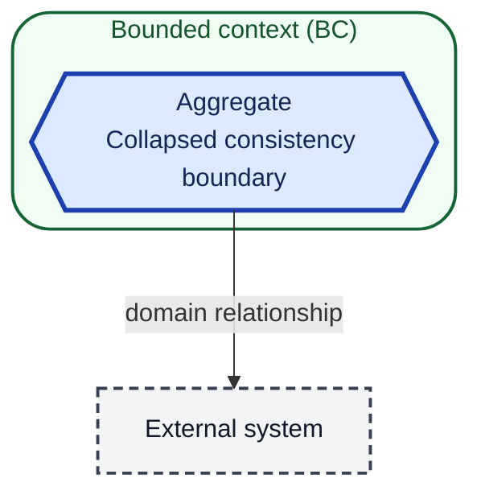
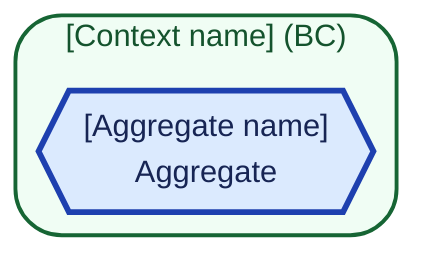

# Instruction: domain-modeling

Establish and enforce the domain language and the durable structure of the
project. This is an active discipline, not a one-shot step: challenge fuzzy
terms the moment they appear, keep the project's glossary current, and keep the
structural model honest as the language crystallises. The design and the specs
must use exactly the vocabulary in the glossary.

For every user-facing question, follow the effective policy from
`givn instructions dialog`; load it once per context before the first question.

## Use-case vocabulary

The selected use-case `usecase.md` is the domain contract shared by ideation,
proposal, specs, design, implementation, review, and archive. Keep its stable
ID and exact terms throughout the change. Treat confirmed Personas as
stakeholder review lenses and Actors as interaction roles; do not collapse the
two or invent either one.

## Document ownership

The project has two durable documents with separate owners:

- `docs/glossary.md` is the sole vocabulary authority.
- `docs/domain-model.md` is the thin structural map.

Vocabulary belongs in the glossary. Structure belongs in the domain model.
Behaviour belongs to use-case contracts and specifications. Apply the three
checks before writing:

1. **Ownership** — what knowledge belongs in this document, and which existing
   source governs the rest?
2. **Added value** — does this section explain a boundary or relationship, or
   merely paraphrase scenarios?
3. **Change impact** — did this change alter the structure or an included
   explanatory view? If not, leave the model unchanged.

The domain model is not a rulebook. Link each relationship to its governing
contract or specification rather than copy them. A rule that changes without a
structural change must not force a model edit. A no-op document edit, a
timestamp, or a boilerplate rewrite is not evidence of maintenance.

This includes maintaining the project's glossary inline and keeping the model
honest. The rule is to create it only when it is absent; do not invent structure
to complete a diagram or table.

## Active discipline

- **Challenge generic or overloaded terms.** When conversation or the specs use
  a word that could mean many things ("list", "item", "user", "trip"), force a
  precise domain noun. When the name matters, do not choose it alone: describe
  the concept in one sentence, propose up to three candidate names with what
  each evokes and any collision it carries, and accept the user's own name.
  Example: "You wrote 'list'. The concept is 'the set of items one household
  plans to buy together'. Candidates: ShoppingList (the household's shared
  plan), Basket (short, but collides with the store's checkout basket). Which
  name should the record use, or what is yours?"
- **Name aggregates with domain nouns.** Every consistency boundary gets a
  domain noun as its root (`ShoppingList`, not `List`). If the natural name is
  a framework word, the naming is wrong.
- **Probe edge-case scenarios.** Stress-test a term by inventing a concrete
  scenario that forces the boundary explicit (offline add, two phones, trip
  reset, reconnect).
- **Cross-reference with code.** Where code names exist, check they match the
  agreed terms. On disagreement, flag and resolve it here - do not leave spec
  and code diverging.
- **Update the glossary inline.** Capture a resolved term immediately, before
  moving on. Do not batch it to the end.

## Document lifecycle

- Create `docs/glossary.md` or `docs/domain-model.md` only when it is absent.
  `givn init` and `givn addons enable` scaffold them with the embedded
  templates; an existing file is project-owned and is never overwritten.
- On later changes, reuse the existing model. Do not overwrite it and never
  create a per-change copy. The durable document is never a per-change copy.
- Fill the model from established knowledge. Do not invent bounded contexts,
  aggregate boundaries, relationships, or external systems to complete a
  diagram or table.
- Distinguish established structure from a proposed model and from unknown
  structure. Name each unresolved structural question and what depends on
  resolving it. Do not let an assumption harden silently into project truth.
- A project may legitimately have one bounded context, no external system, or
  no aggregate-detail view. Do not require every supported notation type.
- Keep the glossary focused on vocabulary. Its definitions may link to the
  domain model for relationships or boundaries instead of describing those
  structures again.

## Migration from an arc42 glossary

An older project may still carry term definitions in
`docs/arc42/12-glossary.md`. Migrate by agent direction, never by an automatic
rewrite:

1. Create `docs/glossary.md` from the scaffold when it is absent.
2. Move every term entry from `docs/arc42/12-glossary.md` into the glossary;
   preserve their wording and ordering, and keep any surrounding knowledge that
   belongs to a use-case contract or the domain model.
3. Leave chapter 12 as a link to `../glossary.md` with no definition table.
   The final state is to leave chapter 12 as a link, not a second table.
4. Do not present two unqualified authoritative definitions. Complete the move
   before relying on the new glossary.

Never silently drop consumer-authored definitions. If a table is nonstandard
or mixed with structural material, separate vocabulary from structure and
record where the behavioural material now lives.

## Glossary maintenance

Record in `docs/glossary.md`:

- **Ubiquitous language** - the agreed terms, each with its definition, the
  spec wording that uses it, the code symbol, and the Anti-terms (rejected
  synonyms).
- **Invariants** - keep behavioural rules in their governing use-case contract
  or specification; the glossary may name the term and link to that owner.

The glossary does not become a second home for aggregates, boundaries, or
lifecycle events; those belong to the domain model or the governing contract.

## Term introduction test

A term may become `confirmed` in the term record (`domain-terms.md` in the
`givn-ideation` skill) only when all three exist:

1. **Genus + differentia** — "a `<Term>` is a `<kind>` that `<distinguishes
   it>`". Example: "a Port is the interface contract at which one
   implementation can be replaced".
2. **Contrast pair** — "`Term`, not `<near neighbour>`" with the distinction.
   Example: "Port, not Boundary — a boundary is a limit that must not be
   crossed".
3. **One concrete domain sentence** using the term.

If the genus slot cannot be filled, the term is not ready. Example failure:
"a Substrate is a kind of ___" has no referent, so the underlying concepts
must be named separately.

Generic words never qualify on their own: `list`, `item`, `data`, `record`,
`entity`, `node`, `object`, `manager`, `service`, `handler`, `container`.
Name the domain noun and give its contrast pair.

## Structural model

The durable model lives at `docs/domain-model.md`. Its suggested shape is:

````markdown
# Domain Model

## Scope and modeling status

[Name the domain covered and important exclusions. State whether this is
established structure, a proposed model, or a mixture with explicitly marked
uncertainties. Do not present planned behavior as implemented behavior.]

## Diagram notation and legend

The legend is notation only, not part of the domain model. Containment shows
bounded-context membership. Read a labeled arrow from source to target; it is
not a runtime call. Shape, border, and labels carry meaning independently of
color.



A host must include the ELK renderer and honour the configuration. Unsupported
hosts may fall back or fail; inspect the rendered result rather than assuming
the layout directive alone proves readability.

## Structural overview

Replace the illustrative placeholder with established domain names. Add only
relevant types and relationships. Every relationship must remain individually
traceable in the rendered view.



## Boundaries and responsibilities

| Bounded context | Responsibility | Explicitly outside its responsibility |
|---|---|---|
| [Domain name] | [What this context governs] | [Important neighboring responsibility] |

| Aggregate | Owning context | Consistency responsibility |
|---|---|---|
| [Domain name] | [Context name] | [What remains consistent together; link to governing rules rather than copy them] |

## Relationships

| Relationship | Domain meaning | Governing contract or specification |
|---|---|---|
| [Source → target] | [Meaning, including material multiplicity or cross-context distinction] | [Specific link with a short description of what it governs] |

## Open modeling questions

[Include only unresolved structural questions. State each uncertainty and what
depends on resolving it. Link to an existing question record when one exists
rather than maintain a duplicate decision log. Remove this section when there
are no open structural questions.]
````

The legend is a separate section from the structural overview. Keep the
notation legend diagram when the project uses any of its notation.

Do not add lifecycle, event, policy, or aggregate-detail sections by default.
Add a focused section only when it provides a specific benefit. For example, a
Certificate lifecycle diagram may explain how issuance, replacement, renewal,
and expiry relate across capabilities; describe the *domain's own* observable
states (for example open / item added / item bought / trip reset) and link the
governing rules rather than copying them. Do not describe the givn change
lifecycle as a domain lifecycle.

A rendered-diagram review is required. Open the rendered Mermaid result and
inspect that relationships remain individually traceable, labels are legible,
contrast survives the host theme, and the practical width fits the reader's
viewport. Treat a diagram as reviewed only when the rendered result is
readable; syntactically plausible Mermaid source is not evidence of
readability. Larger models should be decomposed into an overview and focused
diagrams rather than squeezed until labels become unreadable.

## Review maintenance

Review and design-review check the owners, not a duplicate model:

- vocabulary against `docs/glossary.md`;
- structure against `docs/domain-model.md`;
- behaviour against the governing use-case contract and specifications.

Ask whether the change altered structure. If it did, update the model and
review the rendered view. If it did not, leave the model unchanged; a no-op
document edit is not evidence that the model was maintained.

## Rules

- Stay in domain language. No class names, DB schemas, or framework types
  (except inside the `Code symbol` column).
- Derive everything from the proposal and specs; do not invent new behaviour.
- If a term is ambiguous, pick the interpretation the proposal supports and
  flag it. Do not leave it open for the design to guess.
- No generic nouns where a domain noun exists. `List` is a framework word;
  `ShoppingList`, `Entry` are domain words. Rename.
- One verb per action. List the rejected synonyms explicitly in the
  anti-terms column.
- Keep the glossary short - one page that the design, the review, and the
  implementation all build on.
- One authoritative definition per term. When a term, schema, or governing rule changes,
  sweep README, glossary, ADRs, docs, tests, and code symbols for old values.
  Update them or mark them stale at their entry point.
- When a source must remain unmodified, add a dated stale note at its entry
  point and point to the operative source. Never leave two unqualified
  definitions.

Examples:

  authoritative: the current brief governs this change; the stale policy
    document carries a dated note pointing to it.
  sweep: a glossary names `TENANT_PRIMARY`, but the code uses a literal;
    rename or remove the symbol reference.
  sweep: a risk chapter says a migration backfills rows, but the design says
    it does not; correct the chapter before review.
