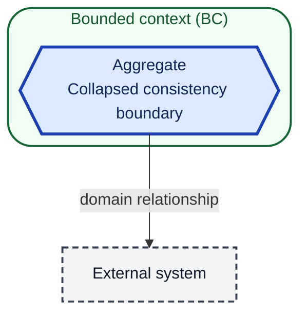
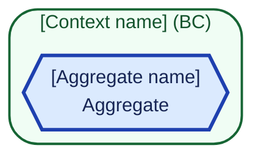

# Domain Model

## Scope and modeling status

[Name the domain covered and important exclusions. State whether this is
established structure, a proposed model, or a mixture with explicitly marked
uncertainties. Do not present planned behavior as implemented behavior.]

## Diagram notation and legend

This is notation only, not part of the domain model. Containment shows
bounded-context membership. Read a labeled arrow from source to target; it is
not a runtime call. Shape, border, and labels carry meaning independently of
color.

A host must include the ELK renderer and honour the configuration. Unsupported
hosts may fall back or fail; inspect the rendered result rather than assuming
the layout directive alone proves readability.

## Structural overview

Replace the illustrative placeholder with established domain names. Add only
relevant types and relationships. Every relationship must remain individually
traceable in the rendered view.

## Boundaries and responsibilities

| Bounded context | Responsibility | Explicitly outside its responsibility |
|---|---|---|
| [Domain name] | [What this context governs] | [Important neighboring responsibility] |

| Aggregate | Owning context | Consistency responsibility |
|---|---|---|
| [Domain name] | [Context name] | [What remains consistent together; link to governing rules rather than copy them] |

## Relationships

| Relationship | Domain meaning | Governing contract or specification |
|---|---|---|
| [Source → target] | [Meaning, including material multiplicity or cross-context distinction] | [Specific link with a short description of what it governs] |

## Open modeling questions

[Include only unresolved structural questions. State each uncertainty and what
depends on resolving it. Link to an existing question record when one exists
rather than maintain a duplicate decision log. Remove this section when there
are no open structural questions.]
