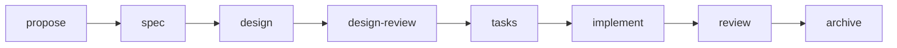

# 1. Introduction and Goals

## 1.1 What is givn?

`givn` (tagline: *"from Given to done"*) is a single-binary, Gherkin-first,
spec-driven workflow tool. It manages a change lifecycle in which **the `.feature`
file IS the specification** — simultaneously the delta document, the executable
cucumber test, and the permanent archived record. There is no parallel `spec.md`.

It distills a proven Gherkin-first workflow (originally prototyped as a fork of
OpenSpec) into a standalone, configurable, easily-installable Rust binary that is
language- and test-runner-agnostic and aimed at the broader open-source community.
This project is dual-licensed under MIT OR Apache-2.0 (see ADR-034).

The lifecycle it manages:

## 1.2 Requirements Overview

### Functional requirements

| ID | Requirement |
| --- | --- |
| FR-1 | Scaffold the workflow into a project directory (`givn init`). |
| FR-2 | Create and track changes through the lifecycle (propose → archive). |
| FR-3 | Treat `.feature` files as the single source of truth — no `spec.md`. |
| FR-4 | Support delta tags (`@givn.delta`, `@givn.added/modified/removed`). |
| FR-5 | Merge delta `.feature` files into permanent specs on archive, stripping tags. |
| FR-6 | Lint `.feature` files (`givn lint`) with distinct exit codes (static check; runs no tests). |
| FR-7 | Emit per-artifact instructions for AI agents (`givn instructions --json`). |
| FR-8 | Drive a scenario-by-scenario RED/GREEN/REFACTOR TDD loop. |
| FR-9 | Provide a completeness-based coverage review (not a percentage gate). |
| FR-10 | Generate agent skills (`.agents/skills`, mirrors). `AGENTS.md` is user-owned and never written. |
| FR-11 | Allow per-facet override of all defaults via a CSS-style cascade. |
| FR-12 | Eject embedded defaults on demand (`givn eject`). |
| FR-13 | Derive lifecycle state from the filesystem (no separate state file). |
| FR-14 | Declare the test-runner command in the project manifest. |
| FR-15 | Default test-runner command is a self-documenting sentinel that prints setup guidance and fails until configured. |
| FR-16 | Generate `givn/config.yaml` fully commented, with documented defaults for every key. |
| FR-17 | Version the project config (`givn_config_version`) and provide `givn upgrade` to refresh scaffolding while preserving user overrides. |
| FR-18 | Allow projects to add, remove, reorder, and mark-optional lifecycle artifacts purely via config (e.g. drop review, add a refactor step). |
| FR-19 | Keep specification artifacts (`proposal`, `.feature`) implementation-independent; carry implementation detail only in `design`/`tasks`. |
| FR-20 | Provide an opt-in addon mechanism; ship an `arc42-docs` addon that creates and maintains durable project-level arc42 documentation (e.g. after `design`). |
| FR-21 | Support per-artifact `post` hooks; run `verify.command` (tests) after `tasks` and `review` by default. Provide `givn check`; run required hooks as the archive gate, blocking on failure. |
| FR-22 | Expose one canonical authoring policy for interaction inventories and E2E evidence; generated guidance references it rather than restating it. |
| FR-23 | Provide local retrieval over permanent scenarios and enforce the fixed semantic-similarity gate during review and archive preparation. |
| FR-24 | Keep interactive `givn spec search` advisory while requiring every permanent or current-delta scenario pair at or above the fixed `0.95` threshold to be rewritten or removed before review passes. |
| FR-25 | Use local retrieve-then-rerank scoring as advisory evidence to reduce the recommended semantic worklist without assigning a Givn classification. |
| FR-26 | Let an author explore exactly one complete draft scenario against all permanent scenarios from a file or stdin, with human-readable or stable JSON results, before creation. |
| FR-27 | Let an author optionally explore that complete draft against active scenarios in a named current change, from a file or stdin, with source-labeled results and no persistence of delta candidates. |
| FR-28 | During blocking `givn check review --change <id>`, generate a complete change-local semantic review worklist for active added/modified delta candidates at the fixed E5 `0.9500` boundary, require an agent classification for every admitted candidate, record non-blocking BGE-filtered evidence separately when enabled, emit a deterministic report with exact headers/field order and complete source-ordered endpoint evidence, leave feature files untouched, and retain the generated report as archive evidence. |
| FR-29 | During blocking change review, verify that each resolved semantic classification has produced the required projected remediation: remove duplicates, consolidate variants, or make valid boundaries explicit below the active boundary. |
| FR-30 | Provide one complete, interface-consistent authoring policy for interaction inventories and E2E evidence, including the distinction between public interfaces and secondary repository evidence. |
| FR-31 | Emit the documented machine-readable instruction contract with the effective artifact id, generated paths, prerequisites, and resolved instruction text. |
| FR-32 | Provide a read-only `givn spec duplicates` audit over the complete permanent scenario corpus, reporting deterministic exact and Fingerprint-based structural candidates plus advisory E5 candidates in a fixed text/JSON contract without blocking ordinary change work. |
| FR-33 | Make opt-in BGE evidence available to permanent exploration, change-aware exploration, advisory review, blocking review, and permanent duplicate audit through a deterministic bounded E5 top-K union. Record E5 raw candidates, BGE-recommended candidates, BGE-filtered evidence, model identity, symmetric raw scores, and runtime without automatic Givn decisions. |
| FR-34 | Make independently opt-in NLI evidence available on the same five E5-backed surfaces. Record bidirectional entailment/neutral/contradiction probabilities, a symmetric summary, NLI-recommended and NLI-filtered candidates, model identity, pair counts, runtime, and explicit unavailable states; reduce the recommended worklist without automatic Givn decisions. |
| FR-35 | Use one complete deterministic Gherkin semantic serialization for E5, BGE, and NLI; preflight actual model-tokenizer budgets; expose per-candidate token-cap evidence; and preserve visible, unresolved blocking semantics across duplicate audit, Explore, advisory review, and blocking review. |

### Non-functional requirements (top)

| ID | Requirement |
| --- | --- |
| NFR-1 | Install with no npm, no root/sudo, no language runtime. |
| NFR-2 | Single static binary, broadly installable (release binary, brew, cargo, curl\|sh). |
| NFR-3 | All project configuration lives in one visible `givn/` directory. |
| NFR-4 | Binary updates must never clobber project-owned files. |
| NFR-5 | Defaults shipped but nothing format/artifact-name hardcoded for the user. |

## 1.3 Quality Goals

Top three quality goals, in priority order (see chapter 10 for scenarios):

| Priority | Quality goal | Motivation |
| --- | --- | --- |
| 1 | **Configurability without forking** | Prior tools required forking source to customise. Every workflow knob must be override-able from the project directory. |
| 2 | **Installability** | Broad community adoption needs frictionless install: no npm, no root, single binary, many channels. |
| 3 | **Upgradeability** | Updating the binary must never break or overwrite project config. Defaults live in the binary; project files always win. |

Secondary goals: correctness of the Gherkin merge (data integrity of the spec),
AI-agent ergonomics (standards-aligned skill/rule generation), consistency of
that guidance across instructions, skills, commands, and project overrides,
semantic-review integrity (a deterministic admitted worklist whose full
endpoint evidence invalidates stale decisions without allowing the gate to edit
feature files, while the permanent index remains structurally permanent-only),
complete semantic-input fidelity (one full deterministic serialization and an
exact E5 content-hash boundary), token-budget safety (actual untruncated and
unpadded tokenizer counts before inference), complete permanent-corpus
visibility through a deterministic, non-mutating duplicate audit, and measured
semantic recall/precision without automatic model classification. BGE- and
NLI-filtered evidence must reduce false-positive authoring pressure without
hiding its E5 provenance, and token-cap candidates must remain visible and
blocking rather than becoming filtered evidence.

Scenario exploration adds a secondary agent-ergonomics goal: a draft comparison
must be deterministic, advisory, and non-mutating so an author can inspect
evidence against the permanent baseline and the active current change without
changing the permanent specification.

NLI evidence adds a secondary semantic-review integrity goal: the recommended
worklist may be narrowed by an independent local entailment signal, while the
complete E5 raw set and all directional model evidence remain available for
human review and no model status becomes a Givn classification.

## 1.4 Stakeholders

| Stakeholder | Interest / expectation |
| --- | --- |
| Tool author (Sebastian) | Standalone tool extracted from the OpenSpec fork; owns roadmap. |
| OSS developers (end users) | Easy install; customise workflow without forking; clear docs. |
| AI coding agents | Consume `givn instructions` and generated skills, inspect and classify `semantic-review.md`, and edit artifacts and code. `AGENTS.md` (if present) is user-authored. |
| Contributors | Readable Rust; clear architecture (this document). |
| CI systems | Run `givn lint` (static), the project test runner (`verify.command`), and blocking review gates deterministically. |

## 1.5 Repository-owned acceptance

Givn's review, archive, and failure-preservation workflow is itself a product
contract. Its acceptance proof belongs in Givn and must not depend on a private
consumer repository. The repository-owned fixture provides a deterministic
signal for CLI output, archive publication, and pre-merge failure behavior.
