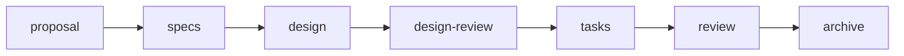

# 1. Introduction and Goals

## 1.1 What is givn?

`givn` is a Rust, Gherkin-first workflow CLI. It manages a change lifecycle in
which a `.feature` file is the behavior specification, the executable test input,
and, after archive, the permanent record. It has no parallel `spec.md` format.

The default lifecycle graph is:

The binary derives state from project files. Embedded assets provide defaults;
project files under `givn/` override them. The initialized project also gets
`givn/commands.yaml`, whose project-owned commands are applied after the main
configuration overlay.

`givn init` currently enables all registered addons by default, including the
`arc42` addon, unless `--no-addons` is supplied. The embedded default manifest
itself has addons disabled; initialization is the operation that writes the
enabled addon settings and scaffolds durable Arc42 chapters.

## 1.2 Requirements Overview

### Functional requirements

| ID | Requirement |
|---|---|
| FR-1 | Scaffold `givn/` and the project-owned command file with `givn init`. |
| FR-2 | Create and track changes through proposal, specs, design, design-review, tasks, review, and archive. |
| FR-3 | Treat `.feature` files as the behavior source of truth. |
| FR-4 | Support `@givn.delta`, `@givn.added`, `@givn.modified`, and `@givn.removed`. |
| FR-5 | Merge deltas into permanent specs and strip `@givn.*` tags on archive. |
| FR-6 | Run static Gherkin lint with distinct parse, duplicate-title, WIP, and clean outcomes. |
| FR-7 | Emit resolved artifact instructions in human-readable and JSON forms. |
| FR-8 | Support scenario-by-scenario RED/GREEN/REFACTOR guidance. |
| FR-9 | Review coverage gaps by classification rather than a percentage threshold. |
| FR-10 | Generate skills and commands to selected targets; preserve all `AGENTS.md` content outside givn-owned fenced blocks. |
| FR-11 | Resolve templates and instructions through a project-overrides-first cascade. |
| FR-12 | Materialize embedded defaults through `givn eject`. |
| FR-13 | Derive lifecycle state from the effective manifest and filesystem. |
| FR-14 | Declare test and coverage commands in `givn/commands.yaml`. |
| FR-15 | Provide an explicit non-zero missing-runner sentinel as the embedded fallback. |
| FR-16 | Generate a documented and versioned `givn/config.yaml` scaffold. |
| FR-17 | Upgrade the scaffold while preserving user-owned values. |
| FR-18 | Allow artifact graph add, remove, reorder, and optional behavior through overlay. |
| FR-19 | Keep proposals and feature files implementation-independent except for observable requirements. |
| FR-20 | Maintain durable Arc42 chapters through the bundled `arc42` addon and fixed `docs/arc42/` output. |
| FR-21 | Run project commands at explicit gate points and keep binary mandatory checks non-deactivatable. |
| FR-22 | Keep one normative interaction and E2E authoring policy. |
| FR-23 | Provide local E5 retrieval over permanent scenarios. |
| FR-24 | Enforce the fixed E5 similarity gate only in the `spec-similarity-gate` build. |
| FR-25 | Provide optional BGE and NLI evidence without automatic Givn classification. |
| FR-26 | Explore exactly one complete draft scenario against permanent scenarios. |
| FR-27 | Optionally add active change scenarios to Explore request-locally. |
| FR-28 | Generate a change-local semantic report from blocking `givn check review`. |
| FR-29 | Verify classified semantic remediation against the projected tree. |
| FR-30 | Audit the complete permanent corpus through `givn spec duplicates` without writing audit state. |
| FR-31 | Use complete compact semantic input and actual-tokenizer cap evidence. |
| FR-32 | Bound second-stage work through the proposed `GIVN_SPEC_MAX_RERANK_PAIRS` setting while retaining unscored tails. |
| FR-33 | Publish version 0.3.0 with a complete changelog and an LLM-executable 0.2.0-to-0.3.0 migration guide. |
| FR-34 | Prepare legacy projects through a visible, reviewable migration change without inventing product specifications. |
| FR-35 | Refresh and commit Givn-owned files for migration-free upgrades without creating a migration change. |
| FR-36 | Resolve multiple release-owned migration bundles into one ordered aggregate maintenance change. |
| FR-37 | Enable every currently declared Cargo feature in the normal installation while preserving an explicit feature-free build. |
| FR-38 | Acquire missing E5, BGE, and NLI model artifacts on explicit semantic use and reuse them from the user-level XDG cache. |
| FR-39 | Give every semantic surface a consistent missing-index repair hint and actionable model-setup diagnostics. |
| FR-40 | Control the compute threads of every semantic model stage (E5, BGE, NLI) through one `GIVN_SPEC_THREADS` setting that defaults to the machine's available parallelism and refuses invalid values by name before any model work. |
| FR-41 | Declare how the built product is started in `givn/commands.yaml` (`run:` block): product type (server, cli, library), start command, exactly one port source for servers (fixed port or `port_env` hand-off), readiness path, and readiness timeout. |
| FR-42 | Scaffold the run declaration on `givn init`, backfill it through the managed upgrade into existing projects, validate it with deterministic rules, render it into a managed README run block, and block `givn check review` and `givn archive` while it is unconfigured. |
| FR-43 | Start the declared product with `givn run`: readiness probe against the declared path, one greppable ready line, `--port` and `--print` forms, forwarded child exit codes, and SIGINT/SIGTERM forwarding on unix. |
| FR-44 | Never derive the product type or start command from repository content; the declaration is the single source of truth. |

### Non-functional requirements

| ID | Requirement |
|---|---|
| NFR-1 | The default Cargo installation enables all declared retrieval capabilities; `--no-default-features` provides a native feature-free binary without npm, root, or language runtime requirements. |
| NFR-2 | Defaults are embedded; project-owned files are not silently overwritten. |
| NFR-3 | Project configuration and lifecycle state are visible under `givn/`. |
| NFR-4 | Semantic evidence is deterministic in identity, ordering, hashes, and output format where the current contract specifies it. |
| NFR-5 | Feature-free and feature-enabled behavior is explicit rather than silently falling back to a false pass. |
| NFR-6 | Automatic migration commits are narrowly scoped, reproducible, and never mix uncommitted user work with Givn-owned files. |
| NFR-7 | Large model artifacts are shared through an XDG user cache; project trees contain only project-specific retrieval state unless an explicit override is selected. |
| NFR-8 | Model acquisition validates complete artifacts and fails with recovery instructions rather than accepting partial or corrupt cache state. |

## 1.3 Quality Goals

| Priority | Quality goal | Motivation |
|---|---|---|
| 1 | **Configurability without forking** | Project overlays and facet overrides change workflow behavior without modifying the binary. |
| 2 | **Installability** | The normal product boundary is one native executable with embedded defaults. |
| 3 | **Upgradeability** | Project-owned values and files remain reviewable and are not clobbered by scaffold updates. |
| 4 | **Architecture contract clarity** | The active ADR register contains only independent durable decisions; current facts and implementation details have one canonical home. |

Secondary goals are merge correctness, agent ergonomics, interface-fidelity in
E2E evidence, deterministic semantic evidence, explicit token-cap safety, a
permanent-only retrieval persistence boundary, and non-redundant architecture
documentation.

The current second-stage budget work is not yet a completed quality claim. Its
open tasks and final verification are listed in the active change referenced by
the [ADR register](adr/README.md).

## 1.4 Stakeholders

| Stakeholder | Interest |
|---|---|
| Tool maintainers | Own the CLI, embedded assets, release path, and architecture. |
| OSS developers | Need a usable local workflow and project-owned customization. |
| AI coding agents | Consume instructions, skills, semantic reports, and Arc42 evidence. |
| Contributors | Need stable Rust modules, contracts, and review gates. |
| CI systems | Need deterministic lint, test-runner, archive, and semantic outcomes. |
| Consumer repositories | Use Givn's workflow but do not host Givn's own acceptance fixtures. |
| Migrating project maintainers | Need a clean Git boundary and an explicit plan for project-specific 0.3.0 work. |
| Automation callers around givn (for example the kiekste preview host) | Consume the run declaration and the `givn run` machine contract (ready line, exit codes, port hand-off) to start products without guessing. |

## 1.5 Acceptance Ownership

Givn's review, archive, and rollback behavior is accepted in this repository
through temporary-project fixtures that invoke the compiled CLI. Consumer
repositories retain their own domain specifications; they are not the hidden
acceptance host for Givn's product contract.
