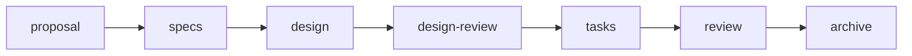

# 1. Introduction and Goals

## 1.1 What is givn?

`givn` is a Rust, Gherkin-first workflow CLI. It manages a change lifecycle in
which a `.feature` file is the behavior specification, the executable test
input, and, after archive, the permanent record. It has no parallel `spec.md`
format.

The default lifecycle graph is:

With the arc42 addon enabled, an `arc42-docs` artifact sits between `design` and
`design-review`. The binary derives state from project files. Embedded assets
provide defaults; project files under `givn/` override them. The initialized
project also gets `givn/commands.yaml`, whose executable settings are applied
after the policy configuration.

`givn init` enables every registered addon unless `--no-addons` is supplied.
There is no default-off addon in the current registry. The addon flags are
visible in `givn/config.yaml`, and an explicit `false` is the only opt-out.

## 1.2 Requirements Overview

### Functional requirements

| ID | Requirement |
|---|---|
| FR-1 | Scaffold `givn/` and the project-owned command file with `givn init`. |
| FR-2 | Create and track changes through proposal, specs, design, design-review, tasks, review, and archive. |
| FR-3 | Treat `.feature` files as the behavior source of truth. |
| FR-4 | Support `@givn.delta`, `@givn.added`, `@givn.modified`, and `@givn.removed`. |
| FR-5 | Merge deltas into permanent specs and strip `@givn.*` tags on archive. |
| FR-6 | Run static Gherkin, use-case, overlap, seed, and persona checks with distinct outcomes; `givn lint` runs no project tests. |
| FR-7 | Emit resolved artifact, policy, and step instructions in human-readable and JSON forms, with project extensions applied. |
| FR-8 | Guide implementation through genuine behavior batches: observed RED, minimum GREEN, optional REFACTOR, one explicit-path commit. |
| FR-9 | Review coverage gaps by classification rather than a percentage threshold. |
| FR-10 | Generate skills only to the selected agent targets; preserve all `AGENTS.md` content outside givn-owned fenced blocks. No command files are generated. |
| FR-11 | Resolve templates and instructions through a project-overrides-first cascade. |
| FR-12 | Materialize embedded defaults through `givn eject`. |
| FR-13 | Derive lifecycle state from the effective manifest and filesystem. |
| FR-14 | Declare test, E2E, coverage, and product-start commands in `givn/commands.yaml`. |
| FR-15 | Provide explicit non-zero missing-runner and missing-start sentinels as embedded fallbacks. |
| FR-16 | Generate a documented and versioned `givn/config.yaml` scaffold. |
| FR-17 | Upgrade the managed scaffold while preserving user-owned values and reporting actual publication/recovery state. |
| FR-18 | Allow artifact graph add, remove, reorder, and optional behavior through overlay. |
| FR-19 | Keep proposals, feature files, and use-case contracts implementation-independent except for observable requirements. |
| FR-20 | Maintain durable Arc42 chapters through the bundled `arc42` addon and fixed `docs/arc42/` output. |
| FR-21 | Run project commands at explicit gate points and keep binary mandatory checks non-deactivatable. |
| FR-22 | Keep one normative interaction and E2E authoring policy served by the specs instruction. |
| FR-30 | Audit the complete permanent corpus through `givn spec duplicates` without writing audit state. |
| FR-33 | Publish each release with a complete changelog and only the migration routes actually shipped; the 1.0 catalog is empty. |
| FR-34 | Support pre-1.0 projects through a documented manual transition, not an embedded automatic route. |
| FR-35 | Refresh and commit Givn-owned files for migration-free upgrades without creating a migration change. |
| FR-36 | Resolve declared future migration bundles into one ordered aggregate maintenance change; synthetic routes prove the resolver until a real route ships. |
| FR-41 | Declare how the built product is started in `givn/commands.yaml` (`run:` block): product type, start command, port source, readiness path, and readiness timeout. |
| FR-42 | Scaffold and backfill the run declaration, validate it deterministically, render it into a managed README block, and block review/archive while it is unconfigured. |
| FR-43 | Start the declared product with `givn run`: readiness probe, one greppable ready line, `--port`/`--print`, child exit-code forwarding, and unix signal forwarding. |
| FR-44 | Never derive the product type or start command from repository content. |
| FR-45 | Record development activity in an append-only, scope-tagged, best-effort local record and render one scope as a self-contained report. |
| FR-46 | Offer an advisory outline report over production Rust, Python, Java, and TypeScript: per-component call tree first, then size, public surface, cohesion, coupling, and complexity hints; no action, recommendation, baseline, verdict, or gate. |
| FR-47 | Use outline evidence once per behavior batch during REFACTOR and reuse it in review; assess unsupported languages from source without a waiver. |
| FR-48 | Require explicit commit paths on Git and Fossil, preserve unrelated work, and keep commit attribution optional and non-blocking. |
| FR-49 | Keep one mandatory dialog policy and an evidence-first challenge instruction without adding lifecycle gates. |

### Non-functional requirements

| ID | Requirement |
|---|---|
| NFR-1 | The product is a single feature-free native binary without npm, root, or language runtime requirements; no Cargo features are declared. |
| NFR-2 | Defaults are embedded; project-owned files are not silently overwritten. |
| NFR-3 | Project configuration and lifecycle state are visible under `givn/`. |
| NFR-4 | Verification results are fresh, bound to stable inputs, and fail closed; archive recovery never rolls back published history. |
| NFR-5 | Generated guidance names only resolvable files and instruction ids in the consumer project. |
| NFR-6 | Managed upgrade and migration revisions are narrowly scoped, reproducible, and never mix uncommitted user work with Givn-owned files. |
| NFR-7 | Recording and advisory analysis are best-effort; neither can block the primary work nor silently present missing data as zero. |

## 1.3 Quality Goals

| Priority | Quality goal | Motivation |
|---|---|---|
| 1 | **Configurability without forking** | Project overlays and facet overrides change workflow behavior without modifying the binary. |
| 2 | **Installability** | The normal product boundary is one native executable with embedded defaults. |
| 3 | **Upgradeability** | Project-owned values and files remain reviewable and are not clobbered by scaffold updates. |
| 4 | **Reliable evidence** | Fresh verification, archive recovery, and advisory analysis state what was actually tested or measured. |
| 5 | **Architecture contract clarity** | The active ADR register contains only independent durable decisions; current facts and implementation details have one canonical home. |

Secondary goals are merge correctness, agent ergonomics, interface fidelity in
E2E evidence, and non-redundant documentation.

The outline addon serves a structural-comprehension goal: a reader should be
able to state a unit's responsibility and call order from its outline. It is
advisory evidence, not a quality score, and it never changes review or archive
behavior.

## 1.4 Stakeholders

| Stakeholder | Interest |
|---|---|
| Tool maintainers | Own the CLI, embedded assets, release path, and architecture. |
| OSS developers | Need a usable local workflow and project-owned customization. |
| AI coding agents | Consume instructions, skills, and architecture evidence. |
| Contributors | Need stable Rust modules, contracts, and review gates. |
| CI systems | Need deterministic lint, runner, and archive outcomes. |
| Consumer repositories | Use Givn's workflow but do not host Givn's own acceptance fixtures. |
| Migrating project maintainers | Need a clean version-control boundary, a manual 1.0 transition, and honest recovery reporting. |
| Archiving developers | Need the archive proof to hold on the backend that owns their project, with the same candidate, receipt, and repair contract on Git and Fossil. |
| Automation callers around givn | Consume the run declaration and `givn run` machine contract without guessing. |

## 1.5 Acceptance Ownership

Givn's review, archive, and upgrade behavior is accepted in this repository
through temporary-project fixtures that invoke the compiled CLI. Consumer
repositories retain their own domain specifications; they are not the hidden
acceptance host for Givn's product contract.

*[Architecture documentation index](README.md)*
