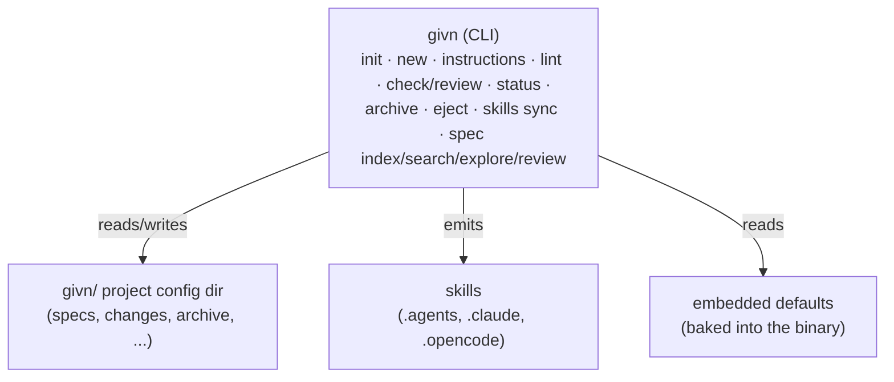

# 3. Context and Scope

## 3.1 Business Context

`givn` sits between a developer (often working with an AI coding agent) and a
project's source tree. It manages spec-driven changes whose specifications are
Gherkin `.feature` files.

### External entities

| Entity | Interaction |
| --- | --- |
| Developer | Runs `givn` commands from the terminal. On `givn init`, answers the agent-target selection prompt (default: opencode only). |
| AI coding agent | Reads `givn instructions --json`, generated skills, and the change-local generated semantic review report (including archived historical reports); `AGENTS.md` (user-authored, if present); edits artifacts and code. |
| Project filesystem | Holds the `givn/` directory, source code, and generated agent files. |
| Test runner (cargo/npm/pytest/…) | The `verify.command`; executes step definitions. Invoked by givn via `post` hooks (`givn check`, archive gate) and directly by the agent during the TDD loop. |
| CI system | Runs `givn lint` (static) and `givn check`/`givn archive` (which run the test runner via hooks); relies on exit codes. |

## 3.2 Technical Context — Interfaces

| Interface | Direction | Format / contract |
| --- | --- | --- |
| CLI args | in | `clap`-parsed subcommands and flags. |
| `givn/config.yaml` | in/out | YAML manifest overlay + `verify.command`; fully commented & documented; carries `givn_config_version`. Written by `init`, refreshed by `upgrade`. |
| `givn/**` artifacts | in/out | Markdown + `.feature` files, including the deterministic `semantic-review.md` wire grammar with fixed headers/field order, compact JSON values, `null` absence, exact score/hash formats, and no timestamp/environment fields. |
| `givn instructions --json` | out | One JSON object `{id, generates, requires, instruction}` for AI agents, resolved from the effective manifest and instruction cascade. |
| `givn spec index/search/explore/review` | in/out | Local permanent-only scenario-index construction, advisory free-form and complete-scenario retrieval, and the existing advisory review contract. `spec review --change` does not create the semantic report. |
| `givn spec explore --file/--stdin [--change <id>]` | in/out | One complete Gherkin scenario in; permanent-corpus candidates plus optional active-change candidates, source metadata, index metadata, and optional stable JSON out. |
| `givn check review --change <id>` | in/out | Runs the existing review checks, calls the dedicated E5 semantic-report and remediation-verification gates, writes `givn/changes/<id>/semantic-review.md` atomically when retrieval is available, rebuilds a malformed/incompatible permanent index as permanent-only before continuing, and exits non-zero for missing/invalid/stale/unremediated classifications or the existing retrieval-unavailable error. |
| `givn lint --json` | out | Machine-readable lint findings (kind/level/files/titles), for tools and the project's own E2E scenarios. |
| `*/skills/<name>/SKILL.md` | out | Markdown + YAML frontmatter. |
| Canonical authoring guidance | out | `givn instructions specs` emits the complete normative E2E and interaction-inventory policy consumed by agents; project overrides may replace the effective policy. |
| Exit codes | out | For `givn lint`: 0 clean / 1 parse error / 3 duplicate scenario title / 2 wip (1 > 3 > 2); standard 0/non-0 elsewhere. |
| `GIVN_FEATURES` env var | in (to test runner) | Path to feature files; default `givn/specs`. |
| Embedded assets | in | Compiled-in default manifest, templates, skill templates. |

## 3.3 Scope

### In scope (MVP)

- Full lifecycle: propose → spec → design → design-review → tasks → implement → review → archive.
- `.feature`-as-spec with delta tags and merge-on-archive.
- Cascade configuration with per-facet override and `eject`.
- YAML manifest overlay onto embedded default graph.
- `givn lint` (static Gherkin check with exit codes; runs no tests).
- Filesystem-derived state and task-progress tracking.
- Skill generation (neutral + claude + opencode, configurable target selection at init). `AGENTS.md` is user-owned.
- Fully-documented, versioned `givn/config.yaml` with a `givn upgrade` path.
- Sentinel default `verify.command` (`givn missing-testrunner`) with setup guidance.
- Per-artifact `post` hooks; givn runs `verify.command` at gates (`givn check`, archive).
- Feature-enabled review rejects every permanent or current-delta scenario pair
  at or above the fixed `0.95` similarity threshold; duplicates are removed and
  valid boundaries are rewritten below the threshold.
- Configurable artifacts (add/remove/reorder/optional) via overlay.
- Opt-in addons; bundled `arc42-docs` addon maintaining durable arc42 docs.
- Distribution: release binaries, curl\|sh, brew, cargo.
- Advisory permanent-scenario exploration from a complete file or stdin query;
  optional request-local exploration of active scenarios in the named current
  change.
- Blocking semantic review report generation for active added/modified delta
  scenarios against permanent and current-change candidates at E5 `0.9500`, with
  agent-owned classifications, complete source-ordered evidence invalidation,
  exact report grammar, and no feature-file mutation. A malformed or
  incompatible permanent index is rebuilt as permanent-only before review
  continues. The generated report remains historical evidence when the existing
  archive move relocates the change directory.

### Out of scope (deferred / non-goals)

| Item | Reason |
| --- | --- |
| `givn migrate` from `openspec/` | Deferred nice-to-have (OC-2). |
| `spec.md` parallel format | Explicit non-goal — `.feature` is the spec. |
| Telemetry / analytics | Dropped from the prototype's surface. |
| Profiles / global config layers | "All config in one place" — single project dir. |
| Workspace/multi-repo coordination | Out of scope for v1. |
| Context stores / initiatives | Dropped weight from the prototype. |
| Additional skill targets (cursor, gemini, …) | The built-in target set is fixed at opencode, .agents, .claude (selectable at init); other tools are achievable via `eject`; not shipped built-in in v1. |
| Automatic classification, automatic feature-file edits, and full-corpus auditing | The report records E5 evidence, the agent classifies and edits, and Givn verifies the projected remediation without choosing or applying edits; permanent-permanent auditing and BGE/NLI evidence remain outside this slice. |
