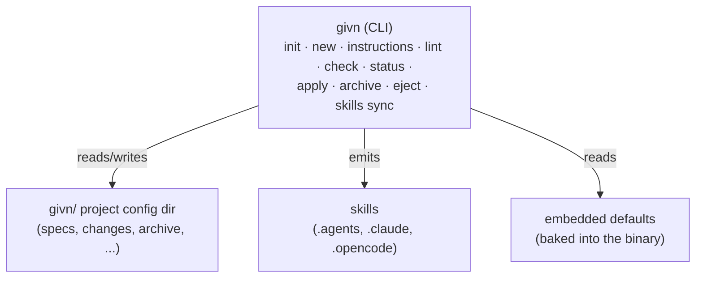

# 3. Context and Scope

## 3.1 Business Context

`givn` sits between a developer (often working with an AI coding agent) and a
project's source tree. It manages spec-driven changes whose specifications are
Gherkin `.feature` files.

### External entities

| Entity | Interaction |
| --- | --- |
| Developer | Runs `givn` commands from the terminal. |
| AI coding agent | Reads `givn instructions --json` and generated skills; `AGENTS.md` (user-authored, if present); edits artifacts and code. |
| Project filesystem | Holds the `givn/` directory, source code, and generated agent files. |
| Test runner (cargo/npm/pytest/…) | The `verify.command`; executes step definitions. Invoked by givn via `post` hooks (`givn check`, archive gate) and directly by the agent during the TDD loop. |
| CI system | Runs `givn lint` (static) and `givn check`/`givn archive` (which run the test runner via hooks); relies on exit codes. |

## 3.2 Technical Context — Interfaces

| Interface | Direction | Format / contract |
| --- | --- | --- |
| CLI args | in | `clap`-parsed subcommands and flags. |
| `givn/config.yaml` | in/out | YAML manifest overlay + `verify.command`; fully commented & documented; carries `givn_config_version`. Written by `init`, refreshed by `upgrade`. |
| `givn/**` artifacts | in/out | Markdown + `.feature` files. |
| `givn instructions --json` | out | JSON for AI agents (artifact id, instruction text, deps, generates). |
| `*/skills/<name>/SKILL.md` | out | Markdown + YAML frontmatter. |
| Exit codes | out | 0 clean / 1 parse error / 2 wip (for `givn lint`); standard 0/non-0 elsewhere. |
| `GIVN_FEATURES` env var | in (to test runner) | Path to feature files; default `givn/specs`. |
| Embedded assets | in | Compiled-in default manifest, templates, skill templates. |

## 3.3 Scope

### In scope (MVP)

- Full lifecycle: propose → spec → design → design-review → tasks → implement → review → archive.
- `.feature`-as-spec with delta tags and merge-on-archive.
- Cascade configuration with per-facet override and `eject`.
- YAML manifest overlay onto embedded default graph.
- `givn lint` (static Gherkin check with exit codes; runs no tests).
- Filesystem-derived state and task-progress tracking.
- Skill generation (neutral + claude + opencode). `AGENTS.md` is user-owned.
- Fully-documented, versioned `givn/config.yaml` with a `givn upgrade` path.
- Sentinel default `verify.command` (`givn missing-testrunner`) with setup guidance.
- Per-artifact `post` hooks; givn runs `verify.command` at gates (`givn check`, archive).
- Configurable artifacts (add/remove/reorder/optional) via overlay.
- Opt-in addons; bundled `arc42-docs` addon maintaining durable arc42 docs.
- Distribution: release binaries, curl\|sh, brew, cargo.

### Out of scope (deferred / non-goals)

| Item | Reason |
| --- | --- |
| `givn migrate` from `openspec/` | Deferred nice-to-have (OC-2). |
| `spec.md` parallel format | Explicit non-goal — `.feature` is the spec. |
| Telemetry / analytics | Dropped from the prototype's surface. |
| Profiles / global config layers | "All config in one place" — single project dir. |
| Workspace/multi-repo coordination | Out of scope for v1. |
| Context stores / initiatives | Dropped weight from the prototype. |
| Additional skill targets (cursor, gemini, …) | Achievable via `eject`; not shipped built-in in v1. |
