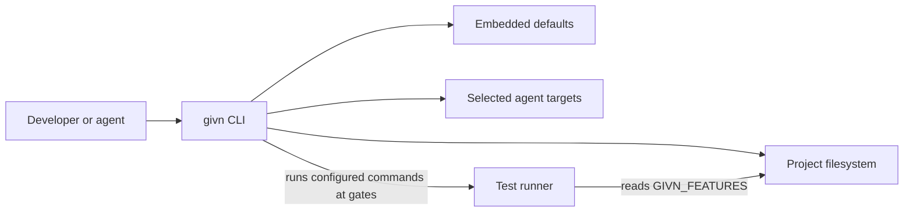

# 3. Context and Scope

## 3.1 Business Context

`givn` sits between a developer or AI coding agent and a project filesystem. It
manages Gherkin specifications, change artifacts, generated guidance, and local
review evidence.

### External entities

| Entity | Interaction |
|---|---|
| Developer | Runs lifecycle, lint, check, archive, retrieval, and addon commands. |
| AI coding agent | Reads effective instructions, generated skills, review reports, and Arc42 docs; edits project artifacts and source. |
| Project filesystem | Stores `givn/`, source code, `AGENTS.md`, generated agent files, and durable `docs/arc42/`. |
| Test runner | Is configured in `givn/commands.yaml`; receives `GIVN_FEATURES` and executes feature scenarios. |
| CI | Runs static lint, configured test commands, mandatory checks, and archive/review gates. |
| Local model artifacts | Supply E5, BGE, or NLI tokenizers/models for feature-enabled retrieval. No hosted inference service is part of the boundary. |

`AGENTS.md` is user-owned except for named givn fenced blocks. Givn may create or
replace the content between matching markers such as
`<!-- givn:begin:givn-project -->` and `<!-- givn:end:givn-project -->`; it does
not alter other content.

## 3.2 Technical Context - Interfaces

| Interface | Direction | Contract |
|---|---|---|
| CLI arguments | in | `clap` subcommands, options, and exit status. |
| `givn/config.yaml` | in/out | Project overlay, addon flags, version marker, and skill targets. |
| `givn/commands.yaml` | in/out | Project-owned `verify`, E2E, and coverage commands/paths; applied as a later overlay. |
| `givn/**` artifacts | in/out | Markdown and `.feature` lifecycle files, plus generated semantic reports. |
| `GIVN_FEATURES` | in | Feature path exported to project command processes. |
| `givn instructions --json` | out | One object with `id`, `generates`, `requires`, and resolved `instruction`. |
| `givn spec index/search/explore/review/duplicates` | in/out | Local E5 index, advisory retrieval, surface-specific second-stage evidence, and complete permanent audit. |
| `givn check review --change <id>` | in/out | Mandatory checks and, with retrieval, change-local semantic report generation. |
| `givn/archive/<id>/` | out | Copy/remove archive of the complete change directory, retaining semantic-review evidence. |
| Agent target directories | out | Selected `.opencode`, `.agents`, and `.claude` skill paths; opencode commands use `.opencode/commands`. |
| Durable Arc42 path | out | Fixed `docs/arc42/`; no effective output-dir setting exists. |

## 3.3 Scope

### In scope

- Gherkin-first change lifecycle and delta merge.
- YAML manifest overlay and per-facet cascade.
- Filesystem-derived state and visible skip markers.
- Static lint and explicit project test-runner commands.
- Mandatory task/review checks plus additional post hooks.
- Addon management, including fixed-path durable Arc42 scaffolding and review.
- Agent skill/command generation with selected targets and fenced-block ownership.
- Local E5 retrieval, complete Explore, change-aware Explore, semantic report,
  projected remediation, and permanent duplicate audit.
- Optional BGE/NLI local evidence with actual-tokenizer cap handling.
- Repository-owned compiled-CLI acceptance fixtures.

### Out of scope

- Hosted model inference or a remote retrieval service.
- Automatic classification, automatic feature edits, automatic chunking, or
  automatic scenario splitting for token caps.
- A configurable Arc42 output directory or chapter selection cascade.
- OpenSpec backward-compatible reads or an implicit migration.
- Multi-repository workflow coordination.
- Release, Homebrew, and shell-installer infrastructure before it is implemented.
- Treating BGE/NLI evidence as a domain classification.
