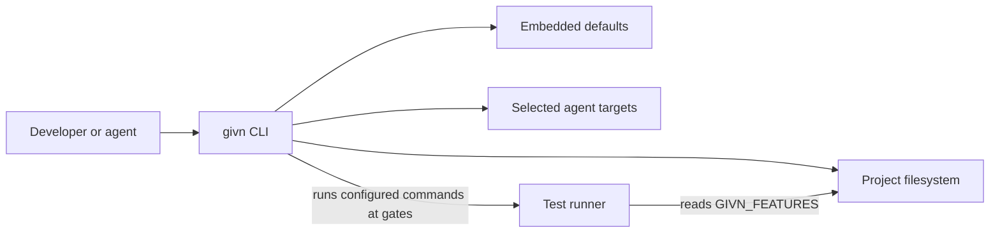

# 3. Context and Scope

## 3.1 Business Context

`givn` sits between a developer or AI coding agent and a project filesystem. It
manages Gherkin specifications, change artifacts, generated guidance, and local
review evidence.

### External entities

| Entity | Interaction |
|---|---|
| Developer | Runs lifecycle, lint, check, archive, addon, and run commands. |
| AI coding agent | Reads effective instructions, generated skills, review reports, and Arc42 docs; edits project artifacts and source. |
| Project filesystem | Stores `givn/`, source code, `AGENTS.md`, generated agent files, and durable `docs/arc42/`. |
| Test runner | Is configured in `givn/commands.yaml`; receives `GIVN_FEATURES` and `GIVN_RESULT_FILE` and executes feature scenarios, reporting per-scope scenario counts. |
| Git CLI | Answers backend selection (`rev-parse --is-inside-work-tree`), stores the archive candidate, finalization, and upgrade revisions, reports the worktree state for the committed-state witness, and provides the recovery history for forward repair. |
| Fossil CLI | Answers checkout discovery and revision identity (`info`), reports the checkout state including `EXTRA` files for the committed-state witness, records and commits the archive candidate, finalization, upgrade, and `givn commit` revisions, and provides the recovery history for forward repair. |
| Fossil checkout marker | `.fslckout` or `_FOSSIL_` at the project root identifies a Fossil checkout; the archive and the managed upgrade run on it through the selected backend. |
| Started product | Spawned by `givn run` from the declared start command; its output is inherited, its exit code forwarded, and its signals forwarded on unix. |
| Automation caller around givn (for example the kiekste preview host) | Reads the run declaration and drives `givn run` through its machine contract (ready line, exit codes, port hand-off); it never guesses start information. |
| CI | Runs static lint, configured test commands, mandatory checks, and archive/review gates. |
| Coding-agent harness reporter | Each supported harness (opencode, Claude Code, omp, and Maki) runs its own generated reporter inside its own runtime; it buffers that harness's activity (steps and token usage, tool calls, subagent spans, question and permission waits) and hands it to `givn history ingest`, keeps working when an event is rejected, and never writes the development record itself. |

`AGENTS.md` is user-owned except for named givn fenced blocks. Givn may create or
replace the content between matching markers such as
`<!-- givn:begin:givn-project -->` and `<!-- givn:end:givn-project -->`; it does
not alter other content.

## 3.2 Technical Context - Interfaces

| Interface | Direction | Contract |
|---|---|---|
| CLI arguments | in | `clap` subcommands, options, and exit status. |
| `givn/config.yaml` | in/out | Project overlay, addon flags, version marker, and skill targets. |
| `givn/commands.yaml` | in/out | Project-owned `verify`, E2E, and coverage commands/paths plus the `run:` block (product type, start command, port source, readiness path, readiness timeout); applied as a later overlay with replace-whole semantics for the block. |
| `givn/**` artifacts | in/out | Markdown and `.feature` lifecycle files. |
| `GIVN_FEATURES` | in | Feature path exported to project command processes. |
| `GIVN_RESULT_FILE` | out | Per-scope result path exported to the verification runner; the runner writes the fail-closed scenario-count contract Givn reconciles. |
| `givn instructions --json` | out | One object with `id`, `generates`, `requires`, and resolved `instruction`. |
| `givn instructions arc42-docs` / `design-review` | out | Effective ADR qualification and review guidance; the project cascade may override the default source. |
| `givn instructions dialog` | out | The effective question policy, resolved through the project-overrides-first cascade with no lifecycle stage. The `make-user-questions-decision-ready` target extends its explicit obligation to every user-facing question and all startup, skill, command, and delegated contexts; distribution is pending implementation. |
| `givn spec find/tree/duplicates/progress/coverage/route` | in/out | Deterministic specification queries: overlap fingerprints, duplicate findings, coverage inventory, and migration comparison. |
| `givn check review --change <id>` | in/out | Mandatory checks and the overlap disposition gate. |
| `givn readme check` | out | Deterministic README report: open placeholders, legacy scaffold texts, development and run managed block damage, unmanaged or missing README; exit status reflects findings. |
| `givn run [--port <n>] [--print]` | in/out | Starts the declared product; for servers waits for readiness, prints `givn run: ready at http://127.0.0.1:<port><ready_path>` on stdout, forwards the child's exit code, and forwards SIGINT/SIGTERM on unix. Exit codes: 0 nothing-to-start/clean shutdown, 1 preflight findings or `--port` without `port_env`, 2 readiness timeout, 130 SIGINT, 143 SIGTERM. `--print` emits one sh-eval-able start line without executing. |
| `givn upgrade` on a project behind a declared migration route | in/out | Clean-checkout preflight through the selected backend, managed scaffold synchronization, and — when a route is declared — two backend revisions including the maintenance migration change; a project below the oldest source declared in the migration catalog (0.7.0) receives the managed refresh only. |
| `assets/migrations/catalog.yaml` | in | Release-owned migration bundle policy used to resolve version gaps and aggregate ordered migration phases. |
| `givn/archive/<id>/` | out | Archived change directory, its pending/proven verification receipt, and the raw per-scope runner results. |
| Agent target directories | out | Selected `.opencode`, `.agents`, `.claude`, and `.omp` skill paths; opencode and omp commands use their own `<target>/commands` directory. `.agents` is a neutral skills mirror that no harness executes, so it receives neither an attribution integration nor a development reporter. |
| OpenCode plugin boundary | in | The generated `.opencode/plugins/givn-attribution.js` receives the current session model through OpenCode's plugin hooks and contributes shell attribution variables. The generated `.opencode/plugins/givn-timeline.js` is a V2 plugin (default-exported definition with a stable id and `setup`, registered through the plugin context) that reports development activity — steps and their token usage, tool calls, subagent child sessions, permission and question waits — through `givn history ingest`. |
| Claude hook boundary | in | The generated `.claude/hooks/givn-attribution.sh` receives Claude Code's PreToolUse JSON, resolves the current model through its transcript path, and rewrites Bash commands with exported attribution variables that remain available to compound commands and shell wrappers. The generated `.claude/hooks/givn-timeline.sh` is registered per event in `.claude/settings.local.json` and pipes its payload to `givn history harness-hook --harness claude`, which maps it to record entries and reads the session record for token usage. |
| omp hook boundary | in | The generated `.omp/hooks/pre/givn-attribution.js` is loaded by omp's extension runner as a `pre` hook; its `tool_call` handler rewrites a revision-creating Bash command with attribution exports carrying the live session model, thinking level, and the `omp` harness marker. The generated `.omp/hooks/pre/givn-timeline.js` observes tool, turn, subagent, question, and message events and reports them through `givn history ingest`. |
| Maki plugin boundary | in | The generated `.maki/lua/givn-timeline.lua` is a project-local Lua plugin loaded by the managed fail-soft `-- givn:begin:timeline` fence in `.maki/init.lua`; its autocmd handlers observe tool, turn, compaction, subagent, status, model, and session events and report them through `givn history ingest`, with grants merged into `.maki/plugin.toml` (the reporter calls `fs_read`, `fs_write`, and `run`); question text is read at the wait's close from the live `maki.session.messages` transcript (no new grants; the every-permission tool slot is not used). The same target also writes Givn's skills to `.maki/skills/` and its commands to `.maki/commands/`. Maki loads nothing from `.maki/` in a folder it has not been trusted for, so the boundary is inactive until the developer trusts the project. |
| `givn outline report [--json] [--out <path>]` | out | Human or schema-v3 JSON report over the project-root `src/` tree; every unit's method outline comes first, then metrics and one classification as hints, never an action or recommendation. `--out` diverts the selected form to a file and prints nothing on stdout; hints exit `0`, a disabled experiment or an unwritable `--out` exits `1`, invalid usage exits `2`. No baseline or cache is written. |
| `givn check review --change <id>` (outline gate) | in/out | Additive review output when `addons.outline` is enabled: the derived change base, the committed head, the outline of every touched unit with methods, its `PASS` or `FAIL` verdict, and the supporting metric hints. Exit stays `0`/`1`; a missing verdict, an empty PASS explanation, a FAIL, conflicting verdicts, a missing reviewer, or a self-review exits non-zero and names the unit. |
| `<change>/review.md` | out | The review record carries `OUTLINE: AUTHOR <id>`, `OUTLINE: REVIEWER <id>`, one `OUTLINE: PASS <unit> \| <responsibility; call order>` or `OUTLINE: FAIL <unit> \| <reason>` per printed outline, and the overall `OUTLINE: PASS`. |
| `addons.outline` | in | Default-off addon flag; absent or `false` disables the report command with a named reason and removes the review gate from `givn check review` and its guidance block, `givn addons enable outline` opts in. |
| Durable Arc42 path | out | Fixed `docs/arc42/`; no effective output-dir setting exists. |
| `givn history ingest` | in | The one intake contract for reported agent activity: a JSON payload on stdin, per-event validation, a stable exit-code pair (`0` payload read, `2` unreadable stdin), and a rejected event named on stderr while the accepted ones are stored. It is the single enforcement site for every bound and enforces the project's `record.mode` for payloads (off appends nothing and warns once; on keeps metadata and drops content; full keeps content under the 64 KiB/256 KiB caps); Claude's in-process `harness_hook` separately enforces `off`. `--with-full-content` overrides `on`/`full` for one payload only and is ignored under `off` with one warning and exit 0. |
| `givn history settings` | out | The mode query: human output `record mode: <mode> (source: <config\|default>)`, `--json` `{"mode":"on\|off\|full","source":"config\|default"}`; both exit 0. An unknown/unreadable value warns once and reports `on`/`default`; outside a Givn project it exits 1 with `error: not a Givn project (givn/ not found)`. It is a non-recorded read view, so a query never appends an entry. |
| `givn history` | out | The development record of one scope as text or `--json`: every entry with its kind, scope, duration, and outcome. |
| `givn timeline` | out | The development report of one change, one ideation topic, or — with no scope flag — the project: one self-contained HTML file whose path is printed, written to `givn/history/reports/<scope>.html` unless `--out` names another path. The command prints the path and opens nothing itself. |
| omp timeline hook boundary | in | The generated `.omp/hooks/pre/givn-timeline.js` is loaded by omp's extension runner next to the attribution hook; it observes tool, turn, subagent, question, and message events and reports them through `givn history ingest`. |
| `givn/history/events.jsonl` | out | The append-only local development record, kept out of repository history by Givn's own fenced ignore block; it is read-only for the report and never a gate input. |

## 3.3 Scope

### In scope

- Gherkin-first change lifecycle and delta merge.
- YAML manifest overlay and per-facet cascade.
- Filesystem-derived state and visible skip markers.
- Static lint and explicit project test-runner commands.
- Mandatory task/review checks plus additional post hooks.
- Run-command declaration in `givn/commands.yaml`: scaffolding, managed-upgrade
  backfill, deterministic validation, managed README run block, archive gate,
  and the `givn run` executor with its readiness probe and machine contract.
- README enforcement when the readme addon is enabled: marked scaffolding, the
  deterministic README check, the archive completeness gate, the review-level
  README impact decision, and managed development-block refresh.
- Addon management, including fixed-path durable Arc42 scaffolding and review,
  and default-off addons such as `outline`.
- The opt-in outline report: production-source discovery, neutral unit
  analysis, method outlines first, then shared metrics and classification as
  hints, and human/JSON output with no action or recommendation.
- The opt-in outline review gate inside `givn check review`: change-base
  derivation from version-control history, committed-head selection, touched-unit
  selection across files and trait implementors, the per-unit outline verdict
  contract, reviewer identity, and the supporting metric hints.
- Agent skill/command generation with selected targets and fenced-block ownership.
- The pending `make-user-questions-decision-ready` contract keeps one effective
  dialog policy and adds universal discovery obligations; it does not intercept
  agent chat or claim runtime enforcement of question quality.
- Pre-proposal ideation facilitation through the synchronized `givn-ideation`
  skill: structured domain exploration with topic state under `givn/ideation/`,
  stakeholder personas, and change seeds, as the artifact-producing alternative
  to `givn-explore`.
- Deterministic specification toolchain (`spec find`, `spec tree`, `spec
  duplicates`, `spec progress`, `spec coverage`, `spec route`) with
  deterministic overlap fingerprints and per-use-case narrative files.
- Repository-owned compiled-CLI acceptance fixtures.
- Version-control backend selection at the project root through one seam: Git
  and Fossil are implemented for the archive and the managed upgrade; both
  markers, no version control, a nested root, and a missing executable are
  refused by name before mutation.
- Strict ADR qualification guidance and canonical routing of architecture rationale.
- The development record and the report over it: best-effort append-only capture
  of Givn's own commands, phases, hooks, verification steps, and revisions; one
  intake contract for harness-reported agent activity including token usage; and
  `givn timeline`, which renders one change or ideation as a self-contained
  interactive report with ranked long steps, question waits, and subagent
  fan-out (ADR-073).
- Release metadata and the release-owned migration routes; the oldest
  source the migration catalog declares is 0.7.0.

### Out of scope

- Deriving run-declaration content from repository sources, build manifests,
  container files, or framework conventions; health monitoring beyond the
  declared readiness probe; a background or daemon mode for `givn run`.
- A configurable Arc42 output directory or chapter selection cascade.
- A project-wide outline scan, a stored outline baseline or watchlist, a
  feedback ledger, and any outline effect on the archive gate; language
  adapters beyond Rust and Python; automatic refactoring; and judging whether
  an outline explanation is true.
- OpenSpec backward-compatible reads or migrations from versions below the
  oldest migration route the catalog declares.
- Multi-repository workflow coordination.
- Release, Homebrew, and shell-installer infrastructure before it is implemented.

*[Architecture documentation index](README.md)*
