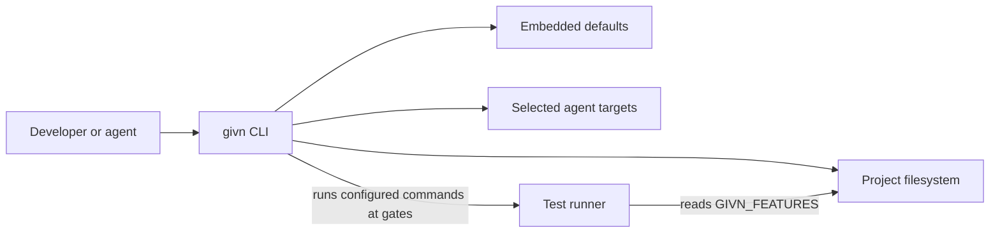

# 3. Context and Scope

## 3.1 Business Context

`givn` sits between a developer or AI coding agent and a project filesystem. It
manages Gherkin specifications, change artifacts, generated guidance, local
review evidence, and an optional advisory structure report.

### External entities

| Entity | Interaction |
|---|---|
| Developer | Runs lifecycle, lint, check, archive, addon, outline, report, and run commands. |
| AI coding agent | Reads effective instructions and generated skills, edits project artifacts and source, and reports activity through the harness integration. |
| Project filesystem | Stores `givn/`, source code, `AGENTS.md`, generated agent files, and durable `docs/arc42/`. |
| Test runner | Is configured in `givn/commands.yaml`; receives `GIVN_FEATURES`, `GIVN_RESULT_FILE`, and `GIVN_RESULT_SCOPE`, and writes per-scope scenario counts. |
| Git CLI | Answers backend selection, stores archive/upgrade revisions, reports the worktree state, and provides recovery history for forward repair. |
| Fossil CLI | Answers checkout discovery and revision identity, reports checkout state including `EXTRA` files, records and commits archive/upgrade/`givn commit` revisions, and provides recovery history. |
| Fossil checkout marker | `.fslckout` or `_FOSSIL_` at the project root identifies a Fossil checkout; archive and managed upgrade run on it through the selected backend. |
| Started product | Spawned by `givn run` from the declared start command; output is inherited, exit code forwarded, and signals forwarded on unix. |
| Automation caller around givn | Reads the run declaration and drives `givn run` through its machine contract (ready line, exit codes, port hand-off); it never guesses start information. |
| CI | Runs static lint, configured test commands, mandatory checks, and archive/review gates. |
| Coding-agent harness reporter | Each supported harness (opencode, Claude Code, omp, and Maki) runs its generated reporter inside its own runtime; it buffers that harness's activity and hands it to `givn history ingest`, keeps working when an event is rejected, and never writes the development record itself. |
| Maki runtime | Loads `.maki/` configuration only in a folder the developer has trusted; an untrusted project leaves the reporter inactive by the harness's own gate. |

`AGENTS.md` is user-owned except for named givn fenced blocks. Givn may create or
replace the content between matching markers such as
`<!-- givn:begin:givn-project -->` and `<!-- givn:end:givn-project -->`; it does
not alter other content. The retired `absolute-mode` block is removed during
sync; the current optional presentation block is `communication-policy`.

## 3.2 Technical Context — Interfaces

| Interface | Direction | Contract |
|---|---|---|
| CLI arguments | in | `clap` subcommands, options, and exit status. |
| `givn/config.yaml` | in/out | Policy and structure: version marker, artifact/apply graph, addon flags, skill targets, rules policy, record mode, instruction extensions. |
| `givn/commands.yaml` | in/out | Executable settings only: `verify`, `coverage`, and `run`. Parsed with a dedicated schema; policy keys are refused. |
| `givn/**` artifacts | in/out | Markdown and `.feature` lifecycle files. |
| `GIVN_FEATURES` | in | Feature path or scope exported to project command processes. |
| `GIVN_RESULT_FILE` | out | Per-scope result path exported to the verification runner; the runner writes the fail-closed four-count result Givn reconciles. |
| `GIVN_RESULT_SCOPE` | out | `change`, `regular`, or `e2e`; a result that declares a different scope is refused. |
| `givn addons enable|disable` | in/out | Refused while a locked change is active; the interactive operator override records the add-on, before/after, reason, and timestamp in the change lock. |
| `givn instructions [<id>] [--json]` | out | No id: project state and request routing (`next_command`, `next_skill`, `overview`). With an artifact id: one object with `id`, `generates`, `requires`, and resolved `instruction`; policy ids use empty artifact arrays and may add `skill_to_load`. |
| `givn instructions arc42-docs` / `design-review` | out | Effective architecture and review guidance; the project cascade may override the default source. |
| `givn instructions dialog` / `dialog-examples` / `challenge` | out | The mandatory question policy, its worked examples, and the evidence-first challenge policy. They resolve without a lifecycle change. |
| `givn spec find/tree/duplicates/coverage/route` | in/out | Deterministic specification queries and advisory routing. |
| `givn check review --change <id>` | in/out | Integrity, run declaration, change-scoped lint, overlap, retirement, routing, receipt, add-on drift, and scenario-commit checks. It runs no suite and no outline gate. |
| `givn readme check` | out | Deterministic README report: open placeholders, legacy scaffold texts, development/run managed block damage or ambiguity, unmanaged or missing README; exit status reflects findings. |
| `givn run [--port <n>] [--print]` | in/out | Starts the declared product; for servers waits for readiness, prints `givn run: ready at http://127.0.0.1:<port><ready_path>` on stdout, forwards the child's exit code, and forwards SIGINT/SIGTERM on unix. `--print` emits one sh-eval-able start line without executing. |
| `givn upgrade` | in/out | Clean-checkout preflight through the selected backend, managed scaffold and guidance refresh, checkpoint reporting, and one allowlist-only revision when files changed. No pre-1.0 route is shipped. |
| `assets/migrations/catalog.yaml` | in | Release-owned migration bundle policy. The 1.0 baseline ships `migrations: []`; future routes use the same schema. |
| `givn/archive/<id>/` | out | Archived change directory, its pending/proven verification receipt, and the raw per-scope runner results. |
| Agent target directories | out | `.opencode/skills/`, `.agents/skills/`, `.claude/skills/`, `.omp/skills/`, and `.maki/skills/`. No target receives generated command files. |
| OpenCode plugin boundary | in | `.opencode/plugins/givn-attribution.js` contributes shell attribution variables; `.opencode/plugins/givn-timeline.js` reports development activity through `givn history ingest`. |
| Claude hook boundary | in | `.claude/hooks/givn-attribution.sh` rewrites Bash commands with attribution variables and `.claude/hooks/givn-timeline.sh` is registered per event in `.claude/settings.local.json`, piping payloads to `givn history harness-hook --harness claude`. |
| omp hook boundary | in | `.omp/hooks/pre/givn-attribution.js` rewrites revision-creating Bash commands with attribution exports; `.omp/hooks/pre/givn-timeline.js` reports activity through the intake. |
| Maki plugin boundary | in | `.maki/lua/givn-timeline.lua` is loaded by the managed fence in `.maki/init.lua`; grants live in `.maki/plugin.toml`. It reports through the intake and receives no generated command files. |
| `givn outline report [--json] [--out <path>] [--path <dir>]` | out | Advisory human or schema-v3 JSON report over the requested production roots. Every unit's per-component call tree comes first, then metric hints. `--out` writes the selected form and prints nothing on stdout; hints exit `0`, a disabled addon or unwritable `--out` exits `1`, invalid usage exits `2`. No baseline or cache is written. |
| `<change>/review.md` | out | Review record with `Review kind`, `Author`, `Reviewer context`, the coverage disposition, and (when applicable) the visual review markers. No outline verdict is required. |
| Durable Arc42 path | out | Fixed `docs/arc42/`; no effective output-dir setting exists. |
| `givn history ingest` | in | The one intake contract for reported agent activity: JSON on stdin, per-event validation, exit `0` when read and `2` for unreadable stdin, with rejected events named on stderr. It enforces `record.mode` and every bound. |
| `givn history settings` | out | Human `record mode: <mode> (source: <config\|default>)` or JSON `{"mode":…,"source":…}`; a non-recorded read view. |
| `givn history` | out | The record of one scope as text or JSON. |
| `givn timeline` | out | One self-contained HTML report for a change, topic, or the project, written to `givn/history/reports/<scope>.html` unless `--out` names another path. |
| `givn/history/events.jsonl` | out | The append-only local record, kept out of repository history by Givn's own ignore entries; never a gate input. |

## 3.3 Scope

### In scope

- Gherkin-first change lifecycle and delta merge.
- YAML manifest overlay and per-facet cascade.
- Filesystem-derived state and visible skip markers.
- Static lint and explicit project runner commands.
- Mandatory task/review checks plus additive post hooks.
- Run-command declaration: scaffolding, managed-upgrade backfill, deterministic
  validation, managed README run block, archive gate, and `givn run`.
- README enforcement when the readme addon is enabled: marked scaffolding, the
  deterministic check, the archive completeness gate, the review-level impact
  decision, and managed development/run block refresh.
- Addon management, including fixed-path durable Arc42 scaffolding and review,
  and the enabled-by-default advisory outline report.
- Advisory outline evidence: production-source discovery, neutral analysis,
  per-component call trees, metrics and classification as hints, and human/JSON
  output with no action, verdict, or gate.
- Skills-only guidance generation for the selected targets, with the
  communication-policy and dialog instructions and the challenge instruction.
- Explicit-path commit publication on Git and Fossil, with optional
  attribution.
- Pre-proposal start guidance and ideation.
- Deterministic specification toolchain (`spec find`, `spec tree`,
  `spec duplicates`, `spec coverage`, `spec route`).
- Repository-owned compiled-CLI acceptance fixtures.
- Version-control backend selection at the project root through one seam.
- ADR qualification guidance and canonical architecture routing.
- The development record and report: best-effort capture of Givn commands and
  phases, one intake for harness-reported activity, and `givn timeline`.
- Release metadata, the empty 1.0 migration baseline, and the future-route
  resolver contract.

### Out of scope

- Automatic pre-1.0 migration routes or retired-key aliases.
- Deriving run-declaration content from repository sources; health monitoring
  beyond the declared readiness probe; a daemon mode for `givn run`.
- A configurable Arc42 output directory or chapter-selection cascade.
- A project-wide outline baseline or watchlist, a feedback ledger, an outline
  review gate, language adapters beyond the supported set, or automatic
  refactoring.
- Recording redaction, encryption, retention, or a privacy-filtering guarantee.
- Multi-repository workflow coordination.
- Release binaries, Homebrew, and shell-installer infrastructure before it is
  implemented.

*[Architecture documentation index](README.md)*
