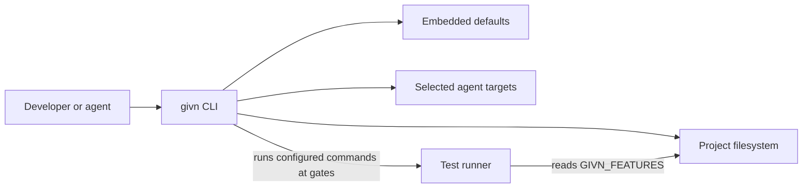

# 3. Context and Scope

## 3.1 Business Context

`givn` sits between a developer or AI coding agent and a project filesystem. It
manages Gherkin specifications, change artifacts, generated guidance, and local
review evidence.

### External entities

| Entity | Interaction |
|---|---|
| Developer | Runs lifecycle, lint, check, archive, addon, and run commands. |
| AI coding agent | Reads effective instructions, generated skills, review reports, and Arc42 docs; edits project artifacts and source. |
| Project filesystem | Stores `givn/`, source code, `AGENTS.md`, generated agent files, and durable `docs/arc42/`. |
| Test runner | Is configured in `givn/commands.yaml`; receives `GIVN_FEATURES` and executes feature scenarios. |
| Started product | Spawned by `givn run` from the declared start command; its output is inherited, its exit code forwarded, and its signals forwarded on unix. |
| Automation caller around givn (for example the kiekste preview host) | Reads the run declaration and drives `givn run` through its machine contract (ready line, exit codes, port hand-off); it never guesses start information. |
| CI | Runs static lint, configured test commands, mandatory checks, and archive/review gates. |

`AGENTS.md` is user-owned except for named givn fenced blocks. Givn may create or
replace the content between matching markers such as
`<!-- givn:begin:givn-project -->` and `<!-- givn:end:givn-project -->`; it does
not alter other content.

## 3.2 Technical Context - Interfaces

| Interface | Direction | Contract |
|---|---|---|
| CLI arguments | in | `clap` subcommands, options, and exit status. |
| `givn/config.yaml` | in/out | Project overlay, addon flags, version marker, and skill targets. |
| `givn/commands.yaml` | in/out | Project-owned `verify`, E2E, and coverage commands/paths plus the `run:` block (product type, start command, port source, readiness path, readiness timeout); applied as a later overlay with replace-whole semantics for the block. |
| `givn/**` artifacts | in/out | Markdown and `.feature` lifecycle files. |
| `GIVN_FEATURES` | in | Feature path exported to project command processes. |
| `givn instructions --json` | out | One object with `id`, `generates`, `requires`, and resolved `instruction`. |
| `givn instructions arc42-docs` / `design-review` | out | Effective ADR qualification and review guidance; the project cascade may override the default source. |
| `givn spec find/tree/duplicates/progress/coverage/route` | in/out | Deterministic specification queries: overlap fingerprints, duplicate findings, coverage inventory, and migration comparison. |
| `givn check review --change <id>` | in/out | Mandatory checks and the overlap disposition gate. |
| `givn readme check` | out | Deterministic README report: open placeholders, legacy scaffold texts, development and run managed block damage, unmanaged or missing README; exit status reflects findings. |
| `givn run [--port <n>] [--print]` | in/out | Starts the declared product; for servers waits for readiness, prints `givn run: ready at http://127.0.0.1:<port><ready_path>` on stdout, forwards the child's exit code, and forwards SIGINT/SIGTERM on unix. Exit codes: 0 nothing-to-start/clean shutdown, 1 preflight findings or `--port` without `port_env`, 2 readiness timeout, 130 SIGINT, 143 SIGTERM. `--print` emits one sh-eval-able start line without executing. |
| `givn upgrade` on a 0.2.0 project | in/out | Clean-worktree preflight, managed scaffold synchronization, two Git commits, and creation of a maintenance migration change. |
| `assets/migrations/catalog.yaml` | in | Release-owned migration bundle policy used to resolve version gaps and aggregate ordered migration phases. |
| `givn/archive/<id>/` | out | Copy/remove archive of the complete change directory. |
| Agent target directories | out | Selected `.opencode`, `.agents`, and `.claude` skill paths; opencode commands use `.opencode/commands`. |
| Durable Arc42 path | out | Fixed `docs/arc42/`; no effective output-dir setting exists. |

## 3.3 Scope

### In scope

- Gherkin-first change lifecycle and delta merge.
- YAML manifest overlay and per-facet cascade.
- Filesystem-derived state and visible skip markers.
- Static lint and explicit project test-runner commands.
- Mandatory task/review checks plus additional post hooks.
- Run-command declaration in `givn/commands.yaml`: scaffolding, managed-upgrade
  backfill, deterministic validation, managed README run block, archive gate,
  and the `givn run` executor with its readiness probe and machine contract.
- README enforcement when the readme addon is enabled: marked scaffolding, the
  deterministic README check, the archive completeness gate, the review-level
  README impact decision, and managed development-block refresh.
- Addon management, including fixed-path durable Arc42 scaffolding and review.
- Agent skill/command generation with selected targets and fenced-block ownership.
- Pre-proposal ideation facilitation through the synchronized `givn-ideation`
  skill: structured domain exploration with topic state under `givn/ideation/`,
  stakeholder personas, and change seeds, as the artifact-producing alternative
  to `givn-explore`.
- Deterministic specification toolchain (`spec find`, `spec tree`, `spec
  duplicates`, `spec progress`, `spec coverage`, `spec route`) with
  deterministic overlap fingerprints and per-use-case narrative files.
- Repository-owned compiled-CLI acceptance fixtures.
- Strict ADR qualification guidance and canonical routing of architecture rationale.
- Version 0.3.0 release metadata and the 0.2.0-to-0.3.0 LLM migration path.

### Out of scope

- Deriving run-declaration content from repository sources, build manifests,
  container files, or framework conventions; health monitoring beyond the
  declared readiness probe; a background or daemon mode for `givn run`.
- A configurable Arc42 output directory or chapter selection cascade.
- OpenSpec backward-compatible reads or migrations from versions other than
  the documented 0.2.0-to-0.3.0 route.
- Multi-repository workflow coordination.
- Release, Homebrew, and shell-installer infrastructure before it is implemented.
