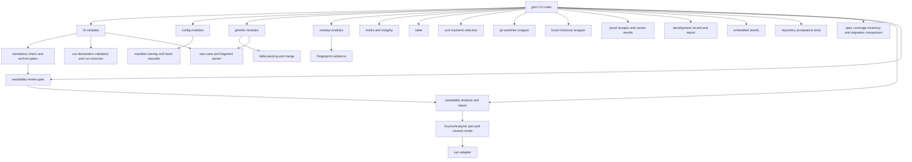

# 5. Building Block View

## 5.4 Commit Attribution Model Extraction

The existing attribution CLI owns the Claude PreToolUse transformation. It
reads the latest assistant model from the transcript named by the hook payload,
then composes an exported environment prefix before the complete Bash command.
The generated Claude shell hook remains a thin launcher. OpenCode model
extraction remains in its generated plugin asset. The same attribution CLI
stamps only the managed co-author line at the commit boundary (`givn commit`
on every backend, the hook on Git).

## 5.1 Level 0 - System

`givn` is one Rust CLI crate. It reads embedded defaults and project-local
configuration, changes lifecycle artifacts, invokes configured commands at gate
points, and produces deterministic overlap and coverage evidence.

## 5.2 Level 1 - Crate Structure

## 5.3 Production Responsibilities

| Building block | Responsibility |
|---|---|
| `main.rs` | Parse `clap` commands, dispatch, and map results to process exit. |
| `cli::init` | Create `givn/{specs,changes,archive}`, write config and commands scaffolds, enable default-on addons unless `--no-addons`, prompt agent targets, and sync outputs. |
| `cli::new` | Validate change id, create a change directory, scaffold proposal unless skipped, and write `.givn-skip` when requested. |
| `cli::instructions` | Resolve effective artifact instructions and non-artifact policy and step instructions with optional JSON metadata; render addon-conditional sections against the effective addon flags; append the project's extension under the marked section; provide context-aware generic guidance without an artifact id. |
| `cli::lint` | Parse features, report WIP/PENDING, run the default tree-wide overlap scan with exit precedence 1, 3, 2, 0, report advisory change-seed status findings and dangling persona references, and classify every finding as `advisory`, `finding`, or `blocking` in the rendered and JSON output. |
| `cli::check` | Run explicit mandatory checks for tasks/review and configured post hooks; named review also runs the overlap gate. Review executes `integrity` and the run-declaration check; scenario execution belongs to the archive verification. `givn check rules` reports tracked and reachable-history rules and exits non-zero on a violation. |
| `cli::test_result` | Write the four-count runner result to `GIVN_RESULT_FILE`, validate reconciliation, and never require a scope field. |
| `cli::archive` | Check archive prerequisites and the current change verification receipt, run the run-declaration gate before the README completeness gate (independent of the readme addon), run the README completeness gate when the readme addon is enabled, select permanent verification for no-product-delta maintenance changes, run configured hooks, write the pending receipt, move the change into the archive location with one rename, merge deltas, publish the archive candidate revision through the selected backend, run the regular and E2E verification scopes once against the candidate, run the optional coverage gate, refresh managed blocks, record the verification receipt, and publish the evidence-only finalization revision. |
| `cli::status` and `cli::graph` | Render manifest-aware filesystem state, dependencies, optional flags, gates, and hooks; status and instructions surface unproven archive candidates with their resume command. |
| `cli::history` | Read one scope's development record as text or machine-readable JSON; serve `givn history settings [--json]` as the non-recorded mode query (human and JSON forms, `config`/`default` source, the documented exit codes); own the single intake contract for reported agent activity (validate each event, store the accepted ones, name a rejected one on stderr, exit `0` whenever the payload was read), the single enforcement site for every bound, and the mode enforcement for payloads plus Claude's in-process `off` path; and map a raw process-per-hook harness payload (Claude Code) into record events, resolving the mode in-process, enforcing `off` before any store/pending/ignore write, holding that harness's start timestamps in pending state, and reading its session record for token usage. |
| `cli::timeline` | Build the report model for one change or ideation (the workflow phase scaffold with statuses and current state, the optional linked ideation group with its own ideation phases, phase aggregates, lane groups, ranked long steps, question-wait totals, repeated-step groups, subagent fan-out, token totals, the captured metadata facts, and the 8 MiB content budget), first dropping the recorder's own command entries (the intake and the process-per-hook mapper) from the model, and render it into one self-contained HTML file whose path is printed; content beyond the budget is marked `content omitted; see the record` while the store stays complete. |
| `cli::eject` | Materialize an embedded facet, skill, or manifest into project-owned `givn/` content. |
| `cli::commit` | Create one attributed revision through the selected backend: stage the named paths (or, under the `local-only` policy, every pending project path except `AGENTS.md` and the strict rules), stamp the managed attribution trailer when context is active, and commit; refuse a project without a backend by name. |
| `cli::readme` | Scaffold the README from the marked template with the development and run managed blocks, run the deterministic completeness check behind `givn readme check`, and refresh the development and run managed blocks from the effective command file at archive time. |
| `cli::addons` | Toggle addon flags from a registry that records each addon's default state; Arc42 enable scaffolds fixed `docs/arc42/` files without overwriting existing files, and a default-off addon such as `readability` is listed as disabled until explicitly enabled. |
| `cli::skills` | Synchronize the selected skill targets, their commands, and their attribution integrations; refresh the project-start block with its resident rules rendered from the canonical tasks instruction. |
| `cli::attribution` | Stamp commit messages from optional runtime attribution, format Claude Bash hook responses, and install the checked-in Git hook with a local dispatcher. |
| `cli::upgrade` | Refresh managed config comments, preserve uncommented overrides, backfill the `run:` scaffold into `givn/commands.yaml` when the key is absent, and dispatch the exact legacy migration preparation route. |
| `cli::migration` | Load the release migration catalog, resolve ordered bundle paths, preflight the selected backend state through the SCM seam (a dirty checkout or a missing backend is refused before any write), calculate the managed-path allowlist (including `givn/commands.yaml` for the run backfill), create managed/migration revisions on the selected backend, and write the aggregate maintenance plan. |
| `cli::run_block` | Validate the `run:` declaration with the deterministic rules (R1–R10) and produce labeled findings for `check review` and the archive gate. |
| `cli::run` | Resolve the start plan (product type, port source, `--port`/`--print`), execute the declared command, probe readiness over `std::net`, print the ready line, forward child exit codes, and forward SIGINT/SIGTERM on unix. |
| `cli::readability` | Gate `givn readability report` on the readability addon at runtime, build the analysis request for the project-root `src/` tree, select human or JSON output, and write to stdout or the explicit `--out` path. |
| `readability` | Orchestrate production-source discovery, neutral analysis, shared metric computation, classification, and human/JSON rendering. The model, metrics, classification, and report depend on the neutral contract, never on a parser; no action or recommendation is produced. |
| `readability::gate` | Run the review gate: resolve the change base from version-control history, materialize base and committed-head trees outside the project, analyze both through the same neutral pipeline, select the touched units (across files, modules, and trait implementors), classify unit-level findings, validate the `review.md` decisions and rationales, and render one deterministic verdict. It computes no metric and makes no classification decision of its own. |
| `readability::gate::base` | Ask the SCM seam for the first reachable revision that touched the change directory and its first parent. A missing first touch fails closed; Git first-parent, Fossil `timeline --reverse -r ancestors current` with `parent:` (never `merged-from:`), root, merge, rebase, and shallow rules live here. |
| `readability::gate::head` | Select the committed `HEAD`, detect dirty production paths through the SCM seam, and fail before analysis with the paths and the remedy. |
| `readability::gate::revision` | Ask the SCM seam for the revision's files and entry kinds under the production roots and their bytes; write a temporary base or head tree and remove it on drop. A non-UTF-8 path, a path containing a line break, a symlink, a submodule, or an unreadable blob is a named diagnostic; Git paths and bytes are read with NUL delimiters. |
| `readability::gate::touched` | Map changed paths to head units by declaration file and by contributing file, add each touched type's module and the implementors of a touched trait, and match base and head by unit id. A base unit with no head counterpart is a removal that needs `FIXED`. |
| `readability::gate::findings` | Apply the finding predicate (classification other than within-limits, data-only size exemption, method length, crossed threshold, growth) and attach the unit-level reason and decision; run the post-analysis guard for every changed production `.rs` path present at head (a deletion is proven by the base unit's removal). |
| `readability::gate::markers` | Parse the fixed `READABILITY: FIXED`, `READABILITY: JUSTIFIED`, `READABILITY: PASS`, and `FAIL` vocabulary from `review.md`; reject unknown `READABILITY:` lines and conflicting decisions, ignore fenced examples, and treat duplicate identical decisions as one. |
| `readability::gate::rationale` | Locate `rationales/<unit-slug>.md`, validate the required fields, unit and classification match, concrete evidence, a named responsibility, a named rejected alternative, the confirmed owner, banned whole-word reasons, and the `Follow-up:`/`Expiry:` pair. |
| `readability::analyzer` and `syn_adapter` | Define the `SourceAnalyzer` port and its neutral `Analysis` contract; implement the first adapter with `syn`, keeping parser types inside `syn_adapter.rs` and returning per-file failures as diagnostics. |
| `cli::missing_run_command` | Sentinel behind `givn missing-run-command`: prints start-configuration guidance to stderr and exits 1. |
| `config::manifest` | Define artifact, apply, verify, coverage, addon, hook, and run-declaration data structures. |
| `config::overlay` | Apply `givn/config.yaml` and then `givn/commands.yaml`, expand Arc42, and validate graph references/cycles. |
| `config::cascade` | Resolve project override assets before embedded core or addon assets. |
| `config::extensions` | Load the `extensions:` map from `givn/config.yaml`, warn and drop an unknown instruction id or a malformed entry, and render the marked project-extension section appended to the served instruction. |
| `skills::rules` | Resolve the generated-rules policy, write the file-precise ignore entries in both destinations, transition tracked rules to local-only without deleting files, and report tracked and reachable-history occurrences. |
| `gherkin::parse` | Parse feature files, collect WIP and E2E tags, and recursively collect `.feature` paths. |
| `gherkin::usecase_md` | Parse strict `usecase.md` and `fragment.md` documents, identities, goal levels, interactions, Personas, and typed relationships. |
| `gherkin::delta` | Interpret delta tags, operation defaults, and capability identity. |
| `gherkin::merge` | Validate all delta preconditions and merge text-level scenario blocks into permanent specs. |
| `overlap::fingerprint` | Produce masked assertion sequences and best-effort exit/contains/table/DONE/TTY facts. |
| `overlap::analysis` | Find title duplicates, shape matches, subsets, long scenarios, dispositions, and net-delta receipts. |
| `hooks` | Execute configured hooks with `GIVN_FEATURES`; built-in hook names are resolved and cannot be made allow-failure. |
| Embedded attribution assets | Provide the checked-in `.githooks/commit-msg` hook and the generated OpenCode/Claude/omp harness integrations. |
| Embedded harness reporter assets | Provide one development-activity reporter per supported harness: `agent-integrations/omp/givn-timeline.js` (pre-hook factory), `agent-integrations/opencode/givn-timeline.js` (plugin with hooks and an event subscription), `agent-integrations/claude/givn-timeline.sh` (per-event command hook shim), and `agent-integrations/maki/givn-timeline.lua` with `agent-integrations/maki/plugin.toml` (Lua module plus its grants, loaded by a managed fail-soft fence in the project's `.maki/init.lua`; the same target additionally writes Givn's skills and commands into `.maki/`). |
| Embedded workflow report asset | Provide the development report's document with inline CSS, JavaScript, and SVG and two substituted markers (the machine-readable model payload element the script parses and the text-only initial view): the phase stack (and the linked ideation group), each phase's vertical lane timeline and lane log, the current state, and the statistics; no third-party JavaScript, no CDN, no build step, and no remote resource at render time. |
| `integrity_hook` | Check revision-identifier/task evidence, promised step-definition files, Arc42 affected-file edits, coverage configuration, the review-level README impact decision, and — for a declared visual interface — the visual verdict, the persona disposition with its ID resolved against the project persona collection, the final-state and per-state evidence completeness, plus the operator decision for any recorded deferral. |
| `scm::Backend` | Inspect a revision's existence, message, and ancestry for the per-scenario commit gate; export the first revision that touched a path, its parent, a revision's files and file bytes, and the changed paths, so the readability gate consumes history and base content without running a backend command itself. |
| `history` / `cli::history` | Record derived usage, attributable answers, bounded command errors, and provider/variant/model identity additively. |
| `state` | Derive status from artifact paths, markers, skip files, and the manifest graph; expose archive provenance (legacy/pending/proven, plus an identical pending candidate that still has an active change) from the receipt. |
| `history` | Own the development record: the entry schema, the single append-only local store, the exactly-one-scope rule (change, ideation, project), the bounded-label rule, the three capture modes (`record.mode: on \| off \| full`, default `on`) — bounded metadata and full question text under `on`, complete content under `full` with the documented 64 KiB/256 KiB caps, and no write at all under `off`, the per-process recorder used by the capture points, and the fenced ignore block that keeps the store out of repository history. |
| `scm` | Select the version-control backend for the project root (a Git worktree first, then a Fossil checkout), enforce the project-boundary rule, refuse absence, ambiguity, a nested root, or a missing executable by name before any mutation, and expose the shared revision, clean-state, publication, and revision-content operations. |
| `fossil` | Implement the Fossil checkout handle: revision identity from `fossil info`, the clean-state witness from `fossil changes --differ` (including `EXTRA` entries), witness-bounded publication through `fossil addremove` plus `fossil commit`, allowlist staging through `fossil add [--force]`, revision-content checks through `fossil cat`, and the history operations the readability gate needs (`timeline --reverse`, `info` with `parent:`, `ls`, `cat`, and a diff for changed paths). |
| `git` | Git backend implementation: root-bound worktree prerequisite, clean-state witness, HEAD resolution, scoped staging, and scoped commits for the archive boundary and the selection seam; the history operations the readability gate needs (`rev-list`, first-parent resolution, `ls-tree -r -z`, one batched `cat-file --batch -z`, and a changed-path diff). |
| `proof` | Verification receipt and runner-result contract: archive provenance, fail-closed scope-result parsing, and the single evidence-path predicate shared by the clean witness and the finalization guard. |
| `spec::coverage` | Emit behavior-hash specification inventories, compare migration baselines, and block missing behavior, lost E2E evidence, or lower interaction/source coverage. |
| `spec::route` | Rank capability-routing candidates with confidence: ownership-weighted goal/rules and interaction evidence above lexical overlap, a scatter penalty for goal-mismatched candidates, and an explicit no-signal verdict on ties or below-threshold overlap. |

The pending `make-user-questions-decision-ready` design reuses these owners:
`cli::instructions` adds a short obligation to its shared startup overview;
the existing skill/command templates and managed project hint carry references;
the effective dialog instruction owns the full rules and worked examples.
No new production module, template include protocol, JSON field, or dependency
is introduced. Deterministic delivery checks and fresh-context question review
remain separate evidence; the former does not prove agent compliance.

## 5.5 Dependencies

| Dependency | Use |
|---|---|
| `clap`, `clap_complete` | CLI parsing and shell completion |
| `serde`, `serde_yaml_ng`, `serde_json` | Manifest, config, index, and machine-readable output |
| `gherkin` | Feature parsing and AST access |
| `syn` | Rust source parsing in the first `SourceAnalyzer` adapter; `full`, `parsing`, and `visit` features only, with parser types confined to `syn_adapter.rs` |
| `anyhow`, `thiserror` | Application context and typed errors |
| `rust-embed` | Embedded defaults and addon assets |
| `tempfile` | The readability gate's temporary base tree, created outside the project and removed on drop; no other production use. |
| `quick-xml` | Cobertura coverage parsing |

## 5.6 Repository-Owned Acceptance Blocks

The Cucumber test binary contains regular step modules and separate compiled-CLI
E2E step modules. They invoke the public binary in temporary project roots.
They are test building blocks, not production modules, and are intentionally
owned by this repository. The `ready_fixture` harness-false test target is a
test-only child process that binds a port, answers a readiness path, and can
self-exit or trap signals; it exists so `givn run` scenarios exercise a real
HTTP-ready product without shipping any test surface in the binary.

*[Architecture documentation index](README.md)*
