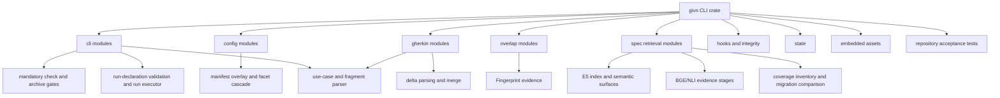

# 5. Building Block View

## 5.1 Level 0 - System

`givn` is one Rust CLI crate. It reads embedded defaults and project-local
configuration, changes lifecycle artifacts, invokes configured commands at gate
points, and optionally uses local retrieval/model artifacts. Retrieval model
artifacts are user-cache data by default; the semantic index remains project
data.

## 5.2 Level 1 - Crate Structure

## 5.3 Production Responsibilities

| Building block | Responsibility |
|---|---|
| `main.rs` | Parse `clap` commands, dispatch, and map results to process exit. |
| `cli::init` | Create `givn/{specs,changes,archive}`, write config and commands scaffolds, enable addons unless `--no-addons`, prompt agent targets, and sync outputs. |
| `cli::new` | Validate change id, create a change directory, scaffold proposal unless skipped, and write `.givn-skip` when requested. |
| `cli::instructions` | Resolve effective artifact instructions and optional JSON metadata; provide context-aware generic guidance without an artifact id. |
| `cli::lint` | Parse features, report WIP/PENDING, and run the default tree-wide overlap scan with exit precedence 1, 3, 2, 0. |
| `cli::check` | Run explicit mandatory checks for tasks/review and configured post hooks; named review also runs overlap/retrieval gates. |
| `cli::archive` | Check archive prerequisites, run the run-declaration gate before the README completeness gate (independent of the readme addon), run the README completeness gate when the readme addon is enabled, select permanent verification for no-product-delta maintenance changes, run configured hooks, run retrieval review when compiled, merge deltas, run post-merge verification/e2e, refresh the development and run managed blocks, run optional coverage, and copy/remove the change to archive. |
| `cli::status` and `cli::graph` | Render manifest-aware filesystem state, dependencies, optional flags, gates, and hooks. |
| `cli::eject` | Materialize an embedded facet, skill, or manifest into project-owned `givn/` content. |
| `cli::readme` | Scaffold the README from the marked template with the development and run managed blocks, run the deterministic completeness check behind `givn readme check`, and refresh the development and run managed blocks from the effective command file at archive time. |
| `cli::addons` | Toggle addon flags; Arc42 enable scaffolds fixed `docs/arc42/` files without overwriting existing files. |
| `cli::skills` | Synchronize selected skill targets and opencode commands. |
| `cli::upgrade` | Refresh managed config comments, preserve uncommented overrides, backfill the `run:` scaffold into `givn/commands.yaml` when the key is absent, and dispatch the exact legacy migration preparation route. |
| `cli::migration` | Load the release migration catalog, resolve ordered bundle paths, preflight Git state, calculate the managed-path allowlist (including `givn/commands.yaml` for the run backfill), create managed/migration commits, and write the aggregate maintenance plan. |
| `cli::run_block` | Validate the `run:` declaration with the deterministic rules (R1–R10) and produce labeled findings for `check review` and the archive gate. |
| `cli::run` | Resolve the start plan (product type, port source, `--port`/`--print`), execute the declared command, probe readiness over `std::net`, print the ready line, forward child exit codes, and forward SIGINT/SIGTERM on unix. |
| `cli::missing_run_command` | Sentinel behind `givn missing-run-command`: prints start-configuration guidance to stderr and exits 1. |
| `config::manifest` | Define artifact, apply, verify, coverage, addon, hook, and run-declaration data structures. |
| `config::overlay` | Apply `givn/config.yaml` and then `givn/commands.yaml`, expand Arc42, and validate graph references/cycles. |
| `config::cascade` | Resolve project override assets before embedded core or addon assets. |
| `gherkin::parse` | Parse feature files, collect WIP and E2E tags, and recursively collect `.feature` paths. |
| `gherkin::usecase_md` | Parse strict `usecase.md` and `fragment.md` documents, identities, goal levels, interactions, Personas, and typed relationships. |
| `gherkin::delta` | Interpret delta tags, operation defaults, and capability identity. |
| `gherkin::merge` | Validate all delta preconditions and merge text-level scenario blocks into permanent specs. |
| `overlap::fingerprint` | Produce masked assertion sequences and best-effort exit/contains/table/DONE/TTY facts. |
| `overlap::analysis` | Find title duplicates, shape matches, subsets, long scenarios, dispositions, and net-delta receipts. |
| `hooks` | Execute configured hooks with `GIVN_FEATURES`; built-in hook names are resolved and cannot be made allow-failure. |
| `integrity_hook` | Check commit-hash/task evidence, promised step-definition files, Arc42 affected-file edits, coverage configuration, and the review-level README impact decision. |
| `state` | Derive status from artifact paths, markers, skip files, and the manifest graph. |
| `spec::retrieval` | Resolve XDG or explicit model caches, validate/acquire E5/BGE/NLI artifacts, build/read the permanent E5 index, serialize complete scenarios, run the unified change-scoped rulebook behind all review surfaces plus Explore/audit, apply evidence, generate semantic reports, and verify remediation. The same blocking review path maintains the append-only remediation log (`src/spec/remediation_log.rs`): run records with per-stage durations, candidate entries with verbatim endpoint text, after-state completion, and stamp/reachability validation against Git history. Long-running phases (artifact acquisition, embedding) emit phase status and per-file download progress on stderr. Advisory review applies a decision-first reporting policy: default text lists only model-recommended second-stage pairs, `--verbose` lifts every listing limit, `--format json` emits one structured review document, and a failed gate persists that document as the change's findings file. |
| `spec::coverage` | Emit behavior-hash specification inventories, compare migration baselines, and block missing behavior, lost E2E evidence, or lower interaction/source coverage. |

## 5.4 Retrieval Building Block

`spec::retrieval` has two persistent boundaries: `.spec-index.json` contains
permanent vector entries and additive E5 cap metadata; `.spec-pair-cache.json`
contains recorded per-pair BGE/NLI evidence keyed by endpoint content and
evidence hashes. Active-delta vectors, classifications, and semantic report
state are not persisted in either.

`givn spec duplicates` is an exception to ordinary index refresh: it reads the
persistent index and reuses it only when every endpoint identity and complete
content hash matches. Otherwise it embeds fitting current permanent scenarios
transiently. It never writes the index as part of the audit.

The change-scoped review surfaces (`givn spec review`, `givn check review`,
the archive similarity gate) share one unified rulebook: single E5 admission
at `0.9000`, hybrid selection (neighbour count per delta scenario, then one
pair cap), and independent BGE/NLI judgement of the selected pairs. The
remaining surfaces stay surface-aware: Duplicate Audit BGE uses its endpoint
top-five union while Duplicate Audit NLI uses the full E5 semantic candidate
set, and Explore keeps its at-most-five ranked results.

Every environment channel that selects model behavior is read through one
gated accessor in this building block. In an installed (release) build the
accessor refuses fixture requests and announces the refusal; model-location
requests that still run the real models pass through. The development build
passes every channel through unchanged.

## 5.5 Dependencies

| Dependency | Use |
|---|---|
| `clap`, `clap_complete` | CLI parsing and shell completion |
| `serde`, `serde_yaml_ng`, `serde_json` | Manifest, config, index, and machine-readable output |
| `gherkin` | Feature parsing and AST access |
| `anyhow`, `thiserror` | Application context and typed errors |
| `rust-embed` | Embedded defaults and addon assets |
| `quick-xml` | Cobertura coverage parsing |
| `fastembed`, `hf-hub`, `ort`, `tokenizers`, `ndarray` | Optional local E5/BGE/NLI retrieval, artifact acquisition, and inference |

## 5.6 Repository-Owned Acceptance Blocks

The Cucumber test binary contains regular step modules and separate compiled-CLI
E2E step modules. They invoke the public binary in temporary project roots.
They are test building blocks, not production modules, and are intentionally
owned by this repository. The `ready_fixture` harness-false test target is a
test-only child process that binds a port, answers a readiness path, and can
self-exit or trap signals; it exists so `givn run` scenarios exercise a real
HTTP-ready product without shipping any test surface in the binary.
