# 5. Building Block View

## 5.1 Level 0 — System

`givn` is one Rust CLI crate. It reads embedded defaults and project-local
configuration, changes lifecycle artifacts, invokes configured commands at gate
points, generates skills for selected agent targets, and produces deterministic
specification, archive, record, and advisory structure evidence.

## 5.2 Level 1 — Crate Structure

```mermaid
flowchart TD
    G[givn CLI crate] --> CLI[cli modules]
    G --> CFG[config modules]
    G --> GH[gherkin modules]
    G --> O[overlap modules]
    G --> HOOK[hooks and integrity]
    G --> STATE[state]
    G --> SCM[scm backend selection]
    G --> GIT[git worktree wrapper]
    G --> FOSSIL[fossil checkout wrapper]
    G --> PROOF[proof receipts and runner results]
    G --> HIST[development record and report]
    G --> SKILL[skills renderer and targets]
    G --> ASSET[embedded assets]
    G --> TEST[repository acceptance tests]
    G --> SPEC[spec inventory, ownership, routing]
    G --> READ[outline analysis and report]
    READ --> PORT[SourceAnalyzer port and neutral model]
    PORT --> SYN[syn adapter]
    PORT --> PYA[python ast adapter]
    CLI --> CHECK[mandatory check and archive gates]
    CLI --> RUNBLK[run-declaration validation and run executor]
    CFG --> GRAPH[manifest overlay, commands schema, facet cascade]
    GH --> MERGE[delta parsing and merge]
    O --> FINGER[Fingerprint evidence]
    GH --> UC[use-case and fragment parser]
    CLI --> UC
```

## 5.3 Production Responsibilities

| Building block | Responsibility |
|---|---|
| `main.rs` | Parse `clap` commands, dispatch, install the development recorder, and map results to process exit. |
| `lib.rs` | Re-export the CLI and history modules for the binary and tests. |
| `cli::init` | Create `givn/{specs,changes,archive}`, write config and commands scaffolds, enable every registered addon unless `--no-addons`, prompt/parse agent targets, scaffold addon files, sync, and report `givn-start` as the entry point. A sync failure exits non-zero with the failed destination and leaves the scaffold for retry. |
| `cli::new` | Validate change id, create a change directory, scaffold proposal unless skipped, and write `.givn-skip` when requested. |
| `cli::instructions` | Resolve artifact instructions and non-artifact policy/step instructions through the project-overrides-first cascade; render addon conditionals; append project extensions; return text or JSON; provide context-aware state and request-routing guidance without an id. The no-active path recommends `givn-start` and names `givn new` as the direct alternative. Domain-skill routing depends only on the `domain_modeling` addon. |
| `cli::lint` | Parse features, report WIP/PENDING, run the default overlap scan with exit precedence 1, 3, 2, 0, report advisory seed and persona findings, and classify every finding as `advisory`, `finding`, or `blocking`. Runs no tests. |
| `cli::check` | Run explicit mandatory checks for tasks/review and configured post hooks. Review runs integrity, the run declaration, change-scoped lint, overlap, retirement, routing, receipt, and scenario-commit checks; it executes no suite. Tasks runs change verification and writes the receipt. Also serves `check migration` and `check rules`. |
| `cli::test_result` | Write the four-count runner result to `GIVN_RESULT_FILE` for simple runners. |
| `proof` (with the check/archive adapters) | Capture stable verification inputs, validate fresh runner results, persist change and archive receipts, and classify archive provenance. |
| `cli::archive` | Check preconditions and receipt freshness; run structural gates; publish the merged candidate; move the change with one rename; run regular/E2E scopes and the optional coverage gate; refresh managed README blocks; guard finalization; publish the proven receipt. Persists successful scope evidence for reuse. |
| `cli::status` and `cli::graph` | Render manifest-aware filesystem state, dependencies, optional flags, gates, hooks, and unproven archive candidates with the resume command. |
| `cli::history` | Read one scope's record; serve `history settings` as a non-recorded query; own the intake contract and its bounds/mode enforcement; map Claude's process-per-hook payloads into record events. |
| `cli::timeline` | Build the report model for one change/topic/project and render one self-contained HTML file; omit the recorder's own command entries; enforce the 8 MiB content budget. |
| `cli::eject` | Materialize an embedded facet, skill, or manifest into project-owned `givn/` content. |
| `cli::commit` | Reject an empty or unsafe explicit path selection, select the backend, stamp optional attribution, and create one revision with exactly the selected paths. |
| `cli::readme` | Scaffold the README from the marked template with development and run managed blocks; run the deterministic completeness check; parse and refresh unique ordered managed marker pairs while preserving surrounding bytes. |
| `cli::addons` | Toggle addon flags from an all-enabled registry; scaffold fixed `docs/arc42/` files plus the standalone `docs/glossary.md` and `docs/domain-model.md` without overwriting existing files; report effective defaults. |
| `cli::skills` | `sync` regenerates selected skills, integrations, `AGENTS.md` blocks, and ignore state, then reconciles old commands and disabled addon skills; `targets add` edits only the targets line and syncs. |
| `cli::agents_block` | Append/replace/remove one named fenced block in `AGENTS.md` while preserving all surrounding content. |
| `cli::project_hint` | Keep the unconditional `givn-project` block current. |
| `cli::attribution` | Stamp commit messages from optional runtime attribution, format Claude Bash hook responses, and install the checked-in Git hook with a local dispatcher. |
| `cli::upgrade` | Refresh managed config comments, preserve uncommented overrides, validate retired/misplaced settings, and dispatch the managed upgrade. |
| `cli::migration` | Load and validate the release migration catalog; resolve ordered future routes; enforce the clean-checkout checkpoint; calculate the managed-path allowlist; create the managed revision and an aggregate plan when a route exists; report partial publication honestly. |
| `cli::run_block` | Validate the `run:` declaration with deterministic rules R1–R10 and produce labeled findings for review and archive. |
| `cli::run` | Resolve the start plan, execute the declared command, probe readiness over `std::net`, print the ready line, forward child exit codes, and forward SIGINT/SIGTERM on unix. |
| `cli::outline` | Gate `givn outline report` on the outline addon at runtime, resolve the production roots, run the neutral analysis, and select human/JSON output or the explicit `--out` path. |
| `outline` | Orchestrate production-source discovery, neutral analysis, call-shape resolution, per-component call-tree rendering, shared metric hints, classification, and human/JSON rendering. No action, recommendation, verdict, or gate. |
| `outline::resolve` | Resolve every call against the callee's call shape. A candidate is accepted only when its owner matches the evidence; an unknown receiver stays `name_only`, multiple compatible methods are `ambiguous`, and a contradictory qualifier is `external`. Only resolved same-unit edges join methods for LCOM4. |
| `outline::analyzer` and adapters | Define the `SourceAnalyzer` port and neutral `Analysis` contract; `syn_adapter` parses Rust in-process; `python_adapter` starts a standard-library `python3` `ast` extractor only when a `.py` file is in scope; `tree_sitter_adapter` parses Java and TypeScript/TSX in-process with bundled grammars. Parser types stay inside each adapter; per-file failures are diagnostics. |
| `config::manifest` | Define artifact, apply, verify, coverage, addon, hook, run, and retirement data structures. |
| `config::overlay` | Apply `givn/config.yaml` policy/graph overlays and the dedicated `commands.yaml` schema; expand Arc42; validate graph references/cycles; resolve targets, rules policy, and record mode. |
| `config::cascade` | Resolve project override assets before embedded core or addon assets. |
| `config::extensions` | Load the `extensions:` map, warn and drop unknown ids or malformed entries, and append the marked project-extension section. |
| `config::render` | Render the managed `config.yaml` scaffold. |
| `skills::render` | Render skill templates and addon-conditional sections from one known-addon map. |
| `skills::targets` | Resolve selected targets; write skills; install per-target attribution/reporter integrations and merged Claude/Maki configuration; reconcile legacy commands, disabled addon skills, retired generated explore skills, managed paths, and AGENTS blocks. Retired exploration output is removed only when recognizable; project content is preserved with a manual notice. |
| `skills::rules` | Resolve the generated-rules policy, write file-precise ignore entries in both destinations, transition tracked rules to local-only without deleting files, and report tracked/reachable-history occurrences. |
| `gherkin::parse` | Parse feature files, collect WIP and E2E tags, and recursively collect `.feature` paths. |
| `gherkin::content` | Encode executable feature content for preservation and duplicate comparisons. |
| `gherkin::usecase_md` | Parse strict `usecase.md` and `fragment.md` documents, identities, goals, interactions, Personas, and typed relationships; collect schema diagnostics in one pass. |
| `gherkin::interaction` | Validate interaction inventories against capabilities. |
| `gherkin::delta` | Interpret delta tags, operation defaults, and capability identity. |
| `gherkin::merge` | Validate delta preconditions and merge scenario blocks into permanent specs. |
| `overlap::fingerprint` | Produce masked assertion sequences and best-effort exit/contains/table/DONE/TTY facts. |
| `overlap::analysis` | Find title duplicates, shape matches, subsets, long scenarios, dispositions, and net-delta receipts. |
| `overlap::disposition` | Validate review dispositions for deterministic overlap findings. |
| `hooks` | Execute configured hooks with `GIVN_FEATURES`; built-in hook names are resolved and cannot be made allow-failure. |
| `integrity_hook` | Check revision-identifier/task evidence, promised step files, Arc42 affected-file edits, coverage configuration, the README impact decision, and the visual review contract. |
| `review_context` | Parse `Review kind`, `Author`, and `Reviewer context`; reject an independent proposal satisfied by a self-review, a reviewer equal to the author, and disagreeing design-review/review contexts. |
| `scm::Backend` | Select Git or Fossil at the project root; expose revision identity, clean-state witness, content paths, selected-path publication, revision content, and history/revision operations used by tests and future adapters. |
| `git` | Git backend: root-bound worktree checks, clean-state witness, HEAD resolution, selected-path commit (`git commit --only`), allowlist staging for managed upgrades, and revision-content checks. |
| `fossil` | Fossil backend: revision identity, clean-state witness including `EXTRA`, witness-bounded publication, allowlist staging, revision-content checks, and explicit selected paths for `givn commit`. |
| `proof` | Change and archive receipt schemas, fail-closed runner-result parsing, tested-content binding, evidence-path predicate, freshness classification, archive provenance, and reusable scope evidence. |
| `history` / `cli::history` | Own the record entry schema, the append-only local store, scope resolution, capture modes and bounds, the recorder, ignore entries, and the intake. |
| `state` | Derive status from artifact paths, markers, skip files, and the manifest graph; expose archive provenance. |
| `spec::coverage` | Emit behavior-hash specification inventories and compare migration baselines. |
| `spec::owner` | Resolve capability ownership across use cases and fragments. |
| `spec::routing_table` | Parse referenced and delta narratives once, collect routing errors, and group the report by document. |
| `spec::route` | Rank advisory capability-routing candidates with ownership-weighted evidence and an explicit no-signal verdict. |
| `spec::tree` | Walk the permanent corpus by group and capability. |
| Embedded attribution assets | Provide `.githooks/commit-msg` and the generated OpenCode/Claude/omp integrations. |
| Embedded reporter assets | Provide one reporter per supported harness: omp, opencode, Claude Code, and Maki. |
| Embedded workflow report asset | Provide the self-contained report document with inline CSS, JavaScript, and SVG; no third-party JavaScript, CDN, build step, or remote resource. |

## 5.4 Repository-Owned Acceptance Blocks

The Cucumber test binary contains regular step modules and separate compiled-CLI
E2E step modules. They invoke the public binary in temporary project roots. They
are test building blocks, not production modules, and are intentionally owned by
this repository. The `ready_fixture` harness-false test target is a test-only
child process that binds a port, answers a readiness path, and can self-exit or
trap signals; it exists so `givn run` scenarios exercise a real HTTP-ready
product without shipping any test surface in the binary.

## 5.5 Dependencies

| Dependency | Use |
|---|---|
| `clap`, `clap_complete` | CLI parsing and shell completion |
| `dialoguer` | Interactive agent-target selection in `givn init` |
| `serde`, `serde_yaml_ng`, `serde_json` | Manifest, config, record, and machine-readable output |
| `gherkin` | Feature parsing and AST access |
| `syn` | Rust source parsing in the first `SourceAnalyzer` adapter; parser types confined to `syn_adapter/` |
| `anyhow`, `thiserror` | Application context and typed errors |
| `rust-embed` | Embedded defaults and addon assets |
| `quick-xml` | Cobertura coverage parsing |
| `sha2` | Tested-content and verification digests |
| `libc` (unix) | Signal forwarding and process-group control in `givn run` |
| `tempfile` | Test fixtures and temporary test directories; no production archive gate depends on it |

*[Architecture documentation index](README.md)*
