# 5. Building Block View

## 5.4 Commit Attribution Model Extraction

The existing attribution CLI owns the Claude PreToolUse transformation. It
reads the latest assistant model from the transcript named by the hook payload,
then composes an exported environment prefix before the complete Bash command.
The generated Claude shell hook remains a thin launcher. OpenCode model
extraction remains in its generated plugin asset. The same attribution CLI
stamps only the managed co-author line at the commit boundary (`givn commit` on every backend, the hook on Git) and removes
stale legacy Givn attribution trailers.

## 5.1 Level 0 - System

`givn` is one Rust CLI crate. It reads embedded defaults and project-local
configuration, changes lifecycle artifacts, invokes configured commands at gate
points, and produces deterministic overlap and coverage evidence.

## 5.2 Level 1 - Crate Structure

```mermaid
flowchart TD
    G[givn CLI crate] --> CLI[cli modules]
    G --> CFG[config modules]
    G --> GH[gherkin modules]
    G --> O[overlap modules]
    G --> HOOK[hooks and integrity]
    G --> STATE[state]
    G --> SCM[scm backend selection]
    G --> GITMOD[git worktree wrapper]
    G --> FOSSIL[fossil checkout wrapper]
    G --> PROOF[proof receipts and runner results]
    G --> ASSET[embedded assets]
    G --> TEST[repository acceptance tests]
    G --> COV[spec coverage inventory and migration comparison]
    CLI --> CHECK[mandatory check and archive gates]
    CLI --> RUNBLK[run-declaration validation and run executor]
    CFG --> GRAPH[manifest overlay and facet cascade]
    GH --> MERGE[delta parsing and merge]
    O --> FINGER[Fingerprint evidence]
    GH --> UC[use-case and fragment parser]
    CLI --> UC
```

## 5.3 Production Responsibilities

| Building block | Responsibility |
|---|---|
| `main.rs` | Parse `clap` commands, dispatch, and map results to process exit. |
| `cli::init` | Create `givn/{specs,changes,archive}`, write config and commands scaffolds, enable addons unless `--no-addons`, prompt agent targets, and sync outputs. |
| `cli::new` | Validate change id, create a change directory, scaffold proposal unless skipped, and write `.givn-skip` when requested. |
| `cli::instructions` | Resolve effective artifact instructions and non-artifact policy instructions with optional JSON metadata; provide context-aware generic guidance without an artifact id. |
| `cli::lint` | Parse features, report WIP/PENDING, run the default tree-wide overlap scan with exit precedence 1, 3, 2, 0, report advisory change-seed status findings and dangling persona references, and classify every finding as `advisory`, `finding`, or `blocking` in the rendered and JSON output. |
| `cli::check` | Run explicit mandatory checks for tasks/review and configured post hooks; named review also runs the overlap gate. Review executes `integrity` and the run-declaration check; scenario execution belongs to the archive verification. |
| `cli::archive` | Check archive prerequisites, run the run-declaration gate before the README completeness gate (independent of the readme addon), run the README completeness gate when the readme addon is enabled, select permanent verification for no-product-delta maintenance changes, run configured hooks, merge deltas, publish the archive candidate revision through the selected backend, run the regular and E2E verification scopes once against the candidate, run the optional coverage gate, refresh managed blocks, record the verification receipt, and publish the evidence-only finalization revision. |
| `cli::status` and `cli::graph` | Render manifest-aware filesystem state, dependencies, optional flags, gates, and hooks; status and instructions surface unproven archive candidates with their resume command. |
| `cli::eject` | Materialize an embedded facet, skill, or manifest into project-owned `givn/` content. |
| `cli::commit` | Create one attributed revision through the selected backend: stage the named paths (or every pending change), stamp the managed attribution trailer when context is active, and commit; refuse a project without a backend by name. |
| `cli::readme` | Scaffold the README from the marked template with the development and run managed blocks, run the deterministic completeness check behind `givn readme check`, and refresh the development and run managed blocks from the effective command file at archive time. |
| `cli::addons` | Toggle addon flags; Arc42 enable scaffolds fixed `docs/arc42/` files without overwriting existing files. |
| `cli::skills` | Synchronize selected skill targets and opencode commands. |
| `cli::attribution` | Stamp commit messages from optional runtime attribution, format Claude Bash hook responses, and install the checked-in Git hook with a local dispatcher. |
| `cli::upgrade` | Refresh managed config comments, preserve uncommented overrides, backfill the `run:` scaffold into `givn/commands.yaml` when the key is absent, and dispatch the exact legacy migration preparation route. |
| `cli::migration` | Load the release migration catalog, resolve ordered bundle paths, preflight the selected backend state through the SCM seam (a dirty checkout or a missing backend is refused before any write), calculate the managed-path allowlist (including `givn/commands.yaml` for the run backfill), create managed/migration revisions on the selected backend, and write the aggregate maintenance plan. |
| `cli::run_block` | Validate the `run:` declaration with the deterministic rules (R1–R10) and produce labeled findings for `check review` and the archive gate. |
| `cli::run` | Resolve the start plan (product type, port source, `--port`/`--print`), execute the declared command, probe readiness over `std::net`, print the ready line, forward child exit codes, and forward SIGINT/SIGTERM on unix. |
| `cli::missing_run_command` | Sentinel behind `givn missing-run-command`: prints start-configuration guidance to stderr and exits 1. |
| `config::manifest` | Define artifact, apply, verify, coverage, addon, hook, and run-declaration data structures. |
| `config::overlay` | Apply `givn/config.yaml` and then `givn/commands.yaml`, expand Arc42, and validate graph references/cycles. |
| `config::cascade` | Resolve project override assets before embedded core or addon assets. |
| `gherkin::parse` | Parse feature files, collect WIP and E2E tags, and recursively collect `.feature` paths. |
| `gherkin::usecase_md` | Parse strict `usecase.md` and `fragment.md` documents, identities, goal levels, interactions, Personas, and typed relationships. |
| `gherkin::delta` | Interpret delta tags, operation defaults, and capability identity. |
| `gherkin::merge` | Validate all delta preconditions and merge text-level scenario blocks into permanent specs. |
| `overlap::fingerprint` | Produce masked assertion sequences and best-effort exit/contains/table/DONE/TTY facts. |
| `overlap::analysis` | Find title duplicates, shape matches, subsets, long scenarios, dispositions, and net-delta receipts. |
| `hooks` | Execute configured hooks with `GIVN_FEATURES`; built-in hook names are resolved and cannot be made allow-failure. |
| Embedded attribution assets | Provide the checked-in `.githooks/commit-msg` hook and generated OpenCode/Claude harness integrations. |
| `integrity_hook` | Check revision-identifier/task evidence, promised step-definition files, Arc42 affected-file edits, coverage configuration, the review-level README impact decision, and — for a declared visual interface — the visual verdict, the persona disposition with its ID resolved against the project persona collection, the final-state and per-state evidence completeness, plus the operator decision for any recorded deferral. |
| `state` | Derive status from artifact paths, markers, skip files, and the manifest graph; expose archive provenance (legacy/pending/proven) from the receipt. |
| `scm` | Select the version-control backend for the project root (a Git worktree first, then a Fossil checkout), enforce the project-boundary rule, refuse absence, ambiguity, a nested root, or a missing executable by name before any mutation, and expose the shared revision, clean-state, publication, and revision-content operations. |
| `fossil` | Implement the Fossil checkout handle: revision identity from `fossil info`, the clean-state witness from `fossil changes --differ` (including `EXTRA` entries), witness-bounded publication through `fossil addremove` plus `fossil commit`, allowlist staging through `fossil add [--force]`, and revision-content checks through `fossil cat`. |
| `git` | Git backend implementation: root-bound worktree prerequisite, clean-state witness, HEAD resolution, scoped staging, and scoped commits for the archive boundary and the selection seam. |
| `proof` | Verification receipt and runner-result contract: archive provenance, fail-closed scope-result parsing, and the single evidence-path predicate shared by the clean witness and the finalization guard. |
| `spec::coverage` | Emit behavior-hash specification inventories, compare migration baselines, and block missing behavior, lost E2E evidence, or lower interaction/source coverage. |
| `spec::route` | Rank capability-routing candidates with confidence: ownership-weighted goal/rules and interaction evidence above lexical overlap, a scatter penalty for goal-mismatched candidates, and an explicit no-signal verdict on ties or below-threshold overlap. |

## 5.5 Dependencies

| Dependency | Use |
|---|---|
| `clap`, `clap_complete` | CLI parsing and shell completion |
| `serde`, `serde_yaml_ng`, `serde_json` | Manifest, config, index, and machine-readable output |
| `gherkin` | Feature parsing and AST access |
| `anyhow`, `thiserror` | Application context and typed errors |
| `rust-embed` | Embedded defaults and addon assets |
| `quick-xml` | Cobertura coverage parsing |

## 5.6 Repository-Owned Acceptance Blocks

The Cucumber test binary contains regular step modules and separate compiled-CLI
E2E step modules. They invoke the public binary in temporary project roots.
They are test building blocks, not production modules, and are intentionally
owned by this repository. The `ready_fixture` harness-false test target is a
test-only child process that binds a port, answers a readiness path, and can
self-exit or trap signals; it exists so `givn run` scenarios exercise a real
HTTP-ready product without shipping any test surface in the binary.
