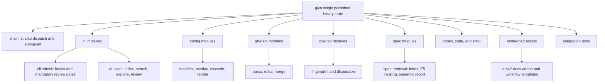

# 5. Building Block View

## 5.1 Level 0 — System

`givn` is a single published binary crate. It reads embedded defaults and the
project's `givn/` directory, and writes artifacts and agent files.

## 5.2 Level 1 — Crate structure

## 5.3 Module responsibilities

| Module | Responsibility | Key collaborators |
| --- | --- | --- |
| `main.rs` | Parse args, dispatch to `cli::*`, map errors to exit codes. | `cli`, `error` |
| `cli::init` | Scaffold `givn/`, write minimal `config.yaml`, prompt for the agent-target selection (default opencode) and persist it as the `skills:` block, generate skills to the selected targets. | `config`, `skills` |
| `cli::new` | Create `givn/changes/<id>/` scaffold (proposal stub). Calls the shared `resolve_change_dir` helper to validate `<id>` (kebab-case) and construct the path before any filesystem write; resolves the proposal template via the cascade; writes only `proposal.md`. | `config::cascade`, `state` |
| `cli::instructions` | Resolve an artifact's instruction (cascade) and emit (optionally `--json`); `specs` is the canonical source for E2E authoring policy. | `config::cascade`, `config::manifest` |
| `cli::lint` | Statically check `.feature` files (syntax, `@wip`, delta tags) plus the tree-wide overlap scan; produce exit codes 0/1/3/2. Runs no tests. `--json` emits findings machine-readably. | `gherkin::parse`, `overlap::analysis` |
| `cli::check` | Run an artifact's `post` hooks and mandatory review checks, including structural overlap, the dedicated E5 semantic report/remediation gate, and the existing strict embedding-similarity gate when `spec-similarity-gate` is compiled. `spec-retrieval` alone provides retrieval but does not enable the strict gate. Without retrieval it returns the existing unavailable error rather than passing or writing a report. | `hooks`, `config::manifest`, `overlap::analysis`, `spec::retrieval` |
| `cli::status` | Report manifest-aware lifecycle state: artifact checklist, current stage, next required step, optional pending steps. `--json` for machine use by commands. | `state`, `config::overlay` |
| `cli::archive` | Run hooks of all `apply.requires` artifacts as the gate; merge deltas into `givn/specs/`, run post-merge verify and verify-e2e gates, optionally run coverage, move the change, then refresh the retrieval index. | `hooks`, `gherkin::merge`, `coverage_gate`, `spec::retrieval`, `config::manifest` |
| `cli::coverage_gate` | Archive-level coverage pipeline: run the project measurement and merge commands, validate source and merged Cobertura XML, update README badges/summary, and restore all changed files on failure. | `cobertura`, `agents_block`, `config::manifest` |
| `cli::eject` | Write an embedded default facet into the project `givn/`. Uses the effective manifest so addon artifacts (e.g. `arc42-docs`) are ejectable once enabled. | `config::embedded`, `config::cascade`, `config::overlay` |
| `cli::addons` | List all known addons with enabled/disabled status; enable or disable an addon by writing the `addons:` key into `givn/config.yaml` (line-based edit, preserves comments). | `config::overlay` |
| `cli::skills` | Regenerate skills + agent commands from current templates. | `skills` |
| `cli::spec` | Build, search, explore, or review the local permanent-only scenario index; exploration can add request-local current-change candidates, while `spec review --change` remains the existing advisory path and never creates the semantic report. | `spec::retrieval`, `gherkin::parse`, `state` |
| `cli::upgrade` | Re-render managed config scaffolding, preserve user overrides, bump `givn_config_version`. | `config::manifest`, `config::embedded` |
| `cli::missing_testrunner` | Default sentinel `verify.command`: print per-language setup guidance, exit non-zero. | — |
| `config::embedded` | Read-only access to compiled-in assets. | `rust-embed` |
| `config::manifest` | Serde model of the manifest (artifacts incl. `optional`, `post` hooks, deps, apply, verify, and project-owned coverage commands); validates the effective graph (acyclic, no dangling `requires`). | `serde_yaml_ng` |
| `config::overlay` | Apply the project overlay (add/deep-merge/`remove`) to the embedded default graph; reorder via `requires`; expand `addons:` (e.g. `arc42`) into their artifact definitions. Also exposes `load_skills_targets()` — reads the `skills:` block from `givn/config.yaml` (ignored by the manifest itself). | `manifest`, `embedded` |
| `config::cascade` | For `(artifact, facet)`, return project file or embedded default. | `embedded`, project FS |
| `config::render` | Render the fully-commented, versioned `givn/config.yaml`; merge-preserve user overrides on upgrade. | `embedded`, `manifest` |
| `gherkin::parse` | Parse `.feature` into a typed AST; classify lint findings. | `gherkin` crate |
| `gherkin::delta` | Detect `@givn.*` tags; split features/scenarios. | `parse` |
| `overlap::analysis` | Tree-wide scenario-overlap analysis: title duplicates (hard error), shape matches, subsets, long scenarios; the review disposition gate and net-delta receipt. | `gherkin::parse`, `gherkin::delta`, `overlap::fingerprint`, `overlap::disposition` |
| `overlap::fingerprint` | Deterministic scenario fingerprint: masked assertion sequence + extracted facts (exit code, contains polarity, data tables, `[DONE]`, TTY). | `gherkin` crate |
| `overlap::disposition` | Parse review.md disposition and split-or-keep tables. | — |
| `gherkin::merge` | Apply added/modified/removed to permanent spec; strip tags. | `delta`, `parse` |
| `skills::render` | Render templates with context into SKILL.md; workflow skills choreograph canonical artifact instructions instead of restating their policy. | `config::cascade` |
| `skills::targets` | Write rendered output to the configured skill locations (`skills.targets` in config; default opencode) + `.opencode/commands/` when opencode is selected. `AGENTS.md` is intentionally not touched (user-owned). | `render`, `config::overlay` |
| `spec::retrieval` | Embed scenario text, persist permanent content-hash/vector entries, rank interactive and complete-scenario queries, collect request-local active deltas, apply lifecycle identity filters, keep the existing advisory review entrypoint separate, generate the change-local E5 semantic report, and verify projected remediation for prior classifications. | `fastembed`, `gherkin::parse`, `gherkin::delta`, `overlap::fingerprint`, `state`, project FS |
| `hooks` | Resolve `post` hook entries (built-in `verify`/`lint` or shell), execute them with `GIVN_FEATURES` set, stream output, map failures to gate-blocking exit codes (respecting `allow_failure`). Uses the shared `find_change_dir` from `state` for task cross-reference. | `config::manifest`, `cli::lint`, `state` |
| `state` | Compute change state from which files exist. Also houses shared utilities: `validate_id` (kebab-case validation), `resolve_change_dir` (validated path construction), and `find_change_dir` (component-based change directory detection from a features path). | project FS, `manifest` |
| `error` | Typed errors; map to process exit codes. | `thiserror` |

### 5.5 Repository-owned acceptance blocks

The Gherkin runner's test-support layer contains two explicit pieces for the
repository-ownership fixture capability: CLI E2E bindings and shared
temporary-project helpers. They are test-system building blocks, not production
CLI modules, and invoke the compiled binary through the existing test
environment seam.

## 5.4 Dependencies (crates)

| Crate | Use | Version (verified) |
| --- | --- | --- |
| `clap` | CLI parsing | 4.6 |
| `clap_complete` | Shell completion script generation (bash/zsh/fish/…) | 4 |
| `serde` + `serde_yaml_ng` | Manifest (de)serialisation | serde 1, serde_yaml_ng 0.10 |
| `rust-embed` | Embed default assets | 8.12.0 |
| `gherkin` | Parse `.feature` files | 0.16 |
| `anyhow` | Application error context | 1.0 |
| `thiserror` | Library error types | 2.0 |
| `serde_json` | `--json` output | 1 |
| `fastembed` | Optional local E5 embeddings for `spec::retrieval`; default features disabled, with Rustls Hub download and ONNX Runtime support. Transitive native/runtime dependencies are feature-gated with retrieval. | 5.17.2 |

Versions are pinned in `Cargo.lock`. The dep-age policy (`scripts/check-dep-age.sh`) enforces that every locked dependency is ≥ 30 days old (TC-13).

### 5.3a Permanent exploration additions

`cli::spec` exposes the `explore` option set and rejects missing or conflicting
input sources before dispatch. `spec::retrieval` parses the complete query,
reuses unchanged permanent vectors through the existing content hashes, ranks
all permanent entries, and renders the advisory text/JSON contract. The exact
identity filter is `(normalized file, scenario title)` and is applied only for
file queries. All permanent, delta-source, projected-target, and query file
identities use one project-relative forward-slash normalization helper that
accepts relative and absolute paths.

The repository-owned acceptance layer adds one capability module for regular
steps and one separate module for e2e CLI steps. Both invoke the compiled
binary; neither calls production retrieval functions in-process.

### 5.3b Current-change exploration additions

With `--change`, `cli::spec` passes the validated change identifier to
`spec::retrieval`. Retrieval validates the change and parses its delta files
before refreshing the permanent index. It collects only active added and
modified scenarios, retains the delta source and projected permanent target
identities, and embeds their text in memory for the current request. Removed
scenarios and rejected requests never enter the candidate pool. The result
record adds `scope` and `change` after the existing JSON result fields, while
the text renderer identifies the source for both permanent and current-change
records.

### 5.3c Semantic review report additions

The blocking `check review` path calls a dedicated report gate after structural
overlap and before the existing feature-gated retrieval path completes.
`spec::retrieval` collects only active `Added` and `Modified` scenarios from the
requested change, including `Rule:`-nested scenarios, compares them with
permanent entries and with other active deltas in that same change at E5
`0.9500`, and excludes removed and permanent-permanent pairs. A Modified
scenario excludes only its own projected target identity; other scenarios in the
target file remain candidates. The report is change-local while active and is
retained by the existing archive move; delta vectors, classifications, and
report state are never persisted in the permanent index.

The report uses the existing E5 cosine evidence and the public deterministic
`overlap::fingerprint` facts model. Candidate identity, endpoint identities,
content hashes, complete evidence hashes, candidate order, score formatting,
strict prior parsing, and classification carry-forward are deterministic. The
complete endpoint representation orders feature `Background`, applicable `Rule`
`Background`, and scenario steps, retaining every docstring and data-table row
and cell in source order. The report has an exact fixed-header/field-order
grammar, compact JSON serialization, `null` as its only absent value, one final
newline, no unknown fields, and no timestamps or environment values. A binary
without `spec-retrieval` returns the existing unavailable error and does not
create a report. If the permanent index is malformed or incompatible, refresh
treats it as stale, rebuilds a permanent-only index, and continues the report
gate without Delta state in the rebuilt index. Regular acceptance bindings
exercise the filesystem boundary; the single E2E scenario invokes the compiled
CLI subprocess and treats its exit status and report output as primary evidence.
No new runtime or test dependency is introduced.

### 5.3d Semantic remediation additions

The remediation verifier introduces prior-entry and projected-endpoint records
inside `spec::retrieval`. It recomputes a prior pair independently of report
candidate admission, so removal and below-boundary transitions remain
verifiable. `DUPLIKAT` requires removal of the redundant endpoint, `VARIANTE`
requires one parameterized `Scenario Outline` with a non-empty `Examples`
table, and `VALID-BOUNDARY` requires a changed deterministic observable fact or
explicit condition/outcome invariant plus a score strictly below `0.9500`.
