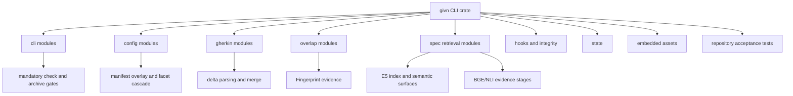

# 5. Building Block View

## 5.1 Level 0 - System

`givn` is one Rust CLI crate. It reads embedded defaults and project-local
configuration, changes lifecycle artifacts, invokes configured commands at gate
points, and optionally uses local retrieval/model artifacts.

## 5.2 Level 1 - Crate Structure

## 5.3 Production Responsibilities

| Building block | Responsibility |
|---|---|
| `main.rs` | Parse `clap` commands, dispatch, and map results to process exit. |
| `cli::init` | Create `givn/{specs,changes,archive}`, write config and commands scaffolds, enable addons unless `--no-addons`, prompt agent targets, and sync outputs. |
| `cli::new` | Validate change id, create a change directory, scaffold proposal unless skipped, and write `.givn-skip` when requested. |
| `cli::instructions` | Resolve effective artifact instructions and optional JSON metadata; provide context-aware generic guidance without an artifact id. |
| `cli::lint` | Parse features, report WIP/PENDING, and run the default tree-wide overlap scan with exit precedence 1, 3, 2, 0. |
| `cli::check` | Run explicit mandatory checks for tasks/review and configured post hooks; named review also runs overlap/retrieval gates. |
| `cli::archive` | Check archive prerequisites, run configured hooks, run retrieval review when compiled, merge deltas, run post-merge verification/e2e, run optional coverage, and copy/remove the change to archive. |
| `cli::status` and `cli::graph` | Render manifest-aware filesystem state, dependencies, optional flags, gates, and hooks. |
| `cli::eject` | Materialize an embedded facet, skill, or manifest into project-owned `givn/` content. |
| `cli::addons` | Toggle addon flags; Arc42 enable scaffolds fixed `docs/arc42/` files without overwriting existing files. |
| `cli::skills` | Synchronize selected skill targets and opencode commands. |
| `cli::upgrade` | Refresh managed config comments, preserve uncommented overrides, and dispatch the exact legacy migration preparation route. |
| `cli::migration` | Preflight Git state, calculate the managed-path allowlist, create the two commits, and write the 0.2.0-to-0.3.0 maintenance plan. |
| `config::manifest` | Define artifact, apply, verify, coverage, addon, and hook data structures. |
| `config::overlay` | Apply `givn/config.yaml` and then `givn/commands.yaml`, expand Arc42, and validate graph references/cycles. |
| `config::cascade` | Resolve project override assets before embedded core or addon assets. |
| `gherkin::parse` | Parse feature files, collect WIP and E2E tags, and recursively collect `.feature` paths. |
| `gherkin::delta` | Interpret delta tags, operation defaults, and capability identity. |
| `gherkin::merge` | Validate all delta preconditions and merge text-level scenario blocks into permanent specs. |
| `overlap::fingerprint` | Produce masked assertion sequences and best-effort exit/contains/table/DONE/TTY facts. |
| `overlap::analysis` | Find title duplicates, shape matches, subsets, long scenarios, dispositions, and net-delta receipts. |
| `hooks` | Execute configured hooks with `GIVN_FEATURES`; built-in hook names are resolved and cannot be made allow-failure. |
| `integrity_hook` | Check commit-hash/task evidence, promised step-definition files, Arc42 affected-file edits, and coverage configuration. |
| `state` | Derive status from artifact paths, markers, skip files, and the manifest graph. |
| `spec::retrieval` | Build/read the permanent E5 index, serialize complete scenarios, run Explore/review/audit surfaces, apply BGE/NLI evidence, generate semantic reports, and verify remediation. |

## 5.4 Retrieval Building Block

`spec::retrieval` has one persistent boundary: `.spec-index.json` contains
permanent vector entries and additive E5 cap metadata. Active-delta vectors,
audit-only evidence, classifications, and semantic report state are not
persisted there.

`givn spec duplicates` is an exception to ordinary index refresh: it reads the
persistent index and reuses it only when every endpoint identity and complete
content hash matches. Otherwise it embeds fitting current permanent scenarios
transiently. It never writes the index as part of the audit.

The current second-stage implementation is surface-aware. Duplicate Audit BGE
uses its endpoint top-five union while Duplicate Audit NLI uses the full E5
semantic candidate set. Blocking semantic review passes its complete report
candidate list independently to BGE and NLI; it does not pass a Duplicate Audit
top-five pool.

## 5.5 Dependencies

| Dependency | Use |
|---|---|
| `clap`, `clap_complete` | CLI parsing and shell completion |
| `serde`, `serde_yaml_ng`, `serde_json` | Manifest, config, index, and machine-readable output |
| `gherkin` | Feature parsing and AST access |
| `anyhow`, `thiserror` | Application context and typed errors |
| `rust-embed` | Embedded defaults and addon assets |
| `quick-xml` | Cobertura coverage parsing |
| `fastembed`, `ort`, `tokenizers`, `ndarray` | Optional local E5/BGE/NLI retrieval and inference |

## 5.6 Repository-Owned Acceptance Blocks

The Cucumber test binary contains regular step modules and separate compiled-CLI
E2E step modules. They invoke the public binary in temporary project roots.
They are test building blocks, not production modules, and are intentionally
owned by this repository.
