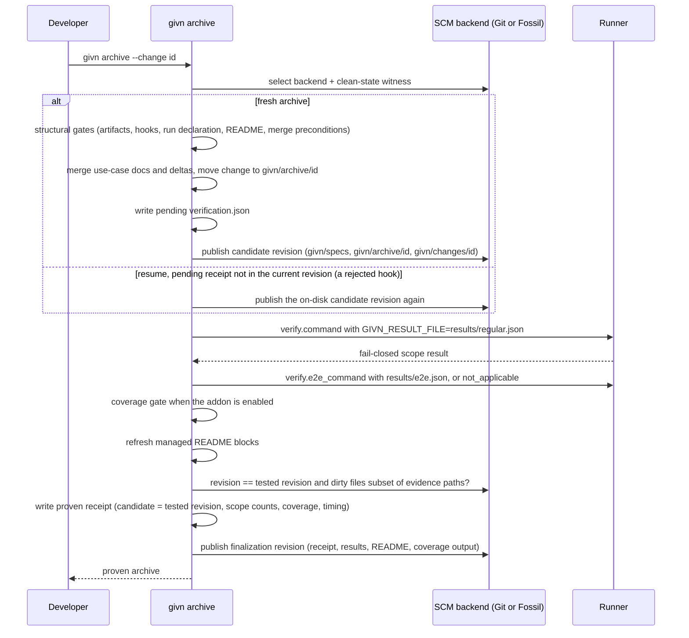
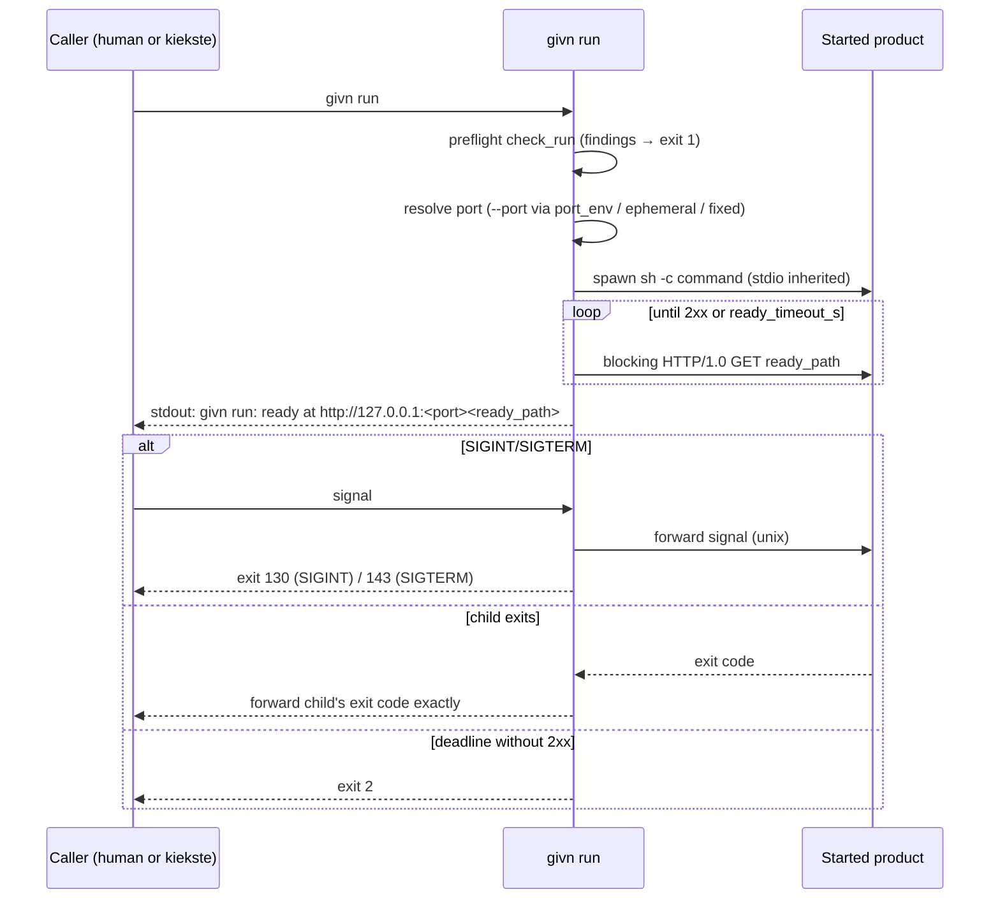
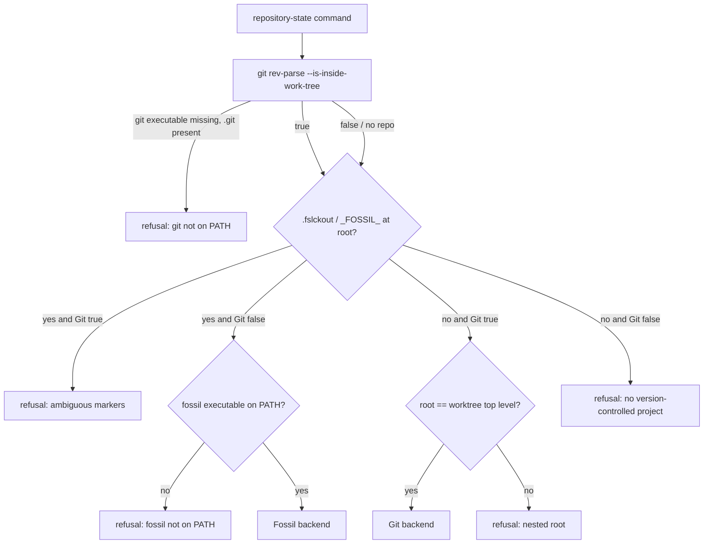

# 6. Runtime View

This chapter records the runtime order implemented by the current checkout. It
distinguishes manifest-driven hooks from binary mandatory checks.

## 6.1 `givn init`

The sequence is:

1. Resolve the current working directory as the project root.
2. Create `givn/specs`, `givn/changes`, and `givn/archive`.
3. Write `givn/config.yaml` from the embedded, versioned scaffold unless the
   file already exists and `--force` is absent.
4. For a newly written config, read the agent-target selection. Empty input or
   EOF selects `.opencode`; recognized selections are `.opencode`, `.agents`,
   and `.claude`. The selection is appended as `skills.targets`.
5. Write `givn/commands.yaml` from the embedded project command template unless
   it already exists and `--force` is absent. The current template contains
   `./run-tests.sh`, `./run-tests.sh --e2e`, and coverage script/path entries.
6. Unless `--no-addons` is set, enable every registered addon. In the current
   registry this scaffolds Arc42, manages the Absolute Mode fenced block, may
   scaffold README content, and enables other registered extras.
7. Synchronize skills and opencode commands to the selected targets. The sync
   updates only givn-owned fenced blocks in `AGENTS.md` and leaves all other
   content unchanged.
8. Materialize the checked-in commit-attribution hook and, when a Git worktree
   exists, install or refresh the local dispatcher without replacing an
   existing `commit-msg` hook.

The embedded default manifest has addon flags disabled, but initialized projects
normally receive enabled addon settings because the current `init` command
enables them. Existing Arc42 files are not overwritten by addon scaffolding.

## 6.1a Commit attribution

The commit flow is:

1. An OpenCode or Claude Code integration provides optional attribution values
   to the shell process that invokes Git.
2. Git resolves the committer identity from that process environment and starts
   the commit operation.
3. The local dispatcher runs an existing `commit-msg` hook first, preserving its
   failure result.
4. The checked-in Givn hook invokes the attribution stamper after the existing
   hook succeeds.
5. The stamper appends the managed `Co-Authored-By` line and normalized Givn
   trailers when context exists. Missing context or stamper errors leave the
   user's message and successful commit path unchanged.
6. Git writes the commit object with the available committer identity and final
   message.

Model and harness changes update only the next agent shell's process-scoped
values. No model selection is written to project configuration.

The OpenCode path is ordered as follows: `chat.message` may receive the
selected model and variant, then `chat.params` receives the selected model
under its required `model` object and caches its provider/model identity by
session; OpenCode then invokes `shell.env` for a shell execution; the plugin
looks up the same session and returns the existing Givn environment protocol.
If the payload has no usable model, the harness marker remains available and
the missing attribution fields retain their best-effort fallback behavior.

The Claude path is ordered as follows: Claude invokes the generated
PreToolUse Bash hook with a Bash command and `transcript_path`; the Givn
attribution command reads the latest assistant transcript entry and extracts
its model; it exports the attribution environment for the complete command;
and Claude executes that updated command. The environment therefore survives
compound commands and shell wrappers such as RTK until Git invokes the shared
hook. If the transcript is missing, unreadable, or has no model, the command
uses the existing environment fallbacks and remains non-blocking.

Initialization and managed upgrade output explicitly reports the shared hook,
local activation result, and selected agent integrations. Managed upgrades
stage the Claude settings entry alongside the other attribution paths so the
retrofit is represented in the upgrade commit.

## 6.2 `givn new <change-id>`

1. Validate the id as non-empty ASCII lowercase letters, digits, and hyphens,
   with no leading or trailing hyphen.
2. Resolve `givn/changes/<id>` through the shared path helper.
3. Reject an existing directory or an uninitialized `givn/` directory.
4. Validate any `--skip` ids against the effective manifest.
5. Create the change directory and write `proposal.md` from the cascade unless
   `proposal` is skipped.
6. If requested, write `.givn-skip` with one skipped artifact id per line.

The proposal template is written verbatim; no change-id substitution is
performed. A leading-hyphen argument supplied without `--` can be rejected by
`clap` before the shared validator, while `givn new -- -foo` reaches the
validator.

## 6.3 `givn instructions`

With an artifact id, the command loads the effective manifest, validates the
artifact, resolves its instruction through the project-overrides-first cascade,
and prints either the text or one JSON object containing `id`, `generates`,
`requires`, and `instruction`. An id that is not a manifest artifact falls back
to the same instruction cascade: a resolvable policy instruction (`dialog`) is
served with empty `generates` and `requires` arrays, an unresolvable id keeps
the existing unknown-artifact error. A sole active change is auto-selected when
no `--change` is given; multiple active changes require an explicit id.

Without an artifact id, the command reports context-aware generic guidance from
the project state. It does not create lifecycle artifacts. When the readme
addon is enabled and the README check reports findings, both report paths
append one text-only status line naming `givn readme check` and the finding
count; the JSON report shape is unchanged.

## 6.4 `givn lint`

`givn lint` parses feature files and runs no project tests. Its default scope is
all `.feature` files below `givn/`, excluding `givn/archive/`. `--change` scopes
to that change's specs directory; explicit paths are used as supplied.

For each parsed file it reports `@wip` and `PENDING`. Removed placeholders are
excluded from the WIP result. The default whole-tree scope additionally runs
the deterministic overlap scan:

- duplicate active scenario titles are errors and produce exit code `3`;
- shape matches, assertion subsets, and scenarios over 14 steps are warnings;
- parse errors produce exit code `1`;
- WIP/PENDING produces exit code `2`.

Precedence is parse error `1`, duplicate title `3`, WIP `2`, then clean `0`.
JSON output is a findings array; it is not test-runner output.

Every finding is classified as `advisory`, `finding`, or `blocking` from one
mapping table; the prose output appends the severity after the existing short
label, and the JSON output carries a `severity` field. The classification is
descriptive: the existing exit-code flags still drive the exit code, so an
advisory-only run exits 0.

The default whole-tree scope additionally scans change seeds under
`givn/ideation/*/changes/*.md` for status hygiene. A missing or unrecognised
`Status:` line, a `proposed by` change that does not exist, and a
`proposed by` change that is already archived are reported on stderr with the
`[SEED ]` label. The findings are advisory: they are counted in the summary's
finding count but never change the exit code. The seed scan is a no-op without
`givn/ideation/`, and explicit paths keep their current scope without seed
advisories.

Persona references in active change use-case documents and ideation use cases
are scanned against `givn/personas/` and every topic's `personas/`. A dangling
reference is reported on stderr with the `[PERS ]` label; the finding is
advisory and never changes the exit code. Forward references during an active
ideation topic stay quiet, and the persona scan runs in both the default and
`--change` scopes.

## 6.5 `givn status` and `givn graph`

Both commands load the effective manifest and derive state from the change
filesystem. `status` opens with the selected backend line (`SCM: git`,
`SCM: fossil`, or `SCM: none` with the unavailable note) and reports artifact
paths, task checkbox progress, sign-off markers, optionality, next required
artifact, and skipped artifacts. `graph`
adds dependency edges, archive-gate flags, and configured post-hook names.

The state rules are:

- a generated path is required for an artifact to exist;
- `tasks.md` is complete only when all recognized `[ ]`, `[x]`, and `[X]`
  checkboxes are done;
- `design-review.md`, `review.md`, and `arc42.md` use their respective marker
  strings for completion;
- `.givn-skip` makes a named artifact `Skipped`;
- `apply.requires` identifies archive-gating artifacts.

## 6.6 `givn check`

The command resolves command and coverage settings from the effective manifest.
The current project obtains them from `givn/commands.yaml`, which is applied as
the later overlay after `givn/config.yaml`.

### Explicit artifact check

For `givn check tasks`, the binary runs the non-configurable mandatory checks:

1. For a change delta, reject non-removed scenarios that still have `@wip`.
2. Run `verify.command` with `GIVN_FEATURES` set to the active change specs.

For `givn check review`, it runs:

1. The integrity hook for task revision identifiers, promised files, enabled Arc42 or
   coverage checks, and — when `design.md` declares a visual interface — the
   visual verdict, the persona disposition, the final-state and per-state
   evidence, and the operator decision for any recorded deferral.
2. The deterministic run-declaration check.
3. For a named change, the overlap disposition gate.

The visual gate reads the `## Visual Design Contract` section from
`design.md`; an absent section or `Interface: none` exempts the change. For a
declared `web` interface it requires a committed final-state screenshot for
every delta `@e2e` scenario at each declared viewport, plus one
`<viewport>--<state>.png` for every state the contract declares; for
`terminal` it requires a committed transcript per scenario. A declared visual
interface also requires a `PERSONAS:` line in `review.md` naming at least one
confirmed Persona whose value resolves to `givn/personas/<id>.md`; a reasoned
`none` is valid only for a change without a user-visible surface. `review.md` must carry `VISUAL-REVIEW: PASS`;
`VISUAL-REVIEW: UNVERIFIED` fails until a human resolves it. A `DEFERRAL:`
line anywhere in `review.md` requires a matching `OPERATOR-DECISION:` record.

Review does not execute `verify.command` or `verify.e2e_command`. Scenario
execution is proven once per archive by the verification receipt; review
inspects the static artifacts and the fabrication audit instead.

These mandatory checks are in `src/cli/check.rs` and cannot be removed by
removing a `post` entry. Built-in hook names also ignore `allow_failure` when
they are configured in a post list.

The `verify-e2e` built-in used by configured post hooks skips only when its
sentinel is effective, there are no direct `@e2e` scenarios in scope, and
`tasks.md` contains no E2E intent. If the sentinel is effective while E2E is
present or planned, it fails. The archive E2E scope applies the same sentinel
rule when deciding that the scope is not applicable.

### No artifact argument

`givn check` without an artifact runs only configured `post` hooks for applicable
outputs. It does not invoke the explicit `tasks` or `review` mandatory-check
branch. With the embedded default manifest, standard post lists are empty.

## 6.7 `givn archive --change <id>`

The archive is forward-only and runs in two published stages against the
selected backend (a Git worktree or a Fossil checkout), using the state model
below:

| Archive directory state | Meaning | Command behavior |
|---|---|---|
| absent | no publication yet | fresh archive |
| present, no receipt | pre-receipt legacy archive | refuse: already archived |
| receipt `status: pending` | unproven candidate | resume verification |
| receipt `status: proven` | proven archive | refuse: already proven |

Stages:

1. Validate the change id, select the backend through the SCM seam (no usable
   backend, or a project nested below the checkout root, is refused by name),
   and read the archive provenance.
2. Clean-state witness: files the selected backend would not publish block the
   archive by name (Git untracked files and Fossil `EXTRA` entries included),
   except the declared evidence paths (the target archive directory,
   `README.md`, and the configured coverage paths), which keep a failed attempt
   resumable.
3. Fresh only — structural gates before any mutation: `apply.requires`
   completeness, configured archive hooks, the run-declaration gate, the
   README completeness gate, use-case and delta prevalidation, and the
   e2e-runner configuration check. An `@e2e` merge with an unconfigured
   `verify.e2e_command` blocks here, leaving the change active.
4. Fresh only — merge and publish the candidate: parse and merge every delta,
   merge use-case narratives, copy the change directory to `givn/archive/<id>/`,
   remove the active directory, write the pending receipt, and publish exactly
   those paths as the candidate revision. A rejected publication is reported as
   an unproven, repairable state; on resume the merged on-disk state is
   published again instead of assuming the merge is committed.
5. Verification against the published candidate revision: the regular scope
   (`verify.command`) and the E2E scope (`verify.e2e_command`, only when merged
   permanent specs contain `@e2e`; otherwise `not_applicable`) each run once
   and must write a reconciling runner result with scenarios, no failures, and
   no skips.
6. Coverage when enabled: measure, validate, and publish once against the
   candidate, with no backup or rollback path.
7. Finalization: refresh managed README blocks, verify that the current
   revision still equals the tested revision and that every dirty path is a
   declared evidence path, write the proven receipt, then publish the
   evidence-only finalization revision.

Any failure after the candidate publication leaves the candidate unproven in
place and prints the forward-repair instruction (`givn archive --change <id>`
after repairing the committed state). Archive's checks are hard-coded in
`src/cli/archive.rs`; they are not configurable artifact `post` hooks, and
archive does not call the explicit `check review` mandatory branch.

## 6.12 Addons, Upgrade, and Completion Commands

`givn addons list` reads enabled flags from `givn/config.yaml`. `enable arc42`
sets the flag, scaffolds missing fixed-path chapter files, and expands the
effective graph; `disable arc42` leaves existing docs in place. The same
commands manage other registered addon flags.

`givn skills sync` resolves the selected targets, writes generated skills and
opencode commands, refreshes the `givn-project` block, and applies/removes the
Absolute Mode block according to its addon flag. `givn upgrade` rewrites the
managed config scaffold, preserves uncommented user blocks, and auto-enables
newly known addons not represented in the old config.

`givn completions <shell>` writes no project files and prints a shell completion
script to stdout.

## 6.13 `givn upgrade` and declared migration bundles

The command selects a declared migration path from the active config marker to
the installed package version. It first selects the project's version-control
backend through the SCM seam (section 6.16) and verifies that the checkout is
clean on that backend; a dirty checkout or a missing backend executable is
refused before any file changes. Managed staging records exactly the
calculated allowlist on both backends — `git add [-f]` on Git, `fossil add
[--force]` on Fossil — and the managed and plan revisions are committed
through the same seam. A failed preflight returns before changing any project
file.

The command then refreshes `givn/config.yaml`, backfills the `run:` scaffold
into `givn/commands.yaml` when the file exists and has no top-level `run:` key
(idempotent; a project that already declares `run:` produces no diff), and
synchronizes generated skills, commands, and Givn-owned `AGENTS.md` blocks. It
stages an explicit allowlist — including `givn/commands.yaml` for the backfill —
never a complete directory or worktree, and creates one managed commit when
files changed. The backfill application reports
`wrote run: scaffold to givn/commands.yaml — fill it in; givn archive is
blocked until you do`. If the catalog returns one or more bundles, the command
then writes one aggregate `givn/changes/<aggregate-id>/` with Proposal, Design,
`migration.yaml`, and `.givn-skip` for `specs`; its Design records the managed
commit hash and all bundle phases in order. A second commit contains only that
aggregate plan. A gap with no declared route creates no migration change.

An existing active or archived migration plan is reported and never
overwritten. The generated plan contains no product feature delta and no
fabricated design-review, task, implementation, or review evidence. The
project LLM must continue the normal workflow and archive the maintenance plan
once its inventory is complete and every deviation names a follow-up change
or an in-flight one; the follow-up changes carry the repairs through the
normal gates.

At archive time, a maintenance change whose `.givn-skip` lists `specs` has no
delta to merge. Its verification scopes run against the permanent project
feature path, and its candidate commit contains only the moved change
directory and the pending receipt. Tasks, review, and all other archive gates
remain required.

## 6.14 Repository-Owned Acceptance Flow

The Cucumber test binary creates an isolated temporary project, invokes the
compiled CLI, captures exit status and stdout/stderr, and performs secondary
filesystem assertions. Review/archive success cases assert the CLI receipt
first. Failure cases assert the unproven candidate and its pending receipt
survive the failure. No consumer
repository or external service participates. The `ready_fixture` test target
plays the started product in `givn run` scenarios: it binds a port, answers a
readiness path, and can self-exit, fail early, answer failure forever, or trap
signals into a marker file.

## 6.15 `givn run`

`givn run [--port <n>] [--print]` executes the product declared by the `run:`
block of `givn/commands.yaml`:

A library product prints that there is nothing to start and exits 0. `--print`
resolves the plan without spawning: it emits one sh-eval-able line
(`PORT=<port> <command>` when `port_env` is set, else `<command>`) and exits 0.
An ephemeral port is allocated by binding `127.0.0.1:0`, reading the port, and
dropping the listener before spawn. Signal forwarding is unix-only; on other
platforms a server product is refused at preflight with exit 1.

## 6.16 SCM backend selection

Every repository-state command starts by asking one selection seam which
version-control backend owns the project root. Both marker kinds are probed
before deciding, so an ambiguous root is never silently resolved:

Selection probes, and all refusals return, before any file is written. The
fixed order is Git worktree, then Fossil checkout; both markers at the root are
an ambiguity refusal, and an ancestor Fossil marker is ignored. A Git project
whose root is nested inside a larger worktree is refused by name (TC-32). The
Git backend exposes clean-state witness, revision identity, scoped staging, and
scoped commit operations; the managed upgrade consumes them. The Fossil backend
exposes the clean-state witness (including `EXTRA` entries), revision identity,
witness-bounded publication, allowlist staging, and revision-content checks;
the archive and the managed upgrade consume them (section 6.13).

## 6.17 `givn spec route`

The command ranks capability-routing candidates against the permanent corpus
and reports a confidence verdict. Scoring weights ownership evidence above
lexical overlap: command-surface invocations, structural tokens, the owning
use case's Goal and Rules text, and the capability's interaction consumer
actions; a candidate with no goal ownership and no command overlap has its
score halved (the scatter penalty).

Confidence rules, in order: no candidates reports no signal; a top-two tie
within `0.01` reports no signal; a top score at or above the extend bar
(`3.0`) reports signal; otherwise the new-use-case path reports signal only
when a unique top use-case affinity reaches the floor (`2.0`), and no signal
on a tie or below the floor. A no-signal report prints the reason and omits
the ranked list, so the output never presents ranking noise as a
recommendation. The recorded decision in the proposal remains the
declaration; the command stays advisory.
