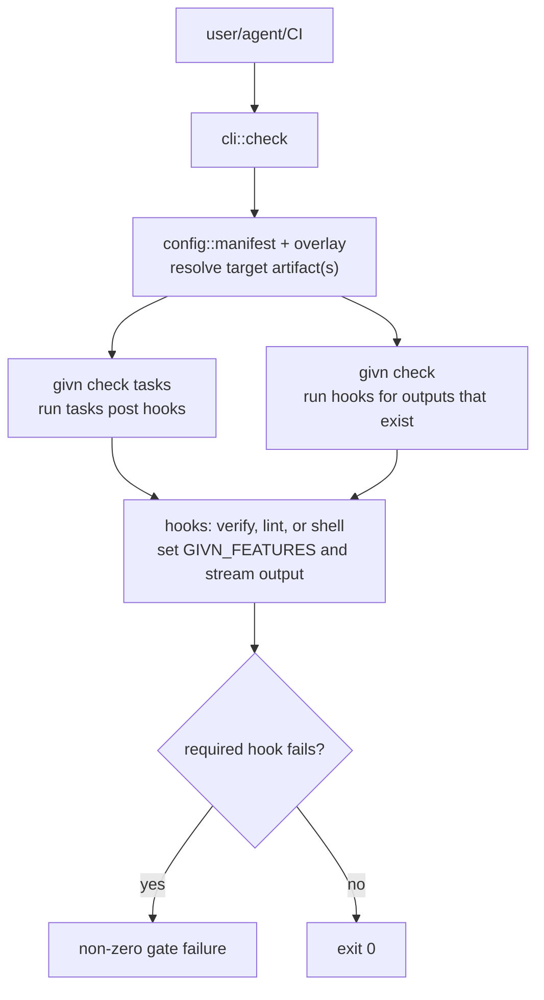
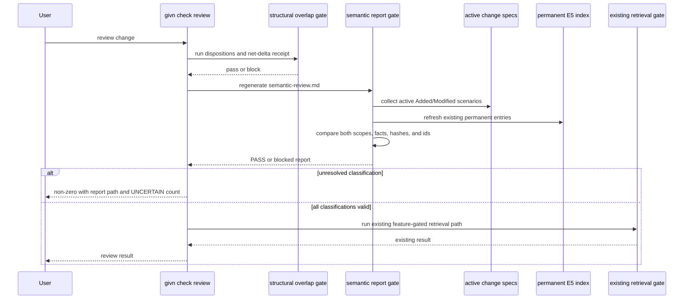
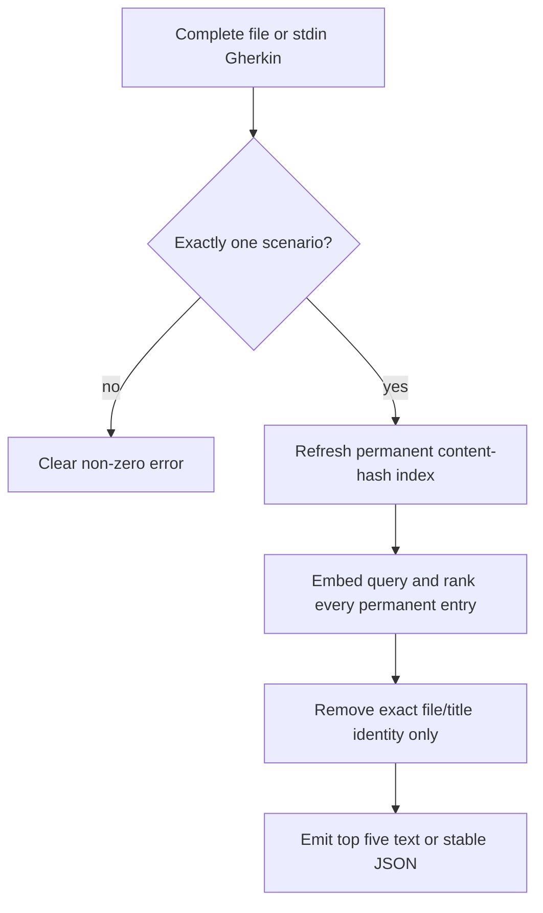
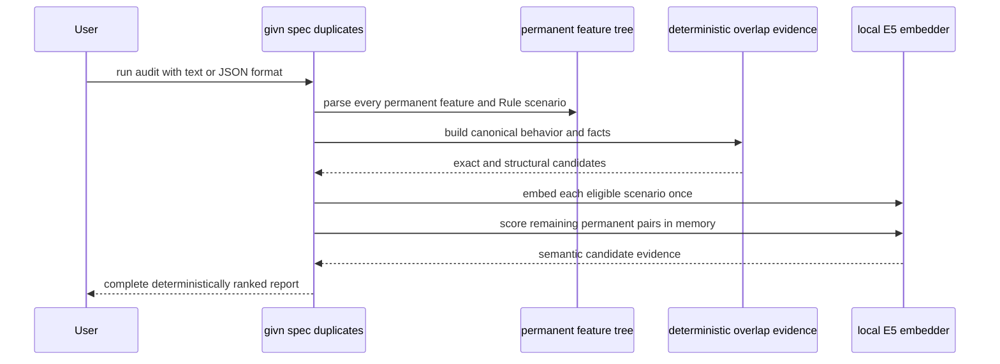
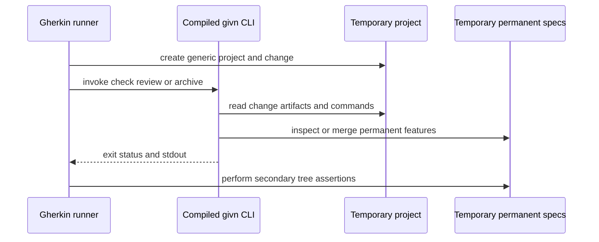

# 6. Runtime View

Key runtime scenarios. Each shows the flow through the building blocks of
chapter 5.

## 6.1 `givn init`

The runtime sequence is:

1. `user` invokes `cli::init`, which detects the project root (`cwd`).
2. Create the `givn/` skeleton: `specs/`, `changes/`, and `archive/`.
3. `config::render` writes the documented, versioned `givn/config.yaml`:
   - Every key is present but commented, with its description, default, and
     allowed values.
   - `verify.command` is uncommented as the sentinel `givn missing-testrunner`.
   - `givn_config_version` is set to the current binary version.
4. When `config.yaml` is (re)created, prompt for agent targets using a
   multi-select list (`opencode`, `.agents`, `.claude`; default `opencode`) and
   persist the selection as the `skills:` block. Non-interactive EOF uses the
   default. Re-initialization with an existing config skips the prompt and keeps
   the selection.
5. `skills::render` and `skills::targets` write each skill template only to the
   configured targets (default: `.opencode/skills/`), and write each command
   template to `.opencode/commands/` only when `opencode` is selected.
   `AGENTS.md` is intentionally not touched because it is user-owned.
6. Print next steps, including "set verify.command to your test runner".

Idempotent: existing files are not overwritten unless `--force`.

## 6.2 `givn new <change-id>`

The runtime sequence is:

1. `user` invokes `cli::new` and validates the id:
   - It is non-empty.
   - Every character is an ASCII lowercase letter, digit, or hyphen; uppercase
     letters, underscores, spaces, dots, and non-ASCII characters are rejected.
   - It does not start or end with a hyphen.
   - A leading-hyphen id passed without `--` is intercepted by clap as an
     unexpected flag and exits 2 before this validator runs.
   - The empty string `""` is not intercepted by clap. It is a valid positional
     value, so `validate_id` runs and bails with "change id must not be empty",
     exiting 1 rather than 2.
2. Compute `change_dir = <cwd>/givn/changes/<id>`.
3. If `change_dir` already exists, bail with
   "change '<id>' already exists at <abs path>".
4. If `<cwd>/givn/` does not exist, bail with
   "givn/ not found. Run `givn init` first." The already-exists check precedes
   the not-found check; in practice, the already-exists branch is unreachable
   when `givn/` is absent because its parent cannot exist (see ch.11 TD-5).
5. Create `givn/changes/<id>/`.
6. `config::cascade::resolve_template("proposal", "proposal.md")` resolves
   the template in this order:
   - Project override `givn/artifacts/proposal/proposal.md`, if present.
   - Embedded `templates/proposal.md`.
   - Embedded `addons/proposal/template.md` as the fallback.
7. Write the resolved template verbatim to
   `givn/changes/<id>/proposal.md`. No placeholder substitution occurs, so the
   embedded template's `{{CHANGE_ID}}` heading is written literally (see ch.11
   TD-5).
8. Print:
   - `Created change '<id>'`.
   - `<absolute path to proposal.md>`.
   - `Next: fill in proposal.md, then run:` followed by
     `givn instructions proposal --change <id>`.

Only `proposal.md` is produced — no `specs/`, `design.md`, `tasks.md`, or
`review.md`. Exit 0 on success; any bail above exits 1 via the main error
mapper (clap argument errors exit 2 directly).

## 6.3 `givn instructions <artifact> --change <id> [--json]`

The runtime sequence is:

1. `user/agent` invokes `cli::instructions`.
2. `config::manifest` loads the embedded `default-manifest.yaml`.
3. `config::overlay` applies the `givn/config.yaml` overlay.
4. Resolve the artifact node, including its id, generated paths, and
   requirements.
5. `config::cascade` resolves the `instructions` facet, using the project file
   before the embedded instruction.
6. Emit the resolved instruction text, or emit exactly one JSON object
   `{id, generates, requires, instruction}` when `--json` is supplied. The
   generated paths and requirements come from the effective manifest; the
   instruction text comes from the project-overrides-first cascade. The
   instruction content is global for the artifact even when `--change` selects
   the lifecycle context.

## 6.4 `givn lint [path]`

Static check of `.feature` files. Runs **no** tests (that is the test runner,
`verify.command` — see 6.9). Default scope is the whole active tree
(`givn/specs/` + all active change deltas) **excluding `givn/archive/`**;
explicit paths and `--change` keep their scoped semantics.

The runtime sequence is:

1. `user/CI` invokes `cli::lint` and collects target `.feature` files. The
   default is the whole active tree minus the archive.
2. `gherkin::parse` parses each file:
   - A parse error is recorded and produces exit 1.
   - `@wip` or `PENDING` steps are recorded and produce exit 2.
3. In the default scope, `overlap::analysis` performs a tree-wide overlap scan:
   - A duplicate title is a hard error with exit 3. Exemptions are removed
     placeholders and exactly one modified delta versus its permanent target in
     the same capability.
   - A shape match is a warning, with a `related_scenario` hint when facts
     contradict.
   - A subset and a scenario longer than 14 steps are warnings.
4. Report findings as prose on stderr or as JSON on stdout when `--json` is
   supplied.
5. Return exit 1 if any parse error exists; otherwise return 3 if any duplicate
   title exists, 2 if any WIP finding exists, or 0 for a clean result.

Exit-code precedence: parse error (1) outranks duplicate title (3) outranks
wip (2) outranks clean (0). Warnings never change the exit code.

## 6.5 `givn status --change <id>`

The runtime sequence is:

1. `user/agent` invokes `cli::status`.
2. Load the effective manifest from `config::manifest` and its overlay.
3. Walk the artifact graph against the filesystem with `state`, deriving the
   status of each artifact.
4. Print the artifact checklist with `✓ Done`, `~ Partial`, `· Pending`, or
   `⊘ Skipped` statuses.
5. If the `tasks` artifact is `Partial`, read `tasks.md` and show its next three
   pending task lines, identified by `[ ]`.
6. Print the next required artifact and any optional pending artifacts.

`givn` tracks and reports; it does not drive the per-scenario TDD loop. That loop
is run by the agent following the instructions, invoking `verify.command` for each
RED/GREEN. givn *does* run `verify.command` at gate points via hooks — see
`givn check` (6.5b) and the archive gate (6.6).

## 6.5b `givn check [<artifact>] [--change <id>]`

Runs an artifact's `post` hooks (see ch.8.12). This is how givn executes the test
runner (`verify.command`) at gate points — e.g. after implementation and review.



For `givn check review --change <id>` the mandatory review checks run in
addition (after verify, verify-e2e, and integrity) in this order:

1. The **overlap disposition gate** requires a disposition row for every shape
   match without fact contradiction involving the change's delta and a
   split-or-keep row for every long delta scenario; the net-delta receipt
   (added/modified/removed counts) is printed on stdout.
2. The dedicated semantic report gate completely regenerates
   `givn/changes/<id>/semantic-review.md` from active added/modified delta
   scenarios. It compares only E5 candidates at or above `0.9500` in
   delta-to-permanent and delta-to-delta scopes, writes complete endpoint
   evidence and deterministic facts, carries only valid classifications whose id
   and full evidence hashes are unchanged, and blocks when any classification is
   missing, invalid, or `UNCERTAIN`.
3. With `spec-similarity-gate` compiled (which includes `spec-retrieval`), the
   existing strict similarity pass then refreshes the permanent index and fails
   on every permanent or projected delta pair at or above `0.95`. Compiling
   `spec-retrieval` alone does not enable this strict gate.

The report gate writes its complete blocked report before returning non-zero.
It does not edit feature files, permanent specs, review dispositions, or the
permanent index's candidate content beyond the existing permanent-only refresh
behavior. A malformed or incompatible index is treated as stale, rebuilt from
the permanent specifications, and followed by semantic review. The rebuilt
index is checked structurally rather than byte-for-byte and contains no `Delta`
state, delta vectors, classifications, or report state. Without
`spec-retrieval`, check review returns the existing retrieval-unavailable error,
does not falsely pass, and does not create the report. See 8.8, 8.5a, 8.5d,
ADR-037, ADR-041, and ADR-046.

The semantic report gate does not replace or suppress the existing strict
similarity gate. A `spec-similarity-gate` build runs that gate after the report
gate, so a report classification cannot override a strict-gate failure. The
semantic-report fixture matrix uses `spec-retrieval` without
`spec-similarity-gate`; the strict-gate behavior remains an existing contract.



Example: after the agent finishes `tasks`, `givn check tasks` runs the configured
test suite and confirms GREEN before review. With the sentinel default runner, it
fails loudly until `verify.command` is set.

## 6.6 `givn archive --change <id>`

The archive runtime sequence is:

1. Load the manifest and confirm that every `apply.requires` artifact is
   satisfied (`tasks` is complete and `review.md` contains `PASS`). Otherwise,
   refuse the archive.
2. Run the hooks of every required artifact, typically `tasks.post` and
   `review.post`. A required non-zero hook without `allow_failure` blocks the
   archive.
3. For each `givn/changes/<id>/specs/**/*.feature`, read the delta tags and
   merge `@givn.added`, `@givn.modified`, and `@givn.removed` scenarios into the
   matching permanent feature files. Strip all `@givn.*` tags from the merged
   output. Any merge precondition failure aborts before partial writes.
4. Run the post-merge `verify.command` gate against `givn/specs/`; a failure
   rolls the permanent tree back.
5. Run the post-merge E2E gate. If merged specs contain `@e2e`, an empty
   `verify.e2e_command` is an unenforced gap and blocks; a configured command is
   run and its failure rolls the merge back. If no merged scenario is tagged
   `@e2e`, the gate is skipped.
6. If coverage is enabled, run and validate the configured measurement and
   merge commands, refresh the managed README coverage values, and restore
   specs, README, and coverage files on any failure.
7. Move the complete `givn/changes/<id>/` directory to
   `givn/archive/<id>/`. This existing whole-directory move retains an existing
   `semantic-review.md` unchanged as historical evidence.
8. With `spec-retrieval`, refresh `givn/.spec-index.json` from the merged
   permanent tree. Without the feature this is a no-op; a refresh failure is a
   visible warning after archive success.
9. Print the archive summary.

If any merge precondition fails (e.g. modify a missing scenario), archive aborts
without partial writes.

## 6.7 `givn eject <artifact>[:facet] | skill:<name> | manifest`

The runtime sequence is:

1. `user` invokes `cli::eject` and resolves what to eject:
   - `artifact:facet` selects the assets/templates or instruction for that
     artifact.
   - `skill:<name>` selects `assets/skills/<name>`.
   - `manifest` selects `assets/default-manifest.yaml`.
2. `config::embedded` reads the default bytes.
3. Write them into `givn/` at the conventional override path, refusing to
   overwrite an existing override unless `--force` is supplied.
4. Print the path now under the user's control.

## 6.8 `givn skills sync`

The runtime sequence is:

1. `user` invokes `cli::skills`.
2. `skills::render` renders all skill templates after resolving their cascade.
3. `config::overlay` uses `%load_skills_targets` to resolve configured targets,
   defaulting to `opencode`.
4. `skills::targets` writes each skill only to the configured targets, writes
   `.opencode/commands/<name>.md` only when `opencode` is selected, and leaves
   `AGENTS.md` untouched because it is user-owned.

This is used after a binary upgrade or manifest change to refresh generated
agent files.

## 6.11 `givn status [--change <id>] [--json]`

`givn status` is the manifest-aware state view. It goes beyond listing which
files exist — it computes completion per artifact, derives the next required
step, and surfaces optional artifacts still pending.

The runtime sequence is:

1. `user/agent/command` invokes `cli::status`.
2. `config::manifest` and its overlay load the effective manifest.
3. `state::topological_sort` orders artifacts by the `requires` DAG.
4. For each artifact, check generated paths against the filesystem:
   - For `tasks.md`, also parse `[x]` and `[ ]` checkboxes.
   - For `review.md`, also detect the `REVIEW: PASS` marker.
   - Derive `ArtifactStatus` as `Done`, `Partial`, or `Pending`.
5. Derive `next_required` as the first non-optional artifact that is not yet
   `Done`, `optional_pending` as optional artifacts still `Pending`, and
   `all_required_done` as whether every non-optional artifact is `Done`.
6. With `--json`, emit structured output for machine consumption by
   commands/scripts; otherwise emit the human-readable checklist with its next
   step instruction.

This is the mechanism commands use to discover both the workflow sequence
and the current position within it at runtime — without hardcoding artifact
names or order. A project that adds a `risk-assessment` artifact sees it in
`givn status --json` automatically; `/givn-propose` follows `next_required`
to drive its loop regardless of how the manifest is configured.

## 6.8a `givn spec index`, `givn spec search`, and `givn spec review`

The retrieval and similarity-gate flow is:

1. `givn spec index` scans permanent feature files, resolves or creates the
   local model cache, embeds scenario text with the `passage:` role, and stores
   content hashes and vectors.
2. `givn spec search "<query>"` embeds an interactive query with the `query:`
   role, ranks candidates by cosine similarity, and prints the top results. This
   authoring command remains advisory.
3. With `spec-retrieval` compiled, `givn spec review --change <id>` refreshes the
   permanent index, retrieves the top-K added/modified delta neighbours with the
   `passage:` role, and compares them with the pre-change permanent tree. With
   retrieval alone this remains the existing advisory path.
4. Only when `spec-similarity-gate` is compiled (it includes `spec-retrieval`)
   does the same review project the permanent tree after applying the delta's
   capability-tagged added, modified, and removed scenarios, retrieve top-K
   cross-feature pairs, and jointly score each pair in both directions with the
   local multilingual reranker.
5. In the `spec-similarity-gate` build, the averaged reranker raw logit is
   compared with the binary-fixed reranker boundary. A candidate prints its
   embedding score, raw reranker score, diagnostic sigmoid, and remediation
   (`MERGE` means delete the duplicate; `KEEP-AS-BOUNDARY` means rewrite the
   scenario below the reranker boundary), then exits non-zero. A review note
   cannot suppress the candidate.
6. After a successful archive, the change is moved to `givn/archive/` and the
   permanent index is refreshed. The refresh is best-effort and feature-gated;
   it never runs before a merge gate that could roll the permanent tree back.

## 6.8b `givn spec explore`

The exploration flow is intentionally separate from change review. With no
`--change`, its permanent-only path is:



The command validates and parses the input before changing the generated index.
The refresh removes stale entries, reuses unchanged vectors, and embeds only
new or changed permanent scenarios. The query then uses the existing `query:`
embedding role. Same-file candidates remain eligible; only an exact file/title
identity is excluded. The active change tree is never read.

The text path may report refresh counts and index metadata. Every ranked text
line identifies its source scope. The JSON path emits one document only, with
the fixed PR 1 query/index/result fields in their existing order followed by
additive `scope` and `change` result metadata. An agent can consume it without
stripping log lines.

### 6.8c Change-aware request-local exploration

When `--change <id>` is supplied, the command extends the same request with the
active delta before producing the result:

```mermaid
sequenceDiagram
    participant User
    participant CLI as givn spec explore
    participant Delta as active change delta
    participant Index as permanent index
    participant Embedder as local embedder

    User->>CLI: complete file or stdin query plus change id
    CLI->>CLI: validate query cardinality and change id
    CLI->>Delta: require specs directory and parse delta features
    alt invalid change or malformed delta
        Delta-->>CLI: clear error
        CLI-->>User: non-zero; permanent index unchanged
    else valid change
        CLI->>Index: refresh permanent entries by content hash
        Index-->>CLI: permanent vectors and metadata
        CLI->>Embedder: embed active added/modified text in memory
        Embedder-->>CLI: transient current-change vectors
        CLI->>Embedder: embed query with query role
        Embedder-->>CLI: query vector
        CLI->>CLI: merge scopes and filter source/target identities
        CLI-->>User: source-labeled top-five text or JSON
    end
```

Only active `Added` and `Modified` delta scenarios enter the request-local
corpus. Removed scenarios are excluded. A modified scenario is removed when
the query names either its normalized delta source identity or its projected
permanent target identity; an added scenario is removed when its source identity
matches. Permanent index entries remain the only persisted catalogue, and
current-change vectors are discarded after the invocation.

The permanent, delta-source, projected-target, and query file identities all
use one project-relative forward-slash normalization helper. Relative and
absolute paths therefore compare identically. Change validation and delta
collection complete before permanent refresh, so unsafe ids, missing changes,
missing specs directories, and malformed delta features fail without a rejected
request writing the index.

### 6.8d Complete permanent duplicate audit

`givn spec duplicates` is a separate advisory command. It does not accept a
current change and never includes active delta or archive scenarios. It reads
only current permanent files under `givn/specs/`; a missing directory is an
empty successful corpus, while a malformed or unreadable feature fails with
its project-relative path.



The command emits each unordered permanent pair at most once. Exact behavior
duplicates are classified before structural overlaps; structural overlaps use
only the existing masked assertion `Fingerprint` shape/subset and fact model,
not a Given/When action-structure comparison. Semantic candidates are scored
only after deterministic findings are removed and are advisory threshold hits,
not automatic duplicate decisions. The result contains all candidates, not the
interactive top five. Text and JSON share the same fixed header/field grammar,
rank values, relation enum, structural facts, distinguishing values, score/null
semantics, and tie-breaking order. The command does not read or call the
persistent index, so permanent specs, active changes, archive contents, and
the index remain unchanged after an audit; existing model-cache creation is
allowed.

The text header is exactly `Givn spec duplicates`, `Scanned scenarios: N`, and
`Candidate count: N`. JSON has exactly the ordered top-level fields
`schema_version`, `scanned_scenarios`, `candidate_count`, and `candidates`.
Candidate ranks are contiguous and equal to the candidate array length;
semantic scores are four-decimal strings and deterministic candidates use null.
The raw threshold is inclusive at `0.9500`, so a raw `0.9499` pair is absent.

### 6.8e Blocking semantic review report

The semantic report is a change-local generated document under the active
change, not a lifecycle artifact and not a permanent specification. The
existing archive move retains it under `givn/archive/<id>/` as historical
evidence; archive implementation is outside this slice. Its candidate corpus
contains active `Added` and `Modified` scenarios from the requested change,
including scenarios nested under `Rule:`. Each active delta is compared with
permanent scenarios (`delta-to-permanent`) and with other active deltas in the
same change (`delta-to-delta`) only when the existing E5 score is at least
`0.9500`. Removed scenarios and permanent-permanent pairs are never reported.

For a Modified scenario in a delta-to-permanent comparison, only the own
projected `(target file, title)` endpoint is excluded. Other scenarios in that
target file remain eligible. Delta-to-delta endpoints are canonicalized into one
pair. Candidate ordering is ascending lexical scope (`delta-to-delta` before
`delta-to-permanent`), descending score, left endpoint tuple, right endpoint
tuple, then candidate id. Scores have exactly four decimals in `0.9500` through
`1.0000`;
candidate, content, and evidence hashes are exactly 16 lowercase hexadecimal
characters; timestamps and environment fields are forbidden.

The report wire grammar is fixed. It is UTF-8 with LF endings, no BOM, exactly
one final newline, and no trailing blank line. Its first lines are exactly
`# Semantic Review`, `Report schema version: 1`, `Change: <json-string>`,
`Status: PASS|BLOCKED`, and `Candidate count: <canonical-unsigned-integer>`.
For non-empty reports, candidate blocks are separated by one blank line and
use contiguous `## Candidate <ordinal>` headers. Each block contains exactly
the allowed fields in the design-defined order, with no unknown or omitted
fields. Strings, arrays, step records, and table cells use compact JSON
serialization; `null` is the only absent representation. The parser rejects
bare `absent`, unknown fields, invalid field order, invalid JSON, timestamps,
and environment values.

Each candidate has a deterministic identity derived from the report schema,
scope, canonical endpoint tuples, and both endpoint evidence hashes. Each
endpoint records its scope, normalized project-relative path, title, all
normalized steps, background steps, table contents, delta operation, projected
target identity, content hash, full evidence hash, E5 model id, index version,
fingerprint/evidence schema versions, and report schema version. The canonical
endpoint representation orders feature `Background`, applicable `Rule`
`Background`, and scenario steps, retaining every step docstring and data-table
row and cell in source order. It also records the available deterministic
`Fingerprint` facts, including fact contradiction. The existing E5 passage-text
input remains a separate representation and is not replaced by the evidence
serialization. Facts are evidence only; they do not assign a classification.

The allowed classifications are only `DUPLIKAT`, `VARIANTE`, `VALID-BOUNDARY`,
and `UNCERTAIN`. A missing or invalid classification is blocking, as is
`UNCERTAIN`. A high-score seemingly-unrelated candidate requires vocabulary
sharpening or one of these allowed classifications. Vocabulary sharpening
includes making its invariant explicit; `UNCERTAIN` is allowed in the report
grammar but remains blocking. The strict prior-report parser accepts only the
exact report grammar, fixed field order, valid ids/scopes/scores/hashes, unique
current entries, and matching schema. Missing, invalid, duplicate, stale, or
structurally malformed prior entries are discarded. Status and candidate count
are recomputed; new candidates start `UNCERTAIN`. A classification carries
forward only when the candidate id and both complete endpoint evidence hashes
match exactly. The report is written completely through a same-directory
temporary file and atomic rename before a blocked result is returned.

The dedicated semantic report entrypoint is called only by blocking `givn check
review --change <id>`. The existing advisory `givn spec review --change <id>`
does not create this report and retains its behavior. If the permanent index is
missing, malformed, stale, or incompatible, refresh treats it as stale, rebuilds
a permanent-only index from the permanent specifications, and semantic review
continues. The rebuilt index contains no `Delta` state, delta vectors,
classifications, or report state. Without `spec-retrieval`, blocking check
review returns the existing retrieval-unavailable error, exits non-zero, and
creates no report. Givn never edits feature files, permanent specs, `review.md`,
or disposition rows. The acceptance surface has one CLI interaction inventory
entry and exactly one `@e2e` scenario; that driver starts the compiled CLI
subprocess and asserts its exit status and generated report output.

After the prior report is parsed and the current projected tree is built, the
remediation verifier resolves each prior classified entry before the regenerated
report can return PASS. It recomputes the pair even when the score is below the
report boundary. Exact identity/hash matches are checked first, then changed
evidence, endpoint disappearance, and finally no-match stale state. A duplicate
must disappear from the projected tree; a variant must resolve to one
parameterized outline with examples; a valid boundary must retain both endpoints
with a changed observable fact or invariant and a score strictly below `0.9500`.
Failure writes a complete BLOCKED report atomically and emits a remediation
finding; success emits the deterministic `semantic remediation verified`
receipt.

## 6.9 Running the test runner on a fresh project (sentinel)

When a project has not configured `verify.command`, the manifest's default points
at the sentinel:

The runtime sequence is:

1. `agent/user` runs the configured `verify.command`, whose sentinel value is
   `givn missing-testrunner`.
2. `cli::missing_testrunner` prints "no test runner configured" and explains
   how to set `verify.command`.
3. It shows per-language examples such as cargo, mvn, cucumber-js, behave, and
   go test.
4. It exits non-zero, which CI and agents treat as "not GREEN".

Note: `givn lint` (static Gherkin check) is unaffected — it still runs and
returns 0/1/2. Only the *test runner* (`verify.command`) is the sentinel until
configured. The two are complementary: `givn lint` checks the spec is well-formed;
`verify.command` runs the tests that confirm behaviour (GREEN).

## 6.9a `givn completions <shell>`

The runtime sequence is:

1. `user` invokes the inline handler in `main.rs`; there is no separate CLI
   module.
2. `clap_complete::generate(shell, &mut Cli::command(), "givn", stdout)` emits
   a shell-specific completion script to stdout.
3. Exit 0.

The script is printed to stdout so the user can eval it, pipe it, or redirect
it to a completions file. No filesystem writes; no project config required.
Works before `givn init` (does not need `givn/config.yaml`).

Supported shells: `bash`, `zsh`, `fish`, `elvish`, `powershell` (all
`clap_complete::Shell` variants).

Typical one-time install:
```sh
# bash
echo 'eval "$(givn completions bash)"' >> ~/.bashrc

# zsh
echo 'eval "$(givn completions zsh)"' >> ~/.zshrc

# fish (persist to the completions dir — preferred over eval)
givn completions fish > ~/.config/fish/completions/givn.fish
```

## 6.9b `givn addons list / enable / disable`

The runtime sequence is:

1. `user` invokes `cli::addons`.
2. For `list`:
   - Read `givn/config.yaml` with a line scan and parse which addons are enabled.
   - Print each known addon with its `[enabled]` or `[disabled]` status and
     description.
3. For `enable <name>`:
   - Validate the name against the known addon registry, currently `arc42`.
   - Read `givn/config.yaml` and locate or create the `addons:` block.
   - Write `addons.<name>: true` with a line-based edit that preserves all
     comments and other user overrides.
   - Print confirmation and a next-step hint; `givn status` then shows
     `arc42-docs` in the workflow as an optional artifact after design.
4. For `disable <name>`:
   - Perform the same steps as enable, but write `false`.
   - Do not delete existing `docs/arc42/` files.

Enabling an addon is equivalent to adding the artifact manually in the overlay —
`addons: { arc42: true }` expands to the `arc42-docs` artifact definition during
`config::overlay::apply`. The CLI command is convenience sugar; power users may
edit `givn/config.yaml` directly.

## 6.10 `givn upgrade`

The runtime sequence is:

1. `user` invokes `cli::upgrade`.
2. Read `givn/config.yaml`, parsing user overrides and `givn_config_version`.
3. `config::render` re-renders the managed, commented documentation scaffold
   from the current binary's template.
4. Merge the result while preserving every user-uncommented key/value verbatim,
   refreshing only managed comment regions, and retaining removed or renamed
   keys with a note.
5. Set `givn_config_version` to the current binary version.
6. Write `givn/config.yaml` with an ordinary file write.
7. Optionally run `skills sync`, or advise the user to run it.
8. Print a summary; the user reviews it with `git diff` and resolves conflicts
   in git.

Idempotent: running `givn upgrade` twice on the same binary produces no further
diff. Never deletes user-set values.

## 6.12 Repository-ownership fixture flow

The repository-owned acceptance fixture exercises the public CLI without
mutating the checkout:



The successful cases assert the CLI receipt first. The failure case injects a
pre-merge hook failure and compares the complete permanent tree with its
pre-command snapshot. No consumer application or external service participates
in this flow.
