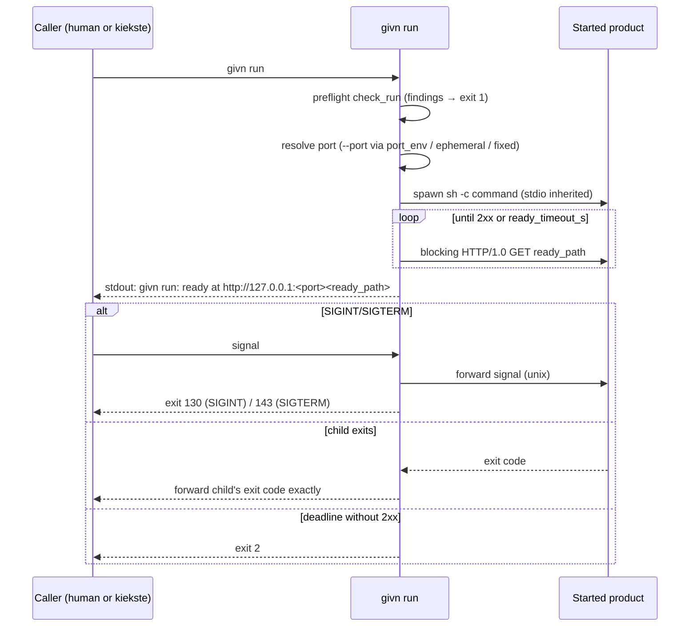

# 6. Runtime View

This chapter records the runtime order implemented by the current checkout. It
distinguishes manifest-driven hooks from binary mandatory checks.

## 6.1 `givn init`

The sequence is:

1. Resolve the current working directory as the project root.
2. Create `givn/specs`, `givn/changes`, and `givn/archive`.
3. Write `givn/config.yaml` from the embedded, versioned scaffold unless the
   file already exists and `--force` is absent.
4. For a newly written config, read the agent-target selection. Empty input or
   EOF selects `.opencode`; recognized selections are `.opencode`, `.agents`,
   and `.claude`. The selection is appended as `skills.targets`.
5. Write `givn/commands.yaml` from the embedded project command template unless
   it already exists and `--force` is absent. The current template contains
   `./run-tests.sh`, `./run-tests.sh --e2e`, and coverage script/path entries.
6. Unless `--no-addons` is set, enable every registered addon. In the current
   registry this scaffolds Arc42, manages the Absolute Mode fenced block, may
   scaffold README content, and enables other registered extras.
7. Synchronize skills and opencode commands to the selected targets. The sync
   updates only givn-owned fenced blocks in `AGENTS.md` and leaves all other
   content unchanged.
8. Materialize the checked-in commit-attribution hook and, when a Git worktree
   exists, install or refresh the local dispatcher without replacing an
   existing `commit-msg` hook.

The embedded default manifest has addon flags disabled, but initialized projects
normally receive enabled addon settings because the current `init` command
enables them. Existing Arc42 files are not overwritten by addon scaffolding.

## 6.1a Commit attribution

The commit flow is:

1. An OpenCode or Claude Code integration provides optional attribution values
   to the shell process that invokes Git.
2. Git resolves the committer identity from that process environment and starts
   the commit operation.
3. The local dispatcher runs an existing `commit-msg` hook first, preserving its
   failure result.
4. The checked-in Givn hook invokes the attribution stamper after the existing
   hook succeeds.
5. The stamper appends the managed `Co-Authored-By` line and normalized Givn
   trailers when context exists. Missing context or stamper errors leave the
   user's message and successful commit path unchanged.
6. Git writes the commit object with the available committer identity and final
   message.

Model and harness changes update only the next agent shell's process-scoped
values. No model selection is written to project configuration.

The OpenCode path is ordered as follows: `chat.message` may receive the
selected model and variant, then `chat.params` receives the selected model
under its required `model` object and caches its provider/model identity by
session; OpenCode then invokes `shell.env` for a shell execution; the plugin
looks up the same session and returns the existing Givn environment protocol.
If the payload has no usable model, the harness marker remains available and
the missing attribution fields retain their best-effort fallback behavior.

The Claude path is ordered as follows: Claude invokes the generated
PreToolUse Bash hook with a Bash command and `transcript_path`; the Givn
attribution command reads the latest assistant transcript entry and extracts
its model; it exports the attribution environment for the complete command;
and Claude executes that updated command. The environment therefore survives
compound commands and shell wrappers such as RTK until Git invokes the shared
hook. If the transcript is missing, unreadable, or has no model, the command
uses the existing environment fallbacks and remains non-blocking.

Initialization and managed upgrade output explicitly reports the shared hook,
local activation result, and selected agent integrations. Managed upgrades
stage the Claude settings entry alongside the other attribution paths so the
retrofit is represented in the upgrade commit.

## 6.2 `givn new <change-id>`

1. Validate the id as non-empty ASCII lowercase letters, digits, and hyphens,
   with no leading or trailing hyphen.
2. Resolve `givn/changes/<id>` through the shared path helper.
3. Reject an existing directory or an uninitialized `givn/` directory.
4. Validate any `--skip` ids against the effective manifest.
5. Create the change directory and write `proposal.md` from the cascade unless
   `proposal` is skipped.
6. If requested, write `.givn-skip` with one skipped artifact id per line.

The proposal template is written verbatim; no change-id substitution is
performed. A leading-hyphen argument supplied without `--` can be rejected by
`clap` before the shared validator, while `givn new -- -foo` reaches the
validator.

## 6.3 `givn instructions`

With an artifact id, the command loads the effective manifest, validates the
artifact, resolves its instruction through the project-overrides-first cascade,
and prints either the text or one JSON object containing `id`, `generates`,
`requires`, and `instruction`. A sole active change is auto-selected when no
`--change` is given; multiple active changes require an explicit id.

Without an artifact id, the command reports context-aware generic guidance from
the project state. It does not create lifecycle artifacts. When the readme
addon is enabled and the README check reports findings, both report paths
append one text-only status line naming `givn readme check` and the finding
count; the JSON report shape is unchanged.

## 6.4 `givn lint`

`givn lint` parses feature files and runs no project tests. Its default scope is
all `.feature` files below `givn/`, excluding `givn/archive/`. `--change` scopes
to that change's specs directory; explicit paths are used as supplied.

For each parsed file it reports `@wip` and `PENDING`. Removed placeholders are
excluded from the WIP result. The default whole-tree scope additionally runs
the deterministic overlap scan:

- duplicate active scenario titles are errors and produce exit code `3`;
- shape matches, assertion subsets, and scenarios over 14 steps are warnings;
- parse errors produce exit code `1`;
- WIP/PENDING produces exit code `2`.

Precedence is parse error `1`, duplicate title `3`, WIP `2`, then clean `0`.
JSON output is a findings array; it is not test-runner output.

## 6.5 `givn status` and `givn graph`

Both commands load the effective manifest and derive state from the change
filesystem. `status` reports artifact paths, task checkbox progress, sign-off
markers, optionality, next required artifact, and skipped artifacts. `graph`
adds dependency edges, archive-gate flags, and configured post-hook names.

The state rules are:

- a generated path is required for an artifact to exist;
- `tasks.md` is complete only when all recognized `[ ]`, `[x]`, and `[X]`
  checkboxes are done;
- `design-review.md`, `review.md`, and `arc42.md` use their respective marker
  strings for completion;
- `.givn-skip` makes a named artifact `Skipped`;
- `apply.requires` identifies archive-gating artifacts.

## 6.6 `givn check`

The command resolves command and coverage settings from the effective manifest.
The current project obtains them from `givn/commands.yaml`, which is applied as
the later overlay after `givn/config.yaml`.

### Explicit artifact check

For `givn check tasks`, the binary runs the non-configurable mandatory checks:

1. For a change delta, reject non-removed scenarios that still have `@wip`.
2. Run `verify.command` with `GIVN_FEATURES` set to the active change specs.

For `givn check review`, it runs:

1. `verify.command`.
2. `verify-e2e` using `verify.e2e_command`.
3. The integrity hook for task hashes, promised files, and enabled Arc42 or
   coverage checks.
4. For a named change, the overlap disposition gate.

These mandatory checks are in `src/cli/check.rs` and cannot be removed by
removing a `post` entry. Built-in hook names also ignore `allow_failure` when
they are configured in a post list.

`verify-e2e` skips only when its sentinel is effective, there are no direct
`@e2e` scenarios in scope, and `tasks.md` contains no E2E intent. If the
sentinel is effective while E2E is present or planned, it fails. A non-sentinel
E2E command is invoked by the mandatory review path.

### No artifact argument

`givn check` without an artifact runs only configured `post` hooks for applicable
outputs. It does not invoke the explicit `tasks` or `review` mandatory-check
branch. With the embedded default manifest, standard post lists are empty.

## 6.7 `givn archive --change <id>`

The archive command executes the following stages:

1. Validate the change id and active directory.
2. Load the effective manifest and ensure every `apply.requires` artifact is
   complete or skipped.
3. Run configured post hooks for each `apply.requires` artifact.
5. When the readme addon is enabled, run the README completeness gate before any
   mutation: open placeholders, legacy scaffold texts, an unmanaged or missing
   README, or development managed block damage block the archive with a
   per-finding report. No backup is needed at this stage.
6. Back up `givn/specs/` and `README.md` as needed.
7. Parse each delta feature, reject WIP, and merge Added/Modified/Removed
   scenarios into `givn/specs/<usecase-id>/<capability>.feature` (the permanent corpus is owned by explicit use-case documents). A new capability merges into the use case its proposal's routing decision declares; when the capability exists nowhere and no `NEW in <usecase-id>` decision is recorded, the archive is blocked.
8. Run `verify.command` against `givn/specs/`. A failure rolls permanent specs
   back from the backup.
9. Run post-merge E2E only when merged permanent specs contain direct `@e2e`
   scenarios. An empty or sentinel E2E command blocks in that case; a configured
   command must pass.
10. When the readme addon is enabled and both development managed block markers
    are present, refresh the block content from the effective command file; a
    failure restores the README from the backup.
11. If coverage is enabled, run the project measurement/merge pipeline, validate
    Cobertura reports, update managed README blocks, and roll back specs,
    README, and coverage files on failure.
12. Copy the complete change directory to `givn/archive/<id>/`, then remove the
    active directory.

Archive's post-merge checks are hard-coded in `src/cli/archive.rs`; they are not
the same thing as configurable artifact `post` hooks. Archive does not call the
explicit `check review` mandatory branch before these stages.

## 6.12 Addons, Upgrade, and Completion Commands

`givn addons list` reads enabled flags from `givn/config.yaml`. `enable arc42`
sets the flag, scaffolds missing fixed-path chapter files, and expands the
effective graph; `disable arc42` leaves existing docs in place. The same
commands manage other registered addon flags.

`givn skills sync` resolves the selected targets, writes generated skills and
opencode commands, refreshes the `givn-project` block, and applies/removes the
Absolute Mode block according to its addon flag. `givn upgrade` rewrites the
managed config scaffold, preserves uncommented user blocks, and auto-enables
newly known addons not represented in the old config.

`givn completions <shell>` writes no project files and prints a shell completion
script to stdout.

## 6.13 `givn upgrade` and declared migration bundles

The command selects a declared migration path from the active config marker to
the installed package version. It first verifies that the project is inside a
Git worktree and that
`git status --porcelain --untracked-files=all` is empty. A failed preflight
returns before changing any project file.

The command then refreshes `givn/config.yaml`, backfills the `run:` scaffold
into `givn/commands.yaml` when the file exists and has no top-level `run:` key
(idempotent; a project that already declares `run:` produces no diff), and
synchronizes generated skills, commands, and Givn-owned `AGENTS.md` blocks. It
stages an explicit allowlist — including `givn/commands.yaml` for the backfill —
never a complete directory or worktree, and creates one managed commit when
files changed. The backfill application reports
`wrote run: scaffold to givn/commands.yaml — fill it in; givn archive is
blocked until you do`. If the catalog returns one or more bundles, the command
then writes one aggregate `givn/changes/<aggregate-id>/` with Proposal, Design,
`migration.yaml`, and `.givn-skip` for `specs`; its Design records the managed
commit hash and all bundle phases in order. A second commit contains only that
aggregate plan. A gap with no declared route creates no migration change.

An existing active or archived migration plan is reported and never
overwritten. The generated plan contains no product feature delta and no
fabricated design-review, task, implementation, or review evidence. The
project LLM must continue the normal workflow and archive the maintenance plan
after all project-specific decisions and verification are complete.

At archive time, a maintenance change whose `.givn-skip` lists `specs` has no
delta to merge. Its global verify and E2E hooks run against the permanent
project feature path. Tasks, review, and all other archive gates remain
required.

## 6.14 Repository-Owned Acceptance Flow

The Cucumber test binary creates an isolated temporary project, invokes the
compiled CLI, captures exit status and stdout/stderr, and performs secondary
filesystem assertions. Review/archive success cases assert the CLI receipt
first. Failure cases snapshot permanent specs and verify rollback. No consumer
repository or external service participates. The `ready_fixture` test target
plays the started product in `givn run` scenarios: it binds a port, answers a
readiness path, and can self-exit, fail early, answer failure forever, or trap
signals into a marker file.

## 6.15 `givn run`

`givn run [--port <n>] [--print]` executes the product declared by the `run:`
block of `givn/commands.yaml`:

A library product prints that there is nothing to start and exits 0. `--print`
resolves the plan without spawning: it emits one sh-eval-able line
(`PORT=<port> <command>` when `port_env` is set, else `<command>`) and exits 0.
An ephemeral port is allocated by binding `127.0.0.1:0`, reading the port, and
dropping the listener before spawn. Signal forwarding is unix-only; on other
platforms a server product is refused at preflight with exit 1.
