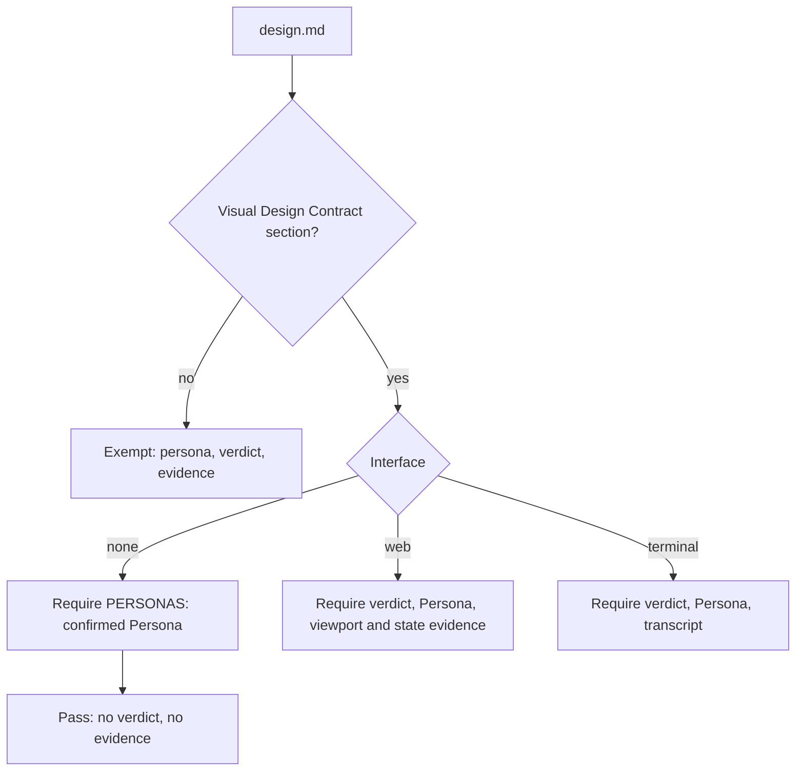
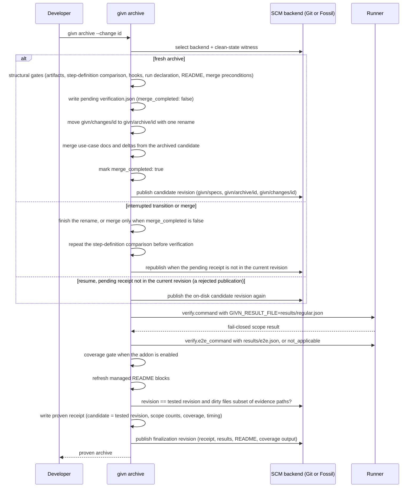
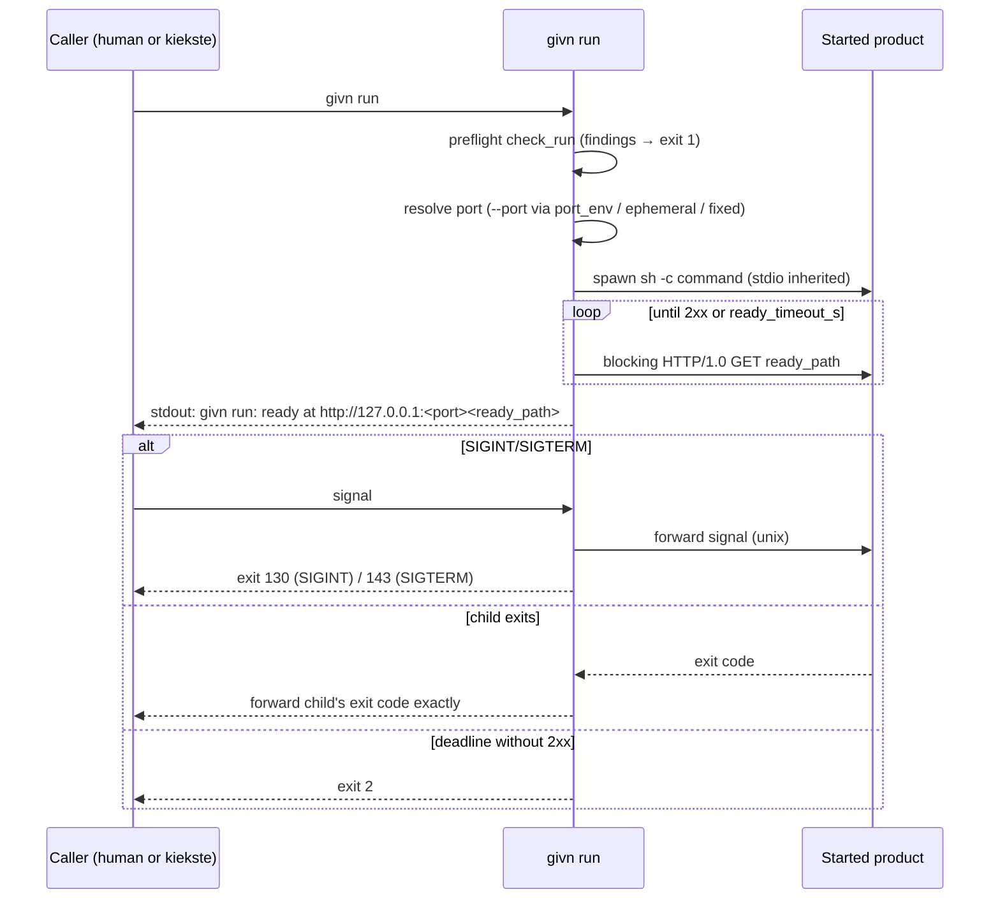
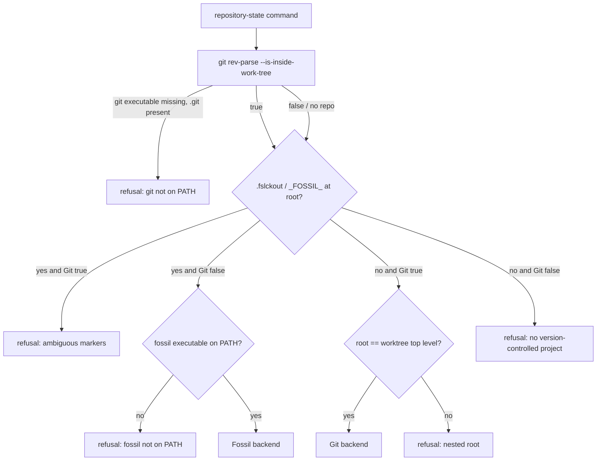
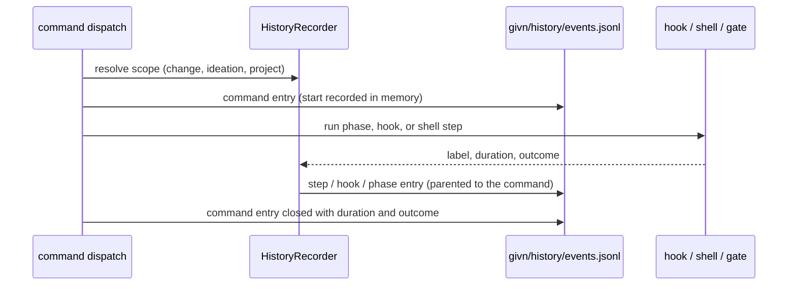

# 6. Runtime View

This chapter records the runtime order implemented by the current checkout. It
distinguishes manifest-driven hooks from binary mandatory checks.

## 6.1 `givn init`

The sequence is:

1. Resolve the current working directory as the project root.
2. Decide whether a fresh `givn/config.yaml` will be written (absent, or
   `--force`). If so, resolve the agent-target selection before the first
   write: `--agents`, else one piped answer line, else the interactive
   checkbox prompt, which opens with `.opencode` marked and re-asks — with an
   error naming the requirement — until a target is marked. Recognized
   selections are `.opencode`, `.agents`, `.claude`, `.omp`, and `.maki`. A
   non-terminal empty or unknown-only selection refuses with a non-zero exit
   and leaves the checkout unchanged.
3. Create `givn/specs`, `givn/changes`, and `givn/archive`.
4. Write `givn/config.yaml` from the embedded, versioned scaffold unless the
   file already exists and `--force` is absent; append the resolved selection
   as `skills.targets`.
5. Write `givn/commands.yaml` from the embedded project command template unless
   it already exists and `--force` is absent. The shipped template contains the
   `givn missing-testrunner`, `givn missing-e2e-runner`, and
   `givn missing-run-command` sentinels plus coverage paths; it does not invent
   project scripts.
6. Unless `--no-addons` is set, enable every registered addon. In the current
   registry this scaffolds Arc42, creates the missing standalone `docs/glossary.md`
   and `docs/domain-model.md` from the embedded templates, manages the
   `communication-policy` fenced block, may scaffold README content, enables the
   archive coverage gate, and enables the project-level skills plus the advisory
   outline report. With `--no-addons`, write an explicit `false` for every known
   addon instead and write neither domain document.
7. Synchronize skills and attribution/reporter integrations to the selected
   targets. The sync writes only skills (never command files), updates only
   givn-owned fenced blocks in `AGENTS.md`, removes the retired `absolute-mode`
   block while preserving surrounding content, and leaves all other content
   unchanged. The unconditional `givn-project` block carries the dialog-policy
   obligation; the communication-policy addon controls only presentation.
8. Materialize the checked-in commit-attribution hook and, when a Git worktree
   exists, install or refresh the local dispatcher without replacing an
   existing `commit-msg` hook.

The embedded default manifest enables every addon, and initialized projects
receive the same enabled settings. A missing addon key in a partial `addons:`
block resolves to enabled; only an explicit `false` disables a flag. `givn init
--no-addons` writes that explicit false for every known addon, and `givn addons
disable <name>` opts one addon out later. Existing Arc42 files are not
overwritten by addon scaffolding.

## 6.1a Commit attribution

The commit flow is:

1. An OpenCode, Claude Code, or omp integration provides optional attribution
   values to the shell process that invokes Git.
2. Git resolves the committer identity from that process environment and starts
   the commit operation.
3. The local dispatcher runs an existing `commit-msg` hook first, preserving its
   failure result.
4. The checked-in Givn hook invokes the attribution stamper after the existing
   hook succeeds.
5. The stamper appends the managed `Co-Authored-By` line and normalized Givn
   trailers when context exists. Missing context or stamper errors leave the
   user's message and successful commit path unchanged.
6. Git writes the commit object with the available committer identity and final
   message.

Model and harness changes update only the next agent shell's process-scoped
values. No model selection is written to project configuration.

The OpenCode 2 path is ordered as follows: the plugin registers for the
session lifecycle events (`context`, `compaction`, `generate`) and remembers
the selected provider, model identity, and reasoning variant per session;
`tool.execute.before` links each shell request to its issuing session and
`tool.execute.after` retires it; when OpenCode creates the shell,
`shell.create.before` stamps the existing Givn environment protocol with the
issuing session's remembered model. When the session has no remembered model,
the plugin falls back to the last observed model, then to OpenCode's
configured default, and leaves the missing attribution fields unavailable. The
harness marker remains available and no shell is blocked, delayed, or
altered.

The Claude path is ordered as follows: Claude invokes the generated
PreToolUse Bash hook with a Bash command and `transcript_path`; the Givn
attribution command reads the latest assistant transcript entry and extracts
its model; it exports the attribution environment for the complete command;
and Claude executes that updated command. The environment therefore survives
compound commands and shell wrappers such as RTK until Git invokes the shared
hook. If the transcript is missing, unreadable, or has no model, the command
uses the existing environment fallbacks and remains non-blocking.

Initialization and managed upgrade output explicitly reports the shared hook,
local activation result, and selected agent integrations. Managed upgrades
stage the Claude settings entry alongside the other attribution paths so the
retrofit is represented in the upgrade commit.

The omp path is ordered as follows: omp loads `.omp/hooks/pre/givn-attribution.js`
as a `pre` hook; before a `bash` tool call executes, the handler reads
`ctx.models.current()` (falling back to `ctx.model`) and `pi.getThinkingLevel()`;
it returns a revised `command` with the same attribution exports the other
integrations set when the command creates a revision, and returns no revision
for any other call. omp re-validates and runs the revised command, so the
exported environment reaches the Git process that invokes the shared hook. A
missing model leaves the LLM value as `unavailable` and omits the committer
override; the harness marker is still written.

## 6.2 `givn new <change-id>`

1. Validate the id as non-empty ASCII lowercase letters, digits, and hyphens,
   with no leading or trailing hyphen.
2. Resolve `givn/changes/<id>` through the shared path helper.
3. Reject an existing directory or an uninitialized `givn/` directory.
4. Validate any `--skip` ids against the effective manifest.
5. Create the change directory and write `proposal.md` from the cascade unless
   `proposal` is skipped.
6. If requested, write `.givn-skip` with one skipped artifact id per line.

The proposal template is written verbatim; no change-id substitution is
performed. A leading-hyphen argument supplied without `--` can be rejected by
`clap` before the shared validator, while `givn new -- -foo` reaches the
validator.

## 6.3 `givn instructions`

With an artifact id, the command loads the effective manifest, validates the
artifact, resolves its instruction through the project-overrides-first cascade,
renders the addon-conditional sections against the effective addon flags, and
appends the project's extension for the id under the marked section. It prints
either the text or one JSON object containing `id`, `generates`, `requires`,
and `instruction`; the `instruction` field carries the same rendered-and-
extended text as the human-readable path. An id that is not a manifest
artifact falls back to the same instruction cascade: a resolvable policy or
step instruction (`dialog`, `ideation`, the reverse-mode ids, the step assets)
is served with empty `generates` and `requires` arrays, an unresolvable id
keeps the existing unknown-artifact error. A sole active change is
auto-selected when no `--change` is given; multiple active changes require an
explicit id.

When the id resolves to the domain-modeling policy, the response names
`givn-domain-modeling` as `skill_to_load` whenever the `domain_modeling` addon is
enabled; arc42 is not a prerequisite. The served instruction owns
`docs/glossary.md` and `docs/domain-model.md`.

Without an artifact id, the command reports project state and request routing from the project state. It does not create lifecycle artifacts. The no-active text recommends loading `givn-start` to choose among answer-only, direct work, ideation, or a formal change, and names `givn new <change-id>` as the direct alternative. JSON carries `next_skill: "givn-start"` and keeps `next_command: "givn new <change-id>"` as the direct alternative. A reported active-change step applies only when continuing that change and does not authorize unrelated work. When the readme addon is enabled and the README check reports findings, both report paths append one text-only status line naming `givn readme check` and the finding count; the JSON report shape is otherwise unchanged.

The shared generic overview directs each fresh context to load the effective
dialog policy before its first user-facing question. Text and JSON state reports
retain their existing next-action and metadata contracts. A delegated
question-preparing context receives the obligation explicitly; no parent-context
inheritance is assumed. The presenting agent checks the question before asking
the person. This is authoring guidance, not a runtime hook or question API.

## 6.4 `givn lint`

`givn lint` parses feature files and runs no project tests. Its default scope is
all `.feature` files below `givn/`, excluding `givn/archive/`. `--change` scopes
to that change's specs directory; explicit paths are used as supplied.

For each parsed file it reports `@wip` and `PENDING`. Removed placeholders are
excluded from the WIP result. The default whole-tree scope additionally runs
the deterministic overlap scan:

- duplicate active scenario titles are errors and produce exit code `3`;
- shape matches, assertion subsets, and scenarios over 14 steps are warnings;
- parse errors produce exit code `1`;
- WIP/PENDING produces exit code `2`.

Precedence is parse error `1`, duplicate title `3`, WIP `2`, then clean `0`.
JSON output is a findings array; it is not test-runner output.

Every finding is classified as `advisory`, `finding`, or `blocking` from one
mapping table; the prose output appends the severity after the existing short
label, and the JSON output carries a `severity` field. The classification is
descriptive: the existing exit-code flags still drive the exit code, so an
advisory-only run exits 0.

The default whole-tree scope additionally scans change seeds under
`givn/ideation/*/changes/*.md` for status hygiene. A missing or unrecognised
`Status:` line, a `proposed by` change that does not exist, and a
`proposed by` change that is already archived are reported on stderr with the
`[SEED ]` label. The findings are advisory: they are counted in the summary's
finding count but never change the exit code. The seed scan is a no-op without
`givn/ideation/`, and explicit paths keep their current scope without seed
advisories.

Persona references in active change use-case documents and ideation use cases
are scanned against `givn/personas/` and every topic's `personas/`. A dangling
reference is reported on stderr with the `[PERS ]` label; the finding is
advisory and never changes the exit code. Forward references during an active
ideation topic stay quiet, and the persona scan runs in both the default and
`--change` scopes.

## 6.5 `givn status` and `givn graph`

Both commands load the effective manifest and derive state from the change
filesystem. `status` opens with the selected backend line (`SCM: git`,
`SCM: fossil`, or `SCM: none` with the unavailable note) and reports artifact
paths, task checkbox progress, sign-off markers, optionality, next required
artifact, and skipped artifacts. `graph`
adds dependency edges, archive-gate flags, and configured post-hook names.

The state rules are:

- a generated path is required for an artifact to exist;
- `tasks.md` is complete only when all recognized `[ ]`, `[x]`, and `[X]`
  checkboxes are done;
- `design-review.md`, `review.md`, and `arc42.md` use their respective marker
  strings for completion;
- `.givn-skip` makes a named artifact `Skipped`;
- `apply.requires` identifies archive-gating artifacts.

## 6.6 `givn check`

The command resolves command and coverage settings from the effective manifest.
The current project obtains them from `givn/commands.yaml`, which is applied
through its dedicated `verify`/`coverage`/`run` schema after the
`givn/config.yaml` policy overlay.

### Explicit artifact check

For `givn check tasks`, the binary runs the non-configurable mandatory checks:

1. For a change delta, reject non-removed scenarios that still have `@wip`.
2. Run `verify.command` with `GIVN_FEATURES` set to the active change specs.

For `givn check review`, it runs:

1. The integrity hook for task revision identifiers, promised files, enabled Arc42 or
   coverage checks, and — when `design.md` declares a visual interface — the
   visual verdict, the persona disposition, the final-state and per-state
   evidence, and the operator decision for any recorded deferral.
2. For a named change, the review-context record: the proposal's requested kind,
   the performed design-review kind, and the performed review kind must agree;
   an independent record requires a reviewer context different from the author,
   and the design-review and review records must name one reviewer context.
3. The deterministic run-declaration check.
4. For a named change, change-scoped lint; when it passes, the overlap
   disposition gate, retirement disclosure, and capability-routing checks.
5. The change-scoped verification receipt, so a stale receipt is reported
   without running the suite.
6. For a named change, the scenario-commit evidence check.

There is no outline review step in `givn check review`; the outline addon is
advisory only.

The visual gate reads the `## Visual Design Contract` section from
`design.md`. An absent section fully exempts the change from the Persona
disposition, the visual verdict, and visual evidence. A declared contract
always requires a `PERSONAS:` line in `review.md` naming at least one confirmed
Persona whose value resolves to `givn/personas/<id>.md` — including
`Interface: none`, where that line is the only visual-review requirement and a
`none`, reasoned `none`, or empty value fails. For a declared `web` interface the gate
also requires a committed final-state screenshot for every delta `@e2e`
scenario at each declared viewport, plus one `<viewport>--<state>.png` for
every state the contract declares; for `terminal` it requires a committed
transcript per scenario. A `web` or `terminal` contract must carry
`VISUAL-REVIEW: PASS`; `VISUAL-REVIEW: UNVERIFIED` fails until a human resolves
it. For those interfaces the verdict check runs before the Persona check, so a
missing verdict is reported first; `Interface: none` has no verdict check, so
its first failure is the Persona disposition. A `DEFERRAL:` line anywhere in
`review.md` requires a matching `OPERATOR-DECISION:` record.



Review does not execute `verify.command` or `verify.e2e_command`. Scenario
execution is proven once per archive by the verification receipt; review
inspects the static artifacts and the implementation evidence check instead.

These mandatory checks are in `src/cli/check.rs` and cannot be removed by
removing a `post` entry. Built-in hook names also ignore `allow_failure` when
they are configured in a post list.

The `verify-e2e` built-in used by configured post hooks skips only when its
sentinel is effective, there are no direct `@e2e` scenarios in scope, and
`tasks.md` contains no E2E intent. If the sentinel is effective while E2E is
present or planned, it fails. The archive E2E scope applies the same sentinel
rule when deciding that the scope is not applicable.

### No artifact argument

`givn check` without an artifact runs only configured `post` hooks for applicable
outputs. It does not invoke the explicit `tasks` or `review` mandatory-check
branch. With the embedded default manifest, standard post lists are empty.

## 6.7 `givn archive --change <id>`

The archive is forward-only and runs in two published stages against the
selected backend (a Git worktree or a Fossil checkout), using the state model
below:

| Archive directory state | Meaning | Command behavior |
|---|---|---|
| absent | no publication yet | fresh archive |
| active change with pending receipt, no archive directory | interrupted transition before the move | rerun the gates and retry the rename |
| present, no receipt | pre-receipt legacy archive | refuse: already archived |
| receipt `status: pending` | unproven candidate | resume merge and verification |
| receipt `status: proven` | proven archive | refuse: already proven |
| active and archived, pending receipt, active artifacts match | interrupted transition | remove the duplicate active directory, stage the path, merge when needed, and publish once if the revision changed |
| active and archived, pending receipt, content differs | corrupted transition | refuse and name the candidate conflict |
| active and archived, no receipt or proven | corrupted transition | refuse: both directories exist |
| archive only, unreadable receipt | corrupted archive | refuse: the receipt is unreadable |



Stages:

1. Validate the change id, select the backend through the SCM seam (no usable
   backend, or a project nested below the checkout root, is refused by name),
   and read the archive provenance.
2. Clean-state witness: files the selected backend would not publish block the
   archive by name (Git untracked files and Fossil `EXTRA` entries included),
   except the declared evidence paths (the target archive directory,
   `givn/changes/<id>/verification.json`, `givn/changes/<id>/evidence/**`,
   `givn/changes/<id>/verification/**`, any archive's receipt, `results/**`,
   `evidence/**`, and `verification/**`, `README.md`, and the configured
   coverage paths), which keep a failed attempt resumable.
3. Fresh or interrupted-move only — structural gates before any mutation:
   `apply.requires` completeness, the delta step-definition comparison,
   configured archive hooks, the run-declaration gate, the README completeness
   gate, use-case and delta prevalidation, the e2e-runner configuration check,
   and the shared change-receipt freshness check (section 6.7.1). The
   step-definition comparison reads the change's `specs/**` step files, collects
   the phrases bound by their binding expressions, compares them with the
   permanent test tree (the project root minus the change, archive, history,
   version-control, build, and cache trees), and refuses when any phrase is
   missing, naming the project-relative delta file and the bounded phrase list
   (section 8.3).
   A resumed-move run repeats these gates before retrying the rename; a pending
   candidate repeats the step-definition comparison and re-checks the e2e
   configuration before its verification scopes run. An `@e2e` merge with an
   unconfigured `verify.e2e_command` blocks here, leaving the change active.
4. Fresh only — move and publish the candidate: write the pending receipt into
   the active change, then move the directory to `givn/archive/<id>/` with one
   rename. Both paths are under the project root; a failed rename leaves the
   active change in place with its pending receipt (an exempt evidence path),
   and the next run re-runs the gates before retrying the rename. Merge every
   delta and narrative from the archived candidate, then mark
   `merge_completed: true` and publish exactly the merged corpus paths as the
   candidate revision. A rejected publication is reported as an unproven,
   repairable state; on resume the merged on-disk state is published again
   instead of assuming the merge is committed.
5. Verification against the published candidate revision: the regular scope
   (`verify.command`) and the E2E scope (`verify.e2e_command`, only when merged
   permanent specs contain `@e2e`; otherwise `not_applicable`) each run once
   and must write a reconciling runner result with scenarios, no failures, and
   no skips.
6. Coverage when enabled: measure, validate, and publish once against the
   candidate, with no backup or rollback path.
7. Finalization: refresh managed README blocks, verify that the current
   revision still equals the tested revision and that every dirty path is a
   declared evidence path, write the proven receipt, then publish the
   evidence-only finalization revision. If that publication is rejected, the
   working-tree receipt is restored to pending, so the archive remains
   unproven and a rerun repeats finalization instead of reporting a proven
   archive that is absent from the tested history.

A failure before the rename leaves the active change; a failure after it
leaves the pending candidate. The pending receipt's `merge_completed` flag
distinguishes an interrupted merge from a candidate that only needs
verification; the delta merge is idempotent, so a partially applied multi-file
merge can be retried. Both-directory states produced by an older binary or a
manual restore are reconciled only when the copies are identical. Any failure
after the candidate publication leaves the candidate unproven in place and
prints the forward-repair instruction (`givn archive --change <id>` after
repairing the committed state). Archive's checks are hard-coded in
`src/cli/archive.rs`; they are not configurable artifact `post` hooks, and
archive does not call the explicit `check review` mandatory branch.

## 6.7.1 Change-scoped verification receipt

`givn check tasks --change <id>` is the only change-scoped test execution. It
requires a clean committed tree except evidence/verification paths, sets
`GIVN_FEATURES` to the delta specs and `GIVN_RESULT_FILE` to
`givn/changes/<id>/verification/tasks-result.json`, runs `verify.command`, and
validates four green counts. Before the run it captures the tested-content
digest: every tracked and untracked non-ignored path outside the closed
documentation/evidence allowlist, sorted, hashed with its executable marker and
file bytes. It then writes
`givn/changes/<id>/verification/tasks-verification.json` (schema 2) with the
tested revision, features digest, verify-command digest, tested-content digest,
`content_scope: "change-proof/v1"`, and counts.

`givn check review` runs no tests: it reads that receipt and refuses a missing
or stale one with `givn check tasks --change <id>`. `givn archive` performs the
same validation before the move and merge; after the candidate is published it
runs only the merged regular and e2e scopes. Both commands use the same
freshness result, in order: the counts must be green; the verify-command and
delta-feature digests must match; a schema 2 receipt with the
`change-proof/v1` scope must match the recomputed tested-content digest and its
tested revision must be available: Git requires ancestry from `HEAD`, while
Fossil's seam can prove only that the revision exists in the repository. A
schema 1 receipt, or a schema 2 receipt without the scope, requires strict
revision equality; an unknown content scope or unknown schema is refused
without reuse. Unchanged tested content under a different, available revision
is accepted as a documentation-only revision and keeps the proof current: the
command prints the reused-proof message and runs no change-suite test. The
check establishes tested-content equality; it does not inspect the intervening
diff. A failed check reports every independent stale reason (changed features,
changed command, changed tested content, unavailable tested revision, unbound
schema 1 receipt, unsupported content scope, or unsupported schema) and routes
to `givn check tasks --change <id>`.

`givn check review` reports every use-case schema and capability-routing
problem in one pass. The routing gate parses each referenced document and every
active delta narrative once, collects parser diagnostics and independent
routing checks, deduplicates the exact messages, and prints them grouped under
the document path. Root diagnostics — an invalid title line or an invalid
`## Level` — are reported first and make the document unusable for routing, so
dependent schema-completeness findings (missing or empty required sections and
the leaf-use-case capability requirement) are withheld until the root is
corrected; genuinely unknown headings and local shape findings are still
reported in the same pass. The schema stays strict: a near-miss title or
heading is refused, a non-kebab-case human title is corrected only by
suggesting its canonical kebab-case identifier, and the suggestion is never
accepted in place of an edit. A non-recoverable parse failure suppresses only
the routing checks that need the missing document structure; the parser's own
diagnostics remain the complete report. Integrity, the run
declaration, overlap, retirement, routing, and the receipt keep this order, so
a structural failure still outranks routing findings.

### 6.7.1 Scenario commit evidence

`givn check tasks` parses each checked scenario in `tasks.md` and requires one
recorded revision. A revision shared by several scenarios is accepted only
with the batch label described below. The revision must exist, be reachable from `HEAD`, and carry
the scenario title in its commit message. A shared revision is valid only when
the scenario line names the batch (`Batch: <name>`). Missing, duplicate,
placeholder, unreachable, untitled, and unlabelled-shared revisions are
reported together and block. `givn check review` repeats the gate. One coherent
completed batch may satisfy several scenarios; per-phase or per-scenario commits
are not required.

A change whose design declares no visual contract may record
`VISUAL-REVIEW: NOT APPLICABLE`; a rendered interface still requires
`VISUAL-REVIEW: PASS`. Plain-text CLI transcripts remain evidence under the
change's `evidence/` tree.

### 6.7.4 Development-record quality

A reported turn stores its inline usage once and marks a linked usage entry
`derived: true` with the turn as its parent. An answered question stores
`selected`, `source`, and `answered_at`; an unanswered question stores none. A
failed command stores the bounded first line of its dispatch error. Provider,
model, and variant are recorded where known; unavailable usage stays explicit.

## 6.12 Addons and Completion Commands

`givn new` records the effective add-on values in
`givn/changes/<id>/config-lock.yaml`. While that change is active,
`givn addons enable|disable` refuses unless an operator uses
`--operator --reason "<reason>"` on an interactive terminal; the override is
recorded in the lock. `givn init --force` refuses only when it would change the
add-on set. Review and archive compare the current effective values with the
lock and refuse on drift.

`givn addons list` reads enabled flags from `givn/config.yaml` and lists every
registered addon with its effective default. All registered addons are enabled
by default; a missing key resolves to enabled, and only an explicit `false`
disables a flag. `enable arc42` sets the flag, scaffolds missing fixed-path
chapter files and `docs/glossary.md`, and expands the effective graph;
`disable arc42` leaves existing docs in place. `enable domain_modeling` sets the
flag and creates missing `docs/glossary.md` and `docs/domain-model.md`;
`disable domain_modeling` removes the generated skill but leaves the documents.
`enable outline` sets its flag and generates no skill or command file;
`disable outline` makes the report exit 1 with the named disabled reason.
Enabling or disabling an addon resyncs generated skills.

`givn skills sync` resolves the selected targets, writes generated skills and
per-target attribution/reporter integrations, refreshes the `givn-project`
block, applies or removes the `communication-policy` block according to its
addon flag, removes the retired `absolute-mode` block, removes a recognizable
generated `givn-explore` skill while preserving custom content, and reconciles
ignore state. No command files are generated; recognizable old ones, including
a generated `givn-explore` command, are removed and custom files are reported
for manual transition.

`givn completions <shell>` writes no project files and prints a shell completion
script to stdout.

## 6.13 `givn upgrade` and the migration baseline

The command first validates `givn/config.yaml`. Malformed YAML, a retired addon
key, or a `verify`/`coverage`/`run` block in `config.yaml` is refused with a
manual-transition message before any write. It then selects the project's
version-control backend through the SCM seam (section 6.16) and verifies that
the checkout is clean; a dirty checkout or missing backend is refused before any
file changes. Managed staging records exactly the calculated allowlist on both
backends — `git add [-f]` on Git, `fossil add [--force]` on Fossil — and the
managed revision is committed through the same seam. A failed preflight returns
before changing any project file.

The command records the checkpoint revision, refreshes `givn/config.yaml`,
backfills the `run:` scaffold into `givn/commands.yaml` when the file exists and
has no top-level `run:` key (idempotent; a project that already declares `run:`
produces no diff), and synchronizes generated skills and Givn-owned `AGENTS.md`
blocks. It stages an explicit allowlist — including `givn/commands.yaml` for the
backfill — never a complete directory or worktree, and creates one managed
commit when files changed.

The shipped catalog is `migrations: []` at the 1.0 baseline. No pre-1.0 route is
resolved, so no aggregate maintenance change is created; a project must have a
current-format configuration after its manual transition. Future routes use the
same resolver: when the catalog returns one or more bundles, the command writes
one aggregate `givn/changes/<aggregate-id>/` with Proposal, Design,
`migration.yaml`, and `.givn-skip` for `specs`; its Design records the managed
commit hash and all bundle phases in order, and a second commit contains only
that aggregate plan. A gap with no declared route creates no migration change.

On failure, `givn upgrade` reports the checkpoint, completed writes, revisions
actually published, best-effort restoration, remaining partial state, and
pending work. It performs no reset, clean, or history rewrite and promises no
complete rollback. The developer restores from the checkpoint manually or fixes
forward.

An existing active or archived migration plan is reported and never
overwritten. The generated plan contains no product feature delta and no
fabricated design-review, task, implementation, or review evidence. The
project LLM must continue the normal workflow and archive the maintenance plan
once its inventory is complete and every deviation names a follow-up change
or an in-flight one; the follow-up changes carry the repairs through the
normal gates.

At archive time, a maintenance change whose `.givn-skip` lists `specs` has no
delta to merge. Its verification scopes run against the permanent project
feature path, and its candidate commit contains only the moved change
directory and the pending receipt. Tasks, review, and all other archive gates
remain required.

## 6.14 Repository-Owned Acceptance Flow

The Cucumber test binary creates an isolated temporary project, invokes the
compiled CLI, captures exit status and stdout/stderr, and performs secondary
filesystem assertions. Review/archive success cases assert the CLI receipt
first. Failure cases assert the unproven candidate and its pending receipt
survive the failure. No consumer
repository or external service participates. The `ready_fixture` test target
plays the started product in `givn run` scenarios: it binds a port, answers a
readiness path, and can self-exit, fail early, answer failure forever, or trap
signals into a marker file.

## 6.15 `givn run`

`givn run [--port <n>] [--print]` executes the product declared by the `run:`
block of `givn/commands.yaml`:



A library product prints that there is nothing to start and exits 0. `--print`
resolves the plan without spawning: it emits one sh-eval-able line
(`PORT=<port> <command>` when `port_env` is set, else `<command>`) and exits 0.
An ephemeral port is allocated by binding `127.0.0.1:0`, reading the port, and
dropping the listener before spawn. Signal forwarding is unix-only; on other
platforms a server product is refused at preflight with exit 1.

## 6.16 SCM backend selection

Every repository-state command starts by asking one selection seam which
version-control backend owns the project root. Both marker kinds are probed
before deciding, so an ambiguous root is never silently resolved:



Selection probes, and all refusals return, before any file is written. The
fixed order is Git worktree, then Fossil checkout; both markers at the root are
an ambiguity refusal, and an ancestor Fossil marker is ignored. A Git project
whose root is nested inside a larger worktree is refused by name (TC-32). The
Git backend exposes clean-state witness, revision identity, scoped staging, and
scoped commit operations; the managed upgrade consumes them. The Fossil backend
exposes the clean-state witness (including `EXTRA` entries), revision identity,
witness-bounded publication, allowlist staging, and revision-content checks;
the archive and the managed upgrade consume them (section 6.13).

## 6.17 `givn spec route`

The command ranks capability-routing candidates against the permanent corpus
and reports a confidence verdict. Scoring weights ownership evidence above
lexical overlap: command-surface invocations, structural tokens, the owning
use case's Goal and Rules text, and the capability's interaction consumer
actions; a candidate with no goal ownership and no command overlap has its
score halved (the scatter penalty).

Confidence rules, in order: no candidates reports no signal; a top-two tie
within `0.01` reports no signal; a top score at or above the extend bar
(`3.0`) reports signal; otherwise the new-use-case path reports signal only
when a unique top use-case affinity reaches the floor (`2.0`), and no signal
on a tie or below the floor. A no-signal report prints the reason and omits
the ranked list, so the output never presents ranking noise as a
recommendation. The recorded decision in the proposal remains the
declaration; the command stays advisory.

## 6.18 `givn history` and `givn timeline`

Two flows share one local record at `givn/history/events.jsonl`, an append-only
line-per-entry file whose entries carry an id, a timestamp, one scope (change,
ideation, or project), a kind, a bounded label, a measured duration, an outcome,
and an optional parent entry.

Capture happens while other commands run, through a per-process recorder created
by the command dispatcher:



Every write is best-effort: a store that cannot be written produces one warning
and the command keeps its own exit code. The store is opened append-only and is
never rewritten; the development record's ignore entry keeps it out of
repository history independently of the `rules` policy and never writes a
versioned file — the recorder re-asserts `.git/info/exclude` on every write in a
Git worktree, writes Fossil's repository-level `ignore-glob` setting only while
no managed file overrides it, and uses `.gitignore` only before a repository
exists; inside a Fossil checkout that already has `.fossil-settings/ignore-glob`,
the entry `givn/history/*` belongs to that file's managed list, written by
`givn init`, `givn skills sync`, and `givn upgrade`.

`givn history ingest` is the one intake for reported agent activity: a harness
reporter buffers its events and hands them over as one JSON payload. Each event
is validated on its own; an event with an unknown kind, an unparsable timestamp,
or a missing required field is named on stderr and the remaining events are
still stored, so a stale reporter degrades to rejected events rather than a
corrupt record. The command exits `0` whenever the payload was read and `2` when
stdin is not readable JSON at all.

Four reporters feed that intake, one per supported harness, and each is
installed in that harness's own generated locations (`src/skills/targets.rs`).
Maki is the exception to "beside the commit-attribution integration that harness
already gets": it has no attribution asset, so its three files (the module, the
merged grants, and the merged `init.lua` fence) are its only integration. They
differ only in where their input comes from:

| Harness | Capture order |
|---|---|
| omp | one in-process session: `pi.on` handlers collect turn, tool, message, and question events plus `task:subagent:lifecycle` frames, buffered per turn and flushed at turn end and at `session_shutdown` (2 s budget) |
| opencode | one in-process session: `setup(ctx)` registers the domain hooks and one `ctx.event.subscribe` iterable, buffers the events (which carry their own epoch-millisecond `created` timestamps) and flushes at step end and at `session.execution.*` |
| Claude Code | one process per hook: each event's payload is piped to `givn history harness-hook --harness claude`, which maps it, consumes or writes the pending-state entry for its call id, reads the session record at `Stop`/`SubagentStop`/`SessionEnd` for token usage, and appends through the same intake path |
| Maki | one in-process Lua plugin per session: `setup()` registers the autocmds, which fill a bounded buffer, and the flush writes the payload to a temporary file, runs `maki.fn.jobstart({ "sh", "-c", "cat <payload-file> | <givn> history ingest" }, { scope = "plugin" })` and awaits it with `maki.fn.jobwait(id, timeout)` inside the callback that triggered it (turn end, session end, or a session reset), because an unawaited task-scope job is lost and the explicit plugin scope covers a load-time `run()`. The harness's own `duration_ms` is used where `ToolDone` supplies it; a call that ran is labelled with the bounded subject of its input and a call that never ran (neither duration nor input) is recorded unmeasured under the tool name; `AutoCompacting`/`CompactionDone` become `phase` entries; and a subagent span carries `data.usage = "unavailable"` because `TurnEnd` fires only for the main session |

On Maki 0.7.0 the reporter also reads the host's newer surfaces: `session_read`
gates the live transcript, so the grant is named in the generated manifest;
`ToolDone` for a `task` call uses `maki.task.list()` to tell a foreground close
from a moved subagent that must stay open; `TaskStopped` and the task status
vocabulary close one span per task (a stopped task is skipped, an open task at
session end is unknown with its observed elapsed time); `SessionTitleChanged`
yields a session point entry for lane naming; a question's `tool_result` block
supplies the answer; the turn-boundary transcript read marks a moved call
unknown; and a subagent's own transcript yields its tool calls under its own
session. Every read is bounded, wrapped, and degrades to an absent value, never
an invented one.

The asymmetry is deliberate and documented per harness in the change design:
omp and opencode stamp their own timestamps where their events do not carry
them (omp tool events), while Claude Code has real `duration_ms` on its
post-tool events but none on its pre-tool events or permission waits, so those
come from the binary-side pending state. None of the three can corrupt the
record: the intake validates, and a signal a harness cannot deliver is rendered
as missing rather than as zero.

Capture follows the project's `record.mode`. Under `off` nothing is written — no
append, no pending state, no record-side ignore write — while reads still serve
what the store already holds. Two sites enforce that even against a stale
reporter: `givn history ingest` warns once and exits 0 without appending, and
the Claude `harness_hook` resolves the mode in-process and writes neither a
store line nor pending state. `--with-full-content` is ignored under `off` with
one warning and exit 0. Under `on` (the default, also the fallback for an
absent or invalid value, parsed leniently by `OverlayDoc`) every metadata field
the harness actually exposes is recorded: session id, title, working directory,
agent identity, turn stop reason/model/cost/context/retry signals where
available, tool call id and bounded error text and output bytes, subagent
identity/routing/duration, compaction and plan state, the harness extras the
inventories list, and question text in full (bounded to 4 000 characters per
question entry). Under `full` the complete LLM-facing content is added inline in
the same entry under the documented caps. The intake is the single enforcement
site for the mode and every bound, so content sent under `on` is dropped while
the event is kept. Lowering the mode retains already-captured entries; it never
purges them. Reporters ask `givn history settings --json` (source `config` or
`default`) once per session by subprocess — omp and opencode at setup, Maki at
its first event callback through the flush's own jobstart/jobwait mechanism —
while Claude's hook process resolves it in-process inside the binary; a failed
query is treated as `on`, warns once, and never blocks the harness.

`givn timeline [--change <id>|--topic <id>] [--out <path>]` reads the record for
one scope — or, with no scope flag, renders the project report, whose "outside a
scope" band carries the project's own entries — builds the report model (the workflow phase scaffold with the current state,
phase aggregates, lane groups, the no-stage group, the ranked longest measured entries of any kind, question wait totals,
repeated-step groups, subagent fan-out, token totals overall, per model, and per subagent), first dropping the recorder's own
command entries (the intake's flush and the process-per-hook mapper's invocation) from the model before any derivation,
substitutes that model into the
embedded report document twice — as the machine-readable model payload element
the document's inline script parses, and as the text-only initial view the
written file itself carries — writes one self-contained HTML file (by
default `givn/history/reports/<scope>.html`), and prints its path. The command
opens nothing itself and publishes no JSON model: the machine-readable view of
the record is `givn history --json`. The document contains its own CSS,
JavaScript, and SVG: it loads nothing, and it renders from the embedded
timestamps, its embedded change-state snapshot, and its embedded linked-ideation
link alone, so the same record, change state, and link always produce the same
pixels (R-96). For a change whose proposal or seed names an existing ideation topic, the
report reads the topic's own record and attaches an ideation group with its
ideation phases above the change workflow; a topic report renders that ideation
stack instead of the change workflow. The dispatcher observes ideation
phase-start markers only for the scope a command was recorded under, at the
first observed topic artifact (the first persona file, `eventstorming.md`,
`use-case-definitions.md`, the first elaborated use case, the first seed or the
published topic document), deduplicated, and never backfills a finished or
historical topic. The
lane log carries the captured metadata facts and one bounded content region;
the report embeds full content only up to the **8 MiB total budget** and marks
the rest `content omitted; see the record`, while the store keeps every byte.
A scope whose model holds no entries — including a record that holds only the
recorder's own command entries — renders the empty state rather than an empty
workflow.

## 6.19 `givn outline report`

The command is registered unconditionally and gated at runtime so that a
disabled addon can explain itself:

```mermaid
sequenceDiagram
  actor Developer
  participant CLI as givn outline report
  participant CFG as config::overlay
  participant ORCH as outline orchestration
  participant AN as SourceAnalyzer
  participant MET as metrics
  participant CLS as classify
  participant RPT as report
  Developer->>CLI: run report [--json] [--out]
  CLI->>CFG: load_effective()
  alt outline disabled
    CLI-->>Developer: exit 1, stderr names the disabled addon
  else enabled
    CLI->>ORCH: report(project root, production roots)
    ORCH->>AN: analyze(request)
    AN-->>ORCH: neutral Analysis plus per-file diagnostics
    ORCH->>MET: compute(analysis)
    MET-->>ORCH: per-unit metric hints
    ORCH->>CLS: classify(metrics)
    CLS-->>ORCH: classification, evidence
    ORCH->>RPT: render(classified units)
    RPT-->>Developer: outline first, then hints; stdout or --out, exit 0
  end
```

1. `clap` dispatches `outline report`; the handler loads the effective
   configuration. An absent or false `addons.outline` stops with exit 1 and
   a stderr message naming the enabling command.
2. With the addon enabled, the orchestration scans the requested production
   roots: `src/` by default, or every explicit `--path` root. A project without
   `src/` and without `--path` refuses and asks for production paths. The scan
   excludes test, benchmark, example, target, Java test/build roots,
   TypeScript and JavaScript test/spec/build/dependency roots, Python
   cache/virtualenv
   directories, Python test modules, and `#[cfg(test)]` items, discovers `.rs`,
   `.py`, `.java`, `.ts`, `.tsx`, `.js`, `.mjs`, and `.cjs` files, and presents a
   deterministic request to the `SourceAnalyzer`. The Python adapter starts
   `python3` only after `.py` discovery, so a Rust-only scope never invokes it;
   a missing interpreter becomes a per-file `analyzer-unavailable` diagnostic,
   not an abort. Java, TypeScript, and JavaScript are parsed in-process;
   `.tsx` selects the TSX grammar, and `.js`/`.mjs`/`.cjs` use the JavaScript
   grammar. An unsupported-only scope names the unsupported production sources
   and refuses rather than claiming no sources exist.
3. The adapter returns one neutral `Analysis`. A shared resolution pass matches
   every call's shape — free function with an optional qualifier, or method
   with `self`/named/unknown receiver evidence — against candidate owners. It
   claims `same_file`/`project_other_file` only when the owner agrees; an
   unknown receiver stays `name_only`, several compatible candidates are
   `ambiguous`, and a contradictory qualifier is `external`. The pass syncs the
   resolved calls into the outline items. A read or parse failure is a
   diagnostic for that file, not an abort; the report continues with the
   analyzable files and names every failure.
4. The report prints each unit as a per-component call tree first: declarations,
   signatures, order, and calls. Module outlines list their declared member
   types as type items beside their free functions. Same-unit calls nest under
   the caller; calls to another component are leaves tagged with resolution,
   visibility, and owner. A `name_only` edge is a leaf and is never expanded.
   The tree is forward-only and omits calls outside the analyzed sources. It
   contains no data, method bodies, or comments. Shared metrics and
   classification follow as hints. File code lines exclude recorded
   `#[cfg(test)]` spans, and unit physical lines cover the unit's own spans.
   Every analyzed unit receives exactly one classification and its evidence;
   no action or recommendation is produced, and wholly unsupported units are
   not classified and are named.
5. The selected renderer writes human text or schema-v5 JSON. JSON call objects
   carry `callee`, `resolution`, and `target`; human tags lead with the
   resolution label. Hints never change the exit code; the only write is the
   explicit `--out` path. The command appends no development-record entry and
   stores no baseline, cache, or classification history.

## 6.20 Retired outline review gate

The blocking outline review gate is retired. `givn check review` contains no
outline analysis, no per-unit verdict, no metric waiver, and no forced reviewer
context. The outline addon still produces the advisory report described in
6.19, and the served implementation and review guidance may refer to that
evidence during REFACTOR and final review, but the report cannot block review or
archive.

The current report behavior is owned by the `outline-report` capability and the
advisory outline guide ([`docs/outline.md`](../outline.md)). Historical gate
material remains in archived changes and ADR history; it is not current
architecture.

*[Architecture documentation index](README.md)*
