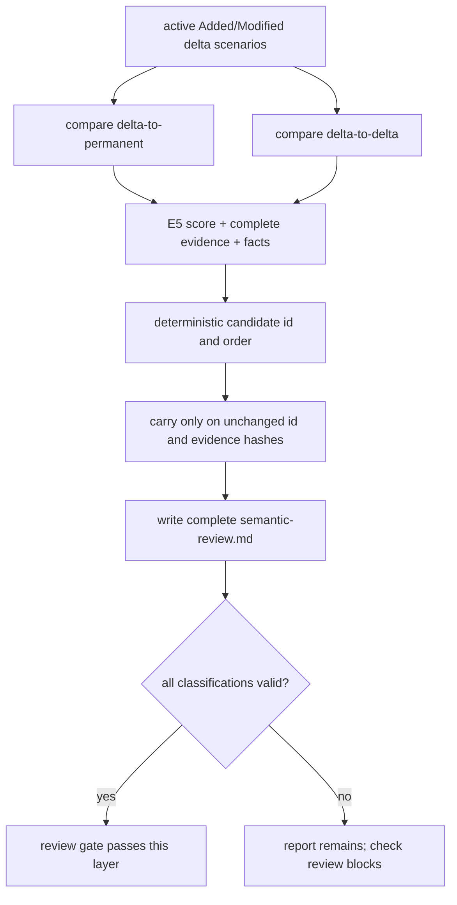
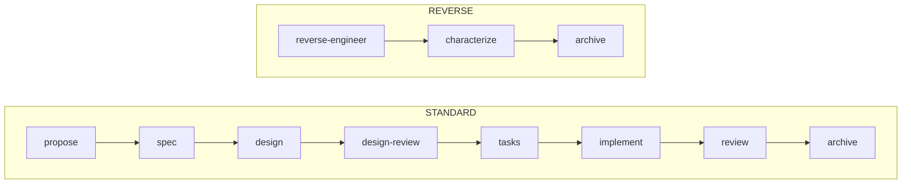

# 8. Cross-cutting Concepts

This is the heart of the design. Read this chapter before implementing.

## 8.1 The cascade engine (override files)

Customisation follows a **CSS-style cascade**. For any requested *facet*, the
resolver returns the project's override if present, otherwise the embedded
default.

```
Resolution order (later wins):
1. Binary built-in defaults (embedded in the givn binary)
2. Project config files under givn/ (project wins)
```

- **Per-facet granularity.** The smallest overridable unit is a single facet —
  a template, an instruction, or a dependency declaration — *not* a whole
  artifact bundle. A project may override just the template for `design` while
  keeping the default instructions, and vice versa.
- **On-demand discovery via `eject`.** The project directory starts with *no*
  overrides. `givn eject <artifact>:<facet>` writes the embedded default into the
  project so it can be edited. Nothing is materialised until ejected.
- **Upgrade safety.** Because defaults live only in the binary, upgrading never
  touches project files. Project overrides always win regardless of binary version.

Pseudocode:

```
fn resolve_facet(artifact_id, facet) -> Bytes {
    // 1. Project override wins.
    let project_path = project_override_path(artifact_id, facet); // givn/artifacts/<id>/<facet>
    if exists(project_path) { return read(project_path); }

    // 2. Embedded core default (templates/ or instructions/).
    if let Some(content) = embedded_core(artifact_id, facet) { return content; }

    // 3. Embedded addon fallback (addons/<artifact_id>/template.md or instructions.md).
    return embedded_addon(artifact_id, facet);   // error if not found
}
```

The third layer exists for addon artifacts (e.g. `arc42-docs`) whose assets live
under `assets/addons/<id>/` rather than the core `assets/templates/` and
`assets/instructions/` directories. Project overrides still win — ejecting an
addon facet places a file at `givn/artifacts/arc42-docs/instructions.md` which
takes precedence over the embedded addon default.

## 8.2 Manifest and overlay/patch

The artifact graph is the one piece that is not a pure per-file override; it is a
structured document. It is handled as:

```
effective_manifest = overlay( embedded_default_manifest, project_config_yaml )
```

- The embedded `default-manifest.yaml` defines the default graph: artifacts,
  their `generates` globs, `requires` (deps), `template` facet name,
  `instruction`, the `apply` block (`requires`, `tracks`), and `verify`.
- The project's `givn/config.yaml` is an **overlay/patch**: it declares only
  additions, changes, or removals, merged onto the embedded graph. This lets
  projects benefit from default-graph improvements on upgrade while still
  customising. It is also where `verify.command` is set.

Overlay semantics (to specify precisely in Phase 2):
- Artifacts are keyed by `id`. An overlay artifact with an existing id is a deep
  merge (field-by-field). A new id is appended. A removal directive deletes by id.
- Scalar fields in the overlay replace the default; the `verify.command` is set
  here by most projects.

### Artifacts are first-class configurable (the workflow is data, not code)

The lifecycle is **not hardcoded**. The sequence of artifacts, their
dependencies, and the gates between them are entirely described by the manifest
and therefore fully reconfigurable per project via the overlay — without touching
the binary. This is a primary feature, not an afterthought. Each artifact node
carries:

| Field | Meaning |
| --- | --- |
| `id` | Unique key (e.g. `proposal`, `specs`, `design`, `tasks`, `review`). |
| `generates` | File(s) the artifact produces (path or glob). |
| `requires` | Artifact ids that must exist first (defines the graph/order). |
| `template` | Facet name of the embedded/ejected template. |
| `instruction` | The guidance text (cascade-resolved). |
| `optional` | If `true`, the artifact may be skipped without blocking the lifecycle. |

The `apply` block separately defines the archive gate via `apply.requires`
(which artifacts must be complete before archiving) and `apply.tracks` (which
file holds the checklist).

Common reconfigurations — all via `givn/config.yaml` overlay only:

**a) Remove the review step (no review gate).**
```yaml
artifacts:
  - id: review
    remove: true
apply:
  requires: [tasks]          # was [tasks, review]
```

**b) Make review optional rather than removing it.**
```yaml
artifacts:
  - id: review
    optional: true
apply:
  requires: [tasks]          # review no longer gates archive
```

**c) Add a dedicated Refactor step after implementation.**
```yaml
artifacts:
  - id: refactor
    generates: refactor.md
    requires: [tasks]        # runs after implementation/tasks
    template: refactor.md    # eject/author this template
    instruction: |
      Record refactorings performed after GREEN: what was cleaned up,
      why, and confirmation that all scenarios still pass. No behaviour change.
apply:
  requires: [tasks, refactor, review]   # refactor now gates archive too
```

**d) Reorder / add any artifact.** Order is derived from `requires`, so changing
dependencies reorders the graph. New ids are appended and slotted by their deps.

**Never apply (a) or (b) to `design-review`.** It is a planning-layer gate
that blocks `tasks`, not an archive gate — removing or making it optional
does not save time, it defers a flawed plan's problems to implementation,
where they cost a rewrite instead of a markdown edit.

Rules and guarantees:
- Removing or reordering artifacts must keep the dependency graph acyclic;
  `givn` validates the effective graph and refuses an inconsistent overlay
  (e.g. a dangling `requires`, a cycle, or an `apply.requires` referencing a
  removed non-optional artifact) with a clear error.
- Default templates/instructions exist only for the built-in artifacts. A
  custom artifact (e.g. `refactor`) needs its template/instruction provided by
  the project (author the file under `givn/artifacts/<id>/`, or rely on a minimal
  generated stub).
- Filesystem-derived state (8.6) adapts automatically: state is computed from the
  effective artifact set, not a hardcoded list.

## 8.3 The Gherkin delta model

The `.feature` file is the spec. During an active change, `.feature` files are
*deltas* tagged for the merge engine.

| Tag | On | Meaning |
| --- | --- | --- |
| `@givn.delta` | Feature | Marks this file as a delta document. |
| `@<capability>` | Feature | Capability identifier (kebab-case). |
| `@givn.added` | Scenario | Append to permanent spec (error if title already exists). |
| `@givn.modified` | Scenario | Replace scenario by title (error if not found). |
| `@givn.removed` | Scenario | Delete scenario by title (error if not found). |
| `@wip` | Scenario | Step definitions not yet implemented. |

Rules:
- A scenario with no `@givn.*` delta tag defaults to `@givn.added`.
- `@givn.removed` scenarios include exactly one placeholder step so the parser
  accepts them; `givn lint` suppresses warnings for them.
- On archive, **all `@givn.*` tags are stripped** from the permanent output; the
  result is clean, runnable Gherkin.

### Merge on archive (chapter 6.6)

For each delta scenario, apply added/modified/removed to
`givn/specs/<cap>/<cap>.feature` by scenario title, then strip tags. Merge
preconditions that fail abort the archive without partial writes.

### Specification vs implementation — strict separation of concerns

There is a hard conceptual boundary between *what/why* and *how*. The artifacts
are assigned to exactly one side of it:

| Layer | Artifacts | Concern | Must NOT contain |
| --- | --- | --- | --- |
| **Specification** | `proposal`, `specs` (`.feature`) | WHAT the system does and WHY (observable behaviour, user value). | Implementation details: classes, function names, frameworks, DB schemas, HTTP routes, step-definition mechanics, file paths, libraries. |
| **Implementation** | `design`, `tasks` (and any custom impl artifacts) | HOW it is built. | — (this is where all the "how" belongs). |

Principles:
- **Proposal and `.feature` files are implementation-independent** — they describe
  behaviour a domain expert could read and validate, independent of the chosen
  technology. They should remain valid even if the entire implementation is
  rewritten.
- **Scenarios assert observable behaviour**, in domain language (Given/When/Then
  about inputs, outputs, state visible to a user/client) — not internal calls,
  not specific code structures.
- **The only permitted exception** is when an implementation aspect is *itself*
  the externally-required behaviour (e.g. "the response is valid JSON", "data is
  persisted across restart", "the endpoint responds within 200 ms"). Such
  constraints are part of the spec because they are observable requirements, not
  implementation choices. When in doubt: if it would still be true under a
  reasonable reimplementation, it belongs in the spec; otherwise it belongs in
  design/tasks.
- **Design owns the technology decisions**: language, test runner, step-definition
  locations, world/context object, coverage setup, runner commands. **Tasks own
  the build steps**: the scenario-by-scenario RED/GREEN/REFACTOR plan.

This separation is enforced *by the instructions* shipped with each artifact
(the proposal and spec instructions explicitly forbid implementation detail; the
design and tasks instructions explicitly carry it). The instructions are
cascade-resolved and ejectable, so a project can tighten or relax the wording —
but the default templates make the boundary explicit.

### 8.3a Normative authoring guidance

The E2E interaction policy has one normative source in the `specs` instruction.
Design, task, review, skill, and slash-command guidance references that source
and supplies only artifact-specific choreography. This prevents generated
entry points from drifting into contradictory rules. The existing cascade
still lets a consuming project override the effective instruction deliberately.

The canonical policy requires the primary assertion to observe the named
consumer interface. Repository or database state is secondary evidence unless
the database is itself the public consumer interface. Browser UI capabilities
must be driven through a real browser; backend HTTP, in-page `fetch()`, and
`XMLHttpRequest` are not substitutes. An obstacle to the real interface is a
design gap, not permission to weaken the assertion.

Artifact instructions may retain derived audit checks and output fields, but
they must not create a competing E2E policy. Skills and slash commands are
choreography only. Generated targets are snapshots and have no independent
authority. The effective instruction may come from the embedded asset in the
running binary or from a project override under `givn/artifacts/`.

### 8.3b Machine-readable instruction contract

`givn instructions <artifact> --json` emits one object with `id`, `generates`,
`requires`, and `instruction`. The first three fields describe the effective
artifact graph; the final field is the resolved instruction facet. Human output
remains the instruction text only. This keeps agents from parsing human
choreography and makes project overrides explicit without adding a runtime
include mechanism.

### 8.3.1 Repository-owned CLI fixtures

The same boundary applies to Givn's own acceptance tests. A fixture invokes
the compiled CLI as an external process, sets its temporary project as the
working directory, captures stdout and exit status, and keeps the temporary
tree alive until all assertions finish. This prevents consumer repositories
from becoming hidden test hosts for Givn behavior.

## 8.4 Project directory layout

```
givn/
+-- config.yaml                       # manifest OVERLAY + verify.command
+-- specs/<cap>/<cap>.feature         # permanent merged spec (source of truth)
+-- changes/<id>/                     # active change (state = which files exist)
|   +-- proposal.md
|   +-- specs/<cap>/<cap>.feature     # delta: @givn.delta + added|modified|removed
|   +-- design.md
|   +-- tasks.md
|   +-- design-review.md
|   +-- review.md
+-- archive/<id>/                     # archived changes (moved here on archive)
+-- artifacts/<id>/                   # OPTIONAL ejected overrides
    +-- template.*                    #   ejected template facet
    +-- instructions.md               #   ejected instructions facet
givn/skills/<name>/SKILL.md.tmpl      # OPTIONAL ejected skill template

# Generated agent files (outside givn/):
.agents/skills/<name>/SKILL.md        # neutral skills (primary)
.claude/skills/<name>/SKILL.md        # mirror for Claude Code
.opencode/skills/<name>/SKILL.md      # mirror for opencode
```

## 8.5 The TDD loop (scenario-by-scenario)

The implement phase runs **one scenario at a time**, in `.feature` order:

```
For each scenario:
  RED:      Remove @wip from THIS scenario only.
            Write step definitions WITH real assertions (Then asserts concrete values).
            Run the test runner → this scenario MUST FAIL (no production code yet).
            If it passes here, the assertions are not real — fix the steps first.
  GREEN:    Write the minimum production code → run runner → this scenario PASSES.
  REFACTOR: Clean up without changing behaviour → runner still PASSES.
Then move to the next scenario.
```

Two distinct tools, never conflated:
- **`givn lint`** — a built-in command. Statically checks `.feature` syntax,
  `@wip`, and delta tags only. **Never runs tests.** Exit 0/1/2.
- **The test runner** — the command in `verify.command` (e.g. `cargo test`).
  Executes step definitions against production code. This is what confirms GREEN.
  It is **not** a givn subcommand; givn does not run it (the agent/CI does).

`givn lint` alone is **never** sufficient to confirm GREEN — that requires the
test runner (`verify.command`).

## 8.5a Local scenario retrieval

`givn spec index` owns a local cache of model-backed vectors and content hashes
under `givn/`; `givn spec search` reads that index and prints ranked candidates
for an interactive query. Search remains an authoring aid.

When the `spec-retrieval` feature is compiled, `givn spec review --change <id>`
provides the local index, search, and advisory review path. The strict E5
similarity gate is enabled only by the independent `spec-similarity-gate`
feature. The opt-in `cross-encoder-reranker` feature instead runs the shared
bounded top-five E5 union through local BGE in both directions. Its symmetric
raw-logit operating point is `3.0`: `BGE_RECOMMENDED` enters the agent's
classification worklist and `BGE_FILTERED` is retained as non-blocking evidence.
Neither status is `MERGE`, `KEEP-AS-BOUNDARY`, or another Givn classification.

Deterministic exclusions happen before BGE, same-file identities remain eligible
unless the exact endpoint is excluded, and no invocation scores more than 512
unique undirected pairs. A missing or failed admission approval keeps the
E5-only contract with no BGE evidence object. A missing model or pool overflow
emits explicit `BGE_UNAVAILABLE` evidence and preserves the E5-only blocking semantics. The
model identity, directional scores, symmetric score, admission status, and
elapsed runtime are rendered without allowing BGE to edit specs or verify
remediation.

Local production BGE is loaded with FastEmbed's user-defined offline API only
after validating the ONNX, tokenizer, config, special-token, and external-data
files. The benchmark harness records `python-reference-v1` and cannot approve
the Rust product until a parity export supplies `rust-production-v1`. Runtime
has no hidden wall-clock cutoff; the bounded pair count and explicit artifact
preflight are the refusal controls.

When the bounded union covers only part of the E5 raw worklist, uncovered pairs
are marked `BGE_UNSCORED` inside the normal blocking candidate grammar. They
remain blocking because BGE did not score them; only `BGE_FILTERED` is
non-blocking. This partial state is valid only when the selected bounded union
is at or below 512 pairs; an overflow refuses the complete BGE invocation and
uses `BGE_UNAVAILABLE` with all raw pairs unscored.

The default binary remains independent of ONNX Runtime. Without the retrieval
feature, ordinary check and archive behavior is unchanged and direct retrieval
commands report that retrieval is unavailable. After a successful archive, a
feature-enabled binary refreshes the generated index from the merged permanent
tree; a refresh error is warned after archive completion and retried at the next
review.

The blocking semantic report is an additional, dedicated `givn check review
--change <id>` gate. Its E5 raw candidate boundary remains the binary-fixed
cosine `0.9500`; BGE may narrow only the recommended, non-blocking admission
worklist. `BGE_FILTERED` blocks carry no classification and cannot change
PASS/BLOCKED status. The advisory `givn spec review --change <id>` command uses
the same bounded evidence path and does not create `semantic-review.md`. NLI
remains outside this slice and is reserved for an independent
`nli-evidence` feature.

### 8.5b Permanent scenario exploration

`givn spec explore` is the authoring boundary for a complete draft scenario. It
accepts `--file` or `--stdin`, but never both, and requires a valid Gherkin
document with exactly one scenario or scenario outline. Free text, malformed
Gherkin, missing scenarios, multiple scenarios, and unreadable files fail with
an explanatory non-zero result.

The command refreshes only `givn/specs/**/*.feature`. Each index entry keeps
the normalized scenario content hash, and a matching `(file, title, hash)` entry
reuses its vector. A changed title/step representation is embedded again and
deleted permanent entries disappear from the refreshed index. The query is
embedded with the existing query role and compared with every refreshed
permanent entry, including same-file entries. A file query excludes only the
entry with the same normalized file and title; stdin has no identity to remove.

The no-change result is advisory. It reports at most five deterministic
embedding-score candidates and index/model metadata, or the same data as stable
JSON. In a `cross-encoder-reranker` build it additionally scores that bounded
set in both directions and reports recommended/filtered evidence; it never
classifies a pair, blocks a workflow, or writes a `.feature` file. NLI is not
selected by this path.

### 8.5c Current-change scenario exploration

`givn spec explore --change <id>` adds a request-local active-delta corpus to the
permanent exploration query. The command accepts the same complete one-scenario
file or stdin input as the no-change path. It validates the change id, confirms
the change and its specs directory exist, and parses every delta feature before
refreshing the permanent index. Unsafe ids, missing changes, missing specs
directories, and malformed delta features therefore fail with a clear non-zero
error before a rejected request can write the index.

Only `@givn.added` and `@givn.modified` scenarios participate. `@givn.removed`
scenarios are excluded. Added and modified delta text is embedded in memory for
the invocation and is never written as a permanent index entry. Modified
scenarios carry both their normalized delta-source identity and their projected
permanent-target identity; either identity is excluded when it is the query.

One project-relative forward-slash normalization helper is used for every
permanent index, delta source, projected target, and query file identity. It
accepts relative and absolute paths, preventing the same scenario from being
shown merely because callers used different path forms.

With `cross-encoder-reranker`, the permanent-plus-active query union is the
bounded BGE input. The query's exact source identity and a modified scenario's
exact projected target are excluded, but another eligible scenario in the same
file remains. The E5 raw result set remains visible; BGE-recommended results
form the recommended view and BGE-filtered results remain explicit non-blocking
evidence.

The result remains advisory and deterministic. Human lines identify `scope`,
source, and owning change where applicable. JSON keeps all PR 1 fields and
their order, then appends `scope` and `change` to every result, including
permanent-only calls. This is additive metadata, not byte-for-byte PR 1 output
compatibility. `index.entries` remains the permanent count.

### 8.5d Blocking semantic review report

Only the blocking `givn check review --change <id>` path calls the dedicated
semantic report entrypoint after the structural overlap gate. It creates or
replaces the change-local `givn/changes/<id>/semantic-review.md` document. The
existing archive move retains that generated file under `givn/archive/<id>/` as
historical evidence; archive implementation is outside this slice. The report
is a working document for the agent, not a permanent spec, a manifest artifact,
or a source of automatic feature edits. The advisory `givn spec review
--change <id>` path does not create it.

The report's candidate set is deliberately bounded and thresholded:

- Active `Added` and `Modified` scenarios in the requested change, including
  `Rule:`-nested scenarios, are the only eligible delta endpoints.
- A `delta-to-permanent` candidate pairs one eligible delta with one permanent
  scenario when the existing E5 cosine score is at least `0.9500`.
- A `delta-to-delta` candidate pairs two distinct eligible deltas from the same
  current change at the same boundary, with canonical endpoint ordering and one
  emitted pair.
- Removed scenarios and permanent-permanent pairs are excluded.
- In a delta-to-permanent comparison, a Modified scenario excludes only its own
  projected `(target file, title)` endpoint; other scenarios in that target file
  remain eligible.

Candidates are ordered by ascending lexical scope (`delta-to-delta` before
`delta-to-permanent`), descending score, left endpoint tuple, right endpoint
tuple, and candidate id. The endpoint tuple is
`(scope, normalized project-relative file, title)`. Scores are fixed four-decimal
strings in `0.9500` through `1.0000`; candidate, content, and evidence hashes
are exactly 16 lowercase hexadecimal characters. Reports contain no timestamps
or environment fields. Equal-score candidates use the endpoint tuples and then
candidate id as tie-breakers, and the exact `0.9500` boundary is included.

Each candidate records a deterministic id (including the fixed score string),
both endpoint scopes, normalized project-relative paths, titles, all normalized
steps, background steps, table contents, delta operations, projected target
identities, content hashes, full evidence hashes, E5 model/index metadata,
fingerprint/evidence schema versions, the report schema version, and available
deterministic `Fingerprint` facts. The canonical endpoint evidence orders
feature `Background`, applicable `Rule` `Background`, and scenario steps, and
retains every step docstring and data-table row and cell in source order. The
existing E5 passage-text input remains separate from this evidence
serialization. Facts include exit-code evidence, `contains` polarity by
position, masked table facts, the `[DONE]` title marker, TTY mention, and fact
contradiction. Missing facts use `null`; no fact combination assigns a Givn
classification. The full evidence hash covers every listed component, so a
changed content/table/background/operation/target/model/index/schema component
invalidates a prior classification.

The Markdown wire grammar is exact: UTF-8/LF with no BOM, fixed headers in the
order `# Semantic Review`, `Report schema version`, `Change`, `Status`, and
`Candidate count`, contiguous candidate ordinals, one blank line between
blocks, exactly one final newline, and no trailing blank line. Every candidate
contains the design-defined field list exactly once and in order. Strings,
arrays, step records, and table cells use compact JSON serialization; `null` is
the only absent representation. Unknown fields, omitted fields, bare `absent`,
invalid JSON, timestamps, and environment values are invalid.



The classification vocabulary is exactly `DUPLIKAT`, `VARIANTE`,
`VALID-BOUNDARY`, and `UNCERTAIN`. A missing or invalid value, or `UNCERTAIN`,
blocks the change review. A candidate that appears unrelated but remains above
the E5 boundary stays unresolved until its vocabulary and invariant are
sharpened or it is resolved as a duplicate, variant, or explicit valid
boundary. Before regeneration, a strict parser
accepts only the exact report grammar, schema, field order, endpoint tuples,
score/hash formats, and unique entries. Missing, invalid, duplicate, stale, or
structurally malformed prior entries are discarded; report-level schema errors
discard all prior entries. Status and candidate count are recomputed, and
regenerated candidates without a valid match start as `UNCERTAIN`. A
classification survives only when the candidate id and both complete endpoint
evidence hashes are unchanged. The complete report is written through a
same-directory temporary file and atomic rename before a blocked result, so
stale entries cannot remain in the worklist.

The agent edits classifications and feature files. Givn generates evidence and
enforces completeness but never performs classification or remediation edits.
If the permanent index is missing, malformed, stale, or incompatible, refresh
treats it as stale, rebuilds a permanent-only index from the permanent
specifications, and continues semantic review. The rebuilt index has no `Delta`
state, delta vectors, classifications, or report state. An unavailable retrieval
feature returns the existing
`spec retrieval is unavailable in this build; rebuild with --features
spec-retrieval` error, exits non-zero, and creates no report. The existing
permanent-only index refresh may change bytes, but the index remains structurally
permanent-only and contains no delta vectors, classifications, or report state.
The semantic report gate does not replace or suppress the existing strict
similarity gate. A `spec-similarity-gate` build runs that gate after the report
gate, so its existing failure remains authoritative; semantic-report fixtures
use `spec-retrieval` without `spec-similarity-gate`.
The regular scenarios cover empty/removed input, Rule nesting, Modified target
identity, scopes/facts/hashes, strict parser and atomic output, no-feature/model/
index failures, uncertainty blocking and complete non-mutation, carry-forward,
all evidence invalidation, deterministic order/bytes, and report retention
boundary. The single `@e2e` scenario invokes the compiled CLI subprocess and
asserts the child exit status and report output.

### 8.5e Projected remediation verification

The semantic report is a worklist, not proof that an agent applied the required
edit. Blocking review therefore evaluates prior classified entries against a
read-only projected permanent tree. A candidate that disappears or falls below
the E5 admission boundary is recomputed from its prior endpoint identities
rather than silently discarded. `DUPLIKAT` requires the redundant endpoint to
be absent; `VARIANTE` requires a single parameterized outline with examples; and
`VALID-BOUNDARY` requires both endpoints plus a changed observable fact or
invariant and a score strictly below `0.9500`. Givn emits a deterministic
verification receipt but never edits feature files.

### 8.5f Complete permanent duplicate audit

`givn spec duplicates` is advisory and separate from both `givn spec explore` and
the blocking change-review gates. It parses only non-removed scenarios under
`givn/specs/`; active changes and `givn/archive/` are outside its aggregate. It
reads current permanent files and transient embeddings, never reads or writes
`.spec-index.json`, and permits only the existing local model-cache creation.
A missing `givn/specs/` directory is an empty successful corpus; malformed or
unreadable permanent features fail with their project-relative path.

The audit classifies pairs in priority order:

1. Exact duplicates use a canonical behavior body containing backgrounds, step
   types and values, docstrings, tables, and examples while excluding title,
   path, and tags.
2. Structural overlaps use only the existing masked assertion `Fingerprint`
   shape, strict assertion-subset relation, extracted fact model, and
   distinguishing values. The audit does not compare Given/When action
   structure.
3. Remaining pairs whose in-memory E5 passage vectors reach the existing fixed
   threshold become advisory semantic candidates, not automatic duplicate
   decisions. Semantic evidence is not structural evidence.

Each eligible scenario is embedded once, each pair is canonicalized once, and
remaining cosine scores are computed in memory. The complete result is sorted
by class, structural relation or descending semantic score, and endpoint
identity. Text and JSON renderers use the same rank values and tie-breakers.
Their stable contract has the fixed text header/candidate grammar and ordered
JSON fields `schema_version`, `scanned_scenarios`, `candidate_count`,
`candidates`, followed by candidate `rank`, `kind`, `left`, `right`, and
`evidence`. Evidence orders `relation`, `assertion_shape`, `facts`,
`distinguishing_facts`, `fact_contradiction`, and `score`; subset relations
name their left/right direction. Semantic scores serialize as four-decimal
strings, deterministic scores as null, and `0.9500` is inclusive while
`0.9499` is excluded. Ranks are contiguous and candidate_count equals the
array length. Model availability remains an explicit setup boundary for the
feature-enabled build; tests use the deterministic stub embedder and its
normalized-endpoint score seam.

## 8.6 Filesystem-derived state

There is no state file. Lifecycle state is computed from which files exist:

| Observation | Derived state |
| --- | --- |
| `givn/changes/<id>/proposal.md` exists | proposal done |
| `givn/changes/<id>/specs/**.feature` exist | spec drafted |
| `design.md` / `design-review.md` / `tasks.md` / `review.md` exist | respective stage reached |
| all `tasks.md` checkboxes `[x]` (case-insensitive: `[X]` also counts as done) | implementation complete |
| `design-review.md` contains `DESIGN-REVIEW: PASS` | design review signed off |
| `review.md` contains `REVIEW: PASS` | coverage review signed off |
| `arc42.md` (in change dir) contains `STATUS: DONE` | arc42-docs update complete |
| `givn/archive/<id>/` exists | archived |

Benefits: no drift, git-friendly, trivially correct. `apply.requires`
(`[tasks, review]`) is checked by file presence (and marker strings) before
archive. `design-review` gates `tasks` via the dependency graph — it is not in
`apply.requires` because it is a planning-layer gate, not an archive gate.

Marker conventions for completion signals beyond mere file presence:
- **`design-review.md`** — must contain the string `DESIGN-REVIEW: PASS`
  (written by the design-review agent at sign-off; absence or `FAIL` → Partial).
- **`review.md`** — must contain the string `REVIEW: PASS` (written by the
  review agent at sign-off; `REVIEW: FAIL` or absence → Partial).
- **`arc42.md`** (change-level) — must contain `STATUS: DONE` (written by the
  arc42-docs agent; `STATUS: PARTIAL` or absence → Partial). The durable
  `docs/arc42/` chapter files are not themselves tracked — only this marker.

### Input validation

All commands accepting `--change` validate the id as kebab-case (lowercase
ASCII, digits, hyphens; no leading/trailing hyphens) before constructing any
filesystem path. The validation uses the shared `resolve_change_dir` helper in
`src/state.rs`, which is called by every command that constructs a
`givn/changes/<id>/` path. This prevents path traversal (e.g. `--change ../etc`)
from escaping the `givn/changes/` directory.

`spec explore --change` performs this validation and delta collection before
the permanent index refresh. A rejected change-aware request consequently has
no persistence side effect at the index boundary.

`givn check <artifact>` and `givn eject <artifact>:instruction` validate the
artifact id against the effective manifest before any further processing,
producing a consistent "unknown artifact" error that lists known artifact ids.
This mirrors the validation already performed by `givn instructions`.

## 8.7 Skill & rule generation

Standards-aligned, configurable-target emit (see ADR-013, ADR-036):

- **`AGENTS.md`** at repo root is **user-owned** — givn never writes or
  overwrites it. Users author whatever project-level rules/context they need.
- **Target selection** — the agent targets that receive generated skills are
  configured in the `skills:` block of `givn/config.yaml` (`targets:` list of
  `opencode`/`agents`/`claude`). `givn init` asks for the selection (default:
  opencode only); `givn skills sync` installs to exactly the persisted
  selection. Absent block → opencode only.
- **Skills →** written to `.opencode/skills/<name>/SKILL.md` when opencode is
  selected, `.agents/skills/<name>/SKILL.md` when agents is selected,
  `.claude/skills/<name>/SKILL.md` when claude is selected.
- **Commands →** `.opencode/commands/<name>.md`, written only when opencode
  is selected.
- Default skills, one per workflow action: `givn-explore`, `givn-propose`,
  `givn-spec`, `givn-design`, `givn-design-review`, `givn-tasks`,
  `givn-implement`, `givn-review`, `givn-archive`.
- `givn-explore` is a pre-lifecycle skill — a thinking stance, not a manifest
  artifact. It produces no tracked output and has no gate. It runs before
  `/givn-propose` when the problem is still vague. See ADR-031.
- Skill templates are **ejectable** (`givn eject skill:<name>`), so users can
  retarget tools givn does not ship support for.
- `SKILL.md` frontmatter: `name`, `description` (kebab-case name matching the
  directory; description 1–1024 chars).

## 8.8 Error handling and exit codes

- Library errors via `thiserror`; application context via `anyhow`.
- `givn lint` exit codes: **0** clean, **1** parse error, **3** duplicate
  scenario title (overlap hard error), **2** `@wip`/PENDING — precedence
  1 > 3 > 2. Overlap **warnings** (shape match, subset, long scenario) never
  change the exit code; they require a disposition at review time
  (see ADR-037). `--json` emits all findings as a JSON array on stdout
  (one object per finding: `kind`, `level`, `files`, `titles`), exit codes
  unchanged. These describe spec well-formedness, not test results — "GREEN"
  comes from the test runner, not from `givn lint`.
- Other commands: **0** success, non-zero on failure with a clear message.
- `givn check review --change <id>` calls the dedicated semantic report entrypoint
  only after structural overlap. It writes the complete semantic report before
  returning a blocked result. Its semantic layer passes when there are no
  candidates or every candidate has one of the four resolved classifications; it
  blocks on any missing, invalid, or `UNCERTAIN` classification. Without
  `spec-retrieval`, it returns the existing retrieval-unavailable error, does not
  falsely pass, and does not create the report. Existing overlap, similarity,
  coverage, and advisory review contracts remain separate gates.
- Destructive operations (archive) validate all preconditions before any write.
- Change-aware exploration treats an unsafe id, missing change, missing specs
  directory, or malformed delta as a non-zero request error and validates it
  before refreshing the permanent index.

## 8.9 Coverage gate (completeness, not percentage)

The review phase classifies every uncovered line/branch into exactly one of:

1. **Dead code** (YAGNI/KISS) → delete it.
2. **Missing test coverage** → fix step definitions, or add a scenario and run
   the full RED/GREEN/REFACTOR loop.
3. **Legitimately hard to test** (rare; needs concrete technical justification).

Coverage is **complete** when every gap is classified and resolved. There is no
minimum percentage; a high number is a side effect, not the target.

### Project-owned coverage commands

Coverage commands live in `givn/commands.yaml`, alongside the test commands,
rather than as long inline invocations in `config.yaml`:

```yaml
verify:
  command: "./run-tests.sh"
  e2e_command: "./run-tests.sh --e2e"
coverage:
  measure_command: "./measure-coverage.sh"
  merge_command: "./merge-coverages.sh"
  non_e2e_path: "coverage/non-e2e-cobertura.xml"
  e2e_path: "coverage/e2e-cobertura.xml"
  output_path: "coverage/cobertura-coverage.xml"
```

The measurement command writes both source Cobertura reports. The merge
command writes the final report. Archive removes an existing final report
before invoking the merge command, so a successful command must create fresh
output. The final report is parsed for line and branch counters and is the sole
source for the README badges and managed coverage summary. The scripts receive
`GIVN_FEATURES`, `GIVN_COVERAGE_NON_E2E_PATH`, `GIVN_COVERAGE_E2E_PATH`, and
`GIVN_COVERAGE_OUTPUT_PATH`.

The coverage transaction backs up and restores the two source reports, final
report, README, and merged permanent specs when any command, parse, validation,
or README update fails. A branch denominator of zero is rendered as `n/a`, not
as a misleading `0%` badge.

## 8.10 Configuration: documented defaults, versioning, and upgrade

The project's `givn/config.yaml` is the primary configuration surface. It is
generated by `givn init` and maintained across versions.

### Self-documenting, fully commented (ADR-022)

Every supported key is present in the generated file but **commented out**, each
with: a one-line description, the effective default (shown commented), allowed
values/format, and a cross-reference where helpful. Users override by uncommenting
and editing. The only thing typically written uncommented is `verify.command`,
prominently flagged as the one value to change.

Sketch of the generated file:

```yaml
# ============================================================================
#  givn configuration  —  https://.../docs/arc42/08-crosscutting-concepts.md
#  Managed by givn. Uncomment a key to override the embedded default.
# ============================================================================

# Managed by givn. Do not delete the next line.
givn_config_version: "1.0.0"

# --- Test runner -------------------------------------------------------------
# Command givn reports as the way to execute step definitions. The shipped
# default is a sentinel that prints setup guidance and fails (see ADR-021).
# CHANGE ME to your project's command, e.g.:
#   cargo test
#   mvn test
#   npx cucumber-js "givn/specs/**/*.feature"
#   behave
verify:
  command: "givn missing-testrunner"   # <-- replace this

# --- Feature path ------------------------------------------------------------
# Path the test runner reads features from (also exported as GIVN_FEATURES).
# Default: givn/specs
# features_path: "givn/specs"

# --- Artifact graph overlay --------------------------------------------------
# Patch the embedded default graph: add/modify/remove artifacts, change deps,
# set apply.requires. See arc42 ch.8.2. Example (commented):
# artifacts:
#   - id: risk-assessment
#     generates: risk-assessment.md
#     requires: [proposal]
#
# apply:
#   requires: [tasks, review]

# --- Hooks (run verify.command / lint / shell at gates) ----------------------
# Each artifact may declare `post:` hooks run after it completes. Built-ins:
#   verify  -> runs verify.command (the test runner)
#   lint    -> runs `givn lint`
# or any shell command string. Object form supports allow_failure / name.
# `givn check <artifact>` runs them; `givn archive` runs hooks of every
# apply.requires artifact as the gate (failure blocks archive). See arc42 ch.8.12.
# Defaults (already in the embedded graph): tasks.post: [verify], review.post: [verify]
# artifacts:
#   - id: tasks
#     post: [lint, verify]
#   - id: review
#     post:
#       - { run: verify, name: "full suite green" }
#       - { run: "scripts/coverage.sh", allow_failure: true }
```

A test asserts the documented keys and the manifest schema stay in sync (ADR-022),
so the file cannot drift from reality.

### `givn lint` vs. the test runner (`verify.command`) — no overlap

These are two different operations and must never be conflated:

| | `givn lint` (command) | `verify.command` (config key) |
| --- | --- | --- |
| Purpose | Static check of `.feature` files: syntax, `@wip`/PENDING, delta tags. | Run the actual tests (execute step definitions against code). |
| Runs code? | No. | Yes. |
| Who runs it | givn (built-in subcommand). | The developer / AI agent / CI — **not** givn itself. |
| Configurable? | No (built-in). | Yes — set in `givn/config.yaml`. |
| Exit codes | 0 clean / 1 parse / 2 wip (spec well-formedness). | Whatever the runner returns (sentinel: non-zero). |
| Confirms GREEN? | Never. | Yes — this is the source of truth for behaviour. |

There is intentionally **no `givn verify`/`givn test` command** that runs tests.
givn does not execute the test suite (ADR-014: givn tracks and reports; the agent
or CI drives the RED/GREEN/REFACTOR loop). The test command lives in config so it
stays language-agnostic and explicit.

### Where `verify.command` is read and used

- **Resolved** by `config::manifest` after `config::overlay` applies the project's
  `givn/config.yaml` onto the embedded default manifest. Effective value = project
  override if present, otherwise the embedded default (the sentinel).
- **Written** into `givn/config.yaml` by `givn init`, refreshed by `givn upgrade`
  (documented and commented; ADR-022/023).
- **Invoked** by the developer, the AI agent (each RED/GREEN/REFACTOR step), and
  CI to run the tests. givn surfaces the value (e.g. in `instructions` and skills)
  but does not run it.
- **Surfaced** to agents via `givn instructions` and the generated skills, so the
  exact runner command is unambiguous wherever it is needed.

### The missing-testrunner sentinel (ADR-021)

The default `verify.command` is `givn missing-testrunner`, a built-in subcommand
that prints per-language guidance and exits non-zero. A fresh project therefore
fails loudly with instructions until a real runner is configured, instead of
silently doing nothing.

### Versioning and upgrade (ADR-023)

- `givn_config_version` records the givn version that wrote/last upgraded the file.
- `givn upgrade` re-renders the **managed** (commented documentation) scaffolding
  of `givn/config.yaml` from the current binary's templates while **preserving
  the user's uncommented overrides**, then bumps `givn_config_version`.
- Because the file lives in the project repo, the user reviews changes via
  `git diff` and resolves any conflicts there — git is the merge surface.
- Upgrades are idempotent and never delete user-set values. Removed/renamed keys
  are left in place with a note rather than dropped.

**Managed vs user regions.** Commented documentation lines are givn-managed and
may be rewritten by `givn upgrade`. Uncommented key/value lines are user-owned and
are preserved verbatim. This convention keeps upgrades safe and `git diff` readable.

## 8.11 Addons and the arc42 documentation artifact

### What an addon is

An **addon** is a pre-packaged artifact (or set of artifacts) that ships embedded
in the binary but is **off by default**. Enabling it is just an overlay edit
(ADR-024) — there is no separate plugin runtime. This is givn's extension model:
the workflow is data, so an addon is "data the user opts into".

Enabling an addon — three equivalent ways:

```bash
givn addons enable arc42          # CLI: writes addons.arc42: true into config.yaml
givn addons disable arc42         # CLI: writes addons.arc42: false
givn addons list                  # CLI: shows all addons + enabled/disabled status
```

```yaml
# givn/config.yaml — direct edit (equivalent to givn addons enable arc42):
addons:
  arc42: true          # expands to the arc42-docs artifact definition

# For full control, add the artifact directly in the overlay:
artifacts:
  - id: arc42-docs
    optional: true
    requires: [design]
```

The `addons:` block is convenience sugar that expands to the addon's artifact
definition during overlay processing; advanced users can declare the artifact
directly and customise every field.

### The `arc42-docs` artifact (ADR-026)

Purpose: create and maintain **durable, project-level arc42 architecture
documentation** as the system evolves — e.g. running after the `design` step so
the docs reflect each change.

| Property | Default | Notes |
| --- | --- | --- |
| `id` | `arc42-docs` | |
| `requires` | `[design]` | Runs after the change's "how" is known. |
| `optional` | `true` | Opt-in; does not gate archive unless added to `apply.requires`. |
| Output location | `docs/arc42/` | Configurable (`arc42.output_dir`). Durable, **not** per-change. |
| Chapter set | 12 arc42 chapters + index | Configurable; chapters are individual files. |
| Templates/instruction | embedded `assets/addons/arc42-docs/` | Cascade-resolved & ejectable. |

Behaviour (driven by the artifact instruction):
- On first run, **create missing** arc42 chapter files from templates and an index.
- On subsequent changes, **update only the affected chapters** based on the
  change's proposal/spec/design (e.g. new decisions → chapter 9; new building
  blocks → chapter 5). Do not rewrite untouched chapters.
- These documents are **project-level and durable**: they live under `docs/`
  (outside `givn/changes/`), evolve across changes, and are **not** archived or
  merged per change. The change lifecycle merely triggers their maintenance.

Distinction from per-change artifacts:
- Per-change artifacts (proposal, spec, design, tasks, review) live under
  `givn/changes/<id>/` and are archived with the change.
- The arc42 docs are a *side effect target* the artifact maintains in the repo's
  durable docs tree; the artifact's own marker file (e.g. an `arc42.md` note in
  the change, or a checklist entry) records that the docs were updated for that
  change, which is what filesystem-derived state observes.

Configuration knobs (all optional, documented in `givn/config.yaml`):
```yaml
addons:
  arc42: true
# arc42:
#   output_dir: "docs/arc42"      # where the durable docs live
#   chapters: [introduction-and-goals, ..., glossary]  # subset/superset allowed
#   require_for_archive: false    # if true, adds arc42-docs to apply.requires
```

Because it is an ordinary configurable artifact, everything in ch.8.2 applies:
reorder via `requires`, make it gate archive via `apply.requires`, eject its
templates/instruction to customise wording or the chapter structure.

## 8.12 Hooks — running `verify.command` at gates (ADR-028)

To make the flow self-contained, artifacts can declare **`post` hooks**: commands
givn runs after an artifact is completed. This is how `verify.command` actually
gets executed *by givn* (e.g. to confirm tests are GREEN after implementation and
after review), rather than only being invoked by the agent/CI.

### Hook entries

A `post` list contains entries that are one of:
- a **named built-in**:
  - `verify` → run the resolved `verify.command` (the test runner),
  - `lint` → run `givn lint` on the relevant `.feature` files,
- an **arbitrary shell command string** (e.g. `"npm run typecheck"`),
- or an **object** with options:
  ```yaml
  { run: verify, allow_failure: false, name: "tests green" }
  ```

### Defaults

```yaml
# (embedded default-manifest, shown as it would appear)
artifacts:
  - id: tasks
    post: [verify]      # run the test runner after implementation
  - id: review
    post: [verify]      # run the test runner again after review
```

A project overrides these like any other artifact field via the overlay — add
hooks, remove them, or add custom ones:

```yaml
# givn/config.yaml
artifacts:
  - id: tasks
    post: [lint, verify, "npm run typecheck"]
  - id: review
    post:
      - { run: verify, name: "full suite green" }
      - { run: "scripts/coverage.sh", allow_failure: true }
```

### Execution and failure semantics

- `givn check <artifact>` runs that artifact's `post` hooks on demand.
- `givn check` (no argument) runs hooks for every artifact whose output exists.
- `givn archive` **auto-runs the hooks of all `apply.requires` artifacts** as the
  archive gate; archive is refused if any required hook fails.
- A hook that exits non-zero **blocks the gate** and givn exits non-zero, unless
  that hook has `allow_failure: true` (then it only warns).
- Hooks run with `GIVN_FEATURES` set to the right target (the active change's
  features during development; `givn/specs` after archive), so the runner tests
  the correct `.feature` files.

### Post-merge e2e gate

After the per-change hooks and delta merge, `givn archive` also runs `verify.command`
and `verify.e2e_command` against the merged permanent specs (`givn/specs/`). The
post-merge e2e gate mirrors the per-change `verify-e2e` hook behaviour: if
`verify.e2e_command` is empty and the merged permanent specs contain `@e2e`
scenarios, the archive is blocked with a clear error — the same "unenforced gap"
message the per-change hook produces. This prevents a delta that adds `@e2e`
scenarios from creating a gap when it becomes permanent.

### Interaction with the sentinel

Because the default `verify.command` is the sentinel `givn missing-testrunner`
(ch.8.10), `givn check` and `givn archive` **fail loudly** on a fresh project
until a real runner is configured. This is the enforcement mechanism behind
"nothing ever falsely reports green" — now checked by givn itself, not just by
convention.

### Relationship to the TDD loop

Hooks do **not** replace or drive the scenario-by-scenario RED/GREEN/REFACTOR loop
(ch.8.5); the agent still does that. Hooks are *gate checks*: after the loop is
done (tasks) and after review, givn runs the whole suite to confirm it is green
before letting the change proceed to archive.

### Security note

Hooks are shell commands declared in the project's own `givn/config.yaml` — the
same trust level as a `Makefile`/`justfile` committed to the repo. givn does not
fetch or execute remote commands.

---

## 8.13 Reverse-engineering flow (ADR-033, supersedes ADR-032)

Reverse-engineering creates the **initial baseline spec** for a capability by
characterizing its observed black-box behaviour. It is used when an existing
codebase has no givn specs yet — most notably for the Phase 7 dogfood (givn on
givn). Reverse-engineering is a **peer flow** to the normal change lifecycle,
not a variant of it. It does not produce proposals or designs — only
descriptive Gherkin specs and characterization tasks.

### Two peer flows



Reverse artifacts (3 only): `specs/<cap>/<cap>.feature`, `tasks.md`,
`review.md`. No proposal, no design, no design-review.

### Where content lives (vs. the old ADR-032 flow)

| Content | Old home (ADR-032) | New home (ADR-033) |
|---|---|---|
| Black-box boundary | `proposal.md` Capability section | `.feature` Feature: description block |
| Suspected bugs (from discovery) | `proposal.md` Out of Scope | `.feature` Feature: description block |
| Suspected bugs/smells (from characterization) | `proposal.md` + `review.md` | Production code `TODO: REVERSE-ENGINEERING NOTE:` comments + `review.md` |
| Seam strategy | `design.md` | Per-task "Seam" blocks in `tasks.md` |
| verify.command choice | `design.md` Test harness section | First task in `tasks.md` (harness setup) |

### Characterization vs. TDD

Both flows use the same RED/GREEN/REFACTOR loop structure (shared via the
`givn-steps` skill). What differs is the GREEN and REFACTOR content:

| Aspect | Normal TDD (`/givn-implement`) | Characterization (`/givn-characterize`) |
|---|---|---|
| Test stance | Prescriptive — test asserts desired behaviour | Descriptive — test asserts **observed** behaviour |
| RED | Unimplemented assertions for new steps; reused steps kept as-is | Same (shared via `givn-steps` skill) |
| GREEN | Real assertions + write minimum production code | Real assertions probing observed behaviour; no production code changes |
| If test fails | RED is good (proves test is real); GREEN failure → fix production code | Diagnose: infrastructure problem or spec/mismatch (correct the spec, never the code) |
| REFACTOR | General cleanup (names, duplication, clarity) | Testability seams only (extract interface, DI, make public) |
| Bugs | Fixed as part of the change | Flagged as follow-up `@givn.modified` candidates; never fixed |

### The two reverse commands

- **`/givn-reverse-engineer`** — discovery phase (interactive: explores the
  codebase, proposes one capability with a black-box boundary, confirms with
  the user). Then writes the `.feature` file directly (descriptive scenarios,
  boundary + suspected bugs in Feature: description block) and `tasks.md`
  (harness setup + one RED/GREEN/REFACTOR cycle per scenario). Uses
  `givn new --skip proposal,design,design-review` to skip unneeded artifacts.
  No architect subagent, no proposal, no design, no design-review.
- **`/givn-characterize`** — execution + review orchestrator. Phase 1:
  characterization loop (RED/GREEN/REFACTOR with step reuse via `givn-steps`
  skill, testability seams, spec/implementation mismatch diagnostic). Phase 2:
  reverse review epilogue (coverage mechanics via `givn-review` skill, reverse
  gap-classification rules: no dead-code deletion, bug flagging,
  behaviour-preservation invariant).

### The `givn-steps` skill

Shared step-writing mechanics, referenced by both `/givn-implement` and
`/givn-characterize`. Contains: the RED/GREEN/REFACTOR loop structure, step
reuse (check existing definitions first), lint-vs-test distinction, step
definition location conventions. Each orchestrator overlays what "GREEN" and
"REFACTOR" mean for its workflow.

### Skipped artifacts and `givn status`

`givn new --skip proposal,design,design-review` writes a per-change
`.givn-skip` file. `givn status` shows skipped artifacts as ⊘ skipped (not
pending), so `next_required` skips them. The `ArtifactStatus::Skipped` enum
variant is treated as satisfied by `all_required_done()` and the archive gate.

### Empty-baseline merge

All scenarios are `@givn.added` against an empty permanent spec. On archive,
the merge engine creates the initial `givn/specs/<cap>/<cap>.feature` baseline.
The merge engine uses the delta feature's name as the baseline header (not the
generic `"Feature: (merged)"` placeholder — fixed in ADR-032, retained in
ADR-033).

### Spec/implementation mismatch diagnostic

When `verify.command` fails during characterization (and infrastructure is
sound), the subagent diagnoses:

1. **Documentation was wrong** — docs said Y, code correctly does Z. Update
   tasks.md, the .feature scenario, and the source documentation.
2. **Code is ambiguous/misleading** — code does Z but reads like Y. Update the
   .feature scenario to AS-IS behaviour. Add a `TODO: REVERSE-ENGINEERING
   NOTE:` comment (language-agnostic comment syntax) at the misleading point.
   Do NOT change code behaviour.

### TODO: REVERSE-ENGINEERING NOTE markers

Standardized code comment prefix for debt tracking. The `TODO:` prefix ensures
IDE discoverability (VS Code, IntelliJ, etc. surface TODOs in task lists). The
`REVERSE-ENGINEERING NOTE:` suffix is grep-able
(`grep -rn "REVERSE-ENGINEERING NOTE"`) and distinguishes reverse-engineering
debt from regular TODOs. All markers are listed in `review.md`. They are
intentional — never removed during characterization. Follow-up refactoring
changes address them.

### Testability-only refactor boundary

Allowed: extract interface, dependency injection, make a function/method public,
add a test-only constructor, extract a pure function from a side-effectful one.

NOT allowed: rename, deduplicate, simplify logic, restructure for clarity, fix
bugs, change error messages, change return types, change control flow.

### Prompt-layer with minimal binary support

Reverse-engineering is primarily prompt-layer: the reverse-mode instruction
files (`assets/instructions/*-reverse.md`) are canonical source, inlined into
command prompts. The only binary changes are: the `--skip` flag on `givn new`,
the `ArtifactStatus::Skipped` variant in `state.rs`, and the `givn-steps` skill
added to the sync lists. No manifest changes, no new CLI subcommands for the
reverse flow itself.

---

## 8.14 Arc42 implementation conformance review (ADR-035)

The `arc42` addon has two distinct review points. `design-review` checks the
planned chapter impact before tasks are written. The completion review checks
whether the durable architecture and the completed change still agree after
implementation.

### Conditional review block

The core review assets contain an explicit Arc42 implementation conformance
block. If `addons.arc42` is disabled, the block is recorded as not applicable.
If it is enabled, the block is mandatory and compares:

| Source | Question |
| --- | --- |
| Durable `docs/arc42/` chapters | What architecture facts and decisions are currently documented? |
| Change-level `arc42.md` | Which chapters does this change claim to affect? |
| `design.md` | Does the planned solution account for every relevant fact? |
| `tasks.md` | Do implementation tasks map to the documented decisions and consequences? |
| Completed implementation | Does the built result follow the documented and designed architecture? |

The reviewer independently derives relevant facts before accepting the
change-level claims. Every chapter named by either assessment is opened and
checked for placeholder text, stale content, and contradictions. The review
records source evidence and a match/finding result for each fact.

### Finding and remediation semantics

The review catches both directions of drift: a completed change missing from
durable Arc42 documentation, and an implementation that ignores or contradicts
an Arc42 fact. Any omission, contradiction, stale chapter, or missing task
mapping is a finding. The affected documentation, design, task list, or code is
corrected and the comparison is repeated. If the design changes, the planning
design-review is run again before the completion review can pass.

This is a human evidence review, not automatic source-code inference. The
architecture facts require context and trade-off judgment that a text scan
cannot establish reliably.
