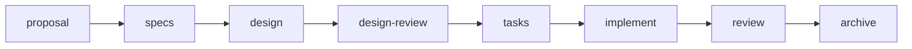
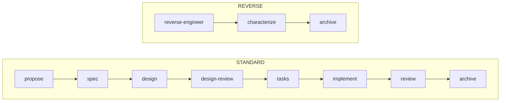

# 9. Architecture Decisions

Every decision below was settled during the design Q&A. Status of all: **Accepted**.
These are the binding decisions — do not silently change them during implementation.

---

## ADR-001: Build a standalone tool, not extend OpenSpec

**Context.** The workflow was prototyped as a fork of OpenSpec (TypeScript, npm).
Pain points: too much hardcoded, npm + root install, schema customisation requires
forking TS source, hardcoded skill templates overwritten on update, config scattered
across three layers.

**Decision.** Extract the essence into a new standalone tool for the broader community.

**Consequences.** Clean slate; freedom to fix the install/config model; loses
nothing essential (lifecycle, pluggable artifacts, graph, templates,
instructions/context/rules, delta+merge, Gherkin lint, state, skill generation).

---

## ADR-002: Implementation language is Rust

**Context.** Need a single binary, broad installability, correctness for merge/state.
Candidates: Rust, Go, Zig, Python(bundled), Nim, Crystal.

**Decision.** **Rust.**

**Rationale.** Small static binaries, strong type system for merge/state logic,
author familiarity, excellent CLI/serde ecosystem and distribution tooling
(`cargo-dist`). Go was the main alternative (easier contributor onboarding) but
correctness and familiarity won.

---

## ADR-003: Tool name is `givn`

**Context.** Need a short, memorable, fast-to-type, on-theme, available name.
Shortlist checked against crates.io, GitHub, Homebrew. Most short names
(`gild`, `canon`, `brine`, `dill`, `vine`, `plumb`) were squatted on crates.io;
`givn` and `gherk` were fully free.

**Decision.** **`givn`** (from Gherkin's `Given`). Tagline: *"from Given to done."*

**Consequences.** Binary, crate, and config directory all named `givn`. Verified
free on crates.io (HTTP 404) and Homebrew (404).

---

## ADR-004: Single static binary; no npm, no root, no runtime

**Decision.** Ship one statically-linked executable; install requires no npm, no
root/sudo, no language runtime.

**Rationale.** Direct fix of the prototype's worst install friction; maximises
adoption.

---

## ADR-005: Customisation via override files (CSS cascade)

**Context.** Options were (A) override files / cascade, (B) one monolithic config
file, (C) fixed lifecycle with hooks.

**Decision.** **(A) Override files, CSS-style cascade**: embedded defaults are the
fallback layer; project files in `givn/` win.

**Rationale.** Zero-config works out of the box; override only what you care about;
binary updates never clobber project files.

---

## ADR-006: Discover defaults via `eject` on demand

**Context.** Options: (A) `eject` on demand, (B) `init` writes ALL defaults, (C) hybrid.

**Decision.** **(A) `eject` on demand.** The project dir starts with no overrides;
`givn eject <name>` materialises a default for editing.

**Rationale.** Keeps the project dir minimal; users manage only what they changed.

---

## ADR-007: Per-facet override granularity

**Context.** Smallest overridable unit: whole artifact bundle vs each facet.

**Decision.** **Each facet** (template / instructions / deps) overridable
independently.

**Consequence.** Overrides are addressable per facet (e.g.
`givn/artifacts/<id>/template.*`, `givn/artifacts/<id>/instructions.md`); the
config cannot be one monolithic file per artifact.

---

## ADR-008: Config directory is a visible `givn/`

**Decision.** The project config directory is named after the tool and is
**visible** (`givn/`, not a dotdir).

**Rationale.** Discoverability for newcomers browsing the repo.

---

## ADR-009: Manifest is YAML

**Context.** Options: TOML, YAML, KDL.

**Decision.** **YAML** for the artifact-graph manifest.

**Rationale.** Familiar (the prototype used `schema.yaml`), handles nesting well,
comments allowed. Note (TC-6): `serde_yaml` is deprecated → use the maintained
fork **`serde_yaml_ng`**.

---

## ADR-010: Manifest customised by overlay/patch

**Context.** Options: (A) eject and fully replace the manifest, (B) overlay/patch
merged onto the embedded default graph.

**Decision.** **(B) Overlay/patch.** `givn/config.yaml` declares only
additions/changes/removals, merged onto the embedded default graph.

**Rationale.** Projects keep benefiting from default-graph improvements on upgrade
while still customising.

---

## ADR-011: The `.feature` file IS the spec

**Decision.** No `spec.md`. The `.feature` file is the delta, the executable test,
and the permanent archived record. Deltas use `@givn.*` tags; tags are stripped on
archive into clean Gherkin.

**Rationale.** Single source of truth; eliminates the duplicate-format weight of
the prototype.

---

## ADR-012: Coverage gate is completeness of classification, not a percentage

**Decision.** The review phase classifies every uncovered line as dead code /
missing test / hard-to-test and resolves each. There is **no** percentage threshold.

**Rationale.** A number is a side effect; the real goal is that every externally
visible behaviour is specified, exercised, and covered — or explicitly justified.

---

## ADR-013: Agent integration — neutral skills with mirrors (AGENTS.md user-owned)

**Context.** Two layers exist: rules/context (well standardised) and invokable
skills (emerging convention). Research findings:
- `AGENTS.md` is the ratified standard for rules/context (Linux Foundation; ~40
  tools; 60k+ repos).
- `SKILL.md`-in-a-folder is an emerging convention read from three parallel paths:
  `.claude/skills/`, `.agents/skills/` (vendor-neutral), `.opencode/skills/`.
- Slash commands are not standardised (per-tool).

**Decision.**
- `AGENTS.md` at repo root is **user-owned** — givn never writes or overwrites
  it. Users author whatever project-level rules/context they need; givn's
  workflow content lives entirely in skills and commands (loaded on demand).
- Skills → primary neutral path **`.agents/skills/<name>/SKILL.md`** (ADR-013a)
  with **built-in mirrors for `.claude/skills/` and `.opencode/skills/`** (ADR-013b).
- Skill templates are ejectable so users can retarget other tools.

**Rationale.** `AGENTS.md` is loaded into every agent context unconditionally —
auto-generating it trampled user content on every `givn skills sync` and
duplicated workflow detail already carried by the skills/commands themselves.
Leaving it user-owned keeps the always-on context free of givn-specific clutter
and respects the file as the user's own project entry point. Skills carry the
real workflow and only load when invoked.

---

## ADR-014: State is derived from the filesystem

**Context.** Options: (A) filesystem-derived, (B) explicit state file.

**Decision.** **(A) Filesystem-derived.** Presence of files determines lifecycle
state; no separate state file.

**Rationale.** No drift, git-friendly, trivially correct.

**Amendment (ADR-028).** givn does **not drive the per-scenario TDD loop** — that
remains the agent/developer's job. However, givn **does** run `verify.command`
(and other hooks) at defined gate points to confirm GREEN. "givn never executes
anything" was too strong: givn executes *hooks* (e.g. the test runner after tasks
and after review), it just does not micro-manage the RED/GREEN/REFACTOR cycle.

---

## ADR-015: Test-runner command declared in the manifest

**Context.** Options: (A) manifest-declared `verify.command`, (B) auto-detect with
override, (C) givn only lints, runner entirely external.

**Decision.** **(A)** `verify.command` is declared in the manifest, language-agnostic.

**Rationale.** Explicit and portable; `givn lint` stays a pure Gherkin static
checker while the runner (`verify.command`) is unambiguous for agents and CI.

**Default value (refined — see ADR-021).** The shipped default `verify.command`
is a deliberate **sentinel** that is not a real runner:

```yaml
verify:
  command: "givn missing-testrunner"
```

`givn missing-testrunner` is a built-in subcommand that prints actionable guidance
("no test runner configured — set `verify.command` in `givn/config.yaml` to your
project's command, e.g. `cargo test`, `mvn test`, `npx cucumber-js ...`,
`behave`") and exits non-zero. This makes the missing configuration loud and
self-documenting instead of silently running nothing or guessing wrong.

---

## ADR-016: Repository location and version control

**Decision.** New project at `~/projects/givn`; local `git init` only, no remote
for now.

---

## ADR-017: Clean break from OpenSpec; migration deferred

**Decision.** No backward-compatible reading of `openspec/` directories or
`@openspec.*` tags. A `givn migrate` command is a deferred nice-to-have.

---

## ADR-018: MVP scope includes the full stack

**Decision.** The first version includes core engine + lifecycle + skills + install
(not a reduced core-only milestone).

---

## ADR-019: `givn lint` exit-code contract (renamed from `givn verify`)

**Decision.** The static Gherkin-check command is named **`givn lint`** (renamed
from `givn verify` to remove the collision with the `verify.command` config key —
see ADR-027). It exits **0** (clean), **1** (parse error), **2** (`@wip`/PENDING).
Parse error outranks wip outranks clean. "GREEN" is determined by the test runner
(`verify.command`), not by `givn lint`.

**Rationale.** Preserves the prototype's CI-friendly contract while making clear
this command checks spec well-formedness and never runs tests.

---

## ADR-020: Delta tag namespace is `@givn.*`

**Decision.** Tags are `@givn.delta`, `@givn.added`, `@givn.modified`,
`@givn.removed`. Renamed from the prototype's `@openspec.*` for the clean break.
Test-runner feature path env var is `GIVN_FEATURES` (default `givn/specs`).

---

## ADR-021: Default `verify.command` is a self-documenting sentinel

**Context.** A freshly initialised project has no idea how to execute the
project's step definitions (the runner is language-specific: cargo/maven/npm/
behave/...). Silently doing nothing, or guessing, both produce confusing
false-GREEN states.

**Decision.** The shipped default `verify.command` is `givn missing-testrunner`,
a built-in subcommand that:
- prints a clear message that no test runner is configured,
- shows per-language examples of what to put in `givn/config.yaml`
  (`cargo test`, `mvn test`, `npx cucumber-js "givn/specs/**/*.feature"`,
  `behave`, `go test ./...`, ...),
- exits with a non-zero status so CI and agents treat it as "not yet GREEN".

**Rationale.** Makes the one mandatory per-project decision impossible to miss,
turns a config gap into guidance, and keeps `givn lint` (static Gherkin check)
cleanly separate from running the actual test runner (`verify.command`).

**Consequences.** `missing-testrunner` is a real (hidden/utility) subcommand.
The generated `givn/config.yaml` documents `verify.command` thoroughly (ADR-022).

---

## ADR-022: Generated config ships fully commented with documented defaults

**Context.** "All config in one place" only helps if users can discover what is
configurable. With eject-on-demand (ADR-006), the artifact facets are pulled in
as needed — but the top-level `givn/config.yaml` is created by `init` and is the
primary knob surface.

**Decision.** `givn init` writes a `givn/config.yaml` in which **every supported
key is present but commented out**, each with:
- a short description of what it does,
- the effective default value shown (commented),
- allowed values / format notes,
- a cross-reference to the relevant arc42/README section where useful.

Only the minimum a project must set (notably `verify.command`) is written
uncommented (or written uncommented as the sentinel default with a prominent
"CHANGE ME" note).

**Rationale.** Self-documenting config; users override exactly what they want by
uncommenting and editing; no need to read external docs to discover options. The
file doubles as living documentation of the configuration surface.

**Consequences.** The config template lives in `assets/` and must be kept in sync
with the manifest schema. A test asserts that every documented key corresponds to
a real schema key (and vice versa) so the docs cannot drift.

---

## ADR-023: Configuration is versioned with an upgrade path

**Context.** A project initialised with givn 1.0.0 should be able to adopt
improvements introduced in 1.1.0 (new keys, changed defaults, new commented
documentation) without manual archaeology. Because all config lives in the
project repo, git is the conflict-resolution surface.

**Decision.**
- The generated `givn/config.yaml` records the givn version that wrote/last
  upgraded it, via a top-level key, e.g.:
  ```yaml
  # Managed by givn. Do not delete this line.
  givn_config_version: "1.0.0"
  ```
- A `givn upgrade` command re-renders the managed/commented scaffolding of
  `givn/config.yaml` (and other generated managed files) from the current
  binary's templates, **preserving the user's uncommented overrides**, and bumps
  `givn_config_version`.
- The upgrade is performed as ordinary file writes in the project repo, so the
  user reviews the result via `git diff` and resolves any conflicts there.
- Upgrades are idempotent and never silently discard user-set values; when a key
  was removed or renamed between versions, `givn upgrade` leaves the old value in
  place and emits a note (and, where possible, a migration hint) rather than
  deleting it.

**Rationale.** Gives a real version-to-version upgrade path while keeping git as
the trusted diff/merge tool. Honours "project files always win" (ADR-005): user
overrides are preserved; only the documentation/scaffolding layer is refreshed.

**Consequences.** Adds a `givn upgrade` command and a `givn_config_version`
marker. Managed-but-editable files need a clear convention distinguishing
user-owned regions (uncommented overrides) from givn-managed regions (the
commented documentation scaffold). See chapter 8.10.

**Scope note.** v1 targets `givn/config.yaml` and generated agent files
(via `givn skills sync`). Upgrading ejected artifact facets is left to the user
through `git diff` against a re-eject; a future enhancement may assist this.

---

## ADR-024: Artifacts (the workflow) are first-class configurable data

**Context.** The default lifecycle is propose → spec → design → design-review
→ tasks → implement → review → archive. Projects legitimately need to vary
this: skip the review gate, make review optional, add a dedicated refactor step
after implementation, or insert custom artifacts (e.g. a risk assessment). Prior
tools hardcoded the workflow, forcing a source fork to change it.

**Decision.** The lifecycle is **entirely described by the manifest** (artifacts,
their `requires` graph, the `apply` gate) and is fully reconfigurable per project
via the overlay (ADR-010). The artifact schema gains:
- `optional: bool` — an artifact that may be skipped without blocking the lifecycle.
- `remove: true` — an overlay directive deleting a default artifact by id.

Order is derived from `requires` (a DAG), so changing dependencies reorders the
workflow. `apply.requires` independently controls which artifacts gate archive.

`givn` validates the effective graph: no cycles, no dangling `requires`, and
`apply.requires` may not reference a removed non-optional artifact; otherwise it
refuses with a clear error. Filesystem-derived state (ADR-014) is computed from
the effective artifact set, not a hardcoded list.

**Rationale.** Makes "add/remove/reorder steps" a config change, never a fork.
Directly satisfies the requirement to keep artifacts configurable (e.g. optional
review, extra refactor step).

**Consequences.** Manifest model adds `optional` and the `remove` overlay
directive; graph validation is required (Phase 2). Custom artifacts need a
project-provided template/instruction (or a minimal generated stub). See ch.8.2.

---

## ADR-025: Strict separation of specification and implementation

**Context.** Gherkin `.feature` files and proposals tend to accumulate
implementation detail (class/function names, frameworks, routes, step mechanics),
which couples the specification to one implementation and undermines the
"`.feature` is the durable source of truth" principle.

**Decision.** Enforce a hard boundary:
- **Specification layer** — `proposal` and `specs` (`.feature`) — describe WHAT
  and WHY (observable behaviour, domain language) and must be
  implementation-independent.
- **Implementation layer** — `design` and `tasks` (and any custom impl
  artifacts) — carry the HOW (technology, step definitions, runner, build steps).
- The **only** permitted implementation-flavoured content in the spec is an
  aspect that is itself an externally observable requirement (e.g. "response is
  valid JSON", "data persists across restart", "responds within 200 ms").
  Heuristic: if it would still hold under a reasonable reimplementation, it is a
  spec; otherwise it is design/tasks.

This is enforced through the **default artifact instructions**: proposal and spec
instructions explicitly forbid implementation detail; design and tasks
instructions explicitly own it. Instructions are cascade-resolved and ejectable,
so projects may adjust the wording.

**Rationale.** Keeps proposals and specs valid across reimplementations; makes
specs reviewable by domain experts; preserves the spec as the durable contract.

**Consequences.** The default template/instruction text for proposal and spec
(Phase 1) must state the prohibition and the narrow exception; design and tasks
text must explicitly capture the "how". Reviews should flag leakage of
implementation detail into the spec layer.

---

## ADR-026: Optional arc42 documentation artifact (addon)

**Context.** Beyond per-change artifacts, projects often want durable, evolving
architecture documentation. A natural fit is an artifact that creates and
maintains arc42 documents — e.g. running after the `design` step so that the
project-level architecture docs reflect the change. This must be opt-in and not
imposed on projects that do not want it.

**Decision.** Ship an **optional `arc42-docs` artifact** (an addon enabled via
config), realising the configurable-artifacts mechanism (ADR-024):
- It is **not** part of the default active gate; projects enable it by adding it
  to the overlay (and, if desired, to `apply.requires`).
- It `requires: [design]` by default, so it runs after design (the change's "how"
  is known) and keeps the durable arc42 docs in sync.
- It maintains **project-level** arc42 documents (the living architecture of the
  whole system), distinct from per-change artifacts. Target location is
  configurable; default `docs/arc42/` (one file per chapter, matching this very
  project's convention).
- It ships with templates for the 12 arc42 chapters and an index, plus an
  instruction to **create missing chapters and update affected ones** based on
  the change's proposal/spec/design — not to rewrite everything each time.
- Like all artifacts, its templates and instructions are cascade-resolved and
  ejectable; the chapter set and output path are configurable.

**Rationale.** Gives teams first-class, maintained architecture docs as a
composable step, demonstrates the addon/extension model, and stays fully optional.

**Consequences.** Adds embedded assets: `assets/addons/arc42-docs/` (chapter
templates + index + instruction; asset directory name matches artifact id). Adds
an "addons" notion in docs/config: an addon is simply a pre-packaged artifact
(or set of artifacts) the user enables via overlay. The arc42 docs it manages
are durable (live under `docs/`), updated across changes, and are not archived
per-change. See ch.8.11.

---

## ADR-027: Lint command renamed `givn verify` → `givn lint`; `verify.command` kept

**Context.** The prototype had a `givn verify` command (static Gherkin check) and
a `verify.command` config key (the command that runs the actual tests). Same word
"verify" for two different operations — and "verify" implies running tests, which
the command does **not** do. This caused real confusion.

**Decision.**
- Rename the static-check command **`givn verify` → `givn lint`**. It checks
  `.feature` syntax, `@wip`/PENDING, and delta tags only; it runs no tests.
- **Keep** the config key **`verify.command`** as the command that runs the actual
  tests (default sentinel `givn missing-testrunner`).
- There is intentionally **no** `givn verify` or `givn test` command: givn does
  not execute the test suite (ADR-014); the agent/CI invokes `verify.command`.

**Rationale.** Two distinct words for two distinct operations removes the
collision. `lint` clearly signals "static check, no execution"; `verify.command`
clearly signals "the command that verifies behaviour by running tests".

**Consequences.** Module `cli::verify` → `cli::lint` (`verify.rs` → `lint.rs`).
All docs/skills/instructions reference `givn lint` for the static check and
`verify.command` for the runner. The `verify.command` key name is unchanged, so
existing config semantics are preserved.

---

## ADR-028: Per-artifact post hooks; givn runs `verify.command` at gates

**Context.** `verify.command` defined the test runner but nothing in givn ever
ran it — it was purely informational, invoked only by the agent/CI. To make the
flow self-contained and give `verify.command` real meaning, givn should run the
tests at the right points (notably after `tasks` and after `review`) and confirm
GREEN before allowing progression/archive.

**Decision.** Introduce **per-artifact `post` hooks** in the manifest (realising
the configurable-artifacts model, ADR-024):

- Each artifact may declare `post: [ ... ]` — commands run after that artifact is
  completed. A hook entry is either:
  - a **named built-in**: `verify` (runs the resolved `verify.command`) or
    `lint` (runs `givn lint` on the relevant features), or
  - an **arbitrary shell command string** (e.g. `"npm run typecheck"`).
- An entry may be an object for options, e.g.
  `{ run: verify, allow_failure: false, name: "tests green" }`.
- **Defaults:** `tasks.post: [verify]` and `review.post: [verify]` so the test
  runner executes after implementation and after review.
- **Failure blocks the gate**: a failing hook (non-zero) blocks progression and
  givn exits non-zero. `allow_failure: true` downgrades a hook to a warning.
- **Invocation:**
  - `givn check <artifact>` runs that artifact's hooks on demand.
  - `givn check` (no arg) runs hooks for all artifacts whose output exists.
  - `givn archive` **auto-runs the hooks of every `apply.requires` artifact** as
    the archive gate; archive is refused if any required hook fails.
- The sentinel default `verify.command` (`givn missing-testrunner`) therefore
  causes `givn check`/`givn archive` to fail loudly until a real runner is set —
  exactly the desired "nothing falsely reports green" behaviour, now enforced by
  givn itself.

**Rationale.** Makes the workflow self-contained (givn confirms GREEN, not just
the agent), gives `verify.command` a concrete role, and stays fully configurable
(hooks are data; override/extend via overlay, eject, or `allow_failure`). Reuses
one runner definition across all gate points.

**Consequences.**
- Manifest schema gains `post` on artifacts (built-in or shell entries, with
  `allow_failure`/`name`). Amends ADR-014 (givn now executes hooks).
- New `cli::check` command and a `hooks` runner module (resolve + execute, map
  exit codes, stream output). `givn archive` integrates the gate.
- Hooks run with `GIVN_FEATURES` set appropriately (active change vs permanent
  specs) so the test runner targets the right `.feature` files.
- Security note: hooks execute shell commands from the project's own config
  (same trust level as a Makefile/justfile in the repo); givn does not fetch or
  run remote commands.

---

## ADR-029: Design constraints are baked into task bodies; implement prompt enforces design adherence

**Context.** During the first real dogfood run (a Rust/HTMX/SSE web app), coding
subagents running `/givn-implement` ignored `design.md`. Each subagent received
only a bare RED/GREEN/REFACTOR task skeleton and interpreted "minimum production
code to make the scenario pass" as: take the shortest path that satisfies the
test assertions, regardless of the architecture specified in design.md. The result
was a working test suite over an implementation that violated every key design
decision (no HTMX attributes, no SSE endpoint, no CSS framework, full-page
redirects instead of HTML fragments, empty `main`).

**Root cause.** The task body was the subagent's primary context. It contained no
design specifics — only the TDD cycle steps. Nothing in the prompt chain prevented
a conforming test from being written against a non-conforming implementation.

**Decision.**

1. **Tasks artifact: every scenario task must include a "Design constraints"
   block** populated from design.md and specific to that scenario — which
   module/layer owns the behaviour, which protocol or library to use, what
   response shape or side-effect the design mandates. The block is mandatory; a
   task body without it is considered incomplete.

2. **Implement prompt: coding subagents must read design.md in full before
   touching any file.** The subagent prompt has an explicit pre-RED step:
   "read givn/changes/<id>/design.md — do not substitute a simpler approach that
   happens to make a test pass."

3. **GREEN definition is sharpened:** "minimum production code that makes this
   scenario pass, following the design constraints in the task and the
   architecture in design.md exactly. 'Minimum' means fewest lines that satisfy
   the scenario — it does not mean a simpler architecture than the one designed."

4. **Orchestrator guardrail:** if a coding subagent reports GREEN but deviated
   from the design, the orchestrator rejects and re-spawns. GREEN requires the
   scenario passes AND the implementation matches the design.

**Rationale.** The "minimum code" principle is correct and preserved — it governs
implementation *size*, not architectural *conformance*. These two concerns were
conflated; separating them fixes the root cause without weakening TDD discipline.
The fix is entirely in the prompt layer (assets/commands/); no binary changes.

**Consequences.**
- `givn-tasks.md`: task template updated with "Design constraints" block and
  rules; guardrail added.
- `givn-implement.md`: step 4 requires full design.md; subagent prompt has
  pre-RED read step; GREEN clarified; orchestrator guardrail added.
- `givn-propose.md`: architect's tasks section requires "Design constraints"
  block per scenario task (mandatory, not optional).
- All changes are technology-neutral — no framework, language, or library names
  appear in the prompts.

---

## ADR-030: Design-review artifact — plan stress-test before tasks

**Context.** After the first real dogfood run revealed that implementation could
diverge from the design (ADR-029), the immediate fix was to strengthen the task
and implement prompts. But a deeper safeguard is to catch design problems before
the task list is even written — when changing a decision costs a markdown edit
rather than a rewrite. Reviewing the plan *after* tasks are written is too late:
the tasks encode the design decisions, so a flawed design produces flawed tasks
that produce a flawed implementation.

**Decision.** Add a `design-review` artifact to the default manifest, positioned
after `design` and before `tasks`:



`design-review` requires `[design]` and `tasks` requires `[design-review]`. It
is NOT in `apply.requires` (still `[tasks, review]`) — it is a planning-layer
gate that blocks tasks, not an archive gate.

The artifact runs in two phases via subagents in clean contexts:

1. **Grilling subagent** — reads all planning artifacts (proposal, spec, design)
   and the relevant codebase, then returns a ranked list of questions with
   recommended answers. The orchestrator presents questions to the user one at a
   time, waits for each answer, and records outcomes. If a question can be
   answered by exploring the codebase, the subagent does so and reports the
   finding instead of asking the user.

   Required branches: scope, tech choices, missing scenarios, testability, risk.

2. **Hardening subagent** — applies all decisions reached: update design.md,
   add missing scenarios to specs/*.feature. Does NOT write tasks.md (that is
   the next artifact). Runs `givn lint` after any feature edits.

Sign-off requires the string `DESIGN-REVIEW: PASS` in `design-review.md`. If
blocking open questions remain, the subagent writes `DESIGN-REVIEW: FAIL`.

**Rationale.** The design-review is a plan-layer gate, separate from the
post-implementation coverage review. It catches architectural decisions that are
wrong, scope that doesn't match the proposal, and scenarios that are untestable
— all before tasks are written. Running it before tasks (rather than after) means
the tasks are written against a hardened plan, not a draft. Using subagents
(rather than running inline) gives the grilling and hardening work a clean
context, consistent with how the coverage review works.

**Consequences.**
- `assets/default-manifest.yaml`: new `design-review` artifact, `requires:
  [design]`; `tasks` now `requires: [design-review]`; `review` stays
  `requires: [tasks]`; `apply.requires` unchanged at `[tasks, review]`.
- `assets/instructions/design-review.md`: grilling branches and hardening rules.
- `assets/templates/design-review.md`: grilling log, codebase findings, open
  questions, hardening changes, sign-off checklist, `DESIGN-REVIEW: PASS` marker.
- `assets/commands/givn-design-review.md`: orchestrator prompt — spawns grilling
  subagent, runs interactive one-question-at-a-time loop, spawns hardening
  subagent.
- `assets/skills/givn-design-review/SKILL.md.tmpl`: skill template.
- `src/state.rs`: `detect_design_review_pass()` parallel to `detect_review_pass()`.
- `src/cli/archive.rs`: error message covers both sign-off markers.

---

## ADR-031: Explore is a pre-lifecycle skill, not a manifest artifact

**Context.** The workflow starts at `proposal` — the first artifact in the
manifest. But before a proposal is written, the problem may be too vague to
formalise: the user might be comparing approaches, investigating feasibility, or
just thinking out loud. Forcing them into `givn new <id>` + `/givn-propose` to
start thinking is premature structure.

**Decision.** Add `givn-explore` as a **skill and command only** — not a manifest
artifact. It has:
- No entry in `default-manifest.yaml`.
- No `generates`, no state tracking, no sign-off marker, no gate.
- No template or instruction (it has no structured output).

Explore is a **stance**: curious, visual, grounded, patient. It reads the
codebase, asks questions, surfaces options, and visualises. It produces
*thinking*, not artifacts. When thinking crystallises, the user transitions to
`/givn-propose <id>` to enter the formal lifecycle.

The relationship to `design-review` is complementary:
- **explore** (pre-proposal): divergent — "what should we build?"
- **design-review** (post-design): convergent — "is this plan sound?"

**Rationale.** The value of explore is its lack of structure. Making it an
artifact with a template and a sign-off marker would kill the stance. givn's
lifecycle starts at `proposal`; explore is pre-lifecycle, like `givn init` or
`givn completions` — a utility, not a lifecycle step. If a user wants to keep
exploration notes, they can write them anywhere; givn doesn't need to track them.

**Consequences.**
- `assets/commands/givn-explore.md`: command prompt — stance, what you might do,
  givn awareness, guardrails.
- `assets/skills/givn-explore/SKILL.md.tmpl`: skill template.
- `docs/arc42/08-crosscutting-concepts.md`: skills list updated.
- No manifest, state, or binary changes — explore is pure prompt layer.

---

## ADR-032: Reverse-engineering mode — characterization for baseline spec creation (SUPERSEDED by ADR-033)

> **Superseded.** This ADR described reverse-engineering as a variant of the
> normal change lifecycle with reverse-mode instruction overrides for every
> artifact (proposal, design, tasks, review). ADR-033 replaces it with a
> separate peer flow that produces only Gherkin specs + characterization
> tasks — no proposal, no design, no design-review. The empty-baseline merge
> mechanics from this ADR are retained.

**Context.** givn is delta-centric: every change assumes a permanent spec
already exists to delta against. But the first dogfood (givn on givn, Phase 7)
requires creating the initial baseline spec from an existing codebase. There is
no "create the initial permanent spec" path — `givn new` creates a change
scaffold, and `archive` merges the delta into the (possibly empty) permanent
spec.

Reverse-engineering an existing codebase is not a delta — it's producing the
initial baseline by characterizing observed behaviour. This must work within
givn's existing lifecycle without parallel paths or bypassed gates.

**Decision.** Reverse-engineering is a **normal givn change** with all
`@givn.added` scenarios against an empty permanent spec. On archive, the merge
creates the initial `givn/specs/<cap>/<cap>.feature` baseline. The difference
from a normal change lives entirely in **prompt-layer instructions**, not in
the Rust binary or manifest.

Two new prompt-layer commands:
- `/givn-reverse-engineer` — planning orchestrator with an interactive
  **discovery phase** (explores the codebase, proposes one capability with a
  black-box boundary, confirms with the user). Then delegates to an architect
  subagent using reverse-mode instructions: proposal (descriptive, AS-IS),
  specs (observed behaviour, `@givn.added @wip`), design (seam strategy,
  testability-only refactor plan), tasks (characterization cycles, GREEN-first).
- `/givn-characterize` — execution + review orchestrator. Phase 1:
  characterization loop (GREEN-first tests, testability seams, spec/implementation
  mismatch diagnostic). Phase 2: reverse review epilogue (coverage with no
  dead-code deletion, bug flagging, behaviour-preservation invariant).

Five reverse-mode instruction files in `assets/instructions/`:
`proposal-reverse.md`, `specs-reverse.md`, `design-reverse.md`,
`tasks-reverse.md`, `review-reverse.md`.

**Key principles:**
- **Descriptive, not prescriptive.** Specs capture what the system *does*
  today, not what it *should* do.
- **GREEN-first, not RED-first.** Characterization tests are written to match
  observed behaviour and must pass immediately. If they fail, the spec (or the
  documentation that informed it) is wrong — never the production code.
- **No behaviour change.** Production code is refactored only for testability
  seams (extract interface, DI, make public). General cleanup (rename, dedup,
  logic simplification) is forbidden.
- **Bugs are flagged, never fixed.** Suspected bugs are recorded as follow-up
  `@givn.modified` candidates. Dead code is flagged as `@givn.removed`
  candidates. Neither is addressed in the reverse-engineering change.
- **REVERSE-ENGINEERING NOTE markers.** When code is ambiguous/misleading and
  caused a wrong spec inference, a code comment is added (language-agnostic
  comment syntax) starting with `REVERSE-ENGINEERING NOTE:`. These are
  intentional debt markers, grep-able, never removed during characterization.

**Failure diagnosis priority** (when `verify.command` fails during
characterization):
1. **Test infrastructure problem** (most common) — fix test plumbing only.
2. **Spec/implementation mismatch** — diagnose: documentation was wrong
   (update docs + spec) or code is ambiguous (update spec to AS-IS, add
   REVERSE-ENGINEERING NOTE comment).

**Rationale.** Option A (normal change, empty-baseline delta) was chosen over
Option B (bootstrap command, bypass lifecycle) because it dogfoods the *entire*
lifecycle on givn's first use — which is the point of Phase 7. The delta-tag
degeneracy (`@givn.added` on everything) is semantically correct and
cosmetically minor. The merge engine already handles `permanent_text: None`.

Prompt-only (no CLI awareness) was chosen over binary-level reverse mode
because the lifecycle mechanics already support it. The "reverse mode" is
enforced by instructions, not by the binary — this is acceptable for v1.

**Consequences.**
- `assets/commands/givn-reverse-engineer.md`: planning orchestrator with
  discovery phase.
- `assets/commands/givn-characterize.md`: execution + review orchestrator.
- `assets/skills/givn-reverse-engineer/SKILL.md.tmpl`: skill template.
- `assets/skills/givn-characterize/SKILL.md.tmpl`: skill template.
- `assets/instructions/proposal-reverse.md`, `specs-reverse.md`,
  `design-reverse.md`, `tasks-reverse.md`, `review-reverse.md`: canonical
  reverse-mode instructions (inlined into command prompts; not served by CLI
  today).
- `src/skills/render.rs`, `src/skills/targets.rs`: new skills/commands added to
  sync lists.
- `src/gherkin/merge.rs`: `apply_deltas` now takes `delta_feature_name` and
  uses it for the empty-baseline header (was `"Feature: (merged)\n"`).
- `docs/arc42/08-crosscutting-concepts.md`: reverse-engineering section added.
- `docs/TASKS.md`: Phase 5.9 added; Phase 7 updated.
- `README.md`: quickstart entries added.
- `/givn-design-review` is reused as-is (grilling branches apply equally to
  reverse-engineering plans).
- No manifest, state, or CLI subcommand changes — reverse-engineering is pure
  prompt layer driving existing `givn new`/`givn status --change`/`givn archive`.

---

## ADR-033: Reverse-engineering as a peer flow (supersedes ADR-032)

**Context.** ADR-032 implemented reverse-engineering as a variant of the
normal change lifecycle: every artifact (proposal, specs, design, tasks,
review) was produced with "reverse-mode" instruction overrides. Five
`*-reverse.md` instruction files existed solely to override the normal meaning
of each artifact.

In practice, this was a semantic stretch:
- "Proposal" doesn't fit — a proposal describes what *should* be;
  reverse-engineering documents what *is*. The `proposal-reverse.md`
  instruction had to lead with "this is not a proposal, it's a
  characterization" — a smell that the artifact name was wrong.
- "Design" was mostly test-harness plumbing (runner choice, step locations,
  seam strategy). Useful, but not "design" in the same sense as designing new
  behaviour.
- The 5 reverse-mode instruction files were the proof of the mixing: they
  existed only to override the normal meaning of each artifact.
- The deliverable is small: descriptive `.feature` + executable step
  definitions, with suspected bugs/smells flagged. The 6-artifact pipeline
  was heavy for that.

**Decision.** Reverse-engineering becomes a **separate peer flow** to the
normal change lifecycle, not a variant of it. It produces only 3 artifacts:
`specs/<cap>/<cap>.feature`, `tasks.md`, and `review.md`. No proposal, no
design, no design-review.



Content that used to live in proposal.md and design.md moves to more
appropriate homes:
- **Black-box boundary** → `.feature` Feature: description block.
- **Suspected bugs (from discovery)** → `.feature` Feature: description block.
- **Suspected bugs/smells (from characterization)** → production code
  `TODO: REVERSE-ENGINEERING NOTE:` comments (IDE-discoverable via `TODO:`
  prefix, grep-able via `REVERSE-ENGINEERING NOTE:`).
- **Seam strategy** → per-task "Seam" blocks in `tasks.md`.
- **verify.command choice** → first task in `tasks.md` (harness setup).

A new shared `givn-steps` skill centralizes step-writing mechanics (the
RED/GREEN/REFACTOR loop, step reuse, lint-vs-test distinction), referenced by
both `/givn-implement` and `/givn-characterize`. This eliminates duplication
of step-writing guidance between the two flows.

The characterization loop is **RED/GREEN/REFACTOR** (same structure as normal
TDD), not "GREEN-first" as in ADR-032. RED confirms the test can fail (new
steps get unimplemented assertions; reused steps are kept as-is). GREEN
implements real assertions probing observed behaviour. This catches fake
GREEN (no-op assertions that pass trivially) and confirms the test harness is
wired up before investing in real assertions. Step reuse is first-class: if
all steps in a scenario are reused and already GREEN, the scenario is
legitimately complete without an artificial RED round-trip.

**Binary changes (minimal):**
- `givn new --skip <artifact-id>[,<artifact-id>...]` — skips scaffolding for
  named artifacts, writes `.givn-skip` file.
- `ArtifactStatus::Skipped` — new enum variant in `state.rs`. Treated as
  satisfied by `all_required_done()`, `next_required()`, and the archive gate.
  Displayed as ⊘ in `givn status`.
- `givn-steps` skill added to sync lists in `render.rs` and `targets.rs`.

**No changes to:** `src/gherkin/merge.rs` (empty-baseline merge retained from
ADR-032), `src/cli/lint.rs`, `src/cli/instructions.rs`, `src/config/`,
`givn/config.yaml` (no manifest overlay needed).

**Key principles (retained from ADR-032):**
- **Descriptive, not prescriptive.** Specs capture what the system *does*
  today, not what it *should* do.
- **No behaviour change.** Production code is refactored only for testability
  seams. General cleanup is forbidden.
- **Bugs are flagged, never fixed.** Suspected bugs are recorded as follow-up
  `@givn.modified` candidates. Dead code is flagged as `@givn.removed`
  candidates.
- **TODO: REVERSE-ENGINEERING NOTE markers.** The `TODO:` prefix ensures IDE
  discoverability; `REVERSE-ENGINEERING NOTE:` is grep-able. Never removed
  during characterization.

**Rationale.** The peer-flow approach was chosen over ADR-032's
variant-of-normal approach because:
- It eliminates the semantic stretch of calling a characterization a
  "proposal" and a test-harness plan a "design."
- It removes the need for 5 parallel instruction files that existed only to
  override normal meanings. Only 3 reverse-mode instruction files remain
  (`specs-reverse.md`, `tasks-reverse.md`, `review-reverse.md`); the other 2
  (`proposal-reverse.md`, `design-reverse.md`) are deleted.
- The `givn-steps` skill deduplicates step-writing mechanics between both
  flows, making the shared RED/GREEN/REFACTOR loop explicit.
- The `--skip` flag + `Skipped` status provide deterministic, visible state
  in `givn status` — no informational noise about pending artifacts that will
  never be produced.
- The deliverable (descriptive specs + executable step definitions) is
  proportionate to the 3-artifact pipeline.

**Consequences.**
- `assets/commands/givn-reverse-engineer.md`: rewritten — no proposal/design/
  design-review; writes .feature and tasks.md directly.
- `assets/commands/givn-characterize.md`: simplified — references `givn-steps`
  for step mechanics, `givn-review` for coverage mechanics.
- `assets/skills/givn-reverse-engineer/SKILL.md.tmpl`: rewritten.
- `assets/skills/givn-characterize/SKILL.md.tmpl`: simplified.
- `assets/skills/givn-steps/SKILL.md.tmpl`: new shared step-writing skill.
- `assets/commands/givn-steps.md`: new shared step-writing command.
- `assets/skills/givn-implement/SKILL.md.tmpl`: edited to reference `givn-steps`.
- `assets/commands/givn-implement.md`: edited to reference `givn-steps`.
- `assets/instructions/proposal-reverse.md`: deleted.
- `assets/instructions/design-reverse.md`: deleted.
- `assets/instructions/specs-reverse.md`: simplified (no proposal/design refs).
- `assets/instructions/tasks-reverse.md`: rewritten (RED/GREEN/REFACTOR with
  step reuse, no design.md refs, `TODO: REVERSE-ENGINEERING NOTE:` format).
- `assets/instructions/review-reverse.md`: slimmed (references givn-review for
  coverage mechanics, reverse rules only).
- `src/cli/new.rs`: `--skip` flag, `.givn-skip` file writing.
- `src/state.rs`: `ArtifactStatus::Skipped`, `is_skipped()`, `read_skip_list()`,
  `SKIP_FILE` constant.
- `src/cli/status.rs`: ⊘ symbol for skipped, `"skipped"` in JSON.
- `src/cli/archive.rs`: gate treats `Skipped` as satisfied.
- `src/cli/apply.rs`: missing-artifacts report excludes `Skipped`.
- `src/skills/render.rs`, `src/skills/targets.rs`: `givn-steps` added to sync
  lists.
- `docs/arc42/08-crosscutting-concepts.md`: §8.13 rewritten.
- `docs/arc42/09-architecture-decisions.md`: ADR-032 marked superseded,
  ADR-033 added.
- `docs/TASKS.md`: Phase 5.9 updated.
- `README.md`: reverse-engineering section and quickstart updated.
- `givn/archive/reverse-engineer-new-command/`: historical archive, unchanged.
  The permanent spec `givn/specs/new-command/new-command.feature` is valid.

---

## ADR-034: Dual-license MIT OR Apache-2.0

**Context.** The project was created with `license = "TBD"` in `Cargo.toml` and
"not yet chosen" in README.md. This blocks `cargo publish` and signals ambiguity
to potential contributors. A license is a prerequisite for distributing the tool
as open source (OC-4).

**Decision.** Dual-license under **MIT OR Apache-2.0**.

**Rationale.** This is the Rust ecosystem standard. The majority of published
Rust crates use this dual-license. It provides:
- MIT: broad, simple, permissive — widely compatible.
- Apache-2.0: patent grant, contribution terms — preferred by some contributors
  and organisations.

Users choose which license applies. The dual form avoids forcing a choice and
maximises compatibility. Both licenses are OSI-approved and GitHub-recognised.

**Consequences.**
- `Cargo.toml`: `license = "MIT OR Apache-2.0"`.
- `README.md`: license section updated from "not yet chosen" to state the dual
  license.
- No CLA (Contributor License Agreement) needed — both licenses handle inbound=
  outbound contribution terms.
- OC-4 (license TBD) is resolved.
- Empty-baseline merge mechanics from ADR-032 retained.
