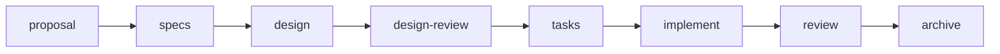
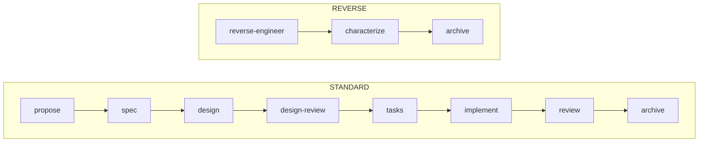

# 9. Architecture Decisions

Every decision below was settled during the design Q&A. Decisions marked
`accepted` are binding; decisions marked `superseded by ADR-NNN` remain
historical context and are not the current contract. Do not silently change a
binding decision during implementation.

---

## ADR-001: Build a standalone tool, not extend OpenSpec

**Context.** The workflow was prototyped as a fork of OpenSpec (TypeScript, npm).
Pain points: too much hardcoded, npm + root install, schema customisation requires
forking TS source, hardcoded skill templates overwritten on update, config scattered
across three layers.

**Decision.** Extract the essence into a new standalone tool for the broader community.

**Consequences.** Clean slate; freedom to fix the install/config model; loses
nothing essential (lifecycle, pluggable artifacts, graph, templates,
instructions/context/rules, delta+merge, Gherkin lint, state, skill generation).

---

## ADR-002: Implementation language is Rust

**Context.** Need a single binary, broad installability, correctness for merge/state.
Candidates: Rust, Go, Zig, Python(bundled), Nim, Crystal.

**Decision.** **Rust.**

**Rationale.** Small static binaries, strong type system for merge/state logic,
author familiarity, excellent CLI/serde ecosystem and distribution tooling
(`cargo-dist`). Go was the main alternative (easier contributor onboarding) but
correctness and familiarity won.

---

## ADR-003: Tool name is `givn`

**Context.** Need a short, memorable, fast-to-type, on-theme, available name.
Shortlist checked against crates.io, GitHub, Homebrew. Most short names
(`gild`, `canon`, `brine`, `dill`, `vine`, `plumb`) were squatted on crates.io;
`givn` and `gherk` were fully free.

**Decision.** **`givn`** (from Gherkin's `Given`). Tagline: *"from Given to done."*

**Consequences.** Binary, crate, and config directory all named `givn`. Verified
free on crates.io (HTTP 404) and Homebrew (404).

---

## ADR-004: Single static binary; no npm, no root, no runtime

**Decision.** Ship one statically-linked executable; install requires no npm, no
root/sudo, no language runtime.

**Rationale.** Direct fix of the prototype's worst install friction; maximises
adoption.

---

## ADR-005: Customisation via override files (CSS cascade)

**Context.** Options were (A) override files / cascade, (B) one monolithic config
file, (C) fixed lifecycle with hooks.

**Decision.** **(A) Override files, CSS-style cascade**: embedded defaults are the
fallback layer; project files in `givn/` win.

**Rationale.** Zero-config works out of the box; override only what you care about;
binary updates never clobber project files.

---

## ADR-006: Discover defaults via `eject` on demand

**Context.** Options: (A) `eject` on demand, (B) `init` writes ALL defaults, (C) hybrid.

**Decision.** **(A) `eject` on demand.** The project dir starts with no overrides;
`givn eject <name>` materialises a default for editing.

**Rationale.** Keeps the project dir minimal; users manage only what they changed.

---

## ADR-007: Per-facet override granularity

**Context.** Smallest overridable unit: whole artifact bundle vs each facet.

**Decision.** **Each facet** (template / instructions / deps) overridable
independently.

**Consequence.** Overrides are addressable per facet (e.g.
`givn/artifacts/<id>/template.*`, `givn/artifacts/<id>/instructions.md`); the
config cannot be one monolithic file per artifact.

---

## ADR-008: Config directory is a visible `givn/`

**Decision.** The project config directory is named after the tool and is
**visible** (`givn/`, not a dotdir).

**Rationale.** Discoverability for newcomers browsing the repo.

---

## ADR-009: Manifest is YAML

**Context.** Options: TOML, YAML, KDL.

**Decision.** **YAML** for the artifact-graph manifest.

**Rationale.** Familiar (the prototype used `schema.yaml`), handles nesting well,
comments allowed. Note (TC-6): `serde_yaml` is deprecated → use the maintained
fork **`serde_yaml_ng`**.

---

## ADR-010: Manifest customised by overlay/patch

**Context.** Options: (A) eject and fully replace the manifest, (B) overlay/patch
merged onto the embedded default graph.

**Decision.** **(B) Overlay/patch.** `givn/config.yaml` declares only
additions/changes/removals, merged onto the embedded default graph.

**Rationale.** Projects keep benefiting from default-graph improvements on upgrade
while still customising.

---

## ADR-011: The `.feature` file IS the spec

**Decision.** No `spec.md`. The `.feature` file is the delta, the executable test,
and the permanent archived record. Deltas use `@givn.*` tags; tags are stripped on
archive into clean Gherkin.

**Rationale.** Single source of truth; eliminates the duplicate-format weight of
the prototype.

---

## ADR-012: Coverage gate is completeness of classification, not a percentage

**Decision.** The review phase classifies every uncovered line as dead code /
missing test / hard-to-test and resolves each. There is **no** percentage threshold.

**Rationale.** A number is a side effect; the real goal is that every externally
visible behaviour is specified, exercised, and covered — or explicitly justified.

---

## ADR-013: Agent integration — neutral skills with mirrors (AGENTS.md user-owned)

**Context.** Two layers exist: rules/context (well standardised) and invokable
skills (emerging convention). Research findings:
- `AGENTS.md` is the ratified standard for rules/context (Linux Foundation; ~40
  tools; 60k+ repos).
- `SKILL.md`-in-a-folder is an emerging convention read from three parallel paths:
  `.claude/skills/`, `.agents/skills/` (vendor-neutral), `.opencode/skills/`.
- Slash commands are not standardised (per-tool).

**Decision.**
- `AGENTS.md` at repo root is **user-owned** — givn never writes or overwrites
  it. Users author whatever project-level rules/context they need; givn's
  workflow content lives entirely in skills and commands (loaded on demand).
- Skills → primary neutral path **`.agents/skills/<name>/SKILL.md`** (ADR-013a)
  with **built-in mirrors for `.claude/skills/` and `.opencode/skills/`** (ADR-013b).
- Skill templates are ejectable so users can retarget other tools.

**Rationale.** `AGENTS.md` is loaded into every agent context unconditionally —
auto-generating it trampled user content on every `givn skills sync` and
duplicated workflow detail already carried by the skills/commands themselves.
Leaving it user-owned keeps the always-on context free of givn-specific clutter
and respects the file as the user's own project entry point. Skills carry the
real workflow and only load when invoked.

---

## ADR-014: State is derived from the filesystem

**Context.** Options: (A) filesystem-derived, (B) explicit state file.

**Decision.** **(A) Filesystem-derived.** Presence of files determines lifecycle
state; no separate state file.

**Rationale.** No drift, git-friendly, trivially correct.

**Amendment (ADR-028).** givn does **not drive the per-scenario TDD loop** — that
remains the agent/developer's job. However, givn **does** run `verify.command`
(and other hooks) at defined gate points to confirm GREEN. "givn never executes
anything" was too strong: givn executes *hooks* (e.g. the test runner after tasks
and after review), it just does not micro-manage the RED/GREEN/REFACTOR cycle.

---

## ADR-015: Test-runner command declared in the manifest

**Context.** Options: (A) manifest-declared `verify.command`, (B) auto-detect with
override, (C) givn only lints, runner entirely external.

**Decision.** **(A)** `verify.command` is declared in the manifest, language-agnostic.

**Rationale.** Explicit and portable; `givn lint` stays a pure Gherkin static
checker while the runner (`verify.command`) is unambiguous for agents and CI.

**Default value (refined — see ADR-021).** The shipped default `verify.command`
is a deliberate **sentinel** that is not a real runner:

```yaml
verify:
  command: "givn missing-testrunner"
```

`givn missing-testrunner` is a built-in subcommand that prints actionable guidance
("no test runner configured — set `verify.command` in `givn/config.yaml` to your
project's command, e.g. `cargo test`, `mvn test`, `npx cucumber-js ...`,
`behave`") and exits non-zero. This makes the missing configuration loud and
self-documenting instead of silently running nothing or guessing wrong.

---

## ADR-016: Repository location and version control

**Decision.** New project at `~/projects/givn`; local `git init` only, no remote
for now.

---

## ADR-017: Clean break from OpenSpec; migration deferred

**Decision.** No backward-compatible reading of `openspec/` directories or
`@openspec.*` tags. A `givn migrate` command is a deferred nice-to-have.

---

## ADR-018: MVP scope includes the full stack

**Decision.** The first version includes core engine + lifecycle + skills + install
(not a reduced core-only milestone).

---

## ADR-019: `givn lint` exit-code contract (renamed from `givn verify`)

**Decision.** The static Gherkin-check command is named **`givn lint`** (renamed
from `givn verify` to remove the collision with the `verify.command` config key —
see ADR-027). It exits **0** (clean), **1** (parse error), **2** (`@wip`/PENDING).
Parse error outranks wip outranks clean. "GREEN" is determined by the test runner
(`verify.command`), not by `givn lint`.

**Rationale.** Preserves the prototype's CI-friendly contract while making clear
this command checks spec well-formedness and never runs tests.

---

## ADR-020: Delta tag namespace is `@givn.*`

**Decision.** Tags are `@givn.delta`, `@givn.added`, `@givn.modified`,
`@givn.removed`. Renamed from the prototype's `@openspec.*` for the clean break.
Test-runner feature path env var is `GIVN_FEATURES` (default `givn/specs`).

---

## ADR-021: Default `verify.command` is a self-documenting sentinel

**Context.** A freshly initialised project has no idea how to execute the
project's step definitions (the runner is language-specific: cargo/maven/npm/
behave/...). Silently doing nothing, or guessing, both produce confusing
false-GREEN states.

**Decision.** The shipped default `verify.command` is `givn missing-testrunner`,
a built-in subcommand that:
- prints a clear message that no test runner is configured,
- shows per-language examples of what to put in `givn/config.yaml`
  (`cargo test`, `mvn test`, `npx cucumber-js "givn/specs/**/*.feature"`,
  `behave`, `go test ./...`, ...),
- exits with a non-zero status so CI and agents treat it as "not yet GREEN".

**Rationale.** Makes the one mandatory per-project decision impossible to miss,
turns a config gap into guidance, and keeps `givn lint` (static Gherkin check)
cleanly separate from running the actual test runner (`verify.command`).

**Consequences.** `missing-testrunner` is a real (hidden/utility) subcommand.
The generated `givn/config.yaml` documents `verify.command` thoroughly (ADR-022).

---

## ADR-022: Generated config ships fully commented with documented defaults

**Context.** "All config in one place" only helps if users can discover what is
configurable. With eject-on-demand (ADR-006), the artifact facets are pulled in
as needed — but the top-level `givn/config.yaml` is created by `init` and is the
primary knob surface.

**Decision.** `givn init` writes a `givn/config.yaml` in which **every supported
key is present but commented out**, each with:
- a short description of what it does,
- the effective default value shown (commented),
- allowed values / format notes,
- a cross-reference to the relevant arc42/README section where useful.

Only the minimum a project must set (notably `verify.command`) is written
uncommented (or written uncommented as the sentinel default with a prominent
"CHANGE ME" note).

**Rationale.** Self-documenting config; users override exactly what they want by
uncommenting and editing; no need to read external docs to discover options. The
file doubles as living documentation of the configuration surface.

**Consequences.** The config template lives in `assets/` and must be kept in sync
with the manifest schema. A test asserts that every documented key corresponds to
a real schema key (and vice versa) so the docs cannot drift.

---

## ADR-023: Configuration is versioned with an upgrade path

**Context.** A project initialised with givn 1.0.0 should be able to adopt
improvements introduced in 1.1.0 (new keys, changed defaults, new commented
documentation) without manual archaeology. Because all config lives in the
project repo, git is the conflict-resolution surface.

**Decision.**
- The generated `givn/config.yaml` records the givn version that wrote/last
  upgraded it, via a top-level key, e.g.:
  ```yaml
  # Managed by givn. Do not delete this line.
  givn_config_version: "1.0.0"
  ```
- A `givn upgrade` command re-renders the managed/commented scaffolding of
  `givn/config.yaml` (and other generated managed files) from the current
  binary's templates, **preserving the user's uncommented overrides**, and bumps
  `givn_config_version`.
- The upgrade is performed as ordinary file writes in the project repo, so the
  user reviews the result via `git diff` and resolves any conflicts there.
- Upgrades are idempotent and never silently discard user-set values; when a key
  was removed or renamed between versions, `givn upgrade` leaves the old value in
  place and emits a note (and, where possible, a migration hint) rather than
  deleting it.

**Rationale.** Gives a real version-to-version upgrade path while keeping git as
the trusted diff/merge tool. Honours "project files always win" (ADR-005): user
overrides are preserved; only the documentation/scaffolding layer is refreshed.

**Consequences.** Adds a `givn upgrade` command and a `givn_config_version`
marker. Managed-but-editable files need a clear convention distinguishing
user-owned regions (uncommented overrides) from givn-managed regions (the
commented documentation scaffold). See chapter 8.10.

**Scope note.** v1 targets `givn/config.yaml` and generated agent files
(via `givn skills sync`). Upgrading ejected artifact facets is left to the user
through `git diff` against a re-eject; a future enhancement may assist this.

---

## ADR-024: Artifacts (the workflow) are first-class configurable data

**Context.** The default lifecycle is propose → spec → design → design-review
→ tasks → implement → review → archive. Projects legitimately need to vary
this: skip the review gate, make review optional, add a dedicated refactor step
after implementation, or insert custom artifacts (e.g. a risk assessment). Prior
tools hardcoded the workflow, forcing a source fork to change it.

**Decision.** The lifecycle is **entirely described by the manifest** (artifacts,
their `requires` graph, the `apply` gate) and is fully reconfigurable per project
via the overlay (ADR-010). The artifact schema gains:
- `optional: bool` — an artifact that may be skipped without blocking the lifecycle.
- `remove: true` — an overlay directive deleting a default artifact by id.

Order is derived from `requires` (a DAG), so changing dependencies reorders the
workflow. `apply.requires` independently controls which artifacts gate archive.

`givn` validates the effective graph: no cycles, no dangling `requires`, and
`apply.requires` may not reference a removed non-optional artifact; otherwise it
refuses with a clear error. Filesystem-derived state (ADR-014) is computed from
the effective artifact set, not a hardcoded list.

**Rationale.** Makes "add/remove/reorder steps" a config change, never a fork.
Directly satisfies the requirement to keep artifacts configurable (e.g. optional
review, extra refactor step).

**Consequences.** Manifest model adds `optional` and the `remove` overlay
directive; graph validation is required (Phase 2). Custom artifacts need a
project-provided template/instruction (or a minimal generated stub). See ch.8.2.

---

## ADR-025: Strict separation of specification and implementation

**Context.** Gherkin `.feature` files and proposals tend to accumulate
implementation detail (class/function names, frameworks, routes, step mechanics),
which couples the specification to one implementation and undermines the
"`.feature` is the durable source of truth" principle.

**Decision.** Enforce a hard boundary:
- **Specification layer** — `proposal` and `specs` (`.feature`) — describe WHAT
  and WHY (observable behaviour, domain language) and must be
  implementation-independent.
- **Implementation layer** — `design` and `tasks` (and any custom impl
  artifacts) — carry the HOW (technology, step definitions, runner, build steps).
- The **only** permitted implementation-flavoured content in the spec is an
  aspect that is itself an externally observable requirement (e.g. "response is
  valid JSON", "data persists across restart", "responds within 200 ms").
  Heuristic: if it would still hold under a reasonable reimplementation, it is a
  spec; otherwise it is design/tasks.

This is enforced through the **default artifact instructions**: proposal and spec
instructions explicitly forbid implementation detail; design and tasks
instructions explicitly own it. Instructions are cascade-resolved and ejectable,
so projects may adjust the wording.

**Rationale.** Keeps proposals and specs valid across reimplementations; makes
specs reviewable by domain experts; preserves the spec as the durable contract.

**Consequences.** The default template/instruction text for proposal and spec
(Phase 1) must state the prohibition and the narrow exception; design and tasks
text must explicitly capture the "how". Reviews should flag leakage of
implementation detail into the spec layer.

---

## ADR-026: Optional arc42 documentation artifact (addon)

**Context.** Beyond per-change artifacts, projects often want durable, evolving
architecture documentation. A natural fit is an artifact that creates and
maintains arc42 documents — e.g. running after the `design` step so that the
project-level architecture docs reflect the change. This must be opt-in and not
imposed on projects that do not want it.

**Decision.** Ship an **optional `arc42-docs` artifact** (an addon enabled via
config), realising the configurable-artifacts mechanism (ADR-024):
- It is **not** part of the default active gate; projects enable it by adding it
  to the overlay (and, if desired, to `apply.requires`).
- It `requires: [design]` by default, so it runs after design (the change's "how"
  is known) and keeps the durable arc42 docs in sync.
- It maintains **project-level** arc42 documents (the living architecture of the
  whole system), distinct from per-change artifacts. Target location is
  configurable; default `docs/arc42/` (one file per chapter, matching this very
  project's convention).
- It ships with templates for the 12 arc42 chapters and an index, plus an
  instruction to **create missing chapters and update affected ones** based on
  the change's proposal/spec/design — not to rewrite everything each time.
- Like all artifacts, its templates and instructions are cascade-resolved and
  ejectable; the chapter set and output path are configurable.

**Rationale.** Gives teams first-class, maintained architecture docs as a
composable step, demonstrates the addon/extension model, and stays fully optional.

**Consequences.** Adds embedded assets: `assets/addons/arc42-docs/` (chapter
templates + index + instruction; asset directory name matches artifact id). Adds
an "addons" notion in docs/config: an addon is simply a pre-packaged artifact
(or set of artifacts) the user enables via overlay. The arc42 docs it manages
are durable (live under `docs/`), updated across changes, and are not archived
per-change. See ch.8.11.

---

## ADR-027: Lint command renamed `givn verify` → `givn lint`; `verify.command` kept

**Context.** The prototype had a `givn verify` command (static Gherkin check) and
a `verify.command` config key (the command that runs the actual tests). Same word
"verify" for two different operations — and "verify" implies running tests, which
the command does **not** do. This caused real confusion.

**Decision.**
- Rename the static-check command **`givn verify` → `givn lint`**. It checks
  `.feature` syntax, `@wip`/PENDING, and delta tags only; it runs no tests.
- **Keep** the config key **`verify.command`** as the command that runs the actual
  tests (default sentinel `givn missing-testrunner`).
- There is intentionally **no** `givn verify` or `givn test` command: givn does
  not execute the test suite (ADR-014); the agent/CI invokes `verify.command`.

**Rationale.** Two distinct words for two distinct operations removes the
collision. `lint` clearly signals "static check, no execution"; `verify.command`
clearly signals "the command that verifies behaviour by running tests".

**Consequences.** Module `cli::verify` → `cli::lint` (`verify.rs` → `lint.rs`).
All docs/skills/instructions reference `givn lint` for the static check and
`verify.command` for the runner. The `verify.command` key name is unchanged, so
existing config semantics are preserved.

---

## ADR-028: Per-artifact post hooks; givn runs `verify.command` at gates

**Context.** `verify.command` defined the test runner but nothing in givn ever
ran it — it was purely informational, invoked only by the agent/CI. To make the
flow self-contained and give `verify.command` real meaning, givn should run the
tests at the right points (notably after `tasks` and after `review`) and confirm
GREEN before allowing progression/archive.

**Decision.** Introduce **per-artifact `post` hooks** in the manifest (realising
the configurable-artifacts model, ADR-024):

- Each artifact may declare `post: [ ... ]` — commands run after that artifact is
  completed. A hook entry is either:
  - a **named built-in**: `verify` (runs the resolved `verify.command`) or
    `lint` (runs `givn lint` on the relevant features), or
  - an **arbitrary shell command string** (e.g. `"npm run typecheck"`).
- An entry may be an object for options, e.g.
  `{ run: verify, allow_failure: false, name: "tests green" }`.
- **Defaults:** `tasks.post: [verify]` and `review.post: [verify]` so the test
  runner executes after implementation and after review.
- **Failure blocks the gate**: a failing hook (non-zero) blocks progression and
  givn exits non-zero. `allow_failure: true` downgrades a hook to a warning.
- **Invocation:**
  - `givn check <artifact>` runs that artifact's hooks on demand.
  - `givn check` (no arg) runs hooks for all artifacts whose output exists.
  - `givn archive` **auto-runs the hooks of every `apply.requires` artifact** as
    the archive gate; archive is refused if any required hook fails.
- The sentinel default `verify.command` (`givn missing-testrunner`) therefore
  causes `givn check`/`givn archive` to fail loudly until a real runner is set —
  exactly the desired "nothing falsely reports green" behaviour, now enforced by
  givn itself.

**Rationale.** Makes the workflow self-contained (givn confirms GREEN, not just
the agent), gives `verify.command` a concrete role, and stays fully configurable
(hooks are data; override/extend via overlay, eject, or `allow_failure`). Reuses
one runner definition across all gate points.

**Consequences.**
- Manifest schema gains `post` on artifacts (built-in or shell entries, with
  `allow_failure`/`name`). Amends ADR-014 (givn now executes hooks).
- New `cli::check` command and a `hooks` runner module (resolve + execute, map
  exit codes, stream output). `givn archive` integrates the gate.
- Hooks run with `GIVN_FEATURES` set appropriately (active change vs permanent
  specs) so the test runner targets the right `.feature` files.
- Security note: hooks execute shell commands from the project's own config
  (same trust level as a Makefile/justfile in the repo); givn does not fetch or
  run remote commands.

---

## ADR-029: Design constraints are baked into task bodies; implement prompt enforces design adherence

**Context.** During the first real dogfood run (a Rust/HTMX/SSE web app), coding
subagents running `/givn-implement` ignored `design.md`. Each subagent received
only a bare RED/GREEN/REFACTOR task skeleton and interpreted "minimum production
code to make the scenario pass" as: take the shortest path that satisfies the
test assertions, regardless of the architecture specified in design.md. The result
was a working test suite over an implementation that violated every key design
decision (no HTMX attributes, no SSE endpoint, no CSS framework, full-page
redirects instead of HTML fragments, empty `main`).

**Root cause.** The task body was the subagent's primary context. It contained no
design specifics — only the TDD cycle steps. Nothing in the prompt chain prevented
a conforming test from being written against a non-conforming implementation.

**Decision.**

1. **Tasks artifact: every scenario task must include a "Design constraints"
   block** populated from design.md and specific to that scenario — which
   module/layer owns the behaviour, which protocol or library to use, what
   response shape or side-effect the design mandates. The block is mandatory; a
   task body without it is considered incomplete.

2. **Implement prompt: coding subagents must read design.md in full before
   touching any file.** The subagent prompt has an explicit pre-RED step:
   "read givn/changes/<id>/design.md — do not substitute a simpler approach that
   happens to make a test pass."

3. **GREEN definition is sharpened:** "minimum production code that makes this
   scenario pass, following the design constraints in the task and the
   architecture in design.md exactly. 'Minimum' means fewest lines that satisfy
   the scenario — it does not mean a simpler architecture than the one designed."

4. **Orchestrator guardrail:** if a coding subagent reports GREEN but deviated
   from the design, the orchestrator rejects and re-spawns. GREEN requires the
   scenario passes AND the implementation matches the design.

**Rationale.** The "minimum code" principle is correct and preserved — it governs
implementation *size*, not architectural *conformance*. These two concerns were
conflated; separating them fixes the root cause without weakening TDD discipline.
The fix is entirely in the prompt layer (assets/commands/); no binary changes.

**Consequences.**
- `givn-tasks.md`: task template updated with "Design constraints" block and
  rules; guardrail added.
- `givn-implement.md`: step 4 requires full design.md; subagent prompt has
  pre-RED read step; GREEN clarified; orchestrator guardrail added.
- `givn-propose.md`: architect's tasks section requires "Design constraints"
  block per scenario task (mandatory, not optional).
- All changes are technology-neutral — no framework, language, or library names
  appear in the prompts.

---

## ADR-030: Design-review artifact — plan stress-test before tasks

**Context.** After the first real dogfood run revealed that implementation could
diverge from the design (ADR-029), the immediate fix was to strengthen the task
and implement prompts. But a deeper safeguard is to catch design problems before
the task list is even written — when changing a decision costs a markdown edit
rather than a rewrite. Reviewing the plan *after* tasks are written is too late:
the tasks encode the design decisions, so a flawed design produces flawed tasks
that produce a flawed implementation.

**Decision.** Add a `design-review` artifact to the default manifest, positioned
after `design` and before `tasks`:



`design-review` requires `[design]` and `tasks` requires `[design-review]`. It
is NOT in `apply.requires` (still `[tasks, review]`) — it is a planning-layer
gate that blocks tasks, not an archive gate.

The artifact runs in two phases via subagents in clean contexts:

1. **Grilling subagent** — reads all planning artifacts (proposal, spec, design)
   and the relevant codebase, then returns a ranked list of questions with
   recommended answers. The orchestrator presents questions to the user one at a
   time, waits for each answer, and records outcomes. If a question can be
   answered by exploring the codebase, the subagent does so and reports the
   finding instead of asking the user.

   Required branches: scope, tech choices, missing scenarios, testability, risk.

2. **Hardening subagent** — applies all decisions reached: update design.md,
   add missing scenarios to specs/*.feature. Does NOT write tasks.md (that is
   the next artifact). Runs `givn lint` after any feature edits.

Sign-off requires the string `DESIGN-REVIEW: PASS` in `design-review.md`. If
blocking open questions remain, the subagent writes `DESIGN-REVIEW: FAIL`.

**Rationale.** The design-review is a plan-layer gate, separate from the
post-implementation coverage review. It catches architectural decisions that are
wrong, scope that doesn't match the proposal, and scenarios that are untestable
— all before tasks are written. Running it before tasks (rather than after) means
the tasks are written against a hardened plan, not a draft. Using subagents
(rather than running inline) gives the grilling and hardening work a clean
context, consistent with how the coverage review works.

**Consequences.**
- `assets/default-manifest.yaml`: new `design-review` artifact, `requires:
  [design]`; `tasks` now `requires: [design-review]`; `review` stays
  `requires: [tasks]`; `apply.requires` unchanged at `[tasks, review]`.
- `assets/instructions/design-review.md`: grilling branches and hardening rules.
- `assets/templates/design-review.md`: grilling log, codebase findings, open
  questions, hardening changes, sign-off checklist, `DESIGN-REVIEW: PASS` marker.
- `assets/commands/givn-design-review.md`: orchestrator prompt — spawns grilling
  subagent, runs interactive one-question-at-a-time loop, spawns hardening
  subagent.
- `assets/skills/givn-design-review/SKILL.md.tmpl`: skill template.
- `src/state.rs`: `detect_design_review_pass()` parallel to `detect_review_pass()`.
- `src/cli/archive.rs`: error message covers both sign-off markers.

---

## ADR-031: Explore is a pre-lifecycle skill, not a manifest artifact

**Context.** The workflow starts at `proposal` — the first artifact in the
manifest. But before a proposal is written, the problem may be too vague to
formalise: the user might be comparing approaches, investigating feasibility, or
just thinking out loud. Forcing them into `givn new <id>` + `/givn-propose` to
start thinking is premature structure.

**Decision.** Add `givn-explore` as a **skill and command only** — not a manifest
artifact. It has:
- No entry in `default-manifest.yaml`.
- No `generates`, no state tracking, no sign-off marker, no gate.
- No template or instruction (it has no structured output).

Explore is a **stance**: curious, visual, grounded, patient. It reads the
codebase, asks questions, surfaces options, and visualises. It produces
*thinking*, not artifacts. When thinking crystallises, the user transitions to
`/givn-propose <id>` to enter the formal lifecycle.

The relationship to `design-review` is complementary:
- **explore** (pre-proposal): divergent — "what should we build?"
- **design-review** (post-design): convergent — "is this plan sound?"

**Rationale.** The value of explore is its lack of structure. Making it an
artifact with a template and a sign-off marker would kill the stance. givn's
lifecycle starts at `proposal`; explore is pre-lifecycle, like `givn init` or
`givn completions` — a utility, not a lifecycle step. If a user wants to keep
exploration notes, they can write them anywhere; givn doesn't need to track them.

**Consequences.**
- `assets/commands/givn-explore.md`: command prompt — stance, what you might do,
  givn awareness, guardrails.
- `assets/skills/givn-explore/SKILL.md.tmpl`: skill template.
- `docs/arc42/08-crosscutting-concepts.md`: skills list updated.
- No manifest, state, or binary changes — explore is pure prompt layer.

---

## ADR-032: Reverse-engineering mode — characterization for baseline spec creation (SUPERSEDED by ADR-033)

> **Superseded.** This ADR described reverse-engineering as a variant of the
> normal change lifecycle with reverse-mode instruction overrides for every
> artifact (proposal, design, tasks, review). ADR-033 replaces it with a
> separate peer flow that produces only Gherkin specs + characterization
> tasks — no proposal, no design, no design-review. The empty-baseline merge
> mechanics from this ADR are retained.

**Context.** givn is delta-centric: every change assumes a permanent spec
already exists to delta against. But the first dogfood (givn on givn, Phase 7)
requires creating the initial baseline spec from an existing codebase. There is
no "create the initial permanent spec" path — `givn new` creates a change
scaffold, and `archive` merges the delta into the (possibly empty) permanent
spec.

Reverse-engineering an existing codebase is not a delta — it's producing the
initial baseline by characterizing observed behaviour. This must work within
givn's existing lifecycle without parallel paths or bypassed gates.

**Decision.** Reverse-engineering is a **normal givn change** with all
`@givn.added` scenarios against an empty permanent spec. On archive, the merge
creates the initial `givn/specs/<cap>/<cap>.feature` baseline. The difference
from a normal change lives entirely in **prompt-layer instructions**, not in
the Rust binary or manifest.

Two new prompt-layer commands:
- `/givn-reverse-engineer` — planning orchestrator with an interactive
  **discovery phase** (explores the codebase, proposes one capability with a
  black-box boundary, confirms with the user). Then delegates to an architect
  subagent using reverse-mode instructions: proposal (descriptive, AS-IS),
  specs (observed behaviour, `@givn.added @wip`), design (seam strategy,
  testability-only refactor plan), tasks (characterization cycles, GREEN-first).
- `/givn-characterize` — execution + review orchestrator. Phase 1:
  characterization loop (GREEN-first tests, testability seams, spec/implementation
  mismatch diagnostic). Phase 2: reverse review epilogue (coverage with no
  dead-code deletion, bug flagging, behaviour-preservation invariant).

Five reverse-mode instruction files in `assets/instructions/`:
`proposal-reverse.md`, `specs-reverse.md`, `design-reverse.md`,
`tasks-reverse.md`, `review-reverse.md`.

**Key principles:**
- **Descriptive, not prescriptive.** Specs capture what the system *does*
  today, not what it *should* do.
- **GREEN-first, not RED-first.** Characterization tests are written to match
  observed behaviour and must pass immediately. If they fail, the spec (or the
  documentation that informed it) is wrong — never the production code.
- **No behaviour change.** Production code is refactored only for testability
  seams (extract interface, DI, make public). General cleanup (rename, dedup,
  logic simplification) is forbidden.
- **Bugs are flagged, never fixed.** Suspected bugs are recorded as follow-up
  `@givn.modified` candidates. Dead code is flagged as `@givn.removed`
  candidates. Neither is addressed in the reverse-engineering change.
- **REVERSE-ENGINEERING NOTE markers.** When code is ambiguous/misleading and
  caused a wrong spec inference, a code comment is added (language-agnostic
  comment syntax) starting with `REVERSE-ENGINEERING NOTE:`. These are
  intentional debt markers, grep-able, never removed during characterization.

**Failure diagnosis priority** (when `verify.command` fails during
characterization):
1. **Test infrastructure problem** (most common) — fix test plumbing only.
2. **Spec/implementation mismatch** — diagnose: documentation was wrong
   (update docs + spec) or code is ambiguous (update spec to AS-IS, add
   REVERSE-ENGINEERING NOTE comment).

**Rationale.** Option A (normal change, empty-baseline delta) was chosen over
Option B (bootstrap command, bypass lifecycle) because it dogfoods the *entire*
lifecycle on givn's first use — which is the point of Phase 7. The delta-tag
degeneracy (`@givn.added` on everything) is semantically correct and
cosmetically minor. The merge engine already handles `permanent_text: None`.

Prompt-only (no CLI awareness) was chosen over binary-level reverse mode
because the lifecycle mechanics already support it. The "reverse mode" is
enforced by instructions, not by the binary — this is acceptable for v1.

**Consequences.**
- `assets/commands/givn-reverse-engineer.md`: planning orchestrator with
  discovery phase.
- `assets/commands/givn-characterize.md`: execution + review orchestrator.
- `assets/skills/givn-reverse-engineer/SKILL.md.tmpl`: skill template.
- `assets/skills/givn-characterize/SKILL.md.tmpl`: skill template.
- `assets/instructions/proposal-reverse.md`, `specs-reverse.md`,
  `design-reverse.md`, `tasks-reverse.md`, `review-reverse.md`: canonical
  reverse-mode instructions (inlined into command prompts; not served by CLI
  today).
- `src/skills/render.rs`, `src/skills/targets.rs`: new skills/commands added to
  sync lists.
- `src/gherkin/merge.rs`: `apply_deltas` now takes `delta_feature_name` and
  uses it for the empty-baseline header (was `"Feature: (merged)\n"`).
- `docs/arc42/08-crosscutting-concepts.md`: reverse-engineering section added.
- `docs/TASKS.md`: Phase 5.9 added; Phase 7 updated.
- `README.md`: quickstart entries added.
- `/givn-design-review` is reused as-is (grilling branches apply equally to
  reverse-engineering plans).
- No manifest, state, or CLI subcommand changes — reverse-engineering is pure
  prompt layer driving existing `givn new`/`givn status --change`/`givn archive`.

---

## ADR-033: Reverse-engineering as a peer flow (supersedes ADR-032)

**Context.** ADR-032 implemented reverse-engineering as a variant of the
normal change lifecycle: every artifact (proposal, specs, design, tasks,
review) was produced with "reverse-mode" instruction overrides. Five
`*-reverse.md` instruction files existed solely to override the normal meaning
of each artifact.

In practice, this was a semantic stretch:
- "Proposal" doesn't fit — a proposal describes what *should* be;
  reverse-engineering documents what *is*. The `proposal-reverse.md`
  instruction had to lead with "this is not a proposal, it's a
  characterization" — a smell that the artifact name was wrong.
- "Design" was mostly test-harness plumbing (runner choice, step locations,
  seam strategy). Useful, but not "design" in the same sense as designing new
  behaviour.
- The 5 reverse-mode instruction files were the proof of the mixing: they
  existed only to override the normal meaning of each artifact.
- The deliverable is small: descriptive `.feature` + executable step
  definitions, with suspected bugs/smells flagged. The 6-artifact pipeline
  was heavy for that.

**Decision.** Reverse-engineering becomes a **separate peer flow** to the
normal change lifecycle, not a variant of it. It produces only 3 artifacts:
`specs/<cap>/<cap>.feature`, `tasks.md`, and `review.md`. No proposal, no
design, no design-review.



Content that used to live in proposal.md and design.md moves to more
appropriate homes:
- **Black-box boundary** → `.feature` Feature: description block.
- **Suspected bugs (from discovery)** → `.feature` Feature: description block.
- **Suspected bugs/smells (from characterization)** → production code
  `TODO: REVERSE-ENGINEERING NOTE:` comments (IDE-discoverable via `TODO:`
  prefix, grep-able via `REVERSE-ENGINEERING NOTE:`).
- **Seam strategy** → per-task "Seam" blocks in `tasks.md`.
- **verify.command choice** → first task in `tasks.md` (harness setup).

A new shared `givn-steps` skill centralizes step-writing mechanics (the
RED/GREEN/REFACTOR loop, step reuse, lint-vs-test distinction), referenced by
both `/givn-implement` and `/givn-characterize`. This eliminates duplication
of step-writing guidance between the two flows.

The characterization loop is **RED/GREEN/REFACTOR** (same structure as normal
TDD), not "GREEN-first" as in ADR-032. RED confirms the test can fail (new
steps get unimplemented assertions; reused steps are kept as-is). GREEN
implements real assertions probing observed behaviour. This catches fake
GREEN (no-op assertions that pass trivially) and confirms the test harness is
wired up before investing in real assertions. Step reuse is first-class: if
all steps in a scenario are reused and already GREEN, the scenario is
legitimately complete without an artificial RED round-trip.

**Binary changes (minimal):**
- `givn new --skip <artifact-id>[,<artifact-id>...]` — skips scaffolding for
  named artifacts, writes `.givn-skip` file.
- `ArtifactStatus::Skipped` — new enum variant in `state.rs`. Treated as
  satisfied by `all_required_done()`, `next_required()`, and the archive gate.
  Displayed as ⊘ in `givn status`.
- `givn-steps` skill added to sync lists in `render.rs` and `targets.rs`.

**No changes to:** `src/gherkin/merge.rs` (empty-baseline merge retained from
ADR-032), `src/cli/lint.rs`, `src/cli/instructions.rs`, `src/config/`,
`givn/config.yaml` (no manifest overlay needed).

**Key principles (retained from ADR-032):**
- **Descriptive, not prescriptive.** Specs capture what the system *does*
  today, not what it *should* do.
- **No behaviour change.** Production code is refactored only for testability
  seams. General cleanup is forbidden.
- **Bugs are flagged, never fixed.** Suspected bugs are recorded as follow-up
  `@givn.modified` candidates. Dead code is flagged as `@givn.removed`
  candidates.
- **TODO: REVERSE-ENGINEERING NOTE markers.** The `TODO:` prefix ensures IDE
  discoverability; `REVERSE-ENGINEERING NOTE:` is grep-able. Never removed
  during characterization.

**Rationale.** The peer-flow approach was chosen over ADR-032's
variant-of-normal approach because:
- It eliminates the semantic stretch of calling a characterization a
  "proposal" and a test-harness plan a "design."
- It removes the need for 5 parallel instruction files that existed only to
  override normal meanings. Only 3 reverse-mode instruction files remain
  (`specs-reverse.md`, `tasks-reverse.md`, `review-reverse.md`); the other 2
  (`proposal-reverse.md`, `design-reverse.md`) are deleted.
- The `givn-steps` skill deduplicates step-writing mechanics between both
  flows, making the shared RED/GREEN/REFACTOR loop explicit.
- The `--skip` flag + `Skipped` status provide deterministic, visible state
  in `givn status` — no informational noise about pending artifacts that will
  never be produced.
- The deliverable (descriptive specs + executable step definitions) is
  proportionate to the 3-artifact pipeline.

**Consequences.**
- `assets/commands/givn-reverse-engineer.md`: rewritten — no proposal/design/
  design-review; writes .feature and tasks.md directly.
- `assets/commands/givn-characterize.md`: simplified — references `givn-steps`
  for step mechanics, `givn-review` for coverage mechanics.
- `assets/skills/givn-reverse-engineer/SKILL.md.tmpl`: rewritten.
- `assets/skills/givn-characterize/SKILL.md.tmpl`: simplified.
- `assets/skills/givn-steps/SKILL.md.tmpl`: new shared step-writing skill.
- `assets/commands/givn-steps.md`: new shared step-writing command.
- `assets/skills/givn-implement/SKILL.md.tmpl`: edited to reference `givn-steps`.
- `assets/commands/givn-implement.md`: edited to reference `givn-steps`.
- `assets/instructions/proposal-reverse.md`: deleted.
- `assets/instructions/design-reverse.md`: deleted.
- `assets/instructions/specs-reverse.md`: simplified (no proposal/design refs).
- `assets/instructions/tasks-reverse.md`: rewritten (RED/GREEN/REFACTOR with
  step reuse, no design.md refs, `TODO: REVERSE-ENGINEERING NOTE:` format).
- `assets/instructions/review-reverse.md`: slimmed (references givn-review for
  coverage mechanics, reverse rules only).
- `src/cli/new.rs`: `--skip` flag, `.givn-skip` file writing.
- `src/state.rs`: `ArtifactStatus::Skipped`, `is_skipped()`, `read_skip_list()`,
  `SKIP_FILE` constant.
- `src/cli/status.rs`: ⊘ symbol for skipped, `"skipped"` in JSON.
- `src/cli/archive.rs`: gate treats `Skipped` as satisfied.
- `src/skills/render.rs`, `src/skills/targets.rs`: `givn-steps` added to sync
  lists.
- `docs/arc42/08-crosscutting-concepts.md`: §8.13 rewritten.
- `docs/arc42/09-architecture-decisions.md`: ADR-032 marked superseded,
  ADR-033 added.
- `docs/TASKS.md`: Phase 5.9 updated.
- `README.md`: reverse-engineering section and quickstart updated.
- `givn/archive/reverse-engineer-new-command/`: historical archive, unchanged.
  The permanent spec `givn/specs/new-command/new-command.feature` is valid.

---

## ADR-034: Dual-license MIT OR Apache-2.0

**Context.** The project was created with `license = "TBD"` in `Cargo.toml` and
"not yet chosen" in README.md. This blocks `cargo publish` and signals ambiguity
to potential contributors. A license is a prerequisite for distributing the tool
as open source (OC-4).

**Decision.** Dual-license under **MIT OR Apache-2.0**.

**Rationale.** This is the Rust ecosystem standard. The majority of published
Rust crates use this dual-license. It provides:
- MIT: broad, simple, permissive — widely compatible.
- Apache-2.0: patent grant, contribution terms — preferred by some contributors
  and organisations.

Users choose which license applies. The dual form avoids forcing a choice and
maximises compatibility. Both licenses are OSI-approved and GitHub-recognised.

**Consequences.**
- `Cargo.toml`: `license = "MIT OR Apache-2.0"`.
- `README.md`: license section updated from "not yet chosen" to state the dual
  license.
- No CLA (Contributor License Agreement) needed — both licenses handle inbound=
  outbound contribution terms.
- OC-4 (license TBD) is resolved.
- Empty-baseline merge mechanics from ADR-032 retained.

---

## ADR-035: Arc42 conformance is a post-implementation evidence review

---
status: accepted
date: 2026-08-10
decision-makers: givn maintainers
consulted: project architecture documentation and lifecycle asset owners
informed: givn users enabling the arc42 addon
---

### Context and Problem Statement

The `arc42` addon updates durable project architecture documents from the
proposal, specification, and design. A design-review audit verifies the planned
chapter set before tasks are written, but implementation can still drift
afterward and a durable chapter can remain stale.

### Decision Drivers

- Detect design-to-implementation drift after the TDD loop.
- Detect durable Arc42 documentation that was not updated for a completed change.
- Keep the default lifecycle language- and framework-agnostic.
- Avoid false confidence from source-text heuristics that cannot judge trade-offs.
- Make the rule visible in every review asset and agent target.

### Considered Options

- Prompt-layer, evidence-based completion review.
- Automatic source-code parser and Arc42 fact checker.
- Keep only the existing pre-task design-review check.

### Decision Outcome

Chosen option: **Prompt-layer, evidence-based completion review**, because
architectural facts and trade-offs require human context while the review can
still demand concrete evidence across durable chapters, design, tasks, and the
completed implementation. When the `arc42` addon is enabled, completion review
includes a mandatory Arc42 implementation conformance block. When disabled, it
is explicitly not applicable.

#### Consequences

- Good, because a completed change must account for both documented architecture
  and implementation evidence before `REVIEW: PASS`.
- Good, because the same conditional block is carried by the template,
  instructions, skill, and slash-command assets.
- Good, because the check remains usable for any language or test runner.
- Bad, because a human reviewer can still omit or weaken evidence; chapter 11
  records this residual risk and the review gate requires explicit clean status.
- Bad, because the check does not mechanically prove source-code conformance;
  automatic inference is deliberately excluded.

#### Confirmation

`design-review` confirms the independent chapter assessment before tasks are
written. Completion review then fills the Arc42 implementation conformance
table, records `ARC42 CONFORMANCE: CLEAN`, and refuses human sign-off while a
fact, chapter, task mapping, or implementation comparison has a finding. The
asset parity scenario confirms the rule reaches generated agent targets.

### Pros and Cons of the Options

#### Prompt-layer, evidence-based completion review

- Good, because it supports architectural judgment and remains portable.
- Good, because it is a small change to existing review assets.
- Bad, because compliance depends on reviewer discipline.

#### Automatic source-code parser and Arc42 fact checker

- Good, because some omissions could be detected mechanically.
- Bad, because source names and text cannot reliably establish architecture,
  trade-offs, or whether a chapter is stale.
- Bad, because it would introduce a language-specific architecture model and
  create false confidence for facts it cannot parse.

#### Keep only the existing pre-task design-review check

- Good, because it adds no new review work.
- Bad, because it cannot see implementation drift or post-design documentation
  staleness.

### More Information

Related decisions: ADR-026 (Arc42 documentation artifact), ADR-030
(`design-review` planning gate), and chapter 8.14 (review mechanics).

---

## ADR-037: Deterministic scenario-overlap fingerprint instead of a model

**Context.** Projects accumulate duplicate, subset, and long scenarios.
`givn lint` only checked parse errors and @wip. Candidate approach: embedding
models for semantic similarity (e5-large etc.). Models add a multi-GB download,
an index, and non-determinism across environments — and a measured 3/8
paraphrase-dup pairs were missed by a deterministic fingerprint anyway
(5/8 found).

**Decision.** Deterministic, rule-based overlap gates over the whole active
tree. Identical titles hard-fail (`givn lint` exit 3); shape matches (equal
masked assertion sequences), subsets (LCS), and long scenarios (> 14 steps)
produce warnings that the review gate converts into required dispositions in
review.md. A review-time gate and a net-delta receipt are mandatory checks of
`givn check review`. The fingerprint masks quoted strings and numbers and
extracts facts (exit code, contains polarity, data tables, `[DONE]`, TTY);
missing facts never contradict (conservative).

**Consequences.**
- Hard error only for identical titles; everything softer warns and requires a
  human disposition (merge/delete/boundary/related) — no score thresholds.
- Lint-as-hook pipelines inherit exit 3; `--json` is the machine contract.
- Embedding retrieval was originally kept as a conditional authoring aid and
  not a gate. The semantic-gate portion of this consequence is superseded by
  ADR-041; deterministic fingerprint gates remain governed by this ADR.
- Disposition volume on large trees can be significant; the review gate
  applies it only to pairs involving the change's delta.

Related decisions: ADR-001 (standalone tool), ADR-026 (arc42 artifact),
chapter 8.8 (exit codes), chapter 11 (R-10).

## ADR-036: Configurable agent target selection with opencode default

---
status: accepted
date: 2026-08-10
decision-makers: givn maintainers
consulted: users of `givn init` and `givn skills sync`
informed: givn users whose projects already contain `.agents`/`.claude` skills
---

### Context and Problem Statement

`givn init` and `givn skills sync` wrote workflow skills and commands to every
agent directory unconditionally (`.agents/`, `.claude/`, `.opencode/`). Most
projects are used from a single agent, so the other two directories were pure
noise — files the user never reads, polluting the repo and confusing which
directory is authoritative. There was no opt-out that survived the next
`givn skills sync`.

### Decision Drivers

- Keep the repo clean for a single-agent workflow by default.
- Preserve multi-agent projects (all three targets) without extra tooling.
- Keep the interaction testable without a PTY or a new dependency.
- Never block non-interactive `givn init` (CI/scripts) on a prompt.

### Considered Options

- Ask at init which agents to install to (multi-select), default opencode.
- Keep writing to all three targets unconditionally.
- Write to `.agents` only by default (neutral-primary argument).

### Decision Outcome

Chosen option: **Ask at init which agents to install to, default opencode**,
because the single-agent project is the common case while the multi-agent
project remains one prompt away. The selection is persisted in
`givn/config.yaml` as `skills.targets` and `givn skills sync` honours it.
Non-interactive init (EOF on stdin) falls back to the opencode default and
re-running init on an existing project preserves the persisted selection.

#### Consequences

- Good, because a fresh single-agent project gets exactly one agent directory.
- Good, because the choice is explicit, persisted, and survives re-sync.
- Good, because the prompt is a plain line-based list — no PTY, no TUI
  dependency, and the cucumber harness drives it via piped stdin.
- Bad, because existing projects that previously synced all three targets will
  narrow to opencode after upgrade unless they add the `skills:` block;
  chapter 11 records this as a migration risk.
- Bad, because the target set itself is fixed at three options; other tools
  still require `eject`.

#### Confirmation

The `@e2e` scenarios in the `init-agent-target-selection` capability drive a
real `givn init`/`givn skills sync` subprocess with piped stdin and assert the
installed files plus the persisted config.

### Pros and Cons of the Options

#### Ask at init which agents to install to (default opencode)

- Good, because single-agent projects are clean by default.
- Good, because the prompt reads plain lines — testable via piped stdin.
- Bad, because it adds an interactive step to init.

#### Keep writing to all three targets unconditionally

- Good, because no new interaction.
- Bad, because it leaves unwanted directories in every single-agent project.

#### Write to `.agents` only by default

- Good, because `.agents` is the neutral primary location and opencode reads
  it.
- Bad, because it ignores the opencode-specific `.opencode/commands/`
  — the user's actual agent — while still creating a directory the user did
  not ask for.

### More Information

Related decisions: ADR-013 (original multi-target emit), chapter 8.7 (skill
& rule generation), and chapter 8.3 (config structure).

---

## ADR-029: Project-owned coverage measurement and merge commands

**Context.** Inline non-E2E and E2E coverage commands become long, opaque, and
easy to copy into README text incorrectly. The resulting badge and summary can
describe a different report from the one used by the archive gate.

**Decision.** `givn/commands.yaml` names one project-owned
`coverage.measure_command` that writes both source reports and one
`coverage.merge_command` that writes the authoritative merged Cobertura report.
The archive gate validates that final report and uses it for both README badges
and the managed coverage summary. It passes configured report paths and
`GIVN_FEATURES` to the scripts and removes stale merged output before invoking
the merge command.

**Rationale.** The project already owns its test runner and coverage tooling.
Keeping the orchestration in short, documented scripts makes the same workflow
visible in the README, reproducible locally, and inspectable in configuration.
The final report must have one authority; recomputing a second result in givn
would recreate the discrepancy this decision removes.

**Consequences.** Projects must provide scripts that emit the configured
Cobertura files. The gate can reject missing or stale output. Legacy projects
may temporarily use the old two-command fields while migrating, but new
configuration and documentation use the script contract.

---

## ADR-030: Coverage README output is managed in two owned blocks

**Decision.** givn owns a `coverage-badge` block directly below the README title
with line and branch badges, and a `coverage` block containing the merged report
link, counters, and reproduction commands. Both are replaced atomically on
archive and restored from the archive backup on failure.

**Rationale.** A single generic fence at the end of the README cannot satisfy
the visibility requirement for badges. Separate markers let givn update the
top badges without taking ownership of surrounding README content.

**Consequences.** A branch denominator of zero is rendered as `n/a`; the README
does not claim `0%` for a metric that the coverage tool did not measure.

---

## ADR-038: One normative authoring-policy source

**Status:** Accepted
**Date:** 2026-08-14
**Decision-makers:** givn maintainers

### Context and Problem Statement

E2E and interaction-inventory rules were repeated across artifact instructions,
skills, slash commands, and templates. The wording drifted, and one skill
contained contradictory inventory guidance about flag combinations and action
variants.

### Decision Drivers

- Authors need one discoverable policy regardless of entry point.
- Project overrides must remain effective and reviewable.
- Generated guidance must be shorter without losing artifact-specific mechanics.
- The policy must remain language- and runner-agnostic.

### Considered Options

1. Keep policy text duplicated in every entry point and rely on review.
2. Put the complete policy in the `specs` instruction; make other assets
   reference it and retain only choreography.
3. Add a new runtime include/preprocessor for policy fragments.

### Decision Outcome

Chosen option: **one normative policy in the `specs` instruction, with thin
references from all other instruction, skill, command, and template assets.**
The existing project override cascade remains the customization mechanism.

### Pros and Cons of the Options

#### Keep duplicated policy text

- Good, because every asset is self-contained.
- Bad, because wording drifts and contradictions are difficult to detect.

#### Canonical specs instruction with choreography references

- Good, because `givn instructions specs` is the discoverable authority at the
  point where interactions are authored.
- Good, because it needs no renderer or binary protocol change.
- Bad, because generated guidance is less self-contained and agents must follow
  the reference before authoring or reviewing.

#### Runtime include/preprocessor

- Good, because shared text could be mechanically inserted.
- Bad, because it adds a templating/runtime mechanism and complicates project
  overrides for a problem that can be solved by explicit delegation.

### Consequences

Authors must read the resolved specs instruction before writing or reviewing
interaction inventories. A project override can replace the effective policy,
so review verifies the resolved instruction rather than only the embedded
default. Generated guidance becomes shorter and less self-contained, but its
entry points are less likely to drift. The residual drift risk and the parity
scan are recorded as R-17 in chapter 11.

### Confirmation

The prose-consolidation executable spec checks canonical instruction output,
flag-variant wording, synchronized generated guidance across configured targets,
absence of legacy policy wording, and project override resolution.

### More Information

Related decisions: ADR-013 (multi-target emit), ADR-026 (Arc42 artifact),
ADR-036 (configurable agent targets), and chapter 8.3a.

---

## ADR-039: Local model-backed scenario retrieval

---
status: accepted
date: 2026-08-14
decision-makers: givn maintainers
---

### Context and Problem Statement

Deterministic fingerprints miss some paraphrases. Authors need related
scenario suggestions without introducing a network service or making CI depend
on model availability.

### Decision Drivers

- Keep the single-binary posture and local-first workflow.
- Make retrieval useful for paraphrases, not only token identity.
- Keep CI, lint, and archive setup-free and deterministic.
- Permit incremental refresh as permanent specs change.

### Considered Options

1. No retrieval; rely only on deterministic gates.
2. Shell out to a Python embedding/index tool.
3. Use local in-binary embeddings with a persisted content-hash index.
4. Make the embedding implementation an opt-in Cargo feature.

### Decision Outcome

Choose local in-binary embeddings through an opt-in `fastembed-rs` feature, with
a cached multilingual E5 model and a JSON index of scenario hashes/vectors.
Interactive retrieval remains advisory, and the default release build does not
link the native ONNX Runtime dependency. The review-specific non-gating portion
of this decision is superseded by ADR-041, which adds a strict gate to the
feature-enabled binary.

### Consequences

- Good, because paraphrase candidates become visible during authoring.
- Good, because CI and deterministic gates need no model or external service.
- Bad, because first-use model setup is large and can fail; feature-enabled
  strict review reports setup failure rather than returning a false clean result.
- Bad, because the local index must be refreshed when content hashes change.
- Bad, because the opt-in build adds a native ONNX Runtime dependency and is not
  automatically a portable musl artifact.
- Bad, because the latest compatible complete lockfile dependency tree is younger than
  the normal 30-day policy; this change uses the explicitly authorized
  lockfile-derived `GIVN_DEP_AGE_ALLOWLIST` override and records that exception
  in its task evidence.

### Confirmation

The retrieval feature indexes permanent scenarios, returns a ranked known
paraphrase candidate, and excludes the current change's own delta.

### More Information

Related decisions: ADR-037 (deterministic overlap fingerprint), ADR-038
(normative authoring policy), chapters 6.8a and 8.5a, and risks R-18/R-19/R-20.
---

## ADR-041: Strict binary-fixed semantic scenario uniqueness gate

---
status: accepted
date: 2026-08-15
decision-makers: givn maintainers
---

### Context and Problem Statement

ADR-039 made local embeddings available as an advisory authoring aid. The
repository's own dogfood scan now shows semantically close scenarios in both
the same and different feature files. A disposition-only review leaves the
duplicate or the confusingly similar boundary in the permanent specification,
so the tool can accumulate the very overlap it is intended to reveal.

The safety boundary must also be protected from an authoring agent changing a
project setting to make its own review pass.

### Decision Drivers

- Prevent duplicate or confusingly similar scenarios from entering the
  permanent specification.
- Check both the projected permanent tree and the current delta against the
  pre-change permanent tree.
- Keep the threshold fixed for a given binary, with future threshold changes
  requiring a new reviewed/dogfooded binary change.
- Preserve the default binary's feature-gated ONNX Runtime and local-first
  posture.
- Make a valid boundary explicit in the scenario itself rather than accepting
  a prose exception in `review.md`.

### Considered Options

1. Keep retrieval advisory and rely on human dispositions.
2. Make the threshold project-configurable, allowing each project or agent to
   choose its own gate.
3. Enforce a binary-fixed threshold for all scenario pairs and require a
   duplicate deletion or a rewrite below the threshold.

### Decision Outcome

Choose option 3. The current binary uses the private constant
`SIMILARITY_THRESHOLD = 0.95`. There is no project-config, CLI, environment, or
review-disposition override. Every distinct permanent pair in the projected
post-change tree and every added/modified delta scenario against the pre-change
permanent tree is compared using passage-role vectors. A score greater than or
equal to `0.95` fails review.

The report labels the required action: `MERGE` means delete the true duplicate;
`KEEP-AS-BOUNDARY` means rewrite the retained scenario's title and steps until
the score falls below the threshold. A note never suppresses a candidate.
After archive, the `spec-similarity-gate` feature-enabled binary refreshes the
generated index. A future threshold change is a new versioned code and plan
decision, not a project-local override.

### Consequences

- Good, because the permanent specification has a mechanically enforced
  semantic-uniqueness floor.
- Good, because valid boundaries must communicate their distinction in the
  scenario text instead of relying on reviewer metadata.
- Good, because the agent cannot weaken the gate by editing project config.
- Bad, because the current repository must resolve every existing candidate
  before the gate can be considered green; the initial dogfood cleanup is
  explicit work rather than grandfathered debt.
- Bad, because a future model, model revision, or threshold change can alter
  the candidate set and requires a fresh baseline and dogfood run.
- Bad, because `spec-similarity-gate` review requires the local model/cache and
  can be slower than deterministic overlap checks.
- Bad, because a false positive requires wording changes even when human review
  believes the behavior is valid; the threshold is intentionally conservative.

### Confirmation

The executable scenarios prove same-file and cross-file permanent scans,
delta-to-permanent scans, projected removal, rewrite-below-threshold behavior,
attempted configuration override resistance, exact threshold handling, and
post-archive index refresh. The current givn permanent tree is scanned with the
same production passage-to-passage algorithm and all candidates are resolved
before this change is archived.

### More Information

Supersedes the advisory review portion of ADR-039. ADR-039 remains the decision
for local model-backed retrieval and interactive `givn spec search`. ADR-046
adds the change-local agent-classified report to `givn check review`; it does not
alter this fixed similarity gate or the advisory `givn spec review` contract.
Related chapters: 1, 2, 3, 4, 5, 6, 7, 8, 10, 11, and 12.

---

## ADR-042: Retrieve with embeddings, decide with a local multilingual reranker

---
status: superseded by ADR-052
date: 2026-08-16
decision-makers: givn maintainers
consulted: exploration feature maintainers
informed: authors and agents using permanent scenario exploration
consulted: cross-encoder benchmark maintainers
informed: maintainers using the opt-in BGE product evidence
---

### Context and Problem Statement

Independent scenario embeddings are efficient for indexing but can over-rank
valid boundary scenarios that share a large amount of test setup language. A
pair model that sees both scenarios together may distinguish a true duplicate
from a different output contract or command boundary more accurately.

### Decision Drivers

- Preserve fast local indexing and bounded review work.
- Compare complete scenario texts jointly for the final candidate score.
- Support German and English scenario text through a local multilingual model.
- Keep the default binary feature-free and avoid a hosted model dependency.
- Measure recall, false positives, and CPU cost before replacing the baseline.

### Considered Options

1. Keep the embedding-only hard gate.
2. Use project-specific string heuristics to remove test harness language.
3. Weight frequent step templates statistically and aggregate short step vectors.
4. Retrieve top-K embedding neighbours and rerank scenario pairs with a local
   multilingual cross-encoder/reranker.

### Decision Outcome

Choose option 4 for the comparison branch. Use FastEmbed-rs `TextRerank` with
the multilingual `BGERerankerV2M3` model, retrieve the top five embedding
neighbours, score each candidate in both directions, and average the raw
logits. The historical experiment used the private binary boundary `3.0` and
focused on cross-feature candidates. For the product decision, ADR-052
supersedes the experiment's same-file limitation: same-file endpoints remain
eligible unless their exact identity or deterministic pair is excluded.

The original branch was an experiment rather than a final quality claim. Its
product admission is governed by ADR-052 and is accepted only if
the real-model benchmark preserves known duplicate recall, materially reduces
manually labeled false positives, and remains practical on CPU.

### Consequences

- Good, because the pair model can attend to both scenario texts at once.
- Good, because the expensive model is bounded to retrieved candidates rather
  than all permanent pairs.
- Good, because the model is local and uses the existing feature-gated ONNX
  runtime path.
- Bad, because a relevance reranker is not automatically a duplicate
  classifier; threshold calibration requires labeled duplicate and boundary
  pairs.
- Bad, because top-K retrieval can miss a true duplicate below the candidate
  cutoff; recall must be measured before adoption.
- Bad, because CPU reranking is substantially slower than embedding-only
  review and adds a second model cache.
- Bad, because model score logits are not probabilities and cannot reuse the
  old embedding `0.95` threshold.

### Confirmation

The branch's executable scenarios use a deterministic reranker stub for true
duplicates, valid boundaries, projected removal, and model setup failure. The
real benchmark uses the local `BGERerankerV2M3` model, records top-K candidate
counts, raw-logit distributions, latency, and manually labeled outcomes.

### Pros and Cons of the Options

- **Embedding-only hard gate:** simple and fast, but leaves related-text false
  positives and authoring pressure unresolved.
- **String or frequency heuristics:** local and cheap, but brittle across
  languages and executable boundaries.
- **Retrieve and locally rerank:** jointly observes both texts and can reduce
  the recommended worklist, but adds model/cache/runtime cost and cannot classify
  Givn semantics without labeled evidence.

### More Information

FastEmbed-rs `TextRerank`, `RerankInitOptions`, and
`RerankerModel::BGERerankerV2M3` were checked against the installed locked
source and Context7 documentation on 2026-08-16. Related decisions: ADR-039
(local embeddings), ADR-041 (strict semantic review), and chapters 6, 8, 10,
and 11.

---

## ADR-040: Repository-owned CLI acceptance fixtures

Status: Accepted

Date: 2026-08-15

Decision-makers: givn maintainers

### Context and Problem Statement

Review, archive, and failure-preservation behavior was being exercised from a
consumer repository. That made Givn's acceptance contract depend on a private
consumer checkout and allowed the fixture to drift from Givn's own CLI.

### Decision Drivers

- Keep the acceptance source of truth with the product that owns the CLI.
- Exercise the real binary and observable output rather than internal modules.
- Avoid providers, network services, shared filesystems, and consumer-specific
  paths.
- Preserve deterministic failure and archive evidence.

### Considered Options

- Keep the fixture in a consumer repository; this creates a private cross-
  repository CI dependency and couples unrelated release pipelines.
- Replace the real CLI with an in-process fake; this loses confidence that the
  shipped command and its filesystem boundary work together.
- Own a generic temporary-project fixture in Givn and invoke the compiled CLI;
  this keeps the test boundary real while removing the consumer dependency.

### Decision Outcome

Choose the Givn-owned temporary-project fixture. The fixture runs review and
archive commands in a fresh directory, asserts CLI output and exit status, and
uses permanent-tree checks only as secondary evidence. Consumer repositories
retain their domain-specific specifications but do not install Givn in their
normal CI.

### Consequences

#### Good

- Givn's review, archive, and failure-preservation contracts are tested where
  they are implemented.
- Consumer CI remains independent of private Givn repository access.
- The fixture is deterministic and reusable for future archive gate changes.

#### Bad

- Givn owns another integration fixture and must keep its generic project
  layout aligned with the CLI contract.
- Child-process coverage must be verified explicitly rather than inferred from
  the step runner's coverage alone.

### Confirmation

The repository-ownership fixture change runs the compiled Givn CLI for review,
archive, and pre-merge failure scenarios, then records both CLI and permanent
tree evidence in the Gherkin run.

---

## ADR-043: Complete-scenario exploration is a permanent-only advisory query

---
status: accepted
date: 2026-08-16
decision-makers: givn maintainers
---

### Context and Problem Statement

An author needs to compare a scenario before adding it to a change. Free-form
`spec search` does not prove that the input is a complete scenario, can miss
same-file candidates, and cannot distinguish an existing scenario's own
identity from a related candidate. The first semantic stack layer must provide
evidence without turning exploration into review or changing the specification.

### Decision Drivers

- Accept the same complete Gherkin boundary that will become a specification.
- Refresh the permanent index incrementally and preserve existing vectors.
- Include all permanent candidates, including same-file candidates.
- Keep the result deterministic, machine-readable, and advisory.
- Keep the default build free of retrieval dependencies; BGE and NLI are
  independent opt-in evidence layers over the complete E5 candidate pool.

### Considered Options

1. Accept free text and delegate validation to the caller.
2. Search only scenarios from other feature files.
3. Accept one complete scenario, refresh the permanent index, and exclude only
   an exact file/title identity.

### Decision Outcome

Choose option 3. `givn spec explore` accepts exactly one complete Gherkin
scenario through `--file` or `--stdin`, refreshes the permanent content-hash
index, ranks all permanent entries with the existing embedding score, and
returns at most five candidates in text or stable JSON. It excludes only the
exact `(file, title)` identity for a file query. The historical E5-only contract
remains the no-layer mode; opt-in BGE and NLI layers may attach bounded
independent evidence to the same permanent query without changing its raw E5
order. It never reads the active change, invokes NLI unless `nli-evidence` is
explicitly enabled, calculates coverage, or makes a review decision.

This decision remains the no-change contract. ADR-044 extends the same command
with an optional request-local current-change corpus; it does not alter the
permanent-only meaning of a request that omits `--change`.

### Consequences

- Good, because agents compare the same artifact shape they are about to write.
- Good, because unchanged vectors are reused and same-file candidates are not
  silently lost.
- Good, because JSON can be consumed without interpreting human log output.
- Good, because exploration remains read-only and cannot block a workflow.
- Bad, because a local model/cache is still required for the feature-enabled
  command; the no-feature build reports explicit unavailability.
- Bad, because embedding similarity is advisory evidence, not a duplicate or
  variant classification.
- Bad, because a later change to query/index representation requires new
  deterministic output evidence and may invalidate stored vectors.

### Confirmation

The executable `spec-explore-permanent` scenarios cover file and stdin parity,
stable JSON, same-file identity filtering, incremental reuse and re-embedding,
input failures, no-feature unavailability, non-mutation, and compatibility of
the existing search and review commands.

### More Information

Related decisions: ADR-039 (local model-backed retrieval), ADR-040
(repository-owned CLI fixtures), ADR-041 (strict review gate), chapters 3, 5,
6, 8, 10, and risks R-18/R-19/R-30/R-31.

---

## ADR-044: Request-local current-change exploration with additive source metadata

---
status: accepted
date: 2026-08-16
decision-makers: givn maintainers
consulted: spec-explore-change proposal, executable scenarios, and design
informed: authors consuming text or JSON exploration results
---

### Context and Problem Statement

ADR-043 deliberately kept complete-scenario exploration permanent-only. An
author working incrementally in a change also needs to compare a draft with the
active scenarios already written there. Reading delta scenarios into the
persisted permanent index would contaminate the permanent catalogue, make
request order observable, and confuse later index/search operations.

The capability has two external result consumers. A person reads source-labeled
terminal text, while an agent or script consumes a machine-readable JSON
document. The new source distinction must be explicit without falsely claiming
that the output remains byte-for-byte compatible with PR 1.

### Decision Drivers

- Make active `Added` and `Modified` scenarios visible during the current
  request while excluding `Removed` scenarios.
- Keep permanent index persistence and `index.entries` permanent-only.
- Preserve PR 1 validation, permanent ranking, candidate set, and old field
  order while making source metadata additive.
- Support both complete file and stdin queries without adding another e2e
  inventory interaction.
- Prevent a scenario from matching its own delta source or projected permanent
  target identity.
- Fail rejected change requests before a permanent index write.

### Considered Options

1. Persist delta scenarios in the permanent index during exploration.
2. Keep exploration permanent-only and require a later review command for
   current-change comparisons.
3. Build a request-local active-delta corpus, merge it with permanent candidates
   for ranking, and discard the delta vectors after rendering.

### Decision Outcome

Choose option 3. `givn spec explore --change <id>` validates the change, parses
and collects its delta features, and then performs the existing permanent
refresh. Active `Added` and `Modified` scenarios are embedded only for the
current invocation; `Removed` scenarios are not candidates. A modified
scenario's delta-source and projected-target identities, and an added
scenario's source identity, are filtered when they equal the query identity.

No-change requests retain PR 1 input validation, permanent candidate set,
ranking, and existing result fields/order. The output contract is intentionally
additive, not byte-for-byte PR 1 compatibility: each result adds `scope` and
`change` in JSON, including permanent-only requests, and text results identify
their source. The two requested e2e interactions remain separate because text
terminal consumption and machine-readable JSON consumption are distinct
consumer interactions. `--change --stdin` is regular coverage, not another
inventory entry.

### Consequences

#### Good

- Good, because an author sees permanent and active-change evidence before
  archiving the change.
- Good, because the permanent index remains a stable catalogue and delta
  vectors cannot persist through an explore request.
- Good, because old JSON fields and their relative order remain stable while
  source ownership becomes explicit.
- Good, because rejected change requests can be proven not to mutate the index
  at the observable persistence boundary.

#### Bad

- Bad, because JSON consumers that reject unknown fields must adopt the
  intentionally additive contract.
- Bad, because active delta embedding adds request-local work and does not
  benefit from permanent index reuse.
- Bad, because lifecycle identity filtering depends on one canonical path rule;
  a path mismatch can expose a false self-match or hide another candidate.

### Confirmation

The executable scenarios cover permanent and current-change text/JSON output,
added self-identity, modified source and projected-target identities, removed
scenario exclusion, another eligible candidate remaining visible, stdin/file
parity, permanent-only metadata, and permanent-index non-persistence. Regular
rejection scenarios cover unsafe ids, missing changes, missing specs
directories, and malformed delta features with clear non-zero errors.

### Pros and Cons of the Options

#### Persist delta scenarios in the permanent index during exploration

- Good, because subsequent requests could reuse delta vectors.
- Bad, because request-local work becomes durable catalogue state.
- Bad, because a rejected or abandoned change could alter permanent search
  results without archive.

#### Keep exploration permanent-only and defer current-change comparisons

- Good, because the existing persistence boundary remains simple.
- Bad, because an author cannot detect repetition among scenarios being written
  in the same change.
- Bad, because review-time comparison is too late for incremental authoring.

#### Build a request-local active-delta corpus

- Good, because the new evidence is available without changing permanent state.
- Good, because the existing embedding and ranking path remains the basis for
  both scopes.
- Bad, because the request has a second transient corpus and lifecycle filters.

### More Information

Related decisions: ADR-039 (local model-backed retrieval), ADR-040
(repository-owned CLI fixtures), ADR-043 (complete-scenario permanent-only
exploration), chapter 6.8c, chapter 8.5c, and risks R-30, R-32, and R-33.

---

## ADR-045: One canonical project-relative path identity for exploration

---
status: accepted
date: 2026-08-16
decision-makers: givn maintainers
consulted: retrieval identity scenarios and permanent exploration contract
informed: authors supplying file paths to exploration
---

### Context and Problem Statement

Exploration compares identities from different sources: permanent index files,
active delta source files, projected permanent target files, and the query file.
The same file may arrive as a relative path or an absolute path, and platform
path separators can differ. Separate normalization at each call site can make
the same scenario appear as a candidate against itself or remove an unrelated
candidate.

### Decision Drivers

- Make all exploration identity comparisons deterministic.
- Treat relative and absolute inputs for the same project file identically.
- Use forward slashes in persisted and rendered project identities.
- Keep identity semantics shared by permanent-only and change-aware requests.
- Avoid a second path representation for projected targets.

### Considered Options

1. Compare paths in the form supplied by each caller.
2. Store absolute filesystem paths as the identity.
3. Route every permanent, delta-source, projected-target, and query identity
   through one project-relative forward-slash normalization helper.

### Decision Outcome

Choose option 3. A single helper resolves relative and absolute inputs against
the project root, produces the project-relative forward-slash identity, and is
used for permanent index entries, active delta source files, projected target
files, and file-query identities. Scenario titles remain the second component
of identity. The helper is used before lifecycle filtering and ranking, not only
when rendering output.

### Consequences

#### Good

- Good, because relative and absolute queries have identical self-identity
  behavior.
- Good, because source metadata and projected-target filtering use the same
  representation as permanent index entries.
- Good, because forward-slash identities are stable in JSON, text, and index
  data across host platforms.

#### Bad

- Bad, because every new identity-producing path must use the helper rather
  than introducing a local conversion.
- Bad, because changing the normalization rule would invalidate identity
  comparisons and require fresh regression evidence.
- Bad, because an input path outside the project root still needs a
  deterministic normalized representation even though it has no permanent
  project-relative counterpart.

### Confirmation

Regular scenarios query an added scenario from its delta source, query a
modified scenario from both its delta source and projected permanent target,
exercise relative/absolute path parity, and assert that another eligible
candidate remains visible after self-filtering.

### Pros and Cons of the Options

#### Compare paths in the form supplied by each caller

- Good, because no normalization helper is needed.
- Bad, because equivalent relative and absolute inputs compare differently.
- Bad, because source and target identities can silently diverge.

#### Store absolute filesystem paths as the identity

- Good, because one host's path can be compared directly on that host.
- Bad, because persisted index data becomes checkout-location dependent.
- Bad, because platform separators and project moves make identities unstable.

#### Route all identities through one project-relative helper

- Good, because every source participates in one deterministic identity model.
- Good, because persisted data and user-visible metadata remain portable.
- Bad, because the helper is a shared correctness boundary that requires
  explicit coverage.

### More Information

Related decisions: ADR-043 (exact scenario identity), chapter 5.3a,
chapter 5.3b, chapter 8.5c, and risk R-30.

---

## ADR-046: Change-local semantic review report at the blocking check gate

---
status: accepted
date: 2026-08-16
decision-makers: givn maintainers
consulted: semantic-review proposal, executable feature, design, and semantic consolidation plan
informed: agents and CI users running `givn check review --change <id>`
---

### Context and Problem Statement

The existing retrieval and overlap output gives an agent evidence in terminal
output, but it does not leave a complete, revisitable semantic worklist for the
current change. A later review cannot reliably distinguish an unchanged pair
from a new or edited pair whose prior decision is stale. The advisory `givn
spec review --change <id>` contract must remain unchanged, while the blocking
`givn check review --change <id>` gate needs a dedicated report entrypoint and a
revisitable working document in the change without turning Givn into an
automatic editor or classifier. The report must use the existing binary-fixed
E5 `0.9500` boundary, reject stale evidence, and remain safe when retrieval is
not compiled.

### Decision Drivers

- Make every relevant current-change semantic candidate visible in one report.
- Keep the candidate corpus bounded to active delta scenarios and the two
  agreed comparison scopes.
- Keep the candidate boundary at the existing E5 cosine `0.9500`; do not pull
  automatic edits or permanent-permanent remediation into this report slice.
  Optional BGE evidence is attached by PR 7 without classification authority.
- Make report regeneration and candidate identity deterministic.
- Define an exact report wire grammar so generated bytes, field order, escaping,
  absent values, score/hash formats, and final newline are unambiguous.
- Prevent a classification from silently surviving any endpoint-evidence edit,
  including content, tables, feature/Rule background, docstrings, operation,
  target, model, index, or schema changes.
- Make malformed prior report state non-authoritative and atomically replace a
  complete blocked report.
- Preserve the existing structural overlap, coverage, permanent-index, strict
  retrieval, and advisory review contracts.
- Keep the persisted index structurally permanent-only even when its allowed
  refresh changes bytes.
- Return the existing retrieval-unavailable error, rather than a false pass,
  when the feature is absent.
- Retain the generated report as historical evidence when the existing archive
  move relocates the change directory.
- Keep the evidence local and deterministic; BGE and NLI are independent
  optional layers over the same E5 candidate pool.
- Keep classification and feature-file remediation with the agent.

### Considered Options

1. Continue emitting retrieval evidence only in terminal output and rely on the
   agent to reconstruct a worklist.
2. Have Givn automatically classify candidates or edit feature files based on
   embedding and fingerprint evidence.
3. Generate a change-local report through a dedicated blocking check entrypoint,
   require explicit agent classifications, and invalidate them when candidate
   identity or either complete endpoint evidence hash changes.

### Decision Outcome

Choose option 3. The blocking `givn check review --change <id>` gate calls a
dedicated semantic-report entrypoint that completely regenerates
`givn/changes/<id>/semantic-review.md` after the existing structural overlap gate
and before the existing feature-gated retrieval path completes. The advisory
`givn spec review --change <id>` entrypoint remains separate and never creates
the report. The report is change-local working state while active, and the
existing archive move retains it under `givn/archive/<id>/` as historical
evidence; archive implementation is outside this decision's code slice.

This report gate does not replace or suppress the existing strict similarity
gate. A `spec-similarity-gate` build runs that existing gate afterward, and its
failure remains authoritative; the semantic-report fixture matrix exercises
`spec-retrieval` without `spec-similarity-gate`.

The candidate corpus contains active `Added` and `Modified` scenarios in the
requested change, including `Rule:`-nested scenarios. Each is compared at the
existing E5 cosine boundary `0.9500` with permanent scenarios as
`delta-to-permanent` and with every distinct active delta pair in the same
change as `delta-to-delta`. `Removed` scenarios and permanent-permanent pairs
are excluded. In a delta-to-permanent comparison, a Modified scenario excludes
only its own projected target identity, not its entire target file. Delta-to-
delta endpoints are canonically ordered so each pair is emitted once. Candidates
are ordered by ascending lexical scope (`delta-to-delta` before
`delta-to-permanent`), descending score, left endpoint tuple, right endpoint
tuple, and candidate id. Equal-score ties use the endpoint tuples and then
candidate id. The exact `0.9500` boundary is included; scores have four
decimals, candidate/content/evidence hashes are exactly 16 lowercase hexadecimal
characters, and timestamps/environment fields are absent.

Each candidate records:

- a deterministic candidate id;
- both endpoint scopes (`permanent` or `current-change`), normalized paths,
  titles, all normalized steps, feature and Rule background steps, docstrings,
  table rows/cells, delta operations, projected target identities, content
  hashes, and complete evidence hashes;
- the existing E5 embedding score and model/index metadata;
- fingerprint/evidence schema versions and report schema version; and
- the available deterministic `Fingerprint` facts for both endpoints, including
  fact contradiction.

The complete endpoint evidence hash is the carry-forward boundary. Its canonical
representation orders feature `Background`, applicable `Rule` `Background`,
 and scenario steps, retaining every docstring and table row/cell in source
 order. The complete semantic serialization is the exact E5 passage and the
 BGE/NLI pair input; the report endpoint object remains separate metadata and
 carry-forward evidence. Paths, tags, scores, and classifications are not model
 text, and deterministic `Fingerprint` facts remain separate. Changing a step,
table, background, docstring, operation, projected target, model, index,
fingerprint/evidence schema, or report schema invalidates the prior
classification. The candidate id includes the report schema, scope, canonical
endpoint tuples, fixed four-decimal score string, and both evidence hashes.

The exact classification vocabulary is `DUPLIKAT`, `VARIANTE`,
`VALID-BOUNDARY`, and `UNCERTAIN`. Missing or invalid classifications, and
`UNCERTAIN`, block the gate. A candidate that appears unrelated but remains
above the boundary stays unresolved until its vocabulary and invariant are
sharpened or it is resolved as a duplicate, variant, or explicit valid
boundary. The report wire grammar is
UTF-8/LF with no BOM, fixed headers and candidate field order, compact JSON
serialization for strings/arrays/step records/table cells, `null` as the only
absent value, exactly one final newline, no unknown fields, and no timestamps or
environment values. Before regeneration, a strict parser accepts only that
exact report schema, field order, endpoint tuples, allowed values, fixed
score/hash formats, JSON representation, and unique entries. Missing, invalid,
duplicate, stale, unknown-field, or structurally malformed prior entries are
discarded; report-level schema errors discard all prior entries. Status and
count are recomputed, and regenerated candidates start `UNCERTAIN`. A
classification carries forward only when the candidate id and both complete
endpoint evidence hashes are unchanged. The complete report is written to a
same-directory temporary file and atomically renamed into place before a
blocked result is returned; no artificial rename-failure seam is needed.

The agent edits classifications and feature files. Givn never edits feature
files, permanent specifications, or review disposition rows. Existing
permanent-only index refresh is allowed. A missing, malformed, stale, or
incompatible index is treated as stale, rebuilt from the permanent
specifications, and followed by semantic report generation. The rebuilt index
is asserted structurally: it contains only permanent entries and vectors, never
`Delta` state, delta vectors, classifications, or report state. Without
`spec-retrieval`, the dedicated gate returns the existing
`spec retrieval is unavailable in this build; rebuild with --features
spec-retrieval` error, exits non-zero, and creates no report. The report gate
invokes optional BGE evidence when `cross-encoder-reranker` participates and
optional NLI evidence when independent `nli-evidence` participates. Each layer
receives the same E5 candidate pool and neither layer assigns classifications or
changes the advisory `givn spec review --change <id>` interface.

### Consequences

#### Good

- Good, because the agent receives a complete, inspectable semantic worklist
  instead of reconstructing candidates from mixed terminal output.
- Good, because deterministic identity, full endpoint evidence hashes, and the
  fixed E5 boundary prevent stale classifications from silently approving
  changed scenarios.
- Good, because complete regeneration removes deleted candidates, recomputes
  status/count, and keeps report bytes/order stable for review and version
  control.
- Good, because the agent retains semantic judgment and feature-file ownership;
  Givn only records evidence and enforces classification completeness.
- Good, because existing overlap, coverage, index, strict retrieval, and
  advisory review behavior remain separate and compatible.
- Good, because the permanent-only index boundary allows normal refresh without
  turning request-local evidence or report state into durable catalogue data.
- Good, because a report generated during the active change remains available as
  historical evidence after the existing archive move.

#### Bad

- Bad, because the gate can block a change until an agent clarifies the domain
  vocabulary or explicitly resolves every candidate as a duplicate, variant,
  or valid boundary; there is no unexplained unrelated escape hatch.
- Bad, because E5 candidate generation can omit a true semantic duplicate
  before the agent sees it; this remains a retrieval-recall risk.
- Bad, because manual report edits can be malformed or create merge conflicts;
  the strict parser discards invalid state and blocks until a complete report is
  classified.
- Bad, because excluding removed and permanent-permanent pairs makes this a
  change-local worklist rather than a full permanent-corpus audit.
- Bad, because any complete-evidence change, including a model/index/schema
  revision, deliberately discards the prior classification even when an agent
  believes the change is immaterial.
- Bad, because a binary without retrieval cannot create a report or pass this
  layer, even when a change would have no candidates.

### Confirmation

The regular executable scenarios cover the fixed E5 boundary and ordering,
Rule-nested deltas, Modified self-target filtering, empty or removed-only
deltas, both candidate scopes and exact endpoint evidence, strict prior-report
discard and atomic blocked output, unavailable model/index/no-feature errors,
blocked `UNCERTAIN` output with complete non-mutation snapshots, successful
classification carry-forward, active/permanent/full-evidence invalidation,
stale version metadata, removed-after-classification, deterministic bytes,
equal-score ties, archive retention, and advisory entrypoint separation. The
version examples seed older metadata in the prior report rather than pretending
that a CLI fixture can mutate compile-time constants. Exactly one
interaction-inventory entry and one `@e2e` scenario invoke the compiled CLI
subprocess and assert its exit status and generated report output. The report is
written before a blocked exit when generation is possible, and no scenario
permits Givn to edit feature files.

### Pros and Cons of the Options

#### Continue terminal-only advisory output

- Good, because it requires no new report format or state boundary.
- Bad, because candidates and prior decisions are easy to lose between runs.
- Bad, because a stale classification cannot be detected by a terminal-only
  workflow.

#### Automatic classification or feature-file editing

- Good, because it could reduce agent work for obvious pairs.
- Bad, because E5 scores and deterministic facts are evidence, not a validated
  Gherkin classifier.
- Bad, because automatic edits would violate the agent-owned feature-file
  boundary and could destroy valid behavior.

#### Change-local blocking report with explicit classification

- Good, because the worklist is complete, deterministic, and revisitable.
- Good, because hash invalidation makes evidence freshness explicit.
- Bad, because the agent must maintain a generated working document and resolve
  every candidate before the blocking gate passes.

### More Information

Related decisions: ADR-037 (deterministic Fingerprint facts), ADR-039 (local
embeddings), ADR-041 (strict similarity gate), ADR-043/044/045 (exploration
identity and current-change corpus), and ADR-040 (repository-owned CLI
acceptance). Related chapters: 1, 3, 4, 5, 6, 8, 10, 11, and 12.

---

## ADR-047: Verify Classified Semantic Remediation Against a Projected Tree

---
status: accepted
date: 2026-08-17
decision-makers: givn maintainers
consulted: semantic-remediation proposal, executable feature, design, and plan
informed: agents and CI users running `givn check review --change <id>`
---

### Context and Problem Statement

PR 3 proves that an agent classified the current semantic candidate, but a
classification does not prove that the projected specification changed as
required. A candidate can disappear because it was removed, renamed, or fell
below the report threshold, and a lower embedding score alone does not prove a
variant consolidation or valid boundary.

### Decision Drivers

- Keep classification and feature-file ownership with the agent.
- Verify disappeared and below-boundary candidates instead of silently dropping
  them from the report.
- Use deterministic projected-tree and endpoint evidence rather than a new
  semantic classifier.
- Require a parameterized outline for `VARIANTE` and an observable invariant for
  `VALID-BOUNDARY`.
- Keep the existing E5 boundary, report grammar, archive boundary, and advisory
  retrieval behavior.

### Considered Options

1. Treat a disappeared or below-boundary candidate as automatically resolved.
2. Let Givn edit or classify the feature files automatically.
3. Verify prior classifications against a projected tree and recompute prior
   pairs independently of report admission.

### Decision Outcome

Choose option 3. Blocking review parses prior remediation entries, projects the
current delta in memory, resolves endpoint identities, recomputes pair scores
even below `0.9500`, and applies the class-specific remediation contract before
returning PASS. Givn emits deterministic findings and a verification receipt;
it does not edit feature files or select classifications.

### Consequences

#### Good

- Good, because a classification cannot substitute for the required projected
  specification change.
- Good, because endpoint disappearance and score-threshold transitions remain
  explicit verification cases rather than silent worklist deletion.
- Good, because the implementation reuses deterministic evidence and the
  permanent-only index without adding a model classifier.

#### Bad

- Bad, because agents must provide a concrete parameterized variant or
  observable boundary invariant instead of relying on a lower score.
- Bad, because prior-entry verification adds a second deterministic path beside
  ordinary report candidate generation.

### Confirmation

The remediation feature scenarios cover each class's blocking and successful
contracts, disappearance, below-boundary recomputation, stale identity, false
score-only remediation, non-mutation, and the real CLI verification boundary.

---

## ADR-048: Complete effective authoring policy and instruction JSON contract

**Status:** Accepted
**Date:** 2026-08-17
**Decision-makers:** givn maintainers

### Context and Problem Statement

The canonical Specs instruction was declared authoritative for E2E interaction
policy, but parts of the real-interface and browser-driver rules remained only
in templates or review guidance. Design-specific E2E setup fields were also
removed from the design instruction. In parallel, workflow Commands described
structured instruction metadata that the JSON command did not emit.

### Decision Drivers

- Agents need one complete resolved policy before authoring or reviewing.
- Artifact-specific choreography must not create a competing E2E policy.
- Project overrides and generated snapshots must remain distinguishable.
- Machine consumers need a stable JSON object without parsing human output.
- Retrieval-enabled and feature-free binaries need explicit, non-conflicting
  guidance.

### Considered Options

1. Keep the missing policy clauses distributed across templates and skills and
   keep parsing human/undocumented instruction output.
2. Complete the resolved `specs` instruction, restore design-owned fields,
   update derived guidance, and emit the documented JSON object.
3. Add a runtime include system and a new metadata schema containing every
   template and command detail.

### Decision Outcome

Choose option 2. The effective `specs` instruction owns the complete
interaction/E2E policy. Design, review, tasks, skills, Commands, and templates
retain only artifact-specific requirements, derived evidence checks, and
choreography. `givn instructions <artifact> --json` emits exactly
`{id, generates, requires, instruction}` from the effective manifest and
instruction cascade. Human-readable output remains the resolved instruction
text.

### Consequences

#### Good

- Good, because agents no longer need to reconstruct primary-interface and
  browser-driver rules from multiple entry points.
- Good, because project overrides are represented by the same effective
  instruction path as human output.
- Good, because commands consume explicit artifact metadata instead of parsing
  undocumented fields.
- Good, because feature-free retrieval failures and retrieval-enabled authoring
  paths are both described without pretending they are the same build.

#### Bad

- Bad, because the resolved specs instruction becomes a larger policy facet and
  project overrides must be reviewed for parity.
- Bad, because generated skill snapshots can still become stale until
  `givn skills sync` is run.
- Bad, because JSON consumers must adopt the documented field names and not
  rely on the previous incorrect `artifact`-only shape.

### Confirmation

The instruction-integrity feature checks canonical policy content, design and
review evidence, retrieval-mode wording, override semantics, generated target
parity, and one valid JSON document from the compiled CLI. The full runner and
the filtered E2E runner both execute the change scenarios.

### More Information

Related decisions: ADR-005, ADR-007, ADR-013, ADR-036, ADR-038, ADR-039,
ADR-041, ADR-046, and ADR-047.

---

## ADR-049: Complete permanent duplicate audit is advisory and in-memory

---
status: accepted
date: 2026-08-17
decision-makers: givn maintainers
consulted: spec-duplicates proposal, executable feature, design, Fingerprint owners, and retrieval maintainers
informed: maintainers and agents consuming duplicate-audit text or JSON output
---

### Context and Problem Statement

Interactive exploration starts from one draft scenario and intentionally shows
only a small ranked result set. Blocking semantic review focuses on active
change deltas. Maintainers still need a complete view of duplicate and related
behaviour already present in the permanent corpus, but an audit must not mutate
permanent specifications, active changes, archive contents, or the persistent
retrieval catalogue merely by being run.

### Decision Drivers

- Make every eligible permanent scenario pair inspectable, including
  same-feature pairs.
- Preserve the permanent-only boundary of the persisted retrieval index.
- Keep exact and structural findings deterministic and explainable through the
  existing masked assertion `Fingerprint` and fact model.
- Reuse the existing local E5 embedding path for remaining semantic candidates.
- Keep semantic evidence advisory and separate from automatic duplicate
  decisions, blocking review, and remediation.
- Provide one stable text and JSON contract with identical ranks and evidence.
- Keep the complete scan measurable while leaving room for a bounded/indexed
  approach at the documented corpus threshold.

### Considered Options

1. Treat interactive exploration and blocking change review as sufficient and
   provide no complete permanent audit.
2. Refresh and extend the persistent index as part of every full audit.
3. Compute a complete permanent-only audit in memory, classify deterministic
   findings first, and report remaining E5 candidates without writing state.

### Decision Outcome

Choose option 3. `givn spec duplicates` parses all eligible permanent scenarios,
emits exact duplicates and structural overlaps from canonical behavior and the
existing `Fingerprint` assertion/fact evidence, then scores remaining pairs
with one in-memory local E5 vector per scenario. It emits every candidate in a
fixed text or JSON order, admits raw scores at or above `0.9500` inclusively,
and writes neither feature files nor `givn/.spec-index.json`. The command
remains advisory; maintainer review and any remediation happen outside the
command. Structural evidence is never inferred from Given/When action
structure, and semantic evidence is never rendered as structural evidence.

### Consequences

#### Good

- Good, because maintainers can inspect the complete permanent corpus instead of
  only a draft-centered top-five view.
- Good, because deterministic findings expose pair identities, masked assertion
  relations, fingerprint facts, and distinguishing values before model
  evidence is considered.
- Good, because an audit cannot contaminate the persistent permanent-only index
  or alter permanent specs, active changes, or archive history.
- Good, because the same complete candidate order, ranks, and null/score rules
  are available to humans and machine consumers.
- Good, because one embedding per scenario and in-memory pair scoring make the
  current quadratic cost measurable against a known corpus baseline.

#### Bad

- Bad, because an exhaustive pair scan has quadratic candidate work and can
  become expensive as the corpus grows past the documented bounded-scan
  threshold.
- Bad, because semantic candidates still require the local retrieval feature
  and model setup even though deterministic findings do not.
- Bad, because E5 recall and precision can produce missed or noisy advisory
  candidates, so the report cannot make automatic duplicate decisions.

### Confirmation

The executable scenarios assert the exact text header and candidate grammar,
JSON field order, endpoint identities, class precedence, direction-specific
subset relations, Fingerprint facts, distinguishing values, four-decimal
score/null semantics, contiguous ranks, inclusive threshold boundary, equal
score ordering, empty/missing corpus behavior, path-specific read/parse errors,
archive and active-change exclusion, and byte-for-byte non-mutation of the
read-only boundary. The absent and malformed index scenarios prove that audit
evidence comes from current permanent files and transient embeddings rather
than `.spec-index.json`. A separate labeled fixture measurement records
semantic precision and recall; the CLI E2E scenario invokes the compiled
binary with the stub embedder and the standalone scoped command.

### Pros and Cons of the Options

#### No complete permanent audit

- Good, because it adds no command, output contract, model work, or runtime
  cost.
- Bad, because maintainers cannot inventory permanent-permanent relationships
  or inspect candidates beyond the interactive top five.
- Bad, because active-change review cannot answer what already overlaps in the
  unchanged permanent corpus.

#### Refresh and extend the persistent index for every audit

- Good, because indexed vectors could be reused by later searches and avoid
  recomputing unchanged embeddings.
- Good, because a persisted catalogue could support larger future corpora.
- Bad, because a read-only inspection would mutate `.spec-index.json` and make
  an audit dependent on persistent state.
- Bad, because the index boundary would need to represent audit-only evidence,
  increasing stale-state and compatibility risk.

#### Complete in-memory permanent-only audit

- Good, because the report uses current permanent files and cannot consume stale
  or active-change index evidence.
- Good, because deterministic exact/Fingerprint classification precedes the
  advisory E5 layer and both renderers share one ordered result model.
- Good, because the model-quality and quadratic costs are measurable before a
  bounded/indexed optimization is introduced.
- Bad, because each invocation pays the complete pair-scan cost and may need a
  local model cache even when only deterministic candidates exist.

### More Information

Related decisions: ADR-037 (deterministic overlap fingerprint), ADR-039 (local
retrieval), ADR-041 (strict semantic uniqueness gate), and ADR-044 (request-local
current-change exploration). Related risks: R-50 and R-51.

---

## ADR-052: BGE is advisory admission evidence, not a Givn classifier

---
status: accepted
date: 2026-08-18
decision-makers: givn maintainers
consulted: semantic plan, BGE benchmark evidence, and maintainers
informed: agents, CI users, and maintainers of semantic review output
---

### Context and Problem Statement

E5 top-K retrieval produces related-text false positives that can pressure an
author or LLM to rename or inflate valid scenarios. BGE can reduce that worklist,
but a relevance logit cannot decide whether two executable scenarios are a
duplicate, variant, or valid boundary.

### Considered Options

1. Keep every E5 candidate blocking and use BGE only as explanatory metadata.
2. Hide low BGE scores without recording them and let the gate infer a clean
   result.
3. Record raw E5 candidates, emit explicit recommended/filtered evidence, and
   make only the recommended subset blocking while retaining filtered evidence.

### Decision Drivers

- Reduce false-positive authoring pressure without pretending relevance is a
  Givn classification.
- Preserve E5 provenance and agent-owned remediation.
- Keep the default E5-only behavior available for comparison and fallback.

### Decision Outcome

Use the symmetric BGE raw-logit operating point `3.0` only to emit
`BGE_RECOMMENDED` or `BGE_FILTERED` evidence. The E5 raw candidate set remains
visible. `BGE_FILTERED` is recorded, is non-blocking, and does not receive a Givn
classification or rationale. `BGE_RECOMMENDED` candidates enter the existing
agent-owned classification/remediation worklist. BGE never edits specs or
verifies remediation.

`cross-encoder-reranker` is independent of `spec-similarity-gate`; the latter
remains the existing E5 hard-gate capability. BGE evidence is available in
permanent and change-aware exploration, advisory review, blocking review, and
permanent duplicate audit.

### Consequences

- Good, because low-relevance E5 false positives do not force unnecessary
  authoring changes or blocking classifications.
- Good, because raw E5 provenance and filtered evidence remain inspectable.
- Bad, because a BGE false negative can remove a candidate from the blocking
  worklist; labeled top-K recall is therefore a release criterion.
- Bad, because a BGE false positive can still be recommended and requires human
  classification; BGE is not a duplicate classifier.

### Confirmation

Executable scenarios prove E5 raw identity preservation, filtered non-blocking
review, exact threshold admission, model/score/runtime output, and no automatic
Givn classification.

### Pros and Cons of the Options

- **E5-only blocking:** preserves recall but keeps false-positive authoring
  pressure and does not use the second-stage evidence to reduce work.
- **Silent suppression:** reduces visible noise but loses auditability and can
  create a false clean result.
- **Explicit admission evidence:** reduces the worklist while preserving raw
  provenance and a non-classifying filtered record; it carries measurable
  false-negative risk that the benchmark must gate.

### More Information

Related decisions: ADR-042, ADR-046, ADR-053, and ADR-054. Related risks: R-26,
R-27, R-52, R-53, and R-57.

---

## ADR-053: Bound BGE with deterministic endpoint unions and refusal

---
status: superseded by ADR-063
date: 2026-08-18
decision-makers: givn maintainers
consulted: semantic plan, BGE benchmark evidence, and maintainers
informed: maintainers running permanent and change-aware semantic audits
---

### Context and Problem Statement

An all-pairs BGE pass is quadratic and was measured at hundreds of seconds or
more on the local CPU. A fixed top-K per query/endpoint provides a deterministic
candidate union, but large corpora still need an operational guard.

### Considered Options

1. Score every permanent pair.
2. Use an endpoint/query top-K union without an absolute refusal.
3. Use the top-K union with a fixed unique-pair cap and refuse before model
   inference when the cap is exceeded.

### Decision Drivers

- Prevent all-pairs CPU inference.
- Make candidate selection deterministic and measurable.
- Preserve an explicit E5-only fallback when BGE cannot run.

### Decision Outcome

This outcome was the original fixed-cap contract. It is superseded by ADR-063:
the endpoint union and deterministic exclusions remain, but a configurable
positive budget selects an E5-ranked prefix instead of refusing the entire
invocation when the union is larger than the budget.

### Consequences

- Good, because the CPU cost is linearly bounded by the selected endpoint/query
  union and never expands to the full permanent pair space.
- Good, because overflow is deterministic and cannot silently claim BGE
  participation.
- Bad, because a large corpus can receive E5-only fallback until an indexed or
  batched future design is approved.
- Bad, because endpoint top-K recall remains a measurable risk.

### Confirmation

Fixtures prove exact 512-pair acceptance, 513-pair refusal before model loading,
stable tie ordering, unique-pair/directional counts, and same-file identity
eligibility for this superseded decision. ADR-063 replaces refusal with
configurable E5-ranked prefix selection.

### Pros and Cons of the Options

- **All pairs:** complete but quadratic and not CPU-compatible for local audit.
- **Uncapped top-K:** bounded per endpoint but still permits an unexpectedly
  large model workload on a large corpus.
- **Capped top-K:** deterministic and CPU-safe with explicit E5 fallback, at the
  cost of unavailable BGE evidence for oversized corpora.

### More Information

Related decisions: ADR-039, ADR-042, ADR-052, and ADR-054. Related risks: R-28,
R-50, R-55, and R-56.

---

## ADR-054: Version opt-in evidence output and isolate future NLI

---
status: accepted
date: 2026-08-18
decision-makers: givn maintainers
consulted: semantic plan, output contract, and maintainers
informed: CLI and machine-readable output consumers
---

### Context and Problem Statement

Existing E5-only text, exploration JSON, duplicate JSON, and semantic-report
consumers have fixed contracts. Adding BGE fields without a mode/version boundary
would silently break consumers. The existing NLI experiment also shares the
`GIVN_SPEC_RERANKER` selector and cannot become an implicit BGE dependency.

### Considered Options

1. Change all existing E5-only wire formats in place.
2. Emit unversioned optional BGE fields and keep the shared NLI selector.
3. Preserve E5-only formats, version opt-in BGE structures, and isolate NLI
   behind the independent `nli-evidence` feature while deferring NLI scoring.

### Decision Drivers

- Avoid silently breaking existing E5-only JSON/report consumers.
- Make BGE participation and unavailable state machine-readable.
- Keep the four future E5/BGE/NLI configurations independently testable.

### Decision Outcome

Preserve E5-only output schemas byte-for-byte where currently specified. Add
versioned opt-in BGE run summaries and per-pair directional evidence only when
BGE participates. Distinguish raw, recommended, filtered, unscored, and
unavailable counts. PR 7 introduces the independent `nli-evidence` feature
boundary and prevents the existing experiment selector from being reached by a
BGE build, but adds no NLI scoring. PR 8 adds NLI evidence and reuses the same
bounded candidate pool.

### Consequences

- Good, because existing E5-only consumers have a stable fallback contract.
- Good, because model identity, score direction, runtime, and unavailable state
  are machine-readable when the opt-in layer participates.
- Bad, because consumers opting into BGE must handle a new schema/version and
  non-blocking filtered evidence.
- Bad, because NLI scoring remains deferred and its future evidence must retain
  the same pool/compatibility contract.

### Confirmation

Executable JSON scenarios assert E5-only compatibility, BGE schema additions,
raw/recommended/filtered accounting, and no implicit NLI output. The benchmark
records model artifact and tokenizer metadata separately from product output.

### Pros and Cons of the Options

- **In-place change:** simple implementation but breaks existing consumers.
- **Unversioned shared output:** small diff but ambiguous unavailable states and
  implicit NLI coupling.
- **Versioned opt-in output:** explicit compatibility and future flag matrix at
  the cost of additional renderer and parser cases.

### More Information

Related decisions: ADR-039, ADR-042, ADR-046, and ADR-055. Related risks: R-29,
R-35, R-41, R-54, and R-56.

---

## ADR-055: Keep BGE, E5 gate, and future NLI flags independent

---
status: accepted
date: 2026-08-18
decision-makers: givn maintainers
consulted: semantic plan, feature matrix, and maintainers
informed: agents, CI users, and the PR-8 NLI implementers
---

### Context and Problem Statement

The existing experiment feature historically implied the E5 similarity gate and
used one environment selector for BGE and NLI. That coupling makes it
impossible to compare E5-only, E5+BGE, E5+NLI, and combined runs without
silently changing behavior.

### Decision Drivers

- Keep `spec-similarity-gate` as the independent E5 hard-gate capability.
- Make `cross-encoder-reranker` select only BGE evidence.
- Reserve `nli-evidence` for a later diagnostic NLI implementation.
- Prevent BGE builds from selecting NLI through an ambiguous selector.

### Considered Options

1. Keep the historical feature implication and shared selector.
2. Remove all NLI experiment code and defer the entire flag matrix.
3. Separate feature/selector boundaries now while deferring NLI scoring.

### Decision Outcome

Choose option 3. The feature graph declares independent retrieval, E5-gate,
BGE, and NLI capability flags. BGE uses a BGE-specific backend selector. NLI
code is not scored by PR 7 and is unreachable unless `nli-evidence` is
explicitly enabled.

### Consequences

- Good, because the four later comparison configurations are representable
  without hidden model participation.
- Good, because E5-only remains a direct fallback for both product and tests.
- Bad, because the implementation must preserve multiple cfg/selector paths.
- Bad, because the existing NLI experiment requires a later PR to regain its
  diagnostic behavior behind the new feature.

### Confirmation

The feature matrix scenario proves BGE output contains no NLI evidence without
the independent capability. Cargo feature checks prove that enabling BGE does
not imply the E5 hard gate.

### Pros and Cons of the Options

- **Historical coupling:** minimal migration work, but feature combinations and
  model participation remain ambiguous.
- **Remove NLI entirely:** clean immediate boundary, but discards existing
  experiment evidence and prevents the planned PR-8 comparison.
- **Independent boundaries:** preserves the evidence and comparison matrix,
  but requires separate cfg and environment handling.

### More Information

Related decisions: ADR-042, ADR-052, ADR-053, ADR-054. Related chapters: 2, 4,
6, 8, 10, 11, and 12.

---

## ADR-056: Require benchmark approval before product BGE admission

---
status: accepted
date: 2026-08-18
decision-makers: givn maintainers
consulted: BGE benchmark and production-risk review
informed: agents, CI users, and release maintainers
---

### Context and Problem Statement

BGE can remove a true duplicate or variant from the blocking worklist. A
benchmark report that is merely generated, or one produced by a candidate
pipeline that differs from Rust production, is not sufficient evidence for
shipping that admission behavior.

### Considered Options

1. Enable BGE whenever the feature and model are present.
2. Require a manual environment override and trust the benchmark report.
3. Require a versioned approval artifact containing passing metrics, exact
   constants, the Rust candidate-pipeline fingerprint, and local model hashes.

### Decision Outcome

Choose option 3. `evaluate_bge_admission.py --enforce` may write
`givn/.spec-bge-admission.json` only for a report carrying the
`rust-production-v2` pipeline marker, a `max_unique_pairs` value matching the
active pair-budget setting, and every acceptance criterion passing.
The runtime accepts that artifact before local/default BGE participation. A
missing or failed artifact leaves the E5-only contract unchanged. The test-only
`GIVN_SPEC_BGE=stub` backend bypasses approval because it is not product model
admission.

### Consequences

- Good, because false-negative risk is fail-closed at the product boundary.
- Good, because Python benchmark evidence cannot silently stand in for Rust
  candidate parity.
- Bad, because maintainers must produce a local artifact and approval report
  before enabling real BGE.
- Bad, because a passing benchmark cannot be inferred from a model cache alone.

### Confirmation

Executable scenarios prove failed approval preserves E5-only output, while the
benchmark evaluator rejects Python-reference reports for enforced approval.

### More Information

Related decisions: ADR-052, ADR-053, ADR-054, and ADR-055. Related risks:
R-52, R-59, and R-61.

---

## ADR-057: Load BGE from validated user-defined local artifacts

---
status: accepted
date: 2026-08-18
decision-makers: givn maintainers
consulted: FastEmbed-rs 5.17.2 API and offline deployment requirements
informed: local model maintainers and test authors
---

### Context and Problem Statement

The normal FastEmbed reranker constructor is download-capable. BGE product
admission must be deterministic and offline after approval, and an incomplete
ONNX export must not trigger a hidden download or a model-load attempt.

### Decision Outcome

Validate the model ONNX file, referenced external weights, tokenizer/config/
special-token files, and tokenizer configuration first. Use FastEmbed-rs
`TextRerank::try_new_from_user_defined` with a file-backed `OnnxSource`, fixed
512-token input length, batch size 32, and four intra-op threads. Record hashes
in the approval artifact; map preflight failures to `BGE_UNAVAILABLE` with zero
model-load attempts.

### Consequences

- Good, because local inference has an explicit no-download boundary.
- Good, because corrupt or incomplete exports fail before ONNX construction.
- Bad, because provisioning requires all tokenizer support files and hash
  maintenance.
- Bad, because runtime remains CPU-bound and its elapsed duration is evidence,
  not a hidden timeout guarantee.

### Confirmation

The valid-artifact smoke scenario uses the user-defined loader; missing and
corrupt-artifact scenarios assert zero model-load attempts.

### More Information

Related decisions: ADR-039, ADR-053, and ADR-056. Related risks: R-55, R-60,
and R-61.

---

## ADR-058: Add independent NLI admission evidence on the shared bounded pool

---
status: accepted
date: 2026-08-18
decision-makers: givn maintainers
consulted: semantic-plan NLI slice and local model evidence review
informed: agents, CI users, and release maintainers
---

### Context and Problem Statement

BGE reduces the recommended semantic worklist, but a second model family is
needed to expose a different relationship signal. The existing NLI experiment
reports diagnostics only in one early-return review path. Letting NLI generate
its own corpus or replace E5 would make recall and runtime incomparable and
could turn an uncalibrated label into an implicit Givn decision.

### Considered Options

1. Keep NLI diagnostic-only and leave the BGE worklist unchanged.
2. Let NLI replace E5 or generate an independent all-pairs candidate set.
3. Add an independent NLI layer over the shared bounded E5 top-K union and
   intersect its advisory admissions with BGE when both are enabled.

### Decision Outcome

Choose option 3. The `nli-evidence` feature scores each selected pair in both
directions with the local multilingual NLI model, emits directional and
symmetrically aggregated probabilities, and uses the fixed inclusive symmetric
entailment point `0.5000` only for `NLI_RECOMMENDED` versus `NLI_FILTERED`
evidence. The E5 raw set remains visible. NLI is independently selectable,
bounded by the active `GIVN_SPEC_MAX_RERANK_PAIRS` E5-ranked prefix, and
unavailable or unscored pairs retain the normal E5 blocking semantics. BGE and NLI admissions are
combined by intersection; neither status is a Givn classification.

### Consequences

- Good, because NLI can reduce false-positive worklists without changing E5
  candidate recall or the existing BGE contract.
- Good, because both directional probabilities and the symmetric summary make
  model behavior auditable and endpoint-order independent.
- Good, because the independent feature matrix permits E5-only, E5+BGE,
  E5+NLI, and combined comparisons.
- Bad, because a fixed NLI admission point still requires labeled measurement
  before it can be treated as evidence of quality rather than a heuristic.
- Bad, because the retrieval-enabled binary grows another local model cache and
  CPU scoring path.

### Confirmation

Executable scenarios cover NLI-only reduction, bidirectional/symmetric output,
advisory and blocking filtering, duplicate-audit bounds, combined admission,
unavailable fallback, and the inclusive boundary. The existing BGE isolation
scenario confirms that NLI remains absent unless its independent capability is
compiled.

### More Information

Related decisions: ADR-039, ADR-042, ADR-052, ADR-053, ADR-054, ADR-055, and
ADR-057. Related risks: R-27, R-28, R-51, R-52, and R-62.

---

## ADR-059: One complete semantic serialization and E5 hash boundary

---
status: accepted
date: 2026-08-19
decision-makers: givn maintainers
consulted: semantic-token-cap proposal, feature, design, and design-review
informed: retrieval maintainers and agents consuming semantic evidence
---

### Context and Problem Statement

The former short semantic projection omitted Feature and Rule context,
inherited backgrounds, resolved step roles, tables, docstrings, outline
templates, and concrete example rows. Two scenarios that differ in those
elements could therefore receive the same or misleading model input. Changing
the projection without changing the E5 index boundary could also reuse vectors
created from stale text.

### Decision Drivers

- Give E5, BGE, and NLI the same complete semantic meaning.
- Make equivalent parsed Gherkin deterministic across runs.
- Invalidate old vectors through content rather than a second version field.
- Keep paths, tags, scores, classifications, and deterministic Fingerprint facts
  outside model text.

### Considered Options

1. Keep the short projection and rely on deterministic fingerprints for omitted
   context.
2. Add complete context only to report evidence while retaining the short E5
   passage.
3. Use one complete deterministic serialization as the E5, BGE, and NLI model
   input and hash that exact E5 passage.

### Decision Outcome

Choose option 3. The serializer orders Feature keyword/name/context/description,
Feature Background, Rule keyword/name/context/description, Rule Background,
Scenario keyword/title/description, resolved behavior steps, tables, docstrings,
the Scenario Outline template, and concrete Examples rows. `And` and `But`
inherit the preceding resolved role. Whitespace normalization is deterministic;
empty optional sections and fields are omitted, while non-empty table cells,
example values, and docstring content are retained in full.

The exact serialized text is the E5 passage and the complete left/right model
text for BGE and NLI. `content_hash` is computed from that exact E5 text. An
existing vector is reused only when endpoint identity and stored hash match;
any mismatch, including an old short-projection entry, is re-embedded. Deleted
entries are removed. No separate serializer-version field is introduced. Paths,
tags, scores, classifications, and run statuses remain metadata, and
deterministic `Fingerprint` evidence remains separate.

### Consequences

#### Good

- Good, because all model evidence sees the context that can distinguish two
  Gherkin scenarios.
- Good, because one text representation aligns E5 candidate generation with
  BGE/NLI pair evidence.
- Good, because content-hash matching gives a direct and auditable stale-vector
  boundary without another version protocol.
- Good, because deterministic fingerprints retain their existing structural
  meaning instead of being replaced by semantic text.

#### Bad

- Bad, because complete passages can be longer and may require more embedding
  and pair-token budget than the short projection.
- Bad, because a serializer change intentionally re-embeds affected entries and
  can invalidate prior semantic evidence.
- Bad, because metadata that is useful for audit identity is deliberately not
  available to model scoring and must remain in the report evidence object.

### Confirmation

The serializer scenarios cover Feature and Rule descriptions, inherited
backgrounds, resolved `And`/`But` roles, tables, docstrings, outline templates,
Examples rows, empty-field omission, metadata exclusion, deterministic output,
matching hash reuse, changed-hash re-embedding, old-projection invalidation,
and deletion cleanup.

### Pros and Cons of the Options

#### Keep the short projection

- Good, because it keeps input small and preserves existing token usage.
- Bad, because meaningful Gherkin context can be omitted from model evidence.
- Bad, because omitted context cannot invalidate a vector through its content.

#### Complete report evidence only

- Good, because audit output becomes richer without changing E5 costs.
- Bad, because E5, BGE, and NLI would score a different representation from
  the evidence an agent reviews.
- Bad, because the index could still reuse a vector made from incomplete text.

#### One complete model serialization

- Good, because model inputs and semantic meaning share one deterministic
  boundary.
- Good, because the exact E5 passage hash handles reuse and invalidation.
- Bad, because longer complete inputs increase the need for explicit token
  budgeting.

### More Information

Related decisions: ADR-037 (deterministic Fingerprint evidence), ADR-039 (local
retrieval), ADR-046 (semantic report), ADR-058 (NLI evidence), and ADR-060.
Related chapters: 1, 2, 3, 4, 5, 6, 8, 10, 11, and 12.

---

## ADR-060: Preflight actual tokenizer budgets and expose token-cap states

---
status: accepted
date: 2026-08-19
decision-makers: givn maintainers
consulted: semantic-token-cap proposal, feature, design, and design-review
informed: agents, CI users, and local model maintainers
---

### Context and Problem Statement

Model-side truncation or padding can make an overlong semantic pair appear
scoreable even though the model did not receive the complete pair. Aggregate
run-level unavailable status also hides whether only one candidate was too long
or whether a layer could score nothing. Agents need exact evidence and a clear
remediation signal without automatic scenario mutation.

### Decision Drivers

- Measure the input accepted by the actual model tokenizer, not an estimate.
- Refuse over-cap inference before model construction or silent truncation.
- Preserve fitting evidence when only some candidates exceed the limit.
- Keep cap evidence distinct from filtered, unscored, and artifact-unavailable
  evidence.
- Keep regular and E2E acceptance deterministic without model downloads.

### Considered Options

1. Let model truncation or batch padding decide the effective input length.
2. Estimate pair length by adding individual token counts.
3. Preflight untruncated/unpadded model encodings, include pair special tokens,
   and record explicit per-candidate cap states before inference.

### Decision Outcome

Choose option 3. E5 passages use the actual E5 tokenizer before E5 model
construction or inference. BGE and NLI pairs use their own actual tokenizer
before their respective model construction, without truncation or padding.
Pair counts are complete pair encodings and include pair special tokens; they
are not inferred by adding left and right counts. Exactly 512 tokens fits and
513 is over.

For E5 passages, the preflight partitions the complete input set before model
construction. Fitting passages continue through the existing embedder and
index; an over-cap passage becomes additive `E5_TOKEN_CAP` metadata in the
permanent index and the duplicate, Explore, advisory-review, and blocking-review
surfaces. The capped endpoint has no vector, is excluded from every E5 semantic
pair, and is never represented by truncation, a zero vector, or an invented
score. Deterministic exact and structural findings are evaluated independently.
The E5 finding records endpoint file/title, complete count, limit, model/
tokenizer provenance, `refactoring_required: true`, and shorten/split-and-rerun
guidance; blocking review renders it with null classification/rationale and
remains non-zero until the author remediates it.

An over-cap E5 passage is an explicit `E5_TOKEN_CAP` retrieval finding rather
than a whole-invocation failure. An over-cap BGE candidate receives
`BGE_TOKEN_CAP`; an over-cap NLI candidate receives
`NLI_TOKEN_CAP`. Each state includes left, right, pair, and limit counts, has no
score/probability, remains visible and unresolved, is outside the filtered
collection, and remains blocking. If at least one pair fits, the layer remains
enabled and scores fitting pairs. If no pair fits, the layer is run-level
`BGE_UNAVAILABLE` or `NLI_UNAVAILABLE` with reason `token-cap`, while affected
candidates retain their cap evidence. The agent is told to shorten or split and
rerun; no automatic chunking, shortening, splitting, or feature edit occurs.

### Consequences

#### Good

- Good, because no model score is presented for a silently truncated or padded
  complete pair.
- Good, because partial runs preserve useful fitting scores and exact cap
  evidence for the remaining candidates.
- Good, because all-over-cap runs cannot construct a model or claim second-stage
  evidence.
- Good, because the token-cap state gives the agent an actionable shorten/split
  instruction without granting Givn edit authority.
- Good, because one over-cap E5 passage no longer discards fitting permanent
  vectors or hides deterministic duplicate/structural evidence.

#### Bad

- Bad, because tokenizer behavior and special-token accounting can make a pair
  exceed the limit earlier than a simple character or word estimate suggests.
- Bad, because agents must manually shorten or split a scenario before review
  can resolve the candidate.
- Bad, because a test-only budget seam must remain behaviorally separate from
  the production tokenizer path.
- Bad, because the persisted index now has vector entries and additive cap
  metadata that renderers must keep in deterministic endpoint order.

### Confirmation

Regular and E2E scenarios use deterministic named fixtures for exact 512 and
513 counts, pair special tokens, no truncation or padding, no model
construction on all-over-cap runs, partial BGE/NLI runs, visible blocking cap
candidates, and shorten/split remediation guidance. E5 fixtures additionally
prove that a fitting passage is indexed beside a 550-token passage, that no E5
pair contains the capped endpoint, that deterministic findings remain, and that
Explore/review retain the cap finding. The tests use no network, downloader, or
multi-gigabyte local inference artifact.

### Pros and Cons of the Options

#### Model truncation or padding

- Good, because inference can proceed for every input.
- Bad, because the model score no longer represents the complete semantic pair.
- Bad, because an agent cannot tell that evidence was silently clipped.

#### Sum individual token counts

- Good, because it is simple to calculate and inspect.
- Bad, because it misses pair special tokens and tokenizer pair behavior.
- Bad, because it can accept a pair that the model tokenizer rejects.

#### Actual-tokenizer preflight

- Good, because the measured boundary matches the consuming model.
- Good, because per-candidate states distinguish partial and all-over-cap runs.
- Bad, because model-specific tokenizers and local artifacts remain required.

### More Information

Related decisions: ADR-052 (BGE admission), ADR-053 (pair-count operational
bound), ADR-057 (offline local artifacts), ADR-058 (NLI evidence), and ADR-061.
Related chapters: 2, 3, 4, 5, 6, 8, 10, 11, and 12.

---

## ADR-061: Score BGE and NLI independently over one E5 candidate pool

---
status: accepted
date: 2026-08-19
decision-makers: givn maintainers
consulted: semantic-token-cap proposal, feature, design, and design-review
informed: agents, CI users, and maintainers consuming combined evidence
---

### Context and Problem Statement

Passing only BGE survivors to NLI can hide a candidate from the second model and
make combined evidence depend on evaluation order. A candidate capped or
unavailable in one layer could also be silently removed by the other layer.
Both models must be comparable over the same E5 retrieval result without making
either model a Givn classifier.

### Decision Drivers

- Preserve one immutable E5 candidate identity set for every second-stage layer.
- Make BGE and NLI evidence independently auditable and order-independent.
- Intersect recommendations without hiding filtered, capped, unscored, or
  unavailable candidates.
- Keep the shared guard and all blocking decisions explicit across all surfaces.

### Considered Options

1. Run NLI only on BGE survivors.
2. Let BGE and NLI build separate candidate pools and union their results.
3. Build one E5 pool, score BGE and NLI independently over it, and intersect
   participating recommendation sets.

### Decision Outcome

Choose option 3. E5 creates one candidate pool with stable endpoint identities.
BGE and NLI independently receive that pool, apply their own actual-tokenizer
preflight, and score every pair that fits their own model budget. NLI never
receives only BGE survivors. A candidate filtered, capped, unscored, or
unavailable in one layer is not silently filtered by that layer and cannot
become resolved from the other layer alone. When both layers participate, the
combined recommended set is the intersection of their recommended sets; a
disabled layer is absent from the intersection.

### Consequences

#### Good

- Good, because BGE and NLI report evidence for the same candidate identities
  and endpoint pairs.
- Good, because layer-specific cap and unavailable states remain visible rather
  than becoming an accidental clean result.
- Good, because the combined recommendation is deterministic and independent
  of whether BGE or NLI runs first.
- Good, because neither model status assigns a Givn classification or edits a
  feature.

#### Bad

- Bad, because the intersection can leave a smaller recommended worklist while
  unresolved candidates remain blocking when a layer did not score them.
- Bad, because maintaining pool identity parity and two independent preflight
  partitions adds renderer and test-matrix complexity.
- Bad, because a missed candidate in the shared E5 pool remains a recall risk for
  both second-stage layers.

### Confirmation

Regular scenarios assert identical E5 candidate identities and endpoint pairs
for BGE and NLI, fitting and over-cap partitions per layer, NLI visibility when
BGE filters a candidate, combined intersection behavior, partial and all-over-
cap run statuses, and the absence of automatic classifications. Duplicate audit,
Explore, advisory review, and blocking review use the same shared-guard path;
the test seam proves no layer receives a survivor-only pool.

### Pros and Cons of the Options

#### NLI on BGE survivors

- Good, because it reduces NLI work.
- Bad, because BGE can hide candidates before NLI evaluates them.
- Bad, because combined evidence becomes sequential and order-dependent.

#### Separate pools and union

- Good, because each model can discover candidates independently.
- Bad, because different pools make precision/recall comparisons and combined
  identity accounting ambiguous.
- Bad, because a union can present a recommendation without a common E5 basis.

#### One E5 pool with independent layers and intersection

- Good, because evidence identity, ordering, and recall comparisons are shared.
- Good, because each layer retains its own tokenizer and state semantics.
- Bad, because the full candidate pool must remain available until both layers
  complete.

### More Information

Related decisions: ADR-052 (BGE admission), ADR-054 (versioned evidence output),
ADR-055 (independent capability flags), and ADR-058 (NLI evidence). Related
chapters: 3, 4, 5, 6, 8, 10, 11, and 12.

---

## ADR-062: Omit empty optional fields from complete semantic passages

---
status: accepted
date: 2026-08-20
decision-makers: givn maintainers
consulted: semantic-compact-serialization proposal, feature, and design
informed: retrieval maintainers and agents consuming semantic evidence
---

### Context and Problem Statement

ADR-059 requires one complete deterministic semantic passage, but its initial
representation used placeholders such as `[]` for absent optional sections,
tables, docstrings, and examples. Those placeholders carry no domain meaning.
They repeat across otherwise unrelated scenarios, consume model-token budget,
and can increase cosine similarity through shared boilerplate.

### Decision Drivers

- Preserve every non-empty semantic value required by ADR-059.
- Remove repeated empty markers that cannot distinguish scenarios.
- Keep the representation deterministic and the existing content-hash
  invalidation boundary intact.
- Avoid changing thresholds, pair limits, or downstream evidence contracts.

### Considered Options

1. Keep a fixed empty marker for every optional section and field.
2. Remove optional sections entirely, including their non-empty content.
3. Keep one complete serialization and emit optional sections and fields only
   when their normalized content is non-empty.

### Decision Outcome

Choose option 3. Required Feature and Scenario identity and non-empty behavior
steps remain in stable order. Feature/Rule context, descriptions, Backgrounds,
tables, docstrings, outline templates, and Examples are emitted only when they
contain normalized content. Non-empty content is retained in full and in source
order. Empty optional sections and fields have no line, key, or placeholder in
the model text.

The exact compact passage remains the E5 input and `content_hash` source for
E5, BGE, and NLI. A changed passage therefore invalidates the old vector by the
existing identity/hash rule; no serializer-version field or threshold change is
introduced.

### Consequences

#### Good

- Good, because unrelated scenarios no longer share synthetic empty tokens.
- Good, because complete non-empty Gherkin context remains available to every
  semantic model.
- Good, because compact passages use less token budget and can reduce noisy
  candidate generation without changing admission thresholds.
- Good, because the existing content-hash boundary naturally rebuilds affected
  index entries.

#### Bad

- Bad, because changing the serializer invalidates existing vectors and requires
  a normal index refresh.
- Bad, because the model text no longer has a fixed field layout; consumers must
  treat absent optional sections as absent rather than as empty values.
- Bad, because a future serializer change must preserve the omission rule across
  every retrieval surface.

### Confirmation

The compact-serialization scenarios and serializer tests assert that empty
optional markers are absent, non-empty descriptions, backgrounds, tables,
docstrings, outline templates, and Examples remain present, and index rebuild
continues to report fitting scenarios.

### Pros and Cons of the Options

#### Fixed empty markers

- Good, because the text shape is superficially uniform.
- Bad, because repeated empty boilerplate contributes no semantic distinction
  and can inflate similarity.

#### Remove all optional sections

- Good, because passages are short.
- Bad, because meaningful context and scenario evidence would be lost.

#### Omit only empty optional content

- Good, because it preserves complete meaning while removing synthetic tokens.
- Good, because the rule is deterministic and local to serialization.
- Bad, because absent fields must not be mistaken for empty domain content by any
  future consumer of the model text.

### More Information

Related decisions: ADR-059 (complete semantic serialization and hash boundary),
ADR-060 (token budgets), and ADR-061 (independent second-stage pool). Related
risks: R-66, R-72, and the compact-passage similarity risk recorded for this
change. Related chapters: 1, 2, 3, 4, 5, 6, 8, 10, 11, and 12.

---

## ADR-063: Use a configurable E5-ranked budget for second-stage inference

---
status: accepted
date: 2026-08-21
decision-makers: givn maintainers
consulted: semantic-reranker-budget proposal, feature, design, and real-model runtime analysis
informed: maintainers operating BGE/NLI semantic audits and benchmark tooling
---

### Context and Problem Statement

The original ADR-053 refusal at more than 512 unique BGE pairs left the current
permanent corpus with no BGE or NLI evidence at all. The current corpus produces
1311 E5 semantic candidates, while the BGE endpoint-neighbour union contains
803 pairs. A capacity guard is still required for local CPU inference, but an
all-or-nothing refusal wastes the highest-confidence E5 evidence.

### Decision Drivers

- Preserve a bounded and predictable local model workload.
- Prefer the highest E5-scoring candidates when the workload exceeds the budget.
- Keep omitted candidates visible and distinguish them from model-filtered pairs.
- Apply the same operational rule independently to BGE and NLI.
- Keep the separate 512-token model-input safety boundary unchanged.
- Make the operating budget auditable and bind BGE approval to it.

### Considered Options

1. Keep a fixed 512-pair refusal for every oversized pool.
2. Remove the pair-count guard and score every eligible candidate.
3. Use a configurable positive pair budget and score its deterministic E5-ranked
   prefix, retaining the remainder as unscored evidence.

### Decision Outcome

Choose option 3. `GIVN_SPEC_MAX_RERANK_PAIRS` is the shared runtime setting. An
unset value defaults to `2048`; explicit empty, zero, negative, malformed,
overflowing, or non-UTF-8 values fail before second-stage inference. Each
surface retains its existing eligibility rules, sorts eligible pairs by E5
score descending with endpoint tuple tie-breakers, and sends at most the
configured prefix to BGE and independently to NLI.

Pairs after the prefix are `BGE_UNSCORED` or `NLI_UNSCORED`. They remain visible
and blocking where the existing review contract requires it, and they are not
included in filtered collections. Selected pairs still undergo the actual
consumer-tokenizer preflight: exactly 512 pair tokens fit, 513 receives the
corresponding token-cap evidence, and an all-over-cap selected set remains a
run-level `*_UNAVAILABLE` token-cap state.

The BGE production attestation uses `rust-production-v2` and includes the active
budget in its descriptor fingerprint. A benchmark approval is valid only for
the same active budget and candidate pipeline; a mismatch cannot silently
authorize another operating point.

### Consequences

#### Good

- Good, because the highest E5 evidence is processed first instead of losing
  the entire second stage at an arbitrary pool boundary.
- Good, because the default of 2048 covers the current 803-pair BGE union and
  1311-pair NLI pool while remaining an explicit operational setting.
- Good, because the unscored tail preserves auditability and is not confused
  with a negative BGE/NLI judgment.
- Good, because BGE and NLI remain independent and their combined result is
  still an intersection of independent recommendations.

#### Bad

- Bad, because a corpus larger than the configured budget still has a recall
  tail that receives no second-stage evidence; the budget is not a recall
  guarantee.
- Bad, because increasing the budget increases local CPU time and memory use;
  the runtime fields and benchmark reports must be inspected before raising it.
- Bad, because changing the active budget invalidates the BGE parity fingerprint
  and requires a matching benchmark/approval artifact.

### Confirmation

Executable scenarios verify the 2048 default, E5-descending prefix selection,
explicit unscored tails, independent BGE/NLI selection, invalid settings, and
the absence of pair-cap refusal. Real-model duplicate-audit runs record the
active budget, selected pair counts, directional calls, and elapsed runtime.
Existing 512/513 tokenizer-cap scenarios remain unchanged.

### Pros and Cons of the Options

#### Fixed refusal

- Good, because the maximum workload is simple to reason about.
- Bad, because one oversized candidate pool removes all second-stage evidence,
  including the highest E5 candidates.

#### Uncapped inference

- Good, because no E5 candidate is omitted for operational reasons.
- Bad, because local CPU cost grows with the corpus and can become quadratic or
  operationally unusable.

#### Configurable ordered prefix

- Good, because it combines a measurable workload bound with confidence-first
  evidence selection and an explicit tail.
- Bad, because omitted lower-ranked candidates need later work or a higher
  setting, and the setting must be included in approval provenance.

### More Information

Related decisions: ADR-052 (BGE admission), ADR-053 (superseded refusal),
ADR-058 (independent NLI evidence), ADR-060 (token budgets), ADR-061
(independent second-stage pool), and ADR-062 (compact serialization). Related
risks: R-50, R-52, R-55, R-59, R-61, R-62, R-64, R-74, and R-75. Related
chapters: 1, 2, 3, 4, 5, 6, 8, 10, 11, and 12.
