# 10. Quality Requirements

The scenarios below describe quality boundaries of the current checkout. They
are acceptance targets, not a claim that every open change has passed them.

## 10.1 Quality Tree

```mermaid
graph TD
    Q[givn quality]
    Q --> CONFIG[Configurability]
    CONFIG --> FACET[Per-facet cascade]
    CONFIG --> GRAPH[Manifest overlay]
    CONFIG --> UPGRADE[Preserve project overrides]
    Q --> INSTALL[Installability]
    INSTALL --> BINARY[Native binary and embedded defaults]
    Q --> CORRECT[Correctness]
    CORRECT --> MERGE[All-or-nothing delta merge]
    CORRECT --> STATE[Filesystem-derived state]
    CORRECT --> GATE[Explicit gate failures]
    Q --> ARCHIVE[Archive proof]
    ARCHIVE --> CANDIDATE[Forward-only committed candidate]
    ARCHIVE --> RECEIPT[Receipt binds the tested commit]
    ARCHIVE --> FAITHFUL[Fail-closed runner results]
    Q --> AGENT[Agent ergonomics]
    AGENT --> POLICY[One normative authoring policy]
    AGENT --> TARGETS[Selected targets and owned blocks]
    Q --> MIGRATE[Semantic migration safety]
    MIGRATE --> BEHAVIOR[Behavior hash preservation]
    MIGRATE --> E2E[Interaction and E2E preservation]
    MIGRATE --> SOURCE[Line and branch non-regression]
```

## 10.2 Quality Scenarios

| ID | Quality | Scenario | Expected response |
|---|---|---|---|
| Q-1 | Configurability | A user ejects only a design template. | The ejected template is used while the instruction remains resolved from the embedded or separately overridden facet. |
| Q-2 | Configurability | A project adds or removes an artifact through overlay. | The effective graph changes only after validation; cycles and dangling references fail. |
| Q-3 | Upgradeability | A project upgrades with uncommented overrides. | `givn upgrade` refreshes managed scaffold content and preserves user-owned values. |
| Q-4 | Agent ergonomics | A project contains unrelated `AGENTS.md` content. | Init/sync changes only givn-owned fenced blocks and preserves all other content. |
| Q-5 | Agent ergonomics | A project selects one or more agent targets during initialization. | The interactive prompt opens with `opencode` marked and re-asks until a target is marked; a non-terminal empty selection is refused before the first write; sync writes skills only to selected `.opencode`, `.agents`, `.claude`, and `.omp` targets, with commands requiring a command-owning target. |
| Q-6 | Correctness | Archive receives a modified scenario with no permanent title match. | Merge aborts before writing the permanent file. |
| Q-7 | Correctness | Archive applies several delta operations. | Added/modified/removed scenarios are merged and all `@givn.*` tags are stripped. |
| Q-8 | Correctness | Lint sees parse errors, duplicate titles, and WIP. | Exit precedence is parse `1`, duplicate title `3`, WIP `2`, clean `0`; lint runs no tests. |
| Q-9 | Correctness | Status sees incomplete tasks or a missing sign-off marker. | The artifact is `Partial`; no automatic repair occurs. |
| Q-10 | Gate safety | `givn check tasks` or `givn check review` is run. | Binary mandatory checks execute regardless of the artifact's configurable post-hook list. |
| Q-11 | Gate safety | A built-in hook is marked `allow_failure: true`. | Built-in `verify`, `verify-e2e`, `lint`, and `integrity` remain required; only custom shell hooks may be allowed to fail. |
| Q-12 | Configuration | A project configures test and coverage commands. | `givn/commands.yaml` is applied after `givn/config.yaml`; effective commands receive `GIVN_FEATURES`. |
| Q-13 | Addons | `givn init` is run without `--no-addons`. | Known addons are enabled; Arc42 scaffolds missing files at fixed `docs/arc42/`. |
| Q-14 | Addons | Arc42 is disabled after files exist. | The addon leaves existing `docs/arc42/` content and removes only the workflow effect. |
| Q-20 | Duplicate audit | A maintainer runs `spec duplicates`. | Current permanent files are scanned, active/archive content is excluded, and deterministic exact/structural findings are reported without writing audit state. |
| Q-41 | Architecture documentation | An ADR candidate is evaluated. | Qualification passes only when alternatives, architectural impact, durable consequence, lower-level classification, and existing-ADR check all pass. |
| Q-42 | Architecture documentation | A candidate is justified only by shared guidance or a broad maintainability claim. | It is not qualified; `Must be shared` is supporting evidence only and the candidate is routed to one canonical artifact. |
| Q-43 | Architecture documentation | A candidate is already fully owned by a specification, design, Arc42 chapter, process document, or code. | No parallel ADR is created and exactly one canonical owner is named. |
| Q-44 | Architecture documentation | An LLM prepares a qualification verdict. | The verdict uses fixed gate, qualification, route, and conditional target fields; missing evidence stays empty and unused targets stay null. |
| Q-45 | Architecture documentation | A candidate refines or replaces an existing ADR. | A refinement uses `AMEND_ADR`; a replacement uses `SUPERSEDE_ADR` and retains the old relationship. A duplicate `NEW_ADR` is rejected. |
| Q-46 | Architecture documentation | The ADR migration is reviewed. | Every assigned identifier has one disposition, reserved IDs have no record, and non-ADRs are absent from ADR storage. |
| Q-47 | Architecture documentation | Effective and generated guidance are compared. | The canonical Arc42 instruction owns the procedure; derived guidance uses the same policy without claiming runtime enforcement, and project overrides remain effective. |
| Q-48 | Release | A clean project marked 0.2.0 runs the 0.3.0 upgrade. | Managed config/integrations are updated, Commit A contains only the allowlist, and a maintenance plan with Commit A evidence is committed separately. |
| Q-49 | Release safety | A project has uncommitted or untracked work. | Upgrade fails before writing or committing and preserves the worktree byte-for-byte. |
| Q-50 | Release safety | A project has no usable version-control backend. | The automatic route fails before writing and names the project root and the missing version-controlled project. |
| Q-51 | Release safety | A migration plan already exists. | Upgrade reports it and never overwrites or duplicates the plan. |
| Q-52 | Migration guidance | An LLM opens the generated maintenance change. | Proposal and design provide ordered project-specific prompts; no synthetic product spec or fabricated pass evidence exists. |
| Q-53 | Maintenance archive | A completed migration change intentionally skips `specs`. | Global verification uses permanent specs, archive succeeds, and no migration feature is added to permanent specs. |
| Q-54 | Managed upgrade | A clean project has stale generated guidance but no selected migration route. | Config/guidance changes are committed once through the allowlist and no maintenance change is created. |
| Q-55 | Version skipping | A 0.2.0 project upgrades directly to a later compatible 0.3.x binary. | The 0.2.0-to-0.3.0 migration route remains selected rather than being bypassed by exact-version matching. |
| Q-56 | Installability | A maintainer installs Givn with the standard command. | The build is a single feature-free binary; no Cargo features are declared and no model dependencies exist. |
| Q-57 | Release safety | A consumer `.gitignore` excludes generated rules under the default `local-only` policy. | Upgrade stages only the scaffold, the ignore-block changes, and the rule removals; it never force-stages a rule and never stages `AGENTS.md`. Under `versioned` it force-stages only the explicit managed allowlist. |
| Q-69 | Correctness | An automation caller starts a server with `givn run` and scans stdout. | Exactly the stable prefix `givn run: ready at http://127.0.0.1:<port><ready_path>` marks readiness, even with the child's interleaved output. |
| Q-70 | Gate safety | A change is archived while the `run:` block is unconfigured. | The archive is blocked with labeled findings before any mutation, independent of the readme addon; the change stays active. |
| Q-71 | Configurability | `givn upgrade` runs twice in a project without a `run:` block. | The first run backfills the scaffold and commits it through the managed allowlist; the second run produces no diff and no commit. |
| Q-72 | Correctness | A server with `port_env` is started without `--port`. | givn allocates a free port by binding `127.0.0.1:0`, hands it to the product through the declared environment variable, and names it in the ready line. |
| Q-73 | Migration safety | A capability moves between use-case documents. | The behavior hash remains present, its E2E evidence and interaction mapping remain present, and the migration ledger records the move. |
| Q-74 | Migration safety | A migration's source coverage decreases. | The migration check blocks and reports covered/total line and branch counters. |
| Q-75 | Migration safety | A migration loses a behavior, E2E entry, or interaction mapping. | `givn check migration` writes a failed comparison receipt and exits non-zero before archive. |
| Q-76 | Migration safety | A migration preserves specification evidence and source coverage. | The check writes passing behavior and source comparison receipts containing before/after counters. |
| Q-77 | Release safety | The 0.5.0-to-0.6.0 bundle is inspected before release. | The catalog resolves one target version and the proposal/design describe semantic moves, confirmation, coverage, Handoff safety, and archive protection. |
| Q-78 | Commit attribution | OpenCode supplies a selected provider and model in chat parameters before a shell execution. | The generated integration returns the provider/model identity, OpenCode harness, and committer name in the shell environment used for Git. |
| Q-79 | Commit attribution | Claude supplies a current model in the session transcript before a Bash command that uses an RTK shell wrapper. | The generated hook exports context for the complete command so the resulting Git committer and message identify that model, reasoning mode, Claude Code harness, and managed co-author attribution. |
| Q-80 | Archive proof | The project has uncommitted work when archive starts. | The archive refuses, names the offending files, and leaves the change active with no candidate created. |
| Q-81 | Archive proof | The full suite fails against the merged candidate. | The candidate commit and pending receipt remain in `givn/archive/<id>/`; the permanent tree is not rolled back. |
| Q-82 | Archive proof | A later archive run resumes an unproven candidate. | The merge is not repeated; the rerun verifies the current committed repair and records a proven receipt naming the tested commit. |
| Q-83 | Archive proof | A verification scope writes no result, declares failures, skips, or non-reconciling counts. | Proof is blocked fail-closed and the candidate stays unproven. |
| Q-84 | Archive proof | Finalization would change a path outside the declared evidence. | The archive refuses with a tested-tree-changed error and the candidate stays unproven. |
| Q-85 | Gate safety | A change declares a visual interface and its review carries no visual verdict. | `givn check review` fails naming the missing `VISUAL-REVIEW` marker. |
| Q-86 | Gate safety | A declared visual interface lacks a final-state screenshot for one contract viewport. | `givn check review` fails naming the scenario title and the missing viewport. |
| Q-87 | Gate safety | A change declares no visual contract. | The visual gate is exempt and the review check proceeds unchanged. |
| Q-88 | Gate safety | A web contract declares a UI state and the change has no state screenshot for one viewport. | `givn check review` fails naming the state and the viewport. |
| Q-89 | Gate safety | A declared visual interface has no `PERSONAS:` line, or the line names `none`. | `givn check review` fails naming the persona disposition. |
| Q-90 | Gate safety | `review.md` records a `DEFERRAL:` without an `OPERATOR-DECISION:`. | `givn check review` fails naming the missing operator decision. |
| Q-91 | Gate safety | A capability renders HTML/CSS/JS in a browser without controls or server state. | The emitted specs and design guidance classify it as a Web UI and require a browser driver; review rejects an HTTP-only step as a downgraded e2e scenario. |
| Q-92 | Portability | A completed change is archived in a Fossil checkout. | The same proof runs as on Git: the candidate check-in contains exactly the merged corpus paths, the receipt binds the tested revision, and the finalization check-in contains only the archive evidence. |
| Q-93 | Agent ergonomics | An author enters through startup, a direct bundled skill, or a fresh question-preparing delegation. | Target of `make-user-questions-decision-ready`: each context is directed to the same effective dialog policy before its first user-facing question; addon-free guidance remains covered. Implementation and execution evidence are pending. |
| Q-94 | Configurability | A project synchronizes guidance beside human instructions and a project-owned dialog override. | The target refreshes only managed guidance, preserves human content and override precedence, and does not inject a bundled full policy into a project replacement. |
| Q-95 | Question quality | A project-familiar reader evaluates an unseen decision question after the policy is delivered. | Review distinguishes the displayed subject, brief sourced context, answer consequences and material change costs from mere formatting; an invalid option or unnecessary fact-finding question is a defect. This is reviewed evidence, not a binary compliance guarantee. |
| Q-96 | Commit attribution | An omp session with a current model prepares a Bash command that creates a revision. | The generated `pre` hook returns the command with attribution exports so the resulting Git committer and message identify the session model, thinking level, and the `omp` harness; a command that creates no revision is returned unchanged, and an unknown model yields `unavailable`. |

## 10.3 Verification Signals

- `cargo check` validates the Rust build; the repository runner exercises the
  single feature-free build.
- Cucumber scenarios under `givn/specs/` exercise the CLI and filesystem
  boundaries. E2E scenarios invoke the compiled CLI in temporary projects.
- For the pending dialog-policy contract, deterministic checks exercise
  delivered CLI/generated documents, source-link integrity, override precedence,
  and human-content preservation. They do not prove arbitrary question meaning.
- Fresh-context exercises on unseen decisions record concrete judgments and
  dispositions in ordinary review evidence, without adding model dependencies,
  online test services, numerical score guarantees, or runtime chat interception.
