# 10. Quality Requirements

The scenarios below describe quality boundaries of the current checkout. They
are acceptance targets, not a claim that every open change has passed them.

## 10.1 Quality Tree

```mermaid
graph TD
    Q[givn quality]
    Q --> CONFIG[Configurability]
    CONFIG --> FACET[Per-facet cascade]
    CONFIG --> GRAPH[Manifest overlay and commands schema]
    CONFIG --> UPGRADE[Preserve project overrides]
    Q --> INSTALL[Installability]
    INSTALL --> BINARY[Native binary and embedded defaults]
    Q --> CORRECT[Correctness]
    CORRECT --> MERGE[All-or-nothing delta merge]
    CORRECT --> STATE[Filesystem-derived state]
    CORRECT --> GATE[Explicit gate failures]
    Q --> ARCHIVE[Archive proof]
    ARCHIVE --> CANDIDATE[Forward-only committed candidate]
    ARCHIVE --> RECEIPT[Fresh receipt binds stable inputs]
    ARCHIVE --> RECOVERY[Per-scope recovery evidence]
    Q --> AGENT[Agent ergonomics]
    AGENT --> POLICY[One served policy per step]
    AGENT --> TARGETS[Selected skills targets]
    Q --> MIGRATE[Migration safety]
    MIGRATE --> BASELINE[1.0 baseline and manual transition]
    MIGRATE --> FUTURE[Future bundle contract]
    Q --> RECORD[Development record]
    RECORD --> LOCAL[Local, ignored, bounded]
    RECORD --> HONEST[Missing data is not zero]
    Q --> STRUCT[Advisory structure]
    STRUCT --> OUTLINE[Outline first, source-confirmed]
    STRUCT --> LIMITS[Unavailable measurements disclosed]
```

## 10.2 Quality Scenarios

| ID | Quality | Scenario | Expected response |
|---|---|---|---|
| Q-1 | Configurability | A user ejects only a design template. | The ejected template is used while the instruction remains resolved from the embedded or separately overridden facet. |
| Q-2 | Configurability | A project adds or removes an artifact through overlay. | The effective graph changes only after validation; cycles and dangling references fail. |
| Q-3 | Upgradeability | A project upgrades with uncommented overrides. | `givn upgrade` refreshes managed scaffold content and preserves user-owned values. |
| Q-4 | Agent ergonomics | A project contains unrelated `AGENTS.md` content. | Init/sync changes only givn-owned fenced blocks and preserves all other content. |
| Q-5 | Agent ergonomics | A project selects agent targets during initialization. | The prompt opens with `opencode` marked and re-asks until something is marked; a non-terminal empty selection is refused before the first write; sync writes skills only to selected `.opencode`, `.agents`, `.claude`, `.omp`, and `.maki` targets. No command files are generated. |
| Q-6 | Correctness | Archive receives a modified scenario with no permanent title match. | Merge aborts before writing the permanent file. |
| Q-7 | Correctness | Archive applies several delta operations. | Added/modified/removed scenarios are merged and all `@givn.*` tags are stripped. |
| Q-8 | Correctness | Lint sees parse errors, duplicate titles, an empty feature, an invalid use-case document, and WIP. | Exit precedence is parse/use-case/interaction `1`, duplicate/empty `3`, WIP `2`, clean `0`; lint runs no tests. |
| Q-9 | Correctness | Status sees incomplete tasks or a missing sign-off marker. | The artifact is `Partial`; no automatic repair occurs. |
| Q-10 | Gate safety | `givn check tasks` or `givn check review` is run. | Binary mandatory checks execute regardless of the artifact's configurable post-hook list. |
| Q-11 | Gate safety | A built-in hook is marked `allow_failure: true`. | Built-in `verify`, `verify-e2e`, `lint`, and `integrity` remain required; only custom shell hooks may be allowed to fail. |
| Q-12 | Configuration | A project configures test, coverage, and run settings. | `givn/commands.yaml` is parsed with its dedicated schema and supplies the effective values; policy keys there are refused. |
| Q-13 | Addons | `givn init` is run without `--no-addons`. | Every known addon is enabled; Arc42 scaffolds missing files at fixed `docs/arc42/`; outline becomes available as an advisory report. |
| Q-14 | Addons | Arc42 is disabled after files exist. | The addon leaves existing `docs/arc42/` content and removes only the workflow effect. |
| Q-20 | Duplicate audit | A maintainer runs `spec duplicates`. | Current permanent files are scanned, active/archive content is excluded, and deterministic exact/structural findings are reported without writing audit state. |
| Q-41 | Architecture documentation | An ADR candidate is evaluated. | Qualification passes only when alternatives, architectural impact, durable consequence, lower-level classification, and existing-ADR check all pass. |
| Q-42 | Architecture documentation | A candidate is justified only by shared guidance or a broad maintainability claim. | It is not qualified; `Must be shared` is supporting evidence only and the candidate is routed to one canonical artifact. |
| Q-43 | Architecture documentation | A candidate is already fully owned by a specification, design, Arc42 chapter, process document, or code. | No parallel ADR is created and exactly one canonical owner is named. |
| Q-44 | Architecture documentation | An LLM prepares a qualification verdict. | The verdict uses fixed gate, qualification, route, and conditional target fields; missing evidence stays empty and unused targets stay null. |
| Q-45 | Architecture documentation | A candidate refines or replaces an existing ADR. | A refinement uses `AMEND_ADR`; a replacement uses `SUPERSEDE_ADR` and retains the old relationship. A duplicate `NEW_ADR` is rejected. |
| Q-48 | Release baseline | A clean pre-1.0 project runs the current upgrade. | Its current-format configuration receives one allowlist-only managed refresh; no embedded pre-1.0 migration change is invented. Retired keys are refused with a manual-transition message. |
| Q-49 | Release safety | A project has uncommitted or untracked work. | Upgrade fails before writing or committing and preserves the worktree byte-for-byte. |
| Q-50 | Release safety | A project has no usable version-control backend. | The managed upgrade fails before writing and names the project root and the missing version-controlled project. |
| Q-51 | Release safety | A migration plan already exists. | Upgrade reports it and never overwrites or duplicates the plan. |
| Q-52 | Migration guidance | An LLM opens a generated future maintenance plan. | Proposal and design provide ordered project-specific prompts; no synthetic product spec or fabricated pass evidence exists. |
| Q-53 | Maintenance archive | A completed maintenance change intentionally skips `specs`. | Global verification uses permanent specs, archive succeeds, and no migration feature is added to permanent specs. |
| Q-54 | Managed upgrade | A clean project has stale generated guidance but no selected migration route. | Config/guidance changes are committed once through the allowlist and no maintenance change is created. |
| Q-56 | Installability | A maintainer installs Givn with the standard command. | The build is a single feature-free binary; no Cargo features are declared and no model dependencies exist. |
| Q-57 | Release safety | A consumer `.gitignore` excludes generated rules under the default `local-only` policy. | Upgrade stages only the scaffold, the ignore-block changes, and the rule removals; it never force-stages a rule and never stages `AGENTS.md`. Under `versioned` it force-stages only the explicit managed allowlist. |
| Q-58 | Upgrade recovery | A managed upgrade fails after some writes. | The command reports the checkpoint, completed writes, revisions actually published, best-effort restoration, remaining partial state, and pending work; it performs no reset or history rewrite. |
| Q-69 | Correctness | An automation caller starts a server with `givn run` and scans stdout. | Exactly the stable prefix `givn run: ready at http://127.0.0.1:<port><ready_path>` marks readiness, even with interleaved child output. |
| Q-70 | Gate safety | A change is archived while the `run:` block is unconfigured. | The archive is blocked with labeled findings before any mutation, independent of the readme addon; the change stays active. |
| Q-71 | Configurability | `givn upgrade` runs twice in a project without a `run:` block. | The first run backfills the scaffold and commits it through the managed allowlist; the second run produces no diff and no commit. |
| Q-72 | Correctness | A server with `port_env` is started without `--port`. | givn allocates a free port by binding `127.0.0.1:0`, hands it to the product through the declared environment variable, and names it in the ready line. |
| Q-78 | Commit attribution | An OpenCode 2 session supplies a selected provider and model before a shell execution. | The generated integration returns the provider/model identity, OpenCode harness, and committer name in the shell environment used for Git. |
| Q-79 | Commit attribution | Claude supplies a current model in the session transcript before a Bash command that uses a shell wrapper. | The generated hook exports context for the complete command so the resulting Git committer and message identify that model, reasoning mode, Claude Code harness, and managed co-author attribution. |
| Q-80 | Archive proof | The project has uncommitted work when archive starts. | The archive refuses, names the offending files, and leaves the change active with no candidate created. |
| Q-81 | Archive proof | The full suite fails against the merged candidate. | The candidate revision and pending receipt remain in `givn/archive/<id>/`; the permanent tree is not rolled back. |
| Q-82 | Archive proof | A later archive run resumes an unproven candidate. | The merge is not repeated; the rerun verifies the committed repair and records a proven receipt naming the tested revision. Unchanged successful scopes are reused. |
| Q-83 | Archive proof | A verification scope writes no result, declares failures, skips, or non-reconciling counts. | Proof is blocked fail-closed and the candidate stays unproven. |
| Q-84 | Archive proof | Finalization would change a path outside the declared evidence. | The archive refuses with a tested-tree-changed error and the candidate stays unproven. |
| Q-85 | Gate safety | A change declares a visual interface and its review carries no visual verdict. | `givn check review` fails naming the missing `VISUAL-REVIEW` marker. |
| Q-86 | Gate safety | A declared web interface lacks a final-state screenshot for one contract viewport. | `givn check review` fails naming the scenario title and the missing viewport. |
| Q-87 | Gate safety | A change declares no visual contract. | The visual gate is exempt and the review check proceeds unchanged. |
| Q-88 | Gate safety | A web contract declares a UI state and the change has no state screenshot for one viewport. | `givn check review` fails naming the state and the viewport. |
| Q-89 | Gate safety | A declared visual design contract — including `Interface: none` — has no `PERSONAS:` line, or the line is empty or names `none`. | `givn check review` fails naming the persona disposition. |
| Q-90 | Gate safety | `review.md` records a `DEFERRAL:` without an `OPERATOR-DECISION:`. | `givn check review` fails naming the missing operator decision. |
| Q-91 | Gate safety | A capability renders HTML/CSS/JS in a browser without controls or server state. | Specs and design guidance classify it as a Web UI and require a browser driver; review rejects an HTTP-only step as a downgraded E2E scenario. |
| Q-92 | Portability | A completed change is archived in a Fossil checkout. | The same proof runs as on Git: the candidate check-in contains exactly the merged corpus paths, the receipt binds the tested revision, and finalization contains only archive evidence. |
| Q-93 | Agent ergonomics | An author enters through startup, a direct bundled skill, or a fresh question-preparing delegation. | Each context is directed to the same effective dialog policy before its first user-facing question; addon-free guidance remains covered. |
| Q-94 | Configurability | A project synchronizes guidance beside human instructions and a project-owned dialog override. | The target refreshes only managed guidance, preserves human content and override precedence, and does not inject a bundled full policy into a project replacement. |
| Q-95 | Question quality | A project-familiar reader evaluates an unseen decision question after the policy is delivered. | Review distinguishes the displayed subject, brief sourced context, answer consequences, and material change costs from mere formatting. This is reviewed evidence, not a binary compliance guarantee. |
| Q-96 | Commit attribution | An omp session with a current model prepares a Bash command that creates a revision. | The generated pre-hook returns the command with attribution exports; a command creating no revision is unchanged, and an unknown model yields `unavailable`. |
| Q-97 | Guidance integrity | A consumer project receives generated guidance. | Every file reference resolves in the project or is owned by a named creation step; every instruction id resolves through the CLI in the context the direction names; the acceptance suite fails the first unresolved reference or id. |
| Q-98 | Agent ergonomics | A harness reports an event whose kind, timestamp, or required field the installed Givn does not accept. | The intake names the rejected event on stderr, stores the accepted ones, and exits 0; the agent's action is never failed by reporting. |
| Q-99 | Correctness | A scope's record is rendered after a restart, and again later. | Earlier entries are unchanged and in time order; both renders of the same record, state snapshot, and ideation link are identical; a later edit requires a re-render. |
| Q-100 | Privacy | A developer inspects what one change's record holds. | Entries carry bounded metadata and a bounded label. Under `on`, no complete tool input or assistant content is present; question text is captured in full up to 4,000 characters. Under `full`, the project explicitly enabled complete LLM-facing content. The store is local and ignored, and is not a privacy-filtered store. |
| Q-101 | Scale | A multi-day ideation leaves a record with tens of thousands of entries. | The report renders a bounded number of shapes at every zoom, caps scroll height, and keeps summary/ranking over the whole model; the model omits the recorder's own command entries. |
| Q-102 | Agent ergonomics | A project selects any supported agent target and works through that harness. | The reporter generated for that harness records activity through the same intake and record shape; `agents` receives no reporter, and a signal the harness cannot deliver is missing rather than zero. |
| Q-103 | Analysis sufficiency | An LLM judge reviews one change's development to explain where it stalled. | The record carries the bounded metadata each harness exposes; a field the surface cannot expose is absent rather than fabricated. `full` adds complete LLM-facing content when enabled. No tier stores provider wire payloads, MCP params, harness system prompts, or credentials as dedicated fields. |
| Q-104 | Archive proof | An archive attempt is interrupted before or after the change leaves its active location. | A failure before the rename leaves the active change intact; a failure after it leaves a pending candidate whose receipt records merge progress, and a rerun finishes without deleting either directory. Identical copies are reconciled; conflicting copies are refused. |
| Q-105 | Change verification | A review or archive runs without a current green change receipt, tested content changed, or only documentation/evidence changed. | Review and archive refuse a stale receipt and name every changed boundary; a documentation-only revision reuses the green proof; archive still runs the merged suite once when the receipt is current. |
| Q-106 | Review preflight | A change has a checked scenario without a commit, a duplicate revision, an unreachable revision, a shared revision without a batch label, or a commit message that omits the scenario title. | Check tasks and review block with every finding at once; a valid batch revision passes. |
| Q-107 | Record quality | A request produces duplicate usage, an unattributed answer, a failed command without error text, or usage/model data without identity. | The record carries one derived-marked usage, selected/source/time on answers, a bounded first error line, and provider/model/variant where known; absent values stay explicit. |
| Q-108 | Determinism | A maintainer runs the outline report twice over the same source tree and toolchain. | Human text and JSON are byte-identical: traversal sorted, paths project-relative, no timestamp, host value, absolute path, or analyzer identity. |
| Q-109 | Hint safety | An outline report contains god-type, interface, module, data-only, method-length, and within-limits units. | The command exits 0 and review/archive behavior is unchanged; each unit carries one classification and evidence as a hint, with no action, recommendation, baseline, or gate. |
| Q-110 | Diagnosability | One production file is malformed while another is well formed. | The report names the failed file and diagnostic, still classifies the well-formed unit, and exits 0. |
| Q-111 | Replaceability | A second analyzer implementation is proposed for the same report. | It is accepted only through the existing `SourceAnalyzer` contract; shared metrics, classification, and renderers are unchanged. |
| Q-112 | Approachability | Go or JSX production files are in the requested scope with no supported-language file. | The report exits non-zero, names the scope, all supported languages, and the unsupported production paths; it does not claim that no production sources exist. |
| Q-113 | Measurement honesty | Tight class cohesion, method complexity, or method nesting is unavailable. | Text says `unavailable`; JSON is `null`; neither is zero. LCC is absent rather than copied from TCC. |
| Q-114 | Review economy | A change completes implementation and review. | The outline is generated once per behavior batch for changed supported-language components and reused in review unless structurally stale; no per-unit verdict, waiver, or second review context is created. |
| Q-118 | Review diagnosis completeness | A change's use-case contract has several schema and capability-routing defects at once. | One `givn check review` run reports every distinct defect, grouped by document and line, including the accepted spelling for a near-miss; the schema stays strict and the command exits non-zero. |
| Q-119 | Gate safety | A change declares `Interface: none`, names a confirmed Persona, and records no visual verdict or visual evidence. | `givn check review` passes: the Persona disposition is required, while the visual verdict and evidence remain conditional on `web` or `terminal`. |
| Q-120 | Gate safety | A proposal records `Review kind: independent`, but the review records a self-review, the reviewer equals the author, or design-review and review name different contexts. | `givn check review` fails with the recorded kind and offending contexts; a matching independent record passes; a legacy record with no kind keeps its previous result. |
| Q-121 | Default capability | A project runs `givn init` without `--no-addons`, or writes a partial `addons:` block. | Every registered add-on is enabled, including outline and architecture_principles; a missing key resolves to enabled, and only an explicit `false` disables a flag. |
| Q-122 | Commit publication | `givn commit` is run without paths or with a path outside the checkout. | It refuses before publication, names the requirement or unsafe path, and preserves unrelated staged/worktree changes. |
| Q-123 | Archive verification reuse | A retry follows a failure after one scope succeeded. | The successful scope's evidence is reused only when its inputs/result still match; a shared source/spec/settings change invalidates both scopes; a single verify-command change invalidates only its own scope. |
| Q-124 | Commit attribution | A Maki session with a focused model prepares and runs a Bash command that creates a revision. | The generated attribution layer returns the command with attribution exports for the model, reasoning mode, and Maki harness; a command creating no revision is unchanged, and a missing model yields `unavailable`. |
| Q-125 | Specification integrity | A change's accepted delta would leave the permanent corpus with an unlisted `@e2e` scenario, a declared interaction whose scenario is missing, an undeclared feature, a feature directory with no document, or an unplaceable delta capability. | Review and change-scoped lint fail with a blocking finding naming the use case, capability, and scenario; archive refuses before mutation, and a merged candidate stays unproven and repairable. |

## 10.3 Verification Signals

- `cargo check` validates the Rust build; the repository runner exercises the
  single feature-free build.
- Cucumber scenarios under `givn/specs/` exercise the CLI and filesystem
  boundaries. E2E scenarios invoke the compiled CLI in temporary projects.
- Deterministic checks exercise delivered CLI/generated documents, source-link
  integrity, override precedence, and human-content preservation. They do not
  prove arbitrary question meaning.
- The generated-guidance reference check (Q-97) walks a temporary project's
  installed skills and printed instructions and fails any rooted reference the
  project neither has nor can create through a named creation step. A companion
  check resolves every named instruction id in the context the direction names.
- Fresh-context exercises on unseen decisions record concrete judgments and
  dispositions in ordinary review evidence, without adding model dependencies,
  online test services, numerical score guarantees, or runtime chat interception.

*[Architecture documentation index](README.md)*
