# 10. Quality Requirements

## 10.1 Quality Tree

```mermaid
graph TD
    Q["givn quality"]

    Q --> CFG["Configurability (Goal 1)"]
    CFG --> CFG1["Per-facet override"]
    CFG --> CFG2["Manifest overlay"]
    CFG --> CFG3["No source fork required"]

    Q --> INST["Installability (Goal 2)"]
    INST --> INST1["No npm / no root / no runtime"]
    INST --> INST2["Multiple channels (release, curl|sh, brew, cargo)"]
    INST --> INST3["Multi-platform"]

    Q --> UPG["Upgradeability (Goal 3)"]
    UPG --> UPG1["Project files never clobbered"]
    UPG --> UPG2["Defaults live only in the binary"]

    Q --> COR["Correctness"]
    COR --> COR1["Gherkin merge integrity (added/modified/removed)"]
    COR --> COR2["No partial writes on archive"]
    COR --> COR3["Accurate filesystem-derived state"]

    Q --> AGE["Agent ergonomics"]
    AGE --> AGE1["Standards-aligned (.agents/skills; AGENTS.md user-owned)"]
    AGE --> AGE2["Machine-readable instructions (--json)"]
```

## 10.2 Quality Scenarios

| ID | Quality | Scenario | Expected response |
| --- | --- | --- | --- |
| Q-1 | Configurability | A user wants a different `design.md` template but the default instructions. | `givn eject design:template`; edit the file; `givn instructions design` still returns the embedded instruction; the ejected template is used. |
| Q-2 | Configurability | A user adds a new artifact `risk-assessment` to the graph. | Add it via overlay in `givn/config.yaml`; it appears in the lifecycle and `givn instructions risk-assessment` works. |
| Q-3 | Installability | A user with no Node and no root wants to install. | `curl \| sh` places the binary in `~/.local/bin`; it runs without any runtime. |
| Q-4 | Upgradeability | A user upgrades the binary after ejecting two templates. | The two ejected files are untouched; non-ejected facets use the new embedded defaults. |
| Q-5 | Upgradeability | After upgrade, generated skills are stale. | `givn skills sync` regenerates skills from the new templates. `AGENTS.md` is never touched (user-owned). |
| Q-6 | Correctness | An archive includes a `@givn.modified` scenario whose title is missing in the permanent spec. | Archive aborts with a clear error; no files are modified. |
| Q-7 | Correctness | An archive merges added/modified/removed across several `.feature` files. | Permanent specs updated correctly; all `@givn.*` tags stripped; result is valid Gherkin. |
| Q-8 | Correctness | CI runs `givn lint` on specs containing a `@wip` scenario. | Exit code 2; CI can distinguish wip from parse error (1) and clean (0). Tests themselves are run separately via `verify.command`. |
| Q-9 | Correctness | State is queried mid-change. | `givn status` reports the correct stage purely from file presence, even after manual edits. |
| Q-24 | Correctness | A user passes a path-traversal change id (e.g. `givn status --change "../etc"`). | The command rejects the id with a clear "must be kebab-case" error before any filesystem path is constructed. |
| Q-25 | Correctness | A user passes an unknown artifact id to `givn check` or `givn eject`. | The command validates against the manifest and produces a helpful error listing known artifact ids. |
| Q-10 | Agent ergonomics | An agent requests instructions for the spec artifact. | `givn instructions specs --change <id> --json` returns id, generates, requires, instruction. |
| Q-11 | Configurability | A fresh project tries to run tests without configuring a runner. | The sentinel `givn missing-testrunner` prints per-language setup guidance and exits non-zero; nothing falsely reports GREEN. |
| Q-12 | Configurability | A user opens `givn/config.yaml` to discover what they can change. | Every key is present (commented) with description, default, and allowed values; no external docs needed. |
| Q-13 | Upgradeability | A project made with 1.0.0 runs `givn upgrade` after installing 1.1.0. | Managed comment scaffold is refreshed, user overrides preserved, `givn_config_version` bumped to 1.1.0; changes reviewable via `git diff`. |
| Q-14 | Upgradeability | `givn upgrade` is run twice on the same binary. | Second run produces no diff (idempotent); no user value is ever deleted. |
| Q-15 | Configurability | A team removes the review gate via overlay (`review: remove`, `apply.requires: [tasks]`). | Lifecycle no longer includes review; archive is allowed after tasks; graph validates. |
| Q-16 | Configurability | A team adds a `refactor` artifact requiring `tasks` and gating archive. | `refactor` appears after implementation; `givn status` tracks it; archive blocks until it exists. |
| Q-17 | Configurability | An overlay introduces a cycle or an `apply.requires` pointing at a removed artifact. | `givn` refuses with a clear graph-validation error; no command proceeds on an invalid graph. |
| Q-18 | Spec/impl separation | A proposal or `.feature` includes class names, routes, or step-definition mechanics. | Default instructions forbid it; review flags the leakage; spec stays implementation-independent. |
| Q-19 | Addons | A team enables `addons: { arc42: true }`. | An `arc42-docs` step is inserted after `design`; running it creates/updates durable `docs/arc42/` chapters; it stays optional unless added to `apply.requires`. |
| Q-20 | Self-contained gate | After implementation, `givn check tasks` is run with tests red. | `verify.command` runs, fails non-zero, the gate blocks; the failure is visible. With tests green it exits 0. |
| Q-21 | Self-contained gate | `givn archive` is run while the suite is red. | Archive runs the hooks of `apply.requires` artifacts, a required hook fails, archive is refused with non-zero exit; no merge/move occurs. |
| Q-22 | Self-contained gate | A fresh project (sentinel runner) runs `givn check` or `givn archive`. | The `verify` hook invokes `givn missing-testrunner`, which fails with setup guidance; the gate blocks until `verify.command` is configured. |
| Q-23 | Configurability | A team adds a custom hook `"npm run typecheck"` to `tasks.post`. | It runs alongside `verify` on `givn check tasks`; a non-zero result blocks unless `allow_failure: true`. |
| Q-26 | Architecture consistency | A team completes a change while `addons.arc42` is enabled. | The human completion review cross-checks durable Arc42 facts and the change assessment against `design.md`, mapped tasks, and completed implementation evidence; any mismatch prevents the reviewer from recording `ARC42 CONFORMANCE: CLEAN` and `REVIEW: PASS` until corrected. |
| Q-29 | Agent ergonomics | An author indexes permanent scenarios before writing a new one. | `givn spec index` reports the indexed inventory and persists a reusable local index. |
| Q-30 | Agent ergonomics | An author searches with a behavior query. | `givn spec search` returns ranked related scenarios; results are advisory and never block the workflow. |
| Q-31 | Semantic uniqueness | A reviewer checks an active change for semantic candidates. | Feature-enabled `givn spec review --change <id>` and `givn check review --change <id>` compare delta scenarios against the permanent tree and fail on every score `>= 0.95`; no disposition suppresses the failure. |
| Q-35 | Semantic uniqueness | A reviewer checks the permanent specification after applying a change. | The projected permanent tree is compared pairwise, including same-file and cross-file pairs; every score `>= 0.95` fails until a duplicate is deleted or a valid boundary is rewritten below the threshold. |
| Q-36 | Threshold integrity | An agent attempts to raise or lower the similarity threshold through project configuration, CLI input, environment, or review notes. | The binary continues to enforce its fixed `0.95` threshold; no project-owned setting changes the gate. |
| Q-37 | Archive consistency | A completed change is archived after strict similarity review passes. | The change is moved to `givn/archive/`, then the feature-enabled binary refreshes the generated index from the merged permanent tree; refresh failure is visible without rewriting the successful archive result. |
| Q-38 | Semantic ranking quality | A reviewer evaluates a high-embedding candidate pair. | The local multilingual reranker scores both scenario orderings, reports the averaged raw logit, and uses the branch-fixed reranker boundary rather than the old embedding `0.95` score. |
| Q-39 | Reranker recall | A known duplicate is among the permanent scenario pairs. | Top-K embedding retrieval includes the pair and the reranker keeps it above the calibrated duplicate boundary. |
| Q-40 | Reranker false positives | A valid text/JSON or command-boundary pair is among the retrieved candidates. | The reranker places it below the duplicate boundary, or the benchmark records the false positive and blocks adoption of the branch. |
| Q-41 | Local performance | A reviewer runs the pair reranker over the current permanent corpus. | Candidate count, model initialization time, and scoring duration are recorded; the review remains practical for local CPU use. |
| Q-27 | Agent ergonomics | An agent requests the specs instruction and then synchronizes skills. | The resolved specs instruction contains the canonical E2E policy; generated guidance points to it and does not contain contradictory legacy wording. |
| Q-28 | Configurability | A project supplies `givn/artifacts/specs/instructions.md`. | `givn instructions specs` returns the project override, while synchronization leaves the override intact and generated guidance continues to delegate to the resolved instruction. |
| Q-32 | Repository-owned acceptance | A maintainer reviews a generic change with explicit overlap dispositions. | The real Givn CLI exits 0 and prints the deterministic overlap and net-change receipt. |
| Q-33 | Repository-owned acceptance | A maintainer archives a generic consolidated change. | The real Givn CLI exits 0; the retained scenario is published, the obsolete scenario is absent, and the permanent tree has no duplicate title. |
| Q-34 | Recovery / Integrity | A pre-merge archive hook fails in the generic fixture. | The CLI exits non-zero and the complete permanent specification tree remains byte-for-byte unchanged. |
| Q-42 | Agent ergonomics | An author supplies one complete draft scenario before adding it. | `givn spec explore --file` and `--stdin` return at most five deterministic candidates with rank, title, file, score, model, index metadata, and additive source metadata without changing feature files. An optional `--change` includes only request-local active candidates. |
| Q-43 | Correctness | A file query names a permanent scenario in the same feature as related scenarios. | Only the exact `(file, title)` entry is omitted; other same-file scenarios remain eligible. |
| Q-44 | Correctness | A permanent scenario is unchanged, then changed, across two explorations. | The first refresh reuses its vector; the second re-embeds the changed content and reports the refresh counts. |
| Q-45 | Compatibility | The retrieval feature is absent while an author invokes `spec explore`. | The command exits non-zero with the existing retrieval-unavailable message; the default build still compiles. |
| Q-46 | Agent ergonomics | An author explores a draft against a current change containing permanent and active candidates. | Text results identify permanent and current-change sources, while the permanent index remains the only persisted catalogue. |
| Q-47 | Compatibility | An author consumes permanent-only exploration JSON after the source metadata extension. | Every result retains the PR 1 `rank`, `title`, `file`, and `score` fields in their existing order, followed by `scope` and `change`; permanent results report `scope: permanent` and `change: null`. |
| Q-48 | Correctness | An author queries an added scenario from its delta source or a modified scenario from its delta source or projected permanent target. | The queried identity is absent, and another eligible candidate remains visible; removed scenarios are absent from the active corpus. |
| Q-49 | Correctness | The same exploration identity is supplied through relative and absolute project paths. | One project-relative forward-slash normalization rule produces the same identity and filtering result for both forms. |
| Q-50 | Recovery / Integrity | An unsafe, missing, incomplete, or malformed change-aware exploration request is rejected. | The command exits non-zero with a clear error before refreshing the permanent index; the existing index remains unchanged where observable. |
| Q-51 | Agent ergonomics | An author supplies a complete change-aware draft through a file and through standard input. | Both regular interactions produce the same ranked candidate set; stdin adds no inventory entry or e2e scenario. |

## 10.3 Acceptance signals per phase

- **Phase 1–2:** cascade + overlay unit tests pass; `givn init`/`eject` work.
- **Phase 3:** Gherkin merge round-trip tests pass; `givn lint` exit codes correct.
- **Phase 4:** lifecycle commands produce correct state and archive results.
- **Phase 5:** three skill targets generated and re-syncable; `AGENTS.md` user-owned.
- **Phase 6:** binaries build for all targets; installer works on a clean machine.
- **Phase 7:** full loop validated end-to-end by dogfooding on gherkintest.
