# 10. Quality Requirements

## 10.1 Quality Tree

```mermaid
graph TD
    Q["givn quality"]

    Q --> CFG["Configurability (Goal 1)"]
    CFG --> CFG1["Per-facet override"]
    CFG --> CFG2["Manifest overlay"]
    CFG --> CFG3["No source fork required"]

    Q --> INST["Installability (Goal 2)"]
    INST --> INST1["No npm / no root / no runtime"]
    INST --> INST2["Multiple channels (release, curl|sh, brew, cargo)"]
    INST --> INST3["Multi-platform"]

    Q --> UPG["Upgradeability (Goal 3)"]
    UPG --> UPG1["Project files never clobbered"]
    UPG --> UPG2["Defaults live only in the binary"]

    Q --> COR["Correctness"]
    COR --> COR1["Gherkin merge integrity (added/modified/removed)"]
    COR --> COR2["No partial writes on archive"]
    COR --> COR3["Accurate filesystem-derived state"]

    Q --> AGE["Agent ergonomics"]
    AGE --> AGE1["Standards-aligned (.agents/skills; AGENTS.md user-owned)"]
    AGE --> AGE2["Machine-readable instructions (--json)"]

    Q --> SEM["Semantic review integrity"]
    SEM --> SEM1["Complete deterministic change-local worklist"]
    SEM --> SEM2["Evidence freshness via complete endpoint hashes"]
    SEM --> SEM3["Blocking gate without feature mutation"]
```

## 10.2 Quality Scenarios

| ID | Quality | Scenario | Expected response |
| --- | --- | --- | --- |
| Q-1 | Configurability | A user wants a different `design.md` template but the default instructions. | `givn eject design:template`; edit the file; `givn instructions design` still returns the embedded instruction; the ejected template is used. |
| Q-2 | Configurability | A user adds a new artifact `risk-assessment` to the graph. | Add it via overlay in `givn/config.yaml`; it appears in the lifecycle and `givn instructions risk-assessment` works. |
| Q-3 | Installability | A user with no Node and no root wants to install. | `curl \| sh` places the binary in `~/.local/bin`; it runs without any runtime. |
| Q-4 | Upgradeability | A user upgrades the binary after ejecting two templates. | The two ejected files are untouched; non-ejected facets use the new embedded defaults. |
| Q-5 | Upgradeability | After upgrade, generated skills are stale. | `givn skills sync` regenerates skills from the new templates. `AGENTS.md` is never touched (user-owned). |
| Q-6 | Correctness | An archive includes a `@givn.modified` scenario whose title is missing in the permanent spec. | Archive aborts with a clear error; no files are modified. |
| Q-7 | Correctness | An archive merges added/modified/removed across several `.feature` files. | Permanent specs updated correctly; all `@givn.*` tags stripped; result is valid Gherkin. |
| Q-8 | Correctness | CI runs `givn lint` on specs containing a `@wip` scenario. | Exit code 2; CI can distinguish wip from parse error (1) and clean (0). Tests themselves are run separately via `verify.command`. |
| Q-9 | Correctness | State is queried mid-change. | `givn status` reports the correct stage purely from file presence, even after manual edits. |
| Q-24 | Correctness | A user passes a path-traversal change id (e.g. `givn status --change "../etc"`). | The command rejects the id with a clear "must be kebab-case" error before any filesystem path is constructed. |
| Q-25 | Correctness | A user passes an unknown artifact id to `givn check` or `givn eject`. | The command validates against the manifest and produces a helpful error listing known artifact ids. |
| Q-10 | Agent ergonomics | An agent requests instructions for the spec artifact. | `givn instructions specs --change <id> --json` returns id, generates, requires, instruction. |
| Q-11 | Configurability | A fresh project tries to run tests without configuring a runner. | The sentinel `givn missing-testrunner` prints per-language setup guidance and exits non-zero; nothing falsely reports GREEN. |
| Q-12 | Configurability | A user opens `givn/config.yaml` to discover what they can change. | Every key is present (commented) with description, default, and allowed values; no external docs needed. |
| Q-13 | Upgradeability | A project made with 1.0.0 runs `givn upgrade` after installing 1.1.0. | Managed comment scaffold is refreshed, user overrides preserved, `givn_config_version` bumped to 1.1.0; changes reviewable via `git diff`. |
| Q-14 | Upgradeability | `givn upgrade` is run twice on the same binary. | Second run produces no diff (idempotent); no user value is ever deleted. |
| Q-15 | Configurability | A team removes the review gate via overlay (`review: remove`, `apply.requires: [tasks]`). | Lifecycle no longer includes review; archive is allowed after tasks; graph validates. |
| Q-16 | Configurability | A team adds a `refactor` artifact requiring `tasks` and gating archive. | `refactor` appears after implementation; `givn status` tracks it; archive blocks until it exists. |
| Q-17 | Configurability | An overlay introduces a cycle or an `apply.requires` pointing at a removed artifact. | `givn` refuses with a clear graph-validation error; no command proceeds on an invalid graph. |
| Q-18 | Spec/impl separation | A proposal or `.feature` includes class names, routes, or step-definition mechanics. | Default instructions forbid it; review flags the leakage; spec stays implementation-independent. |
| Q-19 | Addons | A team enables `addons: { arc42: true }`. | An `arc42-docs` step is inserted after `design`; running it creates/updates durable `docs/arc42/` chapters; it stays optional unless added to `apply.requires`. |
| Q-20 | Self-contained gate | After implementation, `givn check tasks` is run with tests red. | `verify.command` runs, fails non-zero, the gate blocks; the failure is visible. With tests green it exits 0. |
| Q-21 | Self-contained gate | `givn archive` is run while the suite is red. | Archive runs the hooks of `apply.requires` artifacts, a required hook fails, archive is refused with non-zero exit; no merge/move occurs. |
| Q-22 | Self-contained gate | A fresh project (sentinel runner) runs `givn check` or `givn archive`. | The `verify` hook invokes `givn missing-testrunner`, which fails with setup guidance; the gate blocks until `verify.command` is configured. |
| Q-23 | Configurability | A team adds a custom hook `"npm run typecheck"` to `tasks.post`. | It runs alongside `verify` on `givn check tasks`; a non-zero result blocks unless `allow_failure: true`. |
| Q-26 | Architecture consistency | A team completes a change while `addons.arc42` is enabled. | The human completion review cross-checks durable Arc42 facts and the change assessment against `design.md`, mapped tasks, and completed implementation evidence; any mismatch prevents the reviewer from recording `ARC42 CONFORMANCE: CLEAN` and `REVIEW: PASS` until corrected. |
| Q-29 | Agent ergonomics | An author indexes permanent scenarios before writing a new one. | `givn spec index` reports the indexed inventory and persists a reusable local index. |
| Q-30 | Agent ergonomics | An author searches with a behavior query. | `givn spec search` returns ranked related scenarios; results are advisory and never block the workflow. |
| Q-31 | Semantic uniqueness | A reviewer checks an active change for semantic candidates. | E5-only or `spec-similarity-gate` modes preserve the fixed `0.9500` gate; BGE mode records raw/recommended/filtered evidence, makes only admitted candidates blocking, and never maps a BGE status to a Givn class. |
| Q-35 | Semantic uniqueness | A reviewer checks the permanent specification after applying a change. | The projected permanent tree is compared pairwise, including same-file and cross-file pairs; every score `>= 0.95` fails until a duplicate is deleted or a valid boundary is rewritten below the threshold. |
| Q-36 | Threshold integrity | An agent attempts to raise or lower the similarity threshold through project configuration, CLI input, environment, or review notes. | The binary continues to enforce its fixed `0.95` threshold; no project-owned setting changes the gate. |
| Q-37 | Archive consistency | A completed change is archived after strict similarity review passes. | The change is moved to `givn/archive/`, then the feature-enabled binary refreshes the generated index from the merged permanent tree; refresh failure is visible without rewriting the successful archive result. |
| Q-38 | Semantic ranking quality | A reviewer evaluates a high-embedding candidate pair. | The local BGE reranker scores both scenario orderings through the approved offline artifact or deterministic test stub, reports the averaged raw logit, and emits `BGE_RECOMMENDED` or `BGE_FILTERED`; neither is a Givn class. |
| Q-39 | Reranker recall | A known duplicate is among the permanent scenario pairs. | Top-K embedding retrieval includes the pair and the admission benchmark records whether BGE recommends it; insufficient held-out recall disables BGE admission. |
| Q-40 | Reranker false positives | A valid text/JSON or command-boundary pair is among the retrieved candidates. | BGE reduces recommended false positives where labeled evidence supports it; residual false positives remain explicit agent evidence and never create automatic classification. |
| Q-41 | Local performance | A reviewer runs the pair reranker over the current permanent corpus. | Candidate count, model initialization time, and scoring duration are recorded; the 512-pair bound remains hard, while runtime is reported for maintainer CPU-budget review rather than hidden behind an untestable timeout. |
| Q-27 | Agent ergonomics | An agent requests the specs instruction and then synchronizes skills. | The resolved specs instruction contains the canonical E2E policy; generated guidance points to it and does not contain contradictory legacy wording. |
| Q-28 | Configurability | A project supplies `givn/artifacts/specs/instructions.md`. | `givn instructions specs` returns the project override, while synchronization leaves the override intact and generated guidance continues to delegate to the resolved instruction. |
| Q-32 | Repository-owned acceptance | A maintainer reviews a generic change with explicit overlap dispositions. | The real Givn CLI exits 0 and prints the deterministic overlap and net-change receipt. |
| Q-33 | Repository-owned acceptance | A maintainer archives a generic consolidated change. | The real Givn CLI exits 0; the retained scenario is published, the obsolete scenario is absent, and the permanent tree has no duplicate title. |
| Q-34 | Recovery / Integrity | A pre-merge archive hook fails in the generic fixture. | The CLI exits non-zero and the complete permanent specification tree remains byte-for-byte unchanged. |
| Q-42 | Agent ergonomics | An author supplies one complete draft scenario before adding it. | `givn spec explore --file` and `--stdin` return at most five deterministic candidates with rank, title, file, score, model, index metadata, and additive source metadata without changing feature files. An optional `--change` includes only request-local active candidates. |
| Q-43 | Correctness | A file query names a permanent scenario in the same feature as related scenarios. | Only the exact `(file, title)` entry is omitted; other same-file scenarios remain eligible. |
| Q-44 | Correctness | A permanent scenario is unchanged, then changed, across two explorations. | The first refresh reuses its vector; the second re-embeds the changed content and reports the refresh counts. |
| Q-45 | Compatibility | The retrieval feature is absent while an author invokes `spec explore`. | The command exits non-zero with the existing retrieval-unavailable message; the default build still compiles. |
| Q-46 | Agent ergonomics | An author explores a draft against a current change containing permanent and active candidates. | Text results identify permanent and current-change sources, while the permanent index remains the only persisted catalogue. |
| Q-47 | Compatibility | An author consumes permanent-only exploration JSON after the source metadata extension. | Every result retains the PR 1 `rank`, `title`, `file`, and `score` fields in their existing order, followed by `scope` and `change`; permanent results report `scope: permanent` and `change: null`. |
| Q-48 | Correctness | An author queries an added scenario from its delta source or a modified scenario from its delta source or projected permanent target. | The queried identity is absent, and another eligible candidate remains visible; removed scenarios are absent from the active corpus. |
| Q-49 | Correctness | The same exploration identity is supplied through relative and absolute project paths. | One project-relative forward-slash normalization rule produces the same identity and filtering result for both forms. |
| Q-50 | Recovery / Integrity | An unsafe, missing, incomplete, or malformed change-aware exploration request is rejected. | The command exits non-zero with a clear error before refreshing the permanent index; the existing index remains unchanged where observable. |
| Q-51 | Agent ergonomics | An author supplies a complete change-aware draft through a file and through standard input. | Both regular interactions produce the same ranked candidate set; stdin adds no inventory entry or e2e scenario. |
| Q-52 | Semantic review integrity | A change contains active added/modified scenarios with semantic candidates. | Dedicated blocking `givn check review --change <id>` writes `givn/changes/<id>/semantic-review.md` with E5 raw accounting, BGE-recommended admitted candidates, explicit non-blocking filtered evidence when enabled, deterministic ids/order, both endpoint scopes/paths/titles, complete evidence hashes, four-decimal scores, and deterministic facts; an unresolved admitted candidate makes the command non-zero without editing feature files. |
| Q-53 | Correctness | A change contains only removed scenarios, or has no eligible semantic pair. | The regenerated report has status `PASS`, candidate count `0`, excludes removed and permanent-permanent pairs, and leaves the permanent index structurally permanent-only. |
| Q-54 | Semantic review integrity | An agent classifies every report candidate and reruns change review without changing either endpoint or its evidence metadata. | The report regenerates in identical deterministic byte/order form, preserves the classifications, reports `PASS`, leaves feature files, permanent specs, and review dispositions unchanged, and keeps delta vectors/classifications/report state out of the permanent index. |
| Q-55 | Recovery / Integrity | A scenario, table, background, operation, projected target, model, index, fingerprint/evidence schema, or report schema changes after classification. | The complete endpoint evidence hash changes; the prior classification is not carried forward, the regenerated candidate is `UNCERTAIN`, the complete report is atomically written, and change review exits non-zero without Givn editing feature files. |
| Q-56 | Repository-owned acceptance | The semantic report smoke test runs through the real user interface. | The single `@e2e` scenario starts the compiled CLI subprocess and treats its exit status and generated report output as the primary assertions; no second interaction-inventory entry or E2E variant is added. |
| Q-57 | Semantic review integrity | A prior report is missing, invalid, duplicated, stale, or structurally malformed. | The strict parser discards the affected entries, never trusts prior status/count, recomputes both fields, starts regenerated candidates as `UNCERTAIN`, and atomically writes the complete blocked report before non-zero. |
| Q-58 | Compatibility | Blocking check review runs without `spec-retrieval`, or its retrieval model is unavailable. | The command returns the existing retrieval-unavailable error, exits non-zero, does not falsely report `PASS`, and creates no semantic report. Advisory `givn spec review --change <id>` remains separate and creates no semantic report. |
| Q-59 | Correctness | A Modified delta shares a target file with another permanent scenario. | Only the Modified scenario's own projected target endpoint is excluded; another candidate in the same target file remains eligible. Rule-nested active deltas are collected. |
| Q-60 | Historical integrity | A generated report exists when the existing archive move relocates a completed change. | `semantic-review.md` is retained under `givn/archive/<id>/` as historical evidence without changing archive behavior or turning the report into a permanent specification. |
| Q-61 | Semantic review integrity | A candidate is scored exactly at the fixed boundary, or multiple candidates have equal scores. | The `0.9500` candidate is included; every id/content/evidence hash matches exactly 16 lowercase hexadecimal characters; scores have four decimals; equal-score candidates use left tuple, right tuple, then candidate id ordering. |
| Q-62 | Semantic review integrity | A report is regenerated or a prior report contains an unknown field, invalid field order, invalid JSON, or an absent value in the wrong representation. | The strict grammar accepts only the fixed headers, allowed fields, compact JSON serialization, `null` absence, one final newline, and exact field order; invalid prior state is discarded and a complete blocked report is atomically written. |
| Q-63 | Semantic review integrity | A candidate endpoint contains feature/Rule backgrounds, docstrings, and data tables, or a prior report has older model/index/schema metadata. | Evidence lists feature Background, Rule Background, and scenario steps in source order, retains every docstring and table row/cell, keeps E5 passage text separate, and changes the specific candidate's evidence hash so classification becomes `UNCERTAIN`. |
| Q-64 | Recovery / Integrity | The permanent retrieval index is malformed or incompatible when blocking semantic review. | Refresh treats it as stale, rebuilds a permanent-only index, semantic review continues and reports the active candidate, and the rebuilt index contains no `Delta` state, delta vectors, classifications, or report state. |
| Q-65 | Semantic review integrity | A candidate appears unrelated but remains above the fixed E5 boundary. | The report remains blocked until the agent sharpens the overloaded vocabulary/invariant or resolves the candidate as `DUPLIKAT`, `VARIANTE`, or an explicitly justified `VALID-BOUNDARY`; no unexplained unrelated classification can pass. |
| Q-66 | Operational compatibility | The repository dogfood workflow updates the local Givn binary after a change. | The install command enables `spec-retrieval`, `givn skills sync` refreshes all configured agent targets, and the retrieval-enabled full and E2E suites pass before the next change starts; a separate no-feature check proves explicit unavailability. |
| Q-67 | Semantic remediation integrity | An agent resolves a semantic candidate and changes the projected delta. | Blocking review verifies the prior classification against the projected tree, recomputes below-boundary pairs, and blocks unremediated, stale, wrong-endpoint, or indistinguishable edits. |
| Q-68 | Semantic remediation integrity | A `VARIANTE` classification is resolved. | The projected result contains one parameterized `Scenario Outline` contract with a non-empty `Examples` table covering the variant; two independent scenarios with a lower score remain blocked. |
| Q-69 | Semantic remediation integrity | A `VALID-BOUNDARY` classification is resolved. | Both endpoints remain, an observable deterministic fact or condition/outcome invariant changes, and the recomputed score is strictly below `0.9500`; a score-only edit remains blocked. |
| Q-70 | Recovery / Integrity | A prior classified candidate disappears or falls below report admission. | Prior endpoint identities are resolved against the projected tree and recomputed independently of the report candidate list; disappearance without a satisfied class contract is stale and blocking. |
| Q-71 | Authoring policy integrity | An author requests the canonical specs instruction. | It contains primary real-interface assertions, browser-driver fidelity, the no-weaker-interface rule, normalized E2E scope, and build-aware retrieval behavior without contradictory interface wording. |
| Q-72 | Design/review guidance integrity | An author or reviewer requests design/review guidance. | Design receives the full E2E setup fields; review receives semantic classification and class-specific remediation evidence, including the verification receipt. |
| Q-73 | Agent ergonomics | An agent requests `givn instructions <artifact> --json`. | One valid JSON object contains exactly the effective artifact id, generated paths, prerequisites, and resolved instruction text. |
| Q-74 | Upgradeability | A project has an instruction or skill override and regenerates guidance. | The override remains effective, generated snapshots refresh only through `givn skills sync`, and the report distinguishes the running binary from checkout assets. |
| Q-75 | Agent ergonomics | A maintainer audits the permanent corpus for duplicate and related behavior. | `givn spec duplicates` reports every exact, Fingerprint-based structural, and eligible advisory E5 candidate, including candidates beyond rank 5, with exact endpoint identities, class, relation, facts, distinguishing values, score/null semantics, and contiguous ranks in deterministic text or JSON order. |
| Q-76 | Correctness | A maintainer repeats the duplicate audit or runs it alongside active changes. | Unchanged runs produce identical reports, active-change and archive scenarios are excluded, missing `givn/specs/` succeeds empty, malformed/unreadable permanent features name their paths, and permanent specifications, active changes, archive contents, and `.spec-index.json` remain byte-for-byte unchanged. Existing model-cache creation is the only allowed retrieval side effect. |
| Q-77 | Semantic retrieval quality | A maintainer evaluates the audit's semantic candidate layer. | A labeled fixture set records true positives, false positives, false negatives, precision, and recall at the inclusive `0.9500` boundary; semantic output remains advisory and never makes or suppresses an automatic duplicate decision. |
| Q-78 | BGE admission quality | A maintainer compares E5 raw candidates with the bounded BGE recommendation set. | Top-K recall, recommended/filtered/unscored counts, precision, recall, false-positive rate, and false-negative rate are reported; the BGE filter is enabled only when the documented acceptance criteria pass. |
| Q-79 | BGE review integrity | A candidate receives a symmetric BGE score below `3.0000`. | The report records `BGE_FILTERED`, assigns no Givn classification, and does not block `check review`; the E5 raw endpoint and score remain visible. |
| Q-80 | BGE operational bound | A duplicate audit's endpoint union contains 512 or 513 unique pairs. | 512 pairs are scored in both directions; 513 pairs refuse before model loading with explicit `BGE_UNAVAILABLE`/overflow evidence and an E5-only fallback. |
| Q-81 | BGE compatibility | An E5-only consumer reads explore, duplicate, or semantic-review output. | E5-only output retains its existing schema and field order; BGE fields appear only in the explicitly versioned participating mode. |
| Q-82 | BGE authoring quality | A concise and an artificially verbose scenario express the same invariant. | Character, step, assertion, E5, BGE, and admission measurements expose score-gaming; guidance directs the author to clarify the invariant/boundary rather than inflate prose. |
| Q-83 | NLI isolation | A BGE-enabled build runs without the independent NLI capability. | No NLI evidence is selected or emitted; the later `nli-evidence` feature reuses the bounded pool independently. |
| Q-84 | BGE approval integrity | A benchmark report is used to enable product BGE admission. | Only a passing report with the Rust production candidate-pipeline fingerprint, exact constants, and artifact hashes can create `givn/.spec-bge-admission.json`; Python-reference reports remain measurement-only. |
| Q-85 | Local artifact integrity | A maintainer provisions a BGE model without network access. | Offline preflight validates `model.onnx`, referenced external weights, tokenizer/config/special-token files, and hashes before FastEmbed user-defined construction; missing or corrupt files report `BGE_UNAVAILABLE` without a load attempt. |
| Q-86 | Candidate parity | The Python benchmark and Rust product select bounded pairs. | The benchmark labels its parser as a reference implementation, and approval is rejected unless a Rust-production parity fingerprint is present. |
| Q-87 | Compatibility | A failed BGE benchmark approval is present. | Explore, advisory review, blocking review, and duplicate audit use the E5-only contract with no `BGE_FILTERED` output; runtime artifact failures remain the separate `BGE_UNAVAILABLE` state. |
| Q-88 | NLI review integrity | A reviewer enables only `nli-evidence` for an E5 candidate set. | The raw E5 identities remain unchanged; NLI reports both directional probability sets, a symmetric summary, and a smaller recommended set when the fixed entailment rule rejects a candidate. |
| Q-89 | NLI review integrity | A reviewer enables both BGE and NLI. | The recommended worklist contains only candidates admitted by both layers; each filtered layer remains explicit evidence without a Givn classification. |
| Q-90 | NLI compatibility | NLI is disabled or its artifacts are unavailable. | Disabled mode emits no NLI evidence; unavailable mode emits `NLI_UNAVAILABLE` with the reason and preserves the E5 fallback without claiming model participation. |
| Q-91 | NLI directional evidence | A pair is presented in either endpoint order. | Forward and reverse entailment/neutral/contradiction probabilities are reported, and the symmetric summary is identical after reversing endpoint order. |
| Q-92 | NLI operational bound | The shared E5 top-K union contains a bounded or overflowing pair set. | NLI scores only the bounded union and refuses before model loading on overflow; pair count and elapsed runtime are visible. |
| Q-93 | NLI boundary integrity | A pair has symmetric entailment probability exactly `0.5000`. | The pair is `NLI_RECOMMENDED` inclusively and still requires an explicit Givn classification. |

## 10.3 Acceptance signals per phase

- **Phase 1–2:** cascade + overlay unit tests pass; `givn init`/`eject` work.
- **Phase 3:** Gherkin merge round-trip tests pass; `givn lint` exit codes correct.
- **Phase 4:** lifecycle commands produce correct state and archive results.
- **Phase 5:** three skill targets generated and re-syncable; `AGENTS.md` user-owned.
- **Phase 6:** binaries build for all targets; installer works on a clean machine.
- **Phase 7:** full loop validated end-to-end by dogfooding on gherkintest.
