# 10. Quality Requirements

The scenarios below describe quality boundaries of the current checkout. They
are acceptance targets, not a claim that every open change has passed them.

## 10.1 Quality Tree

```mermaid
graph TD
    Q[givn quality]
    Q --> CONFIG[Configurability]
    CONFIG --> FACET[Per-facet cascade]
    CONFIG --> GRAPH[Manifest overlay]
    CONFIG --> UPGRADE[Preserve project overrides]
    Q --> INSTALL[Installability]
    INSTALL --> BINARY[Native binary and embedded defaults]
    INSTALL --> DEFAULT[Feature-free default build]
    Q --> CORRECT[Correctness]
    CORRECT --> MERGE[All-or-nothing delta merge]
    CORRECT --> STATE[Filesystem-derived state]
    CORRECT --> GATE[Explicit gate failures]
    Q --> AGENT[Agent ergonomics]
    AGENT --> POLICY[One normative authoring policy]
    AGENT --> TARGETS[Selected targets and owned blocks]
    Q --> SEMANTIC[Semantic evidence integrity]
    SEMANTIC --> INPUT[Complete deterministic model input]
    SEMANTIC --> CAP[Actual-tokenizer cap evidence]
    SEMANTIC --> POOLS[Surface-specific independent pools]
    SEMANTIC --> REPORT[Fresh change-local report]
    SEMANTIC --> AUDIT[Read-only permanent audit]
```

## 10.2 Quality Scenarios

| ID | Quality | Scenario | Expected response |
|---|---|---|---|
| Q-1 | Configurability | A user ejects only a design template. | The ejected template is used while the instruction remains resolved from the embedded or separately overridden facet. |
| Q-2 | Configurability | A project adds or removes an artifact through overlay. | The effective graph changes only after validation; cycles and dangling references fail. |
| Q-3 | Upgradeability | A project upgrades with uncommented overrides. | `givn upgrade` refreshes managed scaffold content and preserves user-owned values. |
| Q-4 | Agent ergonomics | A project contains unrelated `AGENTS.md` content. | Init/sync changes only givn-owned fenced blocks and preserves all other content. |
| Q-5 | Agent ergonomics | A project selects one or more agent targets. | Sync writes skills only to selected `.opencode`, `.agents`, and `.claude` targets; opencode commands require the opencode target. |
| Q-6 | Correctness | Archive receives a modified scenario with no permanent title match. | Merge aborts before writing the permanent file. |
| Q-7 | Correctness | Archive applies several delta operations. | Added/modified/removed scenarios are merged and all `@givn.*` tags are stripped. |
| Q-8 | Correctness | Lint sees parse errors, duplicate titles, and WIP. | Exit precedence is parse `1`, duplicate title `3`, WIP `2`, clean `0`; lint runs no tests. |
| Q-9 | Correctness | Status sees incomplete tasks or a missing sign-off marker. | The artifact is `Partial`; no automatic repair occurs. |
| Q-10 | Gate safety | `givn check tasks` or `givn check review` is run. | Binary mandatory checks execute regardless of the artifact's configurable post-hook list. |
| Q-11 | Gate safety | A built-in hook is marked `allow_failure: true`. | Built-in `verify`, `verify-e2e`, `lint`, and `integrity` remain required; only custom shell hooks may be allowed to fail. |
| Q-12 | Configuration | A project configures test and coverage commands. | `givn/commands.yaml` is applied after `givn/config.yaml`; effective commands receive `GIVN_FEATURES`. |
| Q-13 | Addons | `givn init` is run without `--no-addons`. | Known addons are enabled; Arc42 scaffolds missing files at fixed `docs/arc42/`. |
| Q-14 | Addons | Arc42 is disabled after files exist. | The addon leaves existing `docs/arc42/` content and removes only the workflow effect. |
| Q-15 | Retrieval | A feature-free binary runs retrieval. | It returns the explicit retrieval-unavailable error rather than a false pass. |
| Q-16 | Retrieval | A changed permanent scenario is indexed twice. | Matching identity/hash reuses its vector; changed complete serialized content re-embeds. |
| Q-17 | Explore | A file contains exactly one complete query scenario. | Explore returns at most five deterministic permanent results and excludes only the exact normalized file/title identity. |
| Q-18 | Explore | A query targets an active change. | Added/Modified deltas are request-local and source-labeled; Removed scenarios and delta persistence are excluded. |
| Q-19 | Explore | A rejected change-aware request is malformed. | Explore parses/collects the delta before refresh and fails without writing the index. |
| Q-20 | Duplicate audit | A maintainer runs `spec duplicates`. | Current permanent files are scanned, active/archive content is excluded, and deterministic findings precede advisory E5 candidates. |
| Q-21 | Duplicate audit | The persistent E5 index matches all current identities/hashes. | Audit reads and reuses matching vectors but does not refresh or write the index. |
| Q-22 | Duplicate audit | The persistent index is absent or incompatible. | Audit embeds fitting current permanent scenarios in memory; it still does not write audit state. |
| Q-23 | BGE evidence | BGE scores a pair below `3.0000`. | `BGE_FILTERED` remains visible non-blocking evidence with no Givn classification. |
| Q-24 | NLI evidence | NLI scores symmetric entailment below `0.5000`. | `NLI_FILTERED` remains visible non-blocking evidence with no Givn classification. |
| Q-25 | Pool isolation | BGE and NLI are both enabled. | Each receives the surface's E5 pool independently; NLI never receives only BGE survivors. |
| Q-26 | Pool correctness | Duplicate Audit is run with both layers. | BGE uses the endpoint top-five union; NLI uses the independent full E5 semantic pool. |
| Q-27 | Pool correctness | Blocking review is run with both layers. | Both layers receive the complete report candidate list after E5 admission; it is not described as a universal top-five pool. |
| Q-28 | Token safety | An E5 passage or selected pair has exactly 512 or 513 tokens. | 512 fits; 513 becomes explicit cap evidence with no truncated or padded score. |
| Q-29 | Token resilience | One E5 input is over cap and another fits. | The fitting vector remains indexed; the capped input has no vector and is visible as `E5_TOKEN_CAP`. |
| Q-30 | Token resilience | One second-stage pair fits and one exceeds the cap. | The fitting pair is scored; the other is `BGE_TOKEN_CAP` or `NLI_TOKEN_CAP`, visible and blocking. |
| Q-31 | Token resilience | No selected pair fits a second-stage tokenizer. | The layer is run-level unavailable with reason `token-cap`; per-candidate cap evidence remains. |
| Q-32 | Report integrity | A blocking review sees an active semantic candidate. | It writes a complete report before returning non-zero until the agent supplies a valid classification and rationale. |
| Q-33 | Report freshness | An endpoint changes after classification. | The evidence hash changes and the classification is not carried forward. |
| Q-34 | Report parser | A prior report contains unknown or reordered fields. | The current extraction path is line-oriented, not a complete strict grammar parser; unsupported fields are not generally rejected. This is a known risk, not a claimed guarantee. |
| Q-35 | Remediation | A duplicate classification is applied. | The redundant endpoint must disappear from the projected tree. |
| Q-36 | Remediation | A variant classification is applied. | The projected delta must be one parameterized outline with a non-empty Examples table and a recomputed score below `0.9500`. |
| Q-37 | Remediation | A valid-boundary classification is applied. | Both endpoints remain, Fingerprint assertions or facts change, and the recomputed score is below `0.9500`. |
| Q-38 | Remediation | A prior delta-to-delta entry is classified. | Current remediation scope validation rejects it; it is not a supported successful remediation path. |
| Q-39 | Historical evidence | A generated semantic report is archived with a change. | The existing copy/remove archive retains it under `givn/archive/<id>/` as historical evidence, not as a permanent spec. |
| Q-40 | Open change | The second-stage budget change is evaluated. | `givn status --change semantic-reranker-budget` remains the authority; open tasks/final verification prevent an accepted-completion claim. |
| Q-41 | Architecture documentation | An ADR candidate is evaluated. | Qualification passes only when alternatives, architectural impact, durable consequence, lower-level classification, and existing-ADR check all pass. |
| Q-42 | Architecture documentation | A candidate is justified only by shared guidance or a broad maintainability claim. | It is not qualified; `Must be shared` is supporting evidence only and the candidate is routed to one canonical artifact. |
| Q-43 | Architecture documentation | A candidate is already fully owned by a specification, design, Arc42 chapter, process document, or code. | No parallel ADR is created and exactly one canonical owner is named. |
| Q-44 | Architecture documentation | An LLM prepares a qualification verdict. | The verdict uses fixed gate, qualification, route, and conditional target fields; missing evidence stays empty and unused targets stay null. |
| Q-45 | Architecture documentation | A candidate refines or replaces an existing ADR. | A refinement uses `AMEND_ADR`; a replacement uses `SUPERSEDE_ADR` and retains the old relationship. A duplicate `NEW_ADR` is rejected. |
| Q-46 | Architecture documentation | The ADR migration is reviewed. | Every assigned identifier has one disposition, reserved IDs have no record, non-ADRs are absent from ADR storage, and `ADR-063` remains proposed under its owning change. |
| Q-47 | Architecture documentation | Effective and generated guidance are compared. | The canonical Arc42 instruction owns the procedure; derived guidance uses the same policy without claiming runtime enforcement, and project overrides remain effective. |

## 10.3 Verification Signals

- `cargo check` validates the Rust build; feature combinations are exercised by
  the repository runner.
- Cucumber scenarios under `givn/specs/` exercise the CLI and filesystem
  boundaries. E2E scenarios invoke the compiled CLI in temporary projects.
- `givn lint --change semantic-reranker-budget` currently reports the active
  change's WIP/open scenarios according to the checked-out task state; it is not
  evidence that the change is complete.
- The PR #27 real-model report records `394` permanent scenarios, `1274` E5
  candidates, and `795` BGE top-five-union pairs. Its raw JSON reports are local
  and ephemeral. The values `288/414?`, `385/100`, and `397/1311/803` are
  historical measurements only.
