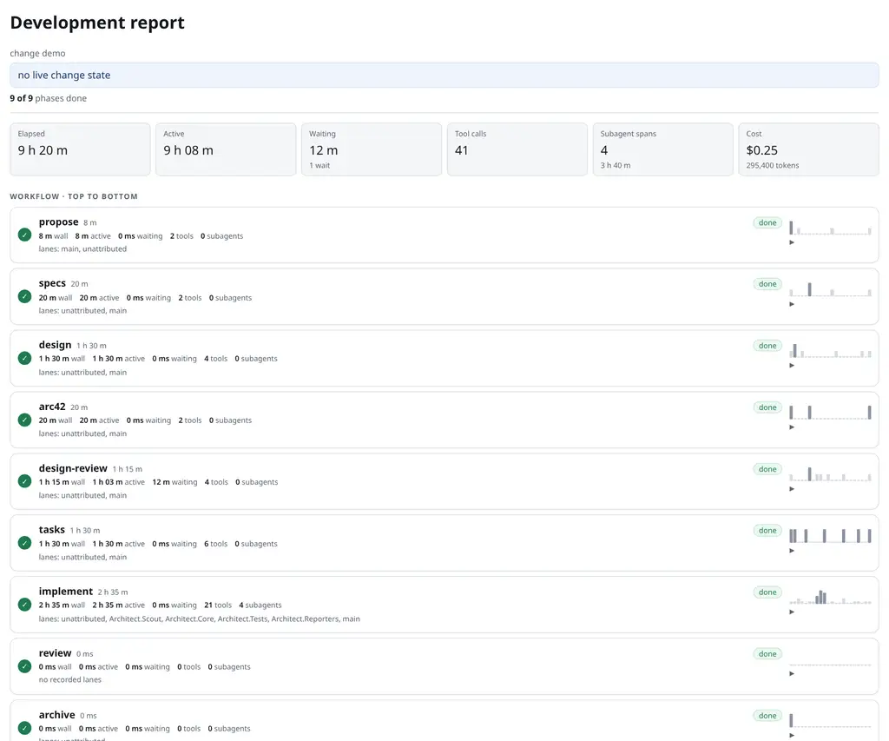
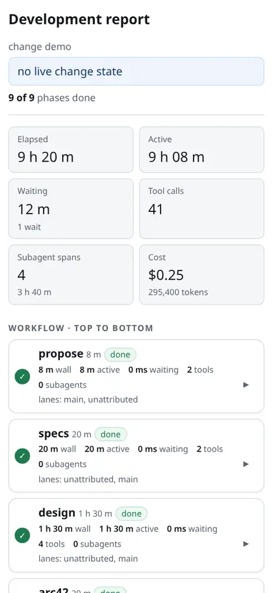

# Development record and report

Givn keeps a local journal of the work it observes and turns it into one
self-contained HTML report. This guide covers the record settings, the report
screens, and analytics over the raw JSONL store.

The record is **local runtime state**, written to `givn/history/events.jsonl`
and ignored by both backends. It never enters repository history. The report is
one HTML file with no server, no network access, and no third-party JavaScript.

## Screens

The report of a change reads top to bottom: the scope and current state, six
KPI tiles, the workflow phase stack, then the statistics. Opening a phase
reveals its vertical time axis, one lane per recorded session side by side, and
the selected lane's log. Every phase has a Fit / 1 h / 15 m zoom. The linked
ideation group, when the change's proposal or seed names an existing topic,
sits above the change workflow with its own ideation phases and totals.



*Desktop: current state, KPI tiles, the workflow stack, and each phase's lanes.*



*Mobile: one column, two-column KPIs, full-width phase cards, and lanes scrolling horizontally inside a card.*

The screenshots use a demonstration change with seeded record data; the layout
and interactions are the product's own.

## Generate and read the report

```sh
givn timeline --change <id>            # one change
givn timeline --topic <id>             # one ideation topic
givn timeline                          # project report
givn timeline --change <id> --out path/to/report.html
```

The command writes `givn/history/reports/<scope>.html` by default, prints the
path, opens nothing, and records nothing. The file is self-contained: open it
directly in a browser; there is no port and no network request. A report of an
archived change renders without a live state; a linked topic with no recorded
entries states that instead of inventing phases.

The current state in the header is the change's derived state (stage label,
current workflow phase, next required artifact, task progress) at render time.
The topic report uses the ideation workflow (`frame`, `personas`,
`event-storming`, `use-case-definition`, `use-case-elaboration`, `handoff`).

## Settings

The capture control lives in `givn/config.yaml`:

```yaml
record:
  mode: on        # on (default) | off | full
```

| Mode | What is recorded | Notes |
|---|---|---|
| `on` (default) | Bounded metadata and the full question text: commands, phases, hooks, steps, revisions, turns, tool calls, subagent spans, waits, usage, cost, context, and reported metadata. Labels ≤ 120 chars, text metadata ≤ 240, error text ≤ 1,000, question text ≤ 4,000. No LLM-facing content. | The default when the key is absent or unreadable; an invalid value falls back to `on` with one warning. |
| `off` | Nothing new: no entry, no pending state, and no record-side ignore write. | Absolute: `givn history ingest --with-full-content` is ignored with one warning and exit 0. |
| `full` | `on` plus complete LLM-facing content: tool input/output, assistant/thinking text, user prompts, compaction summaries, plan content, subagent transcript excerpts. | Capped at 64 KiB per field and 256 KiB per entry; the store keeps every byte. Content is sensitive: enable it deliberately. |

Lowering the mode keeps entries already captured; it never purges. `givn
upgrade` preserves the key. The intake enforces the mode and every bound, so a
stale reporter cannot turn content capture on by sending content.

Inspect the resolved setting:

```sh
givn history settings          # record mode: on (source: default)
givn history settings --json   # {"mode":"on","source":"default"}
```

`source` is `config` when `record:` names a valid mode and `default` otherwise.
The query is a read view: it appends no record entry. Reporters ask the same
question once per session and treat a failed query as `on`.

The report command's own settings are its flags: `--change`, `--topic`, and
`--out` (default `givn/history/reports/<scope>.html`). Reading the report and
the record (`givn history`, `givn history --json`) never records.

The record contains, per line: `schema`, `id`, `at` (UTC), `scope`
(`change|ideation|project` + id), `source` (`givn|agent`), `kind`, `name`,
`label`, `duration_ms` (may be absent), `outcome`, `session` (nullable),
`parent`, and `data` (kind-specific facts such as `usage`, `cost`,
`context_size`, `tool_call_id`, `error`, `agent/subagent`, `question`, and
`content` only in `full`).

## Harness metadata support

The first symbol is what the installed harness exposes; the second is what
Givn's reporter records today: `✓` available/recorded, `◐` partial, `—`
absent/not recorded. Sources: the four harness inventories and the current
generated reporters.

| Field | omp 18.6.1 | Claude Code 2.1.266 | opencode 2.0.26 | Maki 0.6.3 |
|---|---|---|---|---|
| Turn index / count | ✓✓ | —— | —— | ◐✓ (`num_turns` round-trips) |
| Stop reason | ✓✓ | —— | ✓✓ | ✓✓ |
| Model | ✓✓ | ✓✓ (transcript) | ✓✓ | ◐◐ (TUI-only; headless may omit) |
| Cost | ✓✓ | ✓✓ (transcript) | ✓✓ | ✓✓ |
| Context size / window | ✓✓ | ◐— (partial surface, not parsed) | —— | ✓✓ |
| Session title | ✓— (session API only, not recorded) | ✓— (`SessionStart` title not parsed) | ✓✓ | ◐— (wait label only) |
| Transcript path | ✓— (session manager, not recorded) | ✓— (used for usage/cost, not recorded) | —— | —— |

The table is the durable copy of the archived design's per-harness
availability matrix, with the second symbol taken from the implemented
reporters. Known capture gaps are visible in that second symbol: omp and Claude
do not record the session title or transcript path their surfaces expose;
Claude's partial context signal is not parsed; Maki's session title exists only
as a wait label, and its headless turns may omit the model.

For report data, **omp is the richest choice**: every turn-level field the
report renders (index, stop reason, model, cost, context size/window) is present,
plus tool call ids, subagent lifecycle, retries, and permission waits. Claude
Code is strongest for subagent, permission, wait, and content detail but lacks a
turn index and stop reason and does not record the title/context; opencode is a
solid middle ground with stop reason, model, cost, and title but no turn count
or context; Maki supplies stop reason, cost, context, and round-trips, with the
headless gaps and the missing `task`-tool subagent span (`R-90`). Question text
is always captured by all four; per-subagent tool attribution remains
session-based (`R-93`).

## Analytics on the JSONL store

The store is one JSON object per line at `givn/history/events.jsonl`. It is
local and ignored; **never commit it**. Each line carries `id`, `at` (UTC),
`scope` (`change|ideation|project` + id), `source`, `kind`, `name`, `label`,
`duration_ms` (may be absent), `outcome`, `session`, `parent`, and `data`
(kind-specific: `usage`, `cost`, `context_size`, `tool_call_id`, `error`,
`agent/subagent`, `question`, and `content` only in `full` mode).

Four traps before summing:

- `duration_ms` is measured; absent is not zero.
- Durations overlap: a turn overlaps its tools and subagent spans. Sum one kind,
  or use a phase's wall time — never all kinds together.
- The recorder records its own intake commands (`history ingest`,
  `history harness-hook`). Exclude them for work analytics.
- Token fields are per turn; `usage.total_tokens`/`context_size` repeat context
  each turn, so cumulative sums are not unique tokens.

The outputs below come from a frozen snapshot of **8,981 entries**; the live
file grows as work continues.

### jq — no setup, whole-file JSON

jq's strength is the zero-setup ad-hoc question: read the file, reshape the
heterogeneous JSON, print. No database, no schema, and the output pipes into
anything.

**Where did the measured time go, by kind?**
Group every entry by kind and sum its measured durations; the fastest first
look.

```sh
jq -s 'group_by(.kind)
  | map({kind:.[0].kind, n:length, s:((map(.duration_ms // 0)|add)/1000|floor)})
  | sort_by(-.n)' givn/history/events.jsonl
```

```text
kind       n     s
command    2445  512
tool       2308  8857
turn       2088  17584
usage      2088  0
subagent   25    8358
phase      16    11
step       10    409
question   1     137
```

**Which single steps took longest, ignoring the recorder's own commands?**
Filter for measured entries, drop the intake rows, sort descending, and emit
TSV ready for `cut`, `column`, or a spreadsheet.

```sh
jq -s 'map(select(.duration_ms != null
    and ((.kind=="command" and ((.label//"")|test("^history (ingest|harness-hook)\\b"))) | not)))
  | sort_by(-.duration_ms) | .[:5]
  | .[] | [((.duration_ms/1000*10|round)/10), .kind, (.name//"")]
  | @tsv' -r givn/history/events.jsonl
```

```text
963.4  turn      turn 11
963.2  subagent  HybridBundleO
961.0  tool      wait
812.1  subagent  HybridDesignReview
737.3  turn      turn 21
```

**How much token work and cost do the turns carry?**
Select turns whose `usage` is an object (the harness may report
`"unavailable"`), then sum the recorded counts and cost.

```sh
jq -s 'map(select(.kind=="turn" and (.data.usage|type)=="object")) as $t
  | {turns:($t|length),
     input:([$t[]|(.data.usage.input//0)]|add),
     output:([$t[]|(.data.usage.output//0)]|add),
     reasoning:([$t[]|(.data.usage.reasoning//0)]|add),
     cost:([$t[]|(.data.cost|if type=="object" then (.total//0) else (.//0) end)]|add)}'
  givn/history/events.jsonl
```

```text
turns 2086 · input 5,019,281 · output 1,461,596 · reasoning 697,945 · cost $2.60
```

### SQLite — a persistent local table and SQL

SQLite's strength is a stable local database: import once, query repeatedly,
keep views, and use SQL aggregation and window functions. Import the JSONL with
a separator that cannot occur in JSON, then expose a typed view:

```sh
rm -f /tmp/givn.db
sqlite3 /tmp/givn.db 'CREATE TABLE raw(line TEXT);'
printf '.separator \001\n.import givn/history/events.jsonl raw\n' | sqlite3 /tmp/givn.db

sqlite3 /tmp/givn.db <<'SQL'
CREATE VIEW ev AS
SELECT json_extract(line,'$.id')          AS id,
       json_extract(line,'$.at')          AS at,
       json_extract(line,'$.scope.kind')  AS scope_kind,
       json_extract(line,'$.scope.id')    AS scope_id,
       json_extract(line,'$.kind')        AS kind,
       json_extract(line,'$.name')        AS name,
       json_extract(line,'$.label')       AS label,
       json_extract(line,'$.duration_ms') AS duration_ms,
       json_extract(line,'$.outcome')     AS outcome,
       json_extract(line,'$.session')     AS session,
       json_extract(line,'$.data')        AS data
FROM raw WHERE json_valid(line);
SQL
```

**Which Givn commands dominate command time, excluding the recorder?**
Group command names and sum their measured durations — the query the SQL view
makes repeatable.

```sh
sqlite3 -header -column /tmp/givn.db <<'SQL'
SELECT name, count(*) n, round(sum(coalesce(duration_ms,0))/1000.0,1) s
FROM ev
WHERE kind='command'
  AND NOT (label LIKE 'history ingest%' OR label LIKE 'history harness-hook%')
GROUP BY name ORDER BY n DESC LIMIT 5;
SQL
```

```text
name          n    s
commit        167  16.1
attribution    99   1.1
status         31   0.9
instructions   22   0.5
lint           12   1.6
```

**Which agent tool calls repeat enough to look like a loop?**
Group tool labels and keep groups of five or more; this is the loop/fan-out
signal at the tool level.

```sh
sqlite3 -header -column /tmp/givn.db <<'SQL'
SELECT kind, substr(label,1,38) label, count(*) n
FROM ev
WHERE kind='tool' AND label IS NOT NULL
GROUP BY kind,label HAVING n >= 5 ORDER BY n DESC LIMIT 5;
SQL
```

```text
kind  label                                   n
tool  givn/changes/development-timeline/task  90
tool  src/cli/timeline.rs                     72
tool  export GIVN_ATTRIBUTION_ACTIVE='1' GIV  63
tool  givn/changes/development-timeline/desi  60
tool  cd /home/buster/projects/givn && GIVN_  55
```

**How long did each phase run before the next recorded transition?**
Use `lag` over the phase entries per scope; the window function is the reason
to keep a SQL database around.

```sh
sqlite3 -header -column /tmp/givn.db <<'SQL'
SELECT scope_id, label, at,
       unixepoch(at) - unixepoch(lag(at) OVER (PARTITION BY scope_id ORDER BY at)) AS s_since_prev
FROM ev WHERE kind='phase' ORDER BY scope_id, at LIMIT 6;
SQL
```

```text
scope_id              label             at                        s_since_prev
development-timeline  proposal.md       2026-10-17T09:59:46.560Z
development-timeline  specs             2026-10-17T09:59:46.560Z  0
development-timeline  design.md         2026-10-17T09:59:46.560Z  0
development-timeline  arc42.md          2026-10-17T09:59:46.560Z  0
development-timeline  design-review.md  2026-10-17T09:59:46.560Z  0
development-timeline  tasks.md          2026-10-17T10:42:33.994Z  2567
```

### DuckDB — direct JSONL, nested JSON, window analytics

DuckDB's strength is reading the file itself: `read_json_auto` infers the
schema, structs and nested JSON stay queryable, and window/`QUALIFY` analytics
run without an import step. Install the 2.0 alpha with
`curl https://install.duckdb.org | DUCKDB_VERSION=alpha bash`; quote `"at"`
(reserved) and add `-no-agent` in scripts.

**Can I answer from the file without importing it?**
Read the JSONL directly and group by kind.

```sh
duckdb -no-agent -c "SELECT kind, count(*) n,
  round(sum(coalesce(duration_ms,0))/1000.0,1) s
FROM read_json_auto('givn/history/events.jsonl', format='newline_delimited')
GROUP BY kind ORDER BY n DESC;"
```

```text
command  2445   512.7
tool     2308  8857.8
turn     2088 17584.8
usage    2088     0.0
subagent   25  8358.2
phase      16    11.9
step       10   409.0
question    1   137.6
```

**How much token work is inside the nested `usage` JSON?**
Access the JSON field with `->>`, keep rows whose `usage` is an object, and sum.

```sh
duckdb -no-agent -c "SELECT count(*) turns,
  sum(TRY_CAST(data.usage->>'input'  AS BIGINT)) input,
  sum(TRY_CAST(data.usage->>'output' AS BIGINT)) output,
  sum(TRY_CAST(data.usage->>'reasoning' AS BIGINT)) reasoning
FROM read_json_auto('givn/history/events.jsonl', format='newline_delimited')
WHERE kind='turn' AND json_type(data.usage)='OBJECT';"
```

```text
turns 2086 · input 5,019,281 · output 1,461,596 · reasoning 697,945
```

**What was the longest activity in each session?**
`QUALIFY` keeps one row per session without a subquery — the DuckDB way to rank
inside partitions.

```sh
duckdb -no-agent -c "SELECT left(session::VARCHAR,12) session, kind, name,
  round(duration_ms/1000.0,1) s
FROM read_json_auto('givn/history/events.jsonl', format='newline_delimited')
WHERE session IS NOT NULL AND duration_ms IS NOT NULL
  AND NOT (kind='command' AND (label LIKE 'history ingest%' OR label LIKE 'history harness-hook%'))
QUALIFY row_number() OVER (PARTITION BY session ORDER BY duration_ms DESC) = 1
ORDER BY s DESC LIMIT 5;"
```

```text
session       kind      name                           s
01a148a7-1dd  turn      turn 11                      963.4
01a149c5-c4b  subagent  ChangeReview.VisionDeveloper  319.7
01a1495d-46d  turn      turn 80                       48.8
01a14982-796  turn      turn 76                       46.2
01a149b3-af5  turn      turn 115                      44.1
```

### Choose by task

- **jq** for ad-hoc questions on the whole file with no setup; its output pipes.
- **SQLite** for a persistent local database, views, joins, and portable SQL.
- **DuckDB** for direct JSONL analytics without import, nested JSON, window
  functions, and Parquet export (`COPY (SELECT * FROM read_json_auto('givn/history/events.jsonl', format='newline_delimited')) TO 'ev.parquet'`).

Filter by `scope.kind`/`scope.id` for a change or topic, and exclude the
recorder's own commands for work analytics.

## See also

- [Architecture, chapter 8.25](arc42/08-crosscutting-concepts.md) — the record's ownership, privacy bound, and report packaging.
- [Design system](design/design-system.md) — the report's tokens, primitives, breakpoints, and reference views.
- [CLI and configuration reference](reference.md) — command flags and every configuration key.
