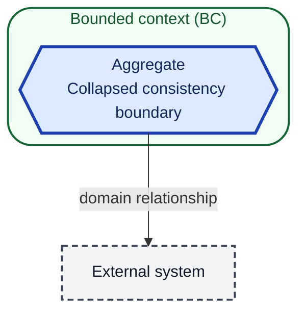
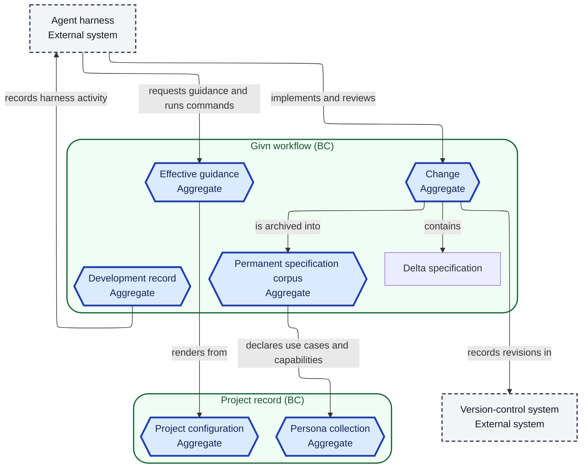

# Domain Model

## Scope and modeling status

This model covers the working domain of a Givn project: the durable units a
change evolves and the external systems the workflow depends on. It is an
established structural map at the level of the documented use cases. It does
not model internal Rust components, command parsing, or file formats; those
belong to the architecture documentation.

## Diagram notation and legend

The legend is notation only, not part of the domain model. Containment shows
bounded-context membership. Read a labeled arrow from source to target; it is
not a runtime call. Shape, border, and labels carry meaning independently of
color.

## Structural overview

## Boundaries and responsibilities

| Bounded context | Responsibility | Explicitly outside its responsibility |
|---|---|---|
| Givn workflow | One change's lifecycle, the permanent specification corpus published from archived changes, the effective guidance served for a project, and the development record | The host repository's build and runtime, and the agent harness's own execution model |
| Project record | Confirmed Personas, the Specification Manifest, and the effective configuration that selects artifacts and addons | The content of a single change; a Persona is a stakeholder review lens, not a Gherkin actor |

| Aggregate | Owning context | Consistency responsibility |
|---|---|---|
| Change | Givn workflow | A change's proposal, delta specifications, design (including the recorded Ise rebuild decision), review, and task evidence stay together and leave the active area only through archive. See [create-change](../givn/specs/create-change/usecase.md) and [archive-change](../givn/specs/archive-change/usecase.md). |
| Permanent specification corpus | Givn workflow | Use cases, capabilities, and their executable scenarios remain the durable behavior record. The corpus is the behavior aggregate of the Specification; it does not include contracts, limits, or the `e2e` package. See [make-usecases-canonical](../givn/specs/make-usecases-canonical/usecase.md) and [discover-specifications](../givn/specs/discover-specifications/usecase.md). |
| Effective guidance | Givn workflow | The instruction, skill, and addon-conditional guidance a project actually receives. See [obtain-effective-guidance](../givn/specs/obtain-effective-guidance/usecase.md). |
| Development record | Givn workflow | The local, best-effort record of agent activity and revisions. See [inspect-development-history](../givn/specs/inspect-development-history/usecase.md). |
| Persona collection | Project record | Confirmed stakeholder review lenses survive individual changes. See [persona identity reuse](../givn/specs/fragments/fragment.md). |
| Project configuration | Project record | Addon flags, artifact graph, command settings, and the Specification Manifest resolve to one effective configuration; each addon's materialization is the filesystem effect its registry entry declares, observed separately from the flag. See [initialize-project](../givn/specs/initialize-project/usecase.md). |

## Relationships

| Relationship | Domain meaning | Governing contract or specification |
|---|---|---|
| Change → permanent specification corpus | An archived, proven change publishes its accepted deltas into the durable corpus. The corpus is not a copy of the change. | [archive-change](../givn/specs/archive-change/usecase.md) |
| Change → delta specification | A change owns the executable delta that describes only its behavior changes. | [author-change](../givn/specs/author-change/usecase.md) |
| Permanent specification corpus → Persona collection | A use case names confirmed Personas as review lenses; the corpus does not own their biographies. | [make-usecases-canonical](../givn/specs/make-usecases-canonical/usecase.md) and [personas](../givn/personas/) |
| Guidance → project configuration | Effective guidance is the built-in asset plus the project's extension and addon-conditional sections. | [obtain-effective-guidance](../givn/specs/obtain-effective-guidance/usecase.md) |
| Change → version-control system | Revisions are recorded through the selected SCM; archive history and attribution depend on it. | [archive-change](../givn/specs/archive-change/usecase.md) and [attribute commits](../givn/specs/fragments/fragment.md) |
| Agent harness → effective guidance | The harness requests instructions, loads generated skills, and invokes the CLI. | [obtain-effective-guidance](../givn/specs/obtain-effective-guidance/usecase.md) |
| Agent harness → change | The harness authors, implements, reviews, and commits the change under the served rules. | [author-change](../givn/specs/author-change/usecase.md) and [verify-change](../givn/specs/verify-change/usecase.md) |
| Development record → agent harness | The record observes harness activity; it never invents missing attribution. | [inspect-development-history](../givn/specs/inspect-development-history/usecase.md) |

## Open modeling questions

- Is "effective guidance" a true consistency boundary, or a derived view over
  configuration and embedded assets? The current model keeps it collapsed
  because a project reasons about the guidance it receives, not about the asset
  tree. Revisit if guidance composition becomes independently mutable.
