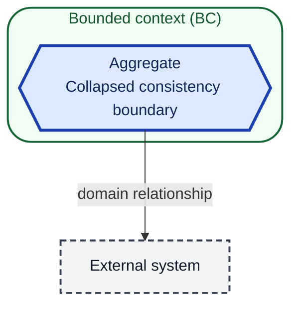
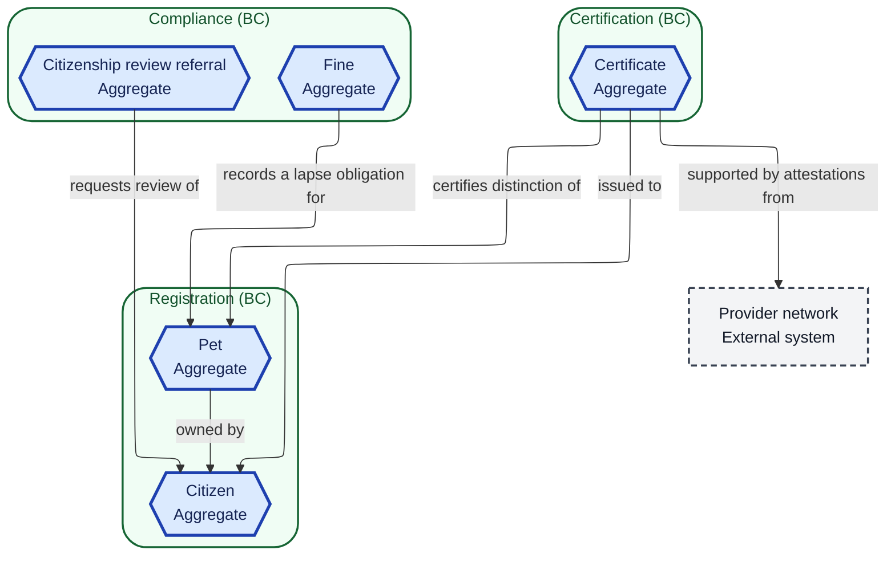
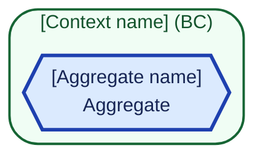

# Standalone domain model governed by the domain-modeling skill

## Status and purpose

Discussion handoff recorded on 2026-10-30 for a future Givn change and a separate session. The directory names the intended improvement target, not a release commitment.

This note preserves the problem, confirmed direction, alternatives, examples, proposed template, and unresolved implementation questions. It is not a proposal, specification, technical design, or implementation authorization. No new Givn change was started by this discussion. When this note was written, the active change was `prepare-0-9-10`, awaiting archive; do not attach this work to that change merely because it is active.

Before continuing in a future session, run `givn instructions` and follow the current project state. Load `givn instructions dialog` before asking questions, and the applicable companion examples from `givn instructions dialog-examples`. Use the domain-modeling skill throughout the future work. Do not re-ask confirmed decisions below without new evidence that requires reconsideration.

## Problem and evidence

The discussion started from this harness output:

`/home/buster/projects/givn-harness/runs/givn-0.9.9-default-r2/20261030T064135Z-givn-0.9.9-default-r2-r1/workspace/docs/arc42/12-glossary.md`

It contains valuable domain information, but its location is misleading:

| Section | Location in the inspected output | Knowledge |
|---|---|---|
| Domain terms | `12-glossary.md:5` | Definitions, specification wording, code symbols, and rejected synonyms |
| Aggregates and boundaries | `12-glossary.md:42` | Consistency boundaries and independence |
| Invariants | `12-glossary.md:53` | Business rules mixed with implementation enforcement sites |
| Lifecycle events | `12-glossary.md:75` | Observable state transitions and other operations |

A reader asking what a provisional certificate means should consult the glossary. A reader asking how certificates relate to citizens and pets, or where consistency boundaries lie, should consult the domain model. Those are different navigation needs.

This is not simply an agent misplacing content. Current Givn guidance explicitly directs agents to put terms, aggregates/boundaries, invariants, and lifecycle events in the arc42 glossary:

- `assets/instructions/domain-modeling.md:13`: the owning use case is the shared domain contract.
- `assets/instructions/domain-modeling.md:44`: domain modeling currently requires the arc42 addon and its glossary.
- `assets/instructions/domain-modeling.md:54`: the glossary is instructed to hold all four categories.
- `assets/instructions/ideation.md:331`: Event Storming reuses declared aggregates, currently referring to the glossary when arc42 is enabled.
- `assets/instructions/specs.md:46`: specifications preserve the owning use case's contract.
- `assets/instructions/specs.md:212`: scenarios derive from existing rules; they must not create a second rule catalogue.
- `assets/instructions/design-review.md:161` and `assets/instructions/review.md:286`: review guidance relies on the durable glossary for vocabulary.
- `assets/addons/arc42-docs/chapters/12-glossary.md`: the shipped chapter template itself is only a term/definition table.

These are investigation entry points, not an exhaustive implementation inventory. Recheck locations against the checkout used for the future change.

## Confirmed direction

### Separate durable documentation

**Resolution:** the domain model gets its own documentation, separate from the glossary and from arc42 chapter 8. The discussed target is `docs/domain-model.md`.

The model is project-level and durable, not copied into each change. It must be usable without enabling arc42. Architecture documentation can reference it instead of reproducing it.

**Rejected:** leaving the model in the glossary. This hides structural knowledge behind a vocabulary-reference title.

**Rejected:** merely moving the entire model into arc42 chapter 8, Cross-cutting Concepts. This still couples the model to optional architecture documentation and mixes domain meaning with technical mechanisms.

The glossary remains the vocabulary reference. Its definitions can link to the domain model for relationships or boundaries, rather than describe those structures again.

### Thin structural map, not another rulebook

**Resolution:** the domain model primarily explains structure and links to governing behavior. The user explicitly selected this option after clarification.

It owns documentation of:

- Bounded contexts and their responsibilities.
- Collapsed aggregates and their consistency responsibilities.
- External systems relevant to understanding the domain.
- Relationships, including material multiplicities and cross-context meaning.
- Unresolved structural questions, clearly qualified rather than presented as facts.

Existing use cases retain their domain contracts. Executable specifications demonstrate behavior; code implements it. The domain model must not become a competing catalogue of business rules, policies, states, or events.

**Rejected:** making the new document the authoritative home for all shared business rules as part of this improvement. That would require changing existing use-case ownership and migrating rule definitions, increasing the scope and synchronization burden.

### Overview abstraction level

**Resolution:** the overview shows bounded contexts, collapsed aggregates, external systems, and labeled relationships. It does not show aggregate roots, internal entities, or value objects.

A hexagon in the final overview means **Aggregate**, not **Aggregate root**. Earlier samples labeled the hexagons as roots; those labels are superseded.

An aggregate and its root are distinct concepts. In a future detail view, an aggregate enclosure could contain its root, other entities, and value objects. That detail is deliberately absent from the overview.

An aggregate boundary is not automatically a software-component boundary. A lifecycle is not a runtime call sequence. A database file, tenant, record, or class is not automatically an aggregate or bounded context merely because it exists in code.

### Diagram format and readability

**Resolution:** use Mermaid, oriented top-down, with a standalone Mermaid legend diagram in its own Markdown section, separate from the domain diagram. Preserve individually traceable relationships rather than merging them into visually ambiguous trunks.

The agreed direction is Mermaid with ELK selected explicitly and edge merging disabled. Color supplements shape and border; it must not be the only distinction.

The user preferred D2's visual result, particularly oval context containers, cloud-shaped external systems, and three distinct incoming arrows into Citizen. Mermaid was favored for its broader Markdown support and lack of a separate D2 rendering toolchain for supported Markdown hosts.

Top-down is intentional: readers often use phones and scroll vertically rather than horizontally. It does not, by itself, guarantee a narrow diagram. Independent branches may still be laid out beside one another.

**Rejected:** making D2 the default merely to obtain better shapes when Mermaid can produce readable relationships. Preserve the D2 comparison below as background, not as a second required output format.

**Rejected:** embedding the legend in the domain graph. It occupies graph-layout space and competes with the model. The final document has a separate legend section containing its own Mermaid diagram, not just a notation table. The legend and domain diagram use matching shapes, borders, labels, and styles.

### Progressive detail

**Resolution:** start with the structural overview. Add aggregate-detail or lifecycle diagrams only where they explain something the overview cannot. Supporting a type does not require populating every model with it.

Do not add mandatory empty headings for event catalogues, policies, states, domain services, or aggregate internals. Such headings encourage agents to manufacture content or paraphrase existing specifications.

## Documentation ownership and DRY

DRY here means avoiding independently maintained definitions of the same knowledge, not prohibiting every repeated word or expected value.

These complementary views are useful:

| Artifact | Question answered | Example |
|---|---|---|
| Glossary | What does this term mean, and how is it distinguished from nearby terms? | Definition of provisional certificate |
| Domain model | What are the boundaries and relationships? | Certificate and Pet are separate aggregates; a Certificate concerns one Pet |
| Owning use case | What goal, guarantees, and rules govern this interaction? | A requester obtains a certificate for a pet they own |
| Executable specification | Which concrete observations demonstrate the behavior? | Certification is refused when the pet belongs to another citizen |
| Code | How is the behavior implemented and enforced? | Ownership validation before persistence |
| Architecture documentation | Which technical mechanisms realize the model? | Tenant isolation, transaction boundaries, and unique indexes |

Harmful duplication occurs when several documents independently define, for example, that a provisional certificate lasts 14 days. Changing the duration then requires locating several editable rule definitions in addition to tests and code.

The thin-map approach avoids creating another such authority:

- A change from 14 to 21 days affects the governing rule, affected scenarios, and implementation, but not the structural overview.
- Splitting Certificate into independent aggregates affects the structural model.
- A lifecycle diagram, if justified, can say “validity period elapsed” and link to the governing duration rather than embed a copied numeric parameter.
- A rule that a repeated compliance sweep must not create another fine belongs to its governing contract. The unique index enforcing it belongs to implementation/architecture evidence. A model may explain the structural relationship to a lapse without duplicating either catalogue.
- A link needs a short description of what it governs, not a bare identifier or a generic directory link.
- Illustrative or derived views do not overrule their governing contracts. A contradiction must be resolved, not excused by labeling both views authoritative.

The skill should apply three checks:

1. **Ownership:** what knowledge belongs in this document, and which existing source governs the rest?
2. **Added value:** does a section explain a boundary or relationship, or merely paraphrase scenarios?
3. **Change impact:** did this change alter the structure or an included explanatory view? If not, leave the model unchanged.

“Keep everything synchronized” is insufficient. Narrow the maintained knowledge first, then review its actual impact. No-op document edits, timestamps, and boilerplate rewrites are not useful evidence of maintenance.

## Alternatives considered for knowledge ownership

| Approach | Meaning and example | Gain | Cost and disposition |
|---|---|---|---|
| Thin structural map | Certificate references Pet; behavioral rules are linked. A duration-only change leaves the map untouched. | Lowest additional maintenance; explicit domain navigation | Readers follow links for behavior. **Selected.** |
| Canonical shared-rule contract | The domain model defines certificate validity once; issuance and renewal use cases reference it. | Central ownership of genuinely shared rules | Changes current use-case contracts, requires migration and careful rule classification. **Rejected for this improvement.** |
| Structured declarations with generated views | Context membership and relationships are declared once, then a diagram and table are generated. | Mechanical consistency between generated representations | Adds schema, tooling, validation, and future format migration; cannot reliably infer arbitrary domain structure from Gherkin. **Not selected for the initial direction.** |

Generation is a mechanism, not a solution to semantic ownership. A generator can make a diagram and table consistently wrong. A richer shared-rule source or generator could be reconsidered later if recurring evidence justifies it; neither is required for the agreed thin map.

## Skill responsibilities and template lifecycle

The user expects the domain-modeling skill to govern this documentation and provide a good template for agents. The following lifecycle was proposed as the concrete behavior to specify in the future change:

- Ship a maintained domain-model template and a reusable Mermaid styling scaffold.
- On the first need for domain modeling, create `docs/domain-model.md` from that template if it is absent, without requiring arc42.
- On later changes, reuse the existing model; do not overwrite it or create per-change copies.
- Fill it from established knowledge. Never invent bounded contexts, aggregate boundaries, or relationships just to complete a diagram or table.
- Clearly distinguish established structure from proposals and unresolved questions.
- Capture confirmed structural knowledge as it becomes available; do not allow unresolved assumptions to harden silently into project truth.
- Assess model impact during subsequent work. Only edit the document when its maintained knowledge changes.
- Keep the glossary focused on vocabulary and enforce the same domain language across model, contracts, scenarios, and code.
- Require a rendered-diagram review, not merely syntactically plausible Mermaid source.
- Treat a partially known model honestly. Do not require every project to have multiple contexts, an external system, or every supported type.

**Current behavior is not this behavior.** Givn presently directs domain modeling toward the arc42 glossary. The discussion did not implement automatic template creation, a standalone model lifecycle, or migration.

The exact creation trigger remains to be designed: first skill use versus project initialization, how the skill obtains the shipped template, and whether any CLI support is needed. A skill can be instructed to create a document; that is not the same as a command already scaffolding it automatically. Do not invent a supported command.

## Visual vocabulary

### Overview notation

| Element | Mermaid | D2 comparison | Meaning |
|---|---|---|---|
| Bounded context | Enclosing frame explicitly labeled “Bounded context” or “BC” with the abbreviation explained | Enclosing oval | Scope of a model and vocabulary |
| Collapsed aggregate | Thick-bordered hexagon labeled “Aggregate” | Thick-bordered hexagon | Consistency boundary; internal structure omitted |
| External system | Dashed rectangle labeled “External system” | Dashed cloud | Outside the modeled system; internal model not asserted |
| Membership | Containment | Containment | Aggregate belongs to the context |
| Relationship | Individually traceable labeled arrow | Individually traceable labeled arrow | Read source to target; not a runtime call, event flow, or ownership of the target aggregate |

These are project diagram conventions, not standardized DDD symbols. Avoid icons that introduce font packs, external resources, or renderer-specific registration when shapes and labels suffice. A cloud is an external-system convention here, not a claim about cloud hosting.

Mermaid flowchart subgraphs do not natively support oval context containers. Rounded frames were obtained locally with `rx`/`ry` styling, but another host may render square frames, as seen in the user's screenshot. The semantic distinction must survive that difference.

For relationships:

- Show meaningful multiplicities where they affect understanding; omit decorative cardinalities.
- Explain the information or domain fact crossing a context boundary. An arrow must not silently assert a shared mutable entity across contexts.
- Do not mix association, inheritance, composition, runtime dependency, and event-flow semantics without explaining each kind.
- Do not add fake domain edges or duplicate aggregates merely to coerce a layout.

### Types reserved for optional detail views

The discussion considered the following vocabulary, but it is not an overview checklist:

| Type | Meaning and potential notation | When warranted |
|---|---|---|
| Expanded aggregate | Nested enclosure showing the consistency boundary | Internal membership or consistency cannot be understood from the collapsed overview |
| Aggregate root | Thick-bordered hexagon explicitly labeled as a root in a detail view | Explaining governed access to aggregate changes |
| Entity | Rectangle explicitly labeled “Entity” | Identity matters independently of changing attributes |
| Value object | Pill/stadium explicitly labeled “Value object” | Value semantics matter; a validity period is a possible example |
| Domain event | Meaningful past-tense domain fact | Explaining collaboration or lifecycle, not cataloguing every operation |
| Domain policy | Named business rule or reaction | A cross-behavior explanation adds value beyond existing contracts |
| Domain service | Domain operation not naturally owned by an entity or value object | Established by domain analysis, not inferred from a service class name |
| Lifecycle state | State in a focused state diagram | Allowed transitions need explanation across scenarios |

A certificate amendment was offered only as a hypothetical entity example if the domain requires identity; it was not discovered as an existing domain concept. Actors belong primarily in use-case and system-context views. Databases, repositories, APIs, and implementation services belong primarily in architecture documentation.

## Mermaid sample: collapsed, top-down overview

This sample illustrates the agreed notation. **Registration, Certification, and Compliance are proposed teaching boundaries, not verified bounded contexts in the inspected application.** Catopia and Petorania are tenant/legal-register boundaries; tenant isolation does not by itself establish distinct bounded contexts. The original glossary's aggregate classifications also require investigation rather than automatic promotion into the new model.

The sample intentionally preserves the earlier relationship labels for comparison. Cross-context meanings and multiplicities must be validated before adopting it as a real project's model.

### Separate legend



This is notation only, not part of the domain model. Containment shows context
membership. Read a labeled arrow from source to target; it is not a runtime
call. Shape, border, and labels carry meaning independently of color.

### Diagram



### Layout findings and limitations

- The first left-to-right Mermaid render had visually shared line segments that obscured distinct relationships.
- Explicit ELK selection yielded three separate incoming arrows into Citizen: ownership, certificate recipient, and citizenship review. Pet had two separate incoming arrows: certification and lapse obligation.
- `mergeEdges: false` was already the installed Mermaid default. Explicitly selecting ELK was the important change; disabling merging alone was not the demonstrated fix.
- Changing `flowchart LR` to `flowchart TB` produced the requested top-down layout, but independent contexts and the then-embedded legend still occupied horizontal space. Separating the legend addresses one source of unnecessary width.
- Shape labels must remain readable in light and dark hosts. The screenshot showed very light arrows against light context fills, so inspect contrast as well as routing.
- Larger models should be decomposed into an overview and focused diagrams, rather than reduced until labels become unreadable. Splitting must preserve navigation and context, not create competing copies of the model.
- Mermaid support does not imply ELK support. A host must include the ELK renderer and honor the configuration. Unsupported hosts may fall back or fail; investigate actual behavior rather than promise portability.
- The user requirement is individually traceable relationships, not merely the presence of `layout: elk` in source.

Earlier samples were rendered locally with Mermaid CLI 11.10.1 and D2 0.9.0. The updated Mermaid overview, Mermaid template scaffold, and top-down D2 comparison embedded in this note were also extracted and rendered successfully when the handoff was written. The standalone Mermaid legend added to both the sample and template was rendered and visually inspected successfully as well. Chromium was available at `/usr/bin/chromium`; the Mermaid CLI needed `PUPPETEER_EXECUTABLE_PATH=/usr/bin/chromium` because its expected downloaded Chrome was absent. No browser installation was needed. This is local validation evidence, not a new consumer dependency requirement.

Temporary files from that exploration were under `/tmp/givn-domain-diagrams.Y982JR/`, including `domain-model.mmd`, `domain-model-mermaid-elk.svg`, and `domain-model-mermaid-elk-top-down.svg`. Those earlier versions still used root labels and an embedded legend. They may disappear and are not canonical sources. This note contains the updated collapsed-aggregate sample without an embedded legend.

## D2 comparison sample

Retained to explain the visual trade-off, not to require a D2 source or image for every project. The original D2 comparison used left-to-right layout; this equivalent source is top-down and uses the final collapsed-aggregate labels and separate-legend convention.

```d2
direction: down

classes: {
  context: {
    shape: oval
    style: {
      fill: "#f0fdf4"
      stroke: "#166534"
      stroke-width: 2
      font-color: "#14532d"
    }
  }
  aggregate: {
    shape: hexagon
    style: {
      fill: "#dbeafe"
      stroke: "#1e40af"
      stroke-width: 3
      font-color: "#172554"
    }
  }
  external: {
    shape: cloud
    style: {
      fill: "#f3f4f6"
      stroke: "#374151"
      stroke-width: 2
      stroke-dash: 5
      font-color: "#111827"
    }
  }
}

registration: "Registration — bounded context" {
  class: context
  citizen: "Citizen\nAggregate" {class: aggregate}
  pet: "Pet\nAggregate" {class: aggregate}
  pet -> citizen: "owned by"
}

certification: "Certification — bounded context" {
  class: context
  certificate: "Certificate\nAggregate" {class: aggregate}
}

compliance: "Compliance — bounded context" {
  class: context
  fine: "Fine\nAggregate" {class: aggregate}
  referral: "Citizenship review referral\nAggregate" {
    class: aggregate
  }
}

provider: "Provider network\nExternal system" {class: external}

certification.certificate -> registration.citizen: "issued to"
certification.certificate -> registration.pet: "certifies distinction of"
certification.certificate -> provider: "supported by attestations from"
compliance.fine -> registration.pet: "records a lapse obligation for"
compliance.referral -> registration.citizen: "requests review of"
```

D2 supports oval containers and cloud shapes directly, but requires a separate rendering workflow for typical Markdown consumption. Mermaid's rectangle-based enclosures are an accepted compromise. Oval containers also consume more space; shape preference must not defeat mobile readability.

## Proposed agent-facing document template

This is a candidate template for the future change, not an already shipped asset. Exact authoring language and packaging remain to be specified. Replace placeholders with evidence-backed content; remove inapplicable rows and omit unavailable structure rather than inventing it. The sample domain above must not leak into arbitrary consumer projects.

Tables and diagram are complementary: the diagram is a navigational view; text explains responsibilities and relationship meaning. Do not maintain two independent inventories or paraphrase every edge in prose. A future generator is not required to implement this template.

````markdown
# Domain Model

## Scope and modeling status

[Name the domain covered and important exclusions. State whether this is
established structure, a proposed model, or a mixture with explicitly marked
uncertainties. Do not present planned behavior as implemented behavior.]

## Diagram notation and legend


This is notation only, not part of the domain model. Containment shows context
membership. Read a labeled arrow from source to target; it is not a runtime
call. Shape, border, and labels carry meaning independently of color.

## Structural overview

[Use the Mermaid scaffold below. Replace illustrative placeholders with
established domain names. Add only relevant types and relationships.
Every relationship must remain individually traceable in the rendered view.]



## Boundaries and responsibilities

| Bounded context | Responsibility | Explicitly outside its responsibility |
|---|---|---|
| [Domain name] | [What this context governs] | [Important neighboring responsibility] |

| Aggregate | Owning context | Consistency responsibility |
|---|---|---|
| [Domain name] | [Context name] | [What remains consistent together; link to governing rules rather than copy them] |

## Relationships

| Relationship | Domain meaning | Governing contract or specification |
|---|---|---|
| [Source → target] | [Meaning, including material multiplicity or cross-context distinction] | [Specific link with a short description of what it governs] |

## Open modeling questions

[Include only unresolved structural questions. State each uncertainty and
what depends on resolving it. Link to an existing question record when one
exists rather than maintain a duplicate decision log. Remove this section
when there are no open structural questions.]
````

Do not add lifecycle, policy, event, or aggregate-detail sections by default. The skill may add a focused section when it provides a specific benefit. For example, a Certificate lifecycle diagram could explain how issuance, replacement, renewal, and expiry relate across several capabilities, with links to governing contracts and executable scenarios rather than copied rules.

The skill and template must ship together: the template supplies structure, while the skill prevents over-modeling and redundant content.

## Migration and integration considerations

These are work to investigate and specify, not permission to modify existing projects immediately:

- Reconcile the domain-modeling instructions with the new model location and thin-map ownership. Merely copying the old glossary's four sections is not the desired outcome.
- Update references from ideation/Event Storming and applicable proposal, design, review, and archive guidance to the appropriate owner: glossary for vocabulary, domain model for boundaries, use cases/specifications for behavior.
- Keep arc42 chapter 8 as a reference to the domain model where relevant; chapters 5 and 6 describe software building blocks and runtime interactions, not substitute domain models.
- Decide how an existing rich glossary is handled. Preserve useful knowledge, separate vocabulary from structure, and relocate or link behavioral material to its governing contracts without silent loss. Do not automatically infer valid aggregate classifications from an old table.
- Review questionable classifications in the inspected example. “Tenant selected” may be command-context selection, not a domain event. A “Certificate expired” entry combines business expiry with a sweep's persisted-status update; distinguish their meanings before drawing a lifecycle.
- Do not require arc42 merely to model a domain. The glossary location and maintenance contract for projects without arc42 remain unresolved; independence of the model does not authorize silently introducing another vocabulary authority.
- Determine how shipped templates reach skill-driven agents through existing integration mechanisms. Avoid a new command, schema, registry, or generator unless existing machinery cannot satisfy the behavior.
- Migration and initialization must preserve consumer-authored content. Existing-file handling and whether creation is automatic or agent-directed need explicit observable requirements.
- Keep this note distinct from operative guidance until the future change is implemented. It records intended direction, not current CLI behavior.

## Verification expectations for the future change

The eventual scenarios should cover meaningful behavior rather than force a production diff for every case:

- First domain-modeling use can obtain the template and establish the durable model without enabling arc42.
- Repeated use preserves and updates an existing model rather than overwriting it or creating per-change copies.
- The scaffold has a standalone Mermaid legend diagram in a separate Markdown section, matching the domain diagram’s notation; top-down Mermaid configuration; collapsed-aggregate semantics; and no required catalogue of events/policies/states. Render both the legend and domain diagram.
- Guidance preserves use-case/specification ownership and requires structural-impact assessment without demanding no-op edits.
- Unknown structure stays qualified; a one-context model or a model without external systems does not acquire invented elements.
- Vocabulary and structural references point to their intended owners across relevant workflow instructions and supported agent integrations.
- Any selected migration preserves consumer knowledge and does not leave two unqualified authoritative definitions.
- Render the representative diagram and inspect distinct arrows, legibility, contrast, and practical width. Source-string assertions alone cannot establish visual readability.
- Establish ELK behavior in intended Markdown hosts and document actual compatibility limitations. Do not promise identical rendering everywhere or require a D2/browser installation for ordinary readers.

## Unresolved decisions for the future session

Confirmed direction above should not be reopened as a generic preference poll. Investigate these implementation and compatibility questions before asking only what remains a human trade-off:

1. **Creation trigger and delivery:** first domain-modeling use, project initialization, or another existing scaffold path; how the shipped template is obtained and existing files are preserved.
2. **Vocabulary without arc42:** where the durable glossary lives and how to avoid introducing a second vocabulary source while removing the model's arc42 prerequisite.
3. **Existing-project migration:** explicit opt-in/manual guidance versus a supported transformation, with preservation and authority rules.
4. **Mermaid host compatibility:** which supported integrations honor ELK, how unavailable layouts behave, and what minimum guidance/fallback is honest and maintainable.
5. **Maintenance checks:** how existing workflow review points require a useful structural-impact assessment without imposing another repetitive reporting artifact.
6. **Template restraint:** how much of the candidate table/scaffold structure is necessary for useful models, and how inapplicable or unknown sections are handled without invented content.

Next work is to turn this handoff into a scoped Givn proposal and executable requirements when the user starts the future change. Creating this note alone does not authorize implementation, commits, archive, or release work.
