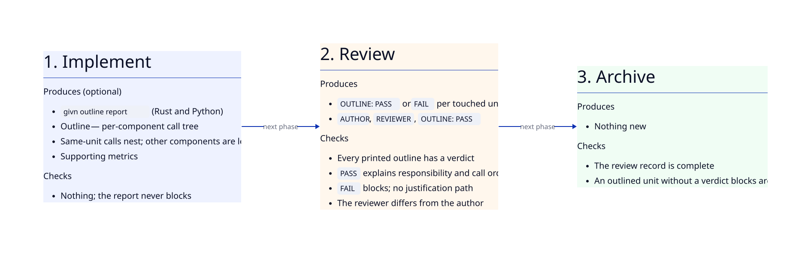

# Outline addon

**TL;DR:** The `outline` addon is enabled by default and produces an advisory
report for production Rust, Python, Java, TypeScript, and JavaScript. Read a unit's outline — a per-component
call tree of method declarations, signatures, and calls, without bodies or data
— to explain its responsibility and call order. Use it once per behavior batch
during REFACTOR for changed supported components and relevant neighbors, and
reuse relevant reports during review. Metrics are hints. The report never blocks
review or archive, needs no verdict, waiver, or second reviewer, stores no
baseline, and is not a product guarantee: the schema, thresholds, and
classifications may change.

## What it does

- **Report.** `givn outline report` prints each unit's per-component call tree
  first — method declarations, signatures, and calls, with same-unit calls
  nested and other components as tagged leaves — then the metric hints. Human
  text is the default; `--json` emits schema version 5; `--out` writes the
  selected form to a path.
- **No gate.** The report is advisory. It never changes review or archive
  behavior, never requires a per-unit verdict, and never asks for a metric
  waiver. The blocking outline gate that earlier releases offered has been
  retired.
- **No stored state.** It writes only stdout/stderr or the explicit `--out`
  path. There is no baseline, watchlist, cache, classification history, or
  feedback ledger.

## Outline comprehension — the core idea

The addon is not a size counter. Its central idea is that a reader given only a
unit's outline should be able to state (a) what the unit is responsible for and
(b) why its calls happen in that order. That is the comprehension test: state
the responsibility in one sentence and the ordered call flow from
declarations, signatures, and call order alone, without bodies or comments.

The names are the contract. The unit and type names, method names, parameter
names and types, return types, and called type names state the domain operation
in the project's vocabulary. A generic or machinery name where a domain noun
exists (`handle`, `process`, `data`, `item`, `manager`, `util`, `helper`) is a
readability finding. A clean metric never excuses an unreadable outline and no
metric waives it.

The outline judges the operation narrative and its signature vocabulary, not
data-model completeness: fields and enum variants are absent, so a complete
data model is not visible here.

The outline lists the unit's method declarations and signatures, their order,
and the calls each method makes. The unit is the root: every method is a
first-level branch, and same-unit calls nest under their caller. A call to
another component is a leaf tagged with the target component; its callee's
calls stay in that component's outline. The report never prints reverse
callers. Data — fields and enum variants — is not part of the outline. It
contains no method bodies and no comments. `givn outline report` prints the
outline for every unit; `--json` keeps the flat per-unit methods and their
call-resolution labels under `units[].outline`. The nested tree is the human
rendering, not the JSON shape.

An example, abridged from the report:

```text
WITHIN-LIMITS type  src/engine.rs  type:src/engine.rs::Engine within-limits
  outline:
    method [public] fn build(&self) -> Engine
      -> [same_file, private, Engine] validate
      -> [same_file, private, Engine] compile
      -> [same_file, public, module] normalize
    method [private] fn validate(&self) -> Result<()>
    method [private] fn compile(&self) -> Engine
  metrics (hint): code lines 120; methods 3; public methods 1; fields 0; LCOM4 1; tight class cohesion 1.000; method complexity 4; method nesting 2
```

The names and call order state the unit's job: build an `Engine` by validating,
then compiling, with normalization delegated to the module component
`module:src/engine.rs`. The metric line is support, not the point.

### Reading the call tree

- The unit is the root. Every method is a first-level branch, in the outline's
  order.
- A same-unit call nests under its caller. A call to another component is a
  leaf tagged with its resolution, the target's visibility, and its component,
  for example `-> [same_file, public, module] normalize`. A same-unit method
  implemented in another file is labelled `project_other_file` and still
  nests, because nesting follows unit membership, not the file label. Its own
  calls are in the target component's outline, not here.
- The tree is forward-only. It never prints callers; there is no reverse index.
  To answer “who calls this private method?”, read the caller's component.
- A method's calls are deduplicated and kept in source order. A recursive edge
  prints `[cycle]` instead of expanding without end.
- `[ambiguous]` means the name matched more than one compatible method, so the
  edge is not expanded. Calls to functions outside the analyzed sources are
  omitted.
- `[name_only]` means a unique project method has this name, but the receiver
  type is unknown, so the report does not claim the call is resolved. It keeps
  the candidate target for inspection and is always a leaf; it never nests and
  never joins methods for cohesion.

Calls are resolved by call shape, not name alone, for every supported language. A
free function call with no qualifier can target a module function; a qualified
call (`Type::method`, `crate::module::function`) must match that owner; a method
call must match `self`/`cls` or a named receiver. A method call on an unknown
receiver stays `name_only`; several compatible candidates are `ambiguous`; an
explicit qualifier that contradicts the only candidate is `external`. `same_file`
means the target is declared in the caller's file, not necessarily the same
unit. Rust also visits expression-list macro arguments (`format!`, `println!`,
`vec!`), so a call inside `format!` belongs to the enclosing method. The JSON
labels are `same_file`, `project_other_file`, `name_only`, `ambiguous`,
`dynamic`, and `external`; each JSON call also names its `target` when one is
resolved or is the unique name-only candidate.

### Metrics are hints

Metrics find candidates for a reviewer's attention, but they do not decide.
Both directions are valid:

| Outline | Metrics | Interpretation |
|---|---|---|
| Readable | clean | No structural concern. |
| Readable | flag | The outline explains the shape; the metric is a hint. |
| Unreadable | clean | The responsibility or call order is still unclear. |
| Unreadable | flag | The metric and the outline agree that the shape needs attention. |

An unreadable outline is a prompt to improve the code, not a gate outcome. The
implementer fixes the unit in REFACTOR; if the unit cannot be fixed within the
batch, the reviewer records a substantive readability finding. A clean metric
never excuses an unreadable outline, and no metric waives it. The report itself
supplies no verdict; the review finding is about the changed code and can
reject PASS until the unit is made readable. No waiver or justification
artifact exists.

## Workflow



Source: [`outline-workflow.d2`](outline-workflow.d2). Regenerate with
`d2 docs/outline-workflow.d2 docs/outline-workflow.svg`.

The report is advisory in every phase. It stores no baseline and has no
project-wide scope requirement.

### Once per behavior batch

During REFACTOR, generate one report for the changed supported components and
their relevant neighbors. Ask the substantive questions against the outline:

1. Does each changed unit have one cohesive responsibility?
2. Is its public surface narrow enough for its consumers?
3. Does the dependency direction point toward stable contracts rather than
   implementation details?
4. Is the decomposition still understandable in method names and call order?

Confirm suspected concerns against the source. The outline is structural
evidence, not a runtime trace. Reuse the report until later structural changes
make it stale; do not rerun it for every edit. The canonical REFACTOR cadence is
owned by the served `givn instructions steps`; review refers to this evidence
and does not trigger another audit loop.

Unsupported production languages receive direct source assessment using the
same questions. They are not a report failure and need no waiver.

### Guidance is served only when enabled

The steps REFACTOR block and the review advisory block render only when the
`outline` addon is enabled. With the addon disabled, no served instruction and
no generated skill carries outline guidance, and the review template carries no
outline verdict phrase. Project instruction overrides remain the project's
responsibility.

### Review

Final review reuses relevant outline reports from implementation when they are
still current. Rerun the report only when structural changes make the relevant
evidence stale. The outline supports a source-confirmed architecture review; it
adds no per-unit verdict, no metric decision, no forced reviewer context, and no
gate. A report that could not cover some components is disclosed and assessed
from source.

Before the architecture questions, the reviewer reconstructs each changed unit
from its outline: responsibility in one sentence and ordered call flow, without
reading bodies or comments. The names, parameters, return types, and type names
must state the domain operation; a generic or machinery name where a domain noun
exists is a readability finding. An outline that cannot carry the story is a
substantive readability finding that rejects PASS until the unit is made
readable. The report itself supplies no verdict.

| Phase | Produced by the addon | Checked by the addon |
|---|---|---|
| Proposal / design | Nothing automatic. You may run the report as evidence. | Nothing. |
| Implement / REFACTOR | One advisory report per behavior batch for changed supported components and relevant neighbors. | Nothing. |
| Review | Reused reports as context for substantive architecture review. | Nothing. |
| Archive | Nothing new. | Nothing. |

## What is checked in the source code exactly

The report analyzes production sources:

- **Scope.** Only production `.rs`, `.py`, `.java`, `.ts`, `.tsx`, `.js`,
  `.mjs`, and `.cjs` files under `src/` (or explicit `--path` roots). `tests/`,
  `benches/`, `examples/`, and `target/` are excluded; `#[cfg(test)]` items are
  excluded; `src/bin/**` is included. Python test modules (`test_*.py`,
  `*_test.py`), Java test/build roots, TypeScript test/spec/build/dependency
  roots, and JavaScript test/spec/build/dependency roots (`*.test.js`,
  `*.spec.js`, and the `.mjs`/`.cjs` forms) are skipped. Python cache,
  virtualenv, build, and dependency directories (`__pycache__`, `.venv`,
  `venv`, `.tox`, `.mypy_cache`, `.pytest_cache`, `build`, `dist`,
  `node_modules`) are skipped.
- **Units.** A unit is a type (struct, enum, trait, union, or type alias) or a
  module. Its methods are checked with it. A unit with no methods has an empty
  outline and no special obligation.
- **Outline.** Method declarations, signatures, order, and calls, rendered as a
  per-component call tree: same-unit calls nest, and calls to another component
  are leaves tagged with the target. Data is excluded.
- **Supporting type metrics.** Over 500 code lines: a trait or a type with more
  than 50 public methods is an `interface`; a struct or enum with at most one
  method is `data-only`; LCOM4 over 2 or TCC below 50% is a `god-type`;
  otherwise it is a `cohesive-large-type`. LCOM4 counts shared fields and
  resolved same-unit call edges; a cross-component call does not connect
  methods in the caller's unit, and a `name_only` edge never connects methods.
  Evidence lists only the predicates that actually fired.
- **Supporting module metrics.** Over 1,000 code lines is a `module`; 500–1,000
  with at least two declared types is a `multi-type-module`; 500–1,000
  otherwise is a `module`. A module outline lists its declared member types as
  type items, interleaved with its free functions in source order.
- **Supporting method metrics.** A method over 100 code lines or over 50 flow
  complexity is a `method-length` finding; each evidence line names the
  predicate that fired.
- **Production line accounting.** A file's `code_lines` excludes inline
  `#[cfg(test)]` spans; a unit's `physical_lines` covers the union of its own
  spans, not its containing files. Unit `code_lines` also excludes recorded
  test spans.
- **Signatures.** Method signatures keep path segments, generic arguments,
  references, tuples, slices, arrays, and pointers; they are not reduced to the
  final path segment or a bare `Result`.
- **Unavailable measurements.** A metric the analyzer cannot compute is
  `unavailable` in text and `null` in JSON, never zero. Loose class cohesion
  (LCC) is not implemented and is omitted; tight class cohesion (TCC) is never
  relabelled as LCC.
- **Diagnostics are data.** An unreadable file, parse failure, unsupported
  construct, or missing `python3` is reported by path and kind; the report
  continues with the analyzable units. A wholly unsupported unit is not
  classified and no data is invented.

## Language scope

The addon analyzes production Rust, Python, Java, TypeScript, and JavaScript.
This is the analyzer's present capability, not the guidance rule: guidance says
supported and unsupported.

- **Rust** is parsed in-process by `syn`.
- **Python** is parsed by a `python3` subprocess that runs a bundled
  standard-library `ast` extractor. The subprocess starts only when the report
  scope contains at least one `.py` file, so a Rust-only project never invokes
  `python3` and does not need Python installed. The extractor parses source
  text; it never imports or executes project code and needs no third-party
  package. Python 3.10 or newer is required for Python projects.
- **Java, TypeScript, and JavaScript** are parsed in-process with bundled
  Tree-sitter grammars. `.tsx` selects the TSX grammar; `.js`, `.mjs`, and
  `.cjs` use the JavaScript grammar. Class expressions and unnamed function
  expressions are reported as unsupported constructs, not units.

| Input | Report |
|---|---|
| Supported file with an unsupported construct | Named in `unsupported` and reported; not a failure by itself |
| Supported file that cannot be parsed | Named as a parse failure; other units continue |
| Python file when `python3` is unavailable | Named `analyzer-unavailable`; the report continues |
| Non-source file under production roots | Ignored |
| Python test module (`test_*.py`, `*_test.py`) | Excluded as test source |
| Go or JSX production source | Not analyzed; assessment is source-based, not a waiver |

Python's dynamic nature limits the outline: a call through a dynamic attribute
or an inferred type is not resolved precisely, so it appears as `name_only`
when one project method has the name, and as `ambiguous` or `external`
otherwise. Both analyzers use the same neutral resolver and the same tree
renderer. The report names these limits as analyzer limitations. An unsupported
construct is named in the report's `unsupported` list; it is not a gate failure.
Supporting another language needs another adapter behind the neutral
`SourceAnalyzer` port (ADR-074); no adapter pretends to understand another
language's syntax.

## Expected outcome

- A changed supported component is read through its outline at least once per
  behavior batch, and relevant reports are reused in review.
- Unsupported components are assessed directly from source with the same
  responsibility, contract, dependency-direction, and decomposition questions.
- A readable outline with a flagging metric stays a hint; an unreadable outline
  prompts a code change, not a waiver.
- The reviewer can name the unit's responsibility and call order, and follows a
  cross-component leaf into the target component when the callee's calls matter.
- The report remains useful for untouched code without creating work for
  unrelated changes.

Success looks like outlines a fresh reader can explain, evidence that improves
code structure rather than only metric numbers, and no review ceremony around
an advisory tool.

## Limitations

- Structural call order is not a complete runtime trace; dynamic dispatch,
  macros, conditional compilation, and Python type inference leave edges
  uncertain or missing.
- `syn` cannot expand item-position macros or read non-UTF-8 files; those files
  are diagnostics and wholly unsupported units are never classified.
- Conditional code is counted as written: non-test `#[cfg(...)]` branches are
  counted together, and a parent `mod tests;` declaration's `#[cfg(test)]` is
  not propagated to its file.
- The report covers the project-root `src/` tree by default; other layouts name
  explicit `--path` roots. Workspace members outside the requested roots are
  not scanned.
- LCOM4 and TCC use visible, resolved same-unit edges only. Thresholds can
  produce false positives and false negatives; the outline, not the metric,
  decides what deserves attention.
- Metrics are not a project-quality score and have no baseline, so two runs
  under different `rules_version` values are not directly comparable.

The current limits and deferred improvements are tracked in
[chapter 11](arc42/11-risks-and-technical-debt.md).

## Enable and disable

```sh
givn addons disable outline        # opt out
givn outline report
givn outline report --json --out outline.json
givn outline report --path crates/app --path tools/check.py
givn addons enable outline         # opt back in
```

When disabled, `givn outline report` exits non-zero with the named reason. The
served review guidance omits its advisory-outline section, and the implementation
guidance's conditional REFACTOR sentence no longer applies; no other behavior
changes. Givn itself does not depend on the report.

## References

- Report specification: [`givn/specs/assess-code-structure/outline-report.feature`](../givn/specs/assess-code-structure/outline-report.feature)
- Use-case contract: [`givn/specs/assess-code-structure/usecase.md`](../givn/specs/assess-code-structure/usecase.md)
- Neutral analyzer port: [`docs/arc42/adr/ADR-074-neutral-source-analyzer-port.md`](arc42/adr/ADR-074-neutral-source-analyzer-port.md)
- Known risks and post-1.0 backlog: [`docs/arc42/11-risks-and-technical-debt.md`](arc42/11-risks-and-technical-debt.md)
- REFACTOR and review guidance: `givn instructions steps` and
  `givn instructions review`

*[Documentation index](INDEX.md)*
