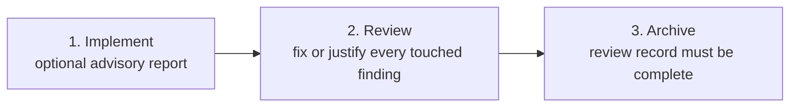

# Readability addon

**Experimental, feature-gated, default off.** The `readability` addon is an
opt-in experiment: it reports structural debt in production Rust and, when
enabled, blocks a review until every touched finding is fixed or independently
justified. It is not a product guarantee; the schema, thresholds,
classifications, and gate rules may change.

## What it does

- **Report.** `givn readability report` gives an advisory snapshot of the
  production Rust code. It classifies each type, module, and method and prints
  the finding with its evidence, as human text or JSON. It never blocks a
  change and stores no baseline.
- **Review gate.** With the addon enabled, `givn check review --change <id>`
  checks the types, modules, and methods the change touched. Every touched
  finding must be fixed or justified. A justified finding needs a rationale
  accepted by a reviewer who did not write it.

## Workflow



The report is advisory. The review gate is blocking. The report never stores a
baseline; the gate only looks at the units the change touched.

## What is produced and checked

| Phase | Produced by the addon | Checked by the addon |
|---|---|---|
| Proposal / design | Nothing automatic. You may run the report as evidence. | Nothing. |
| Implement | An optional report with findings and evidence, as human text or JSON. | Nothing. The report never blocks a change. |
| Review | `READABILITY: FIXED` or `READABILITY: JUSTIFIED` for every touched finding; a rationale for each justified finding; `READABILITY: PASS` when findings exist. | Every touched finding has a decision. A justified finding's rationale names the finding and its evidence and has an independent reviewer's accept. |
| Archive | Nothing new. | The review record is complete. An unaccounted finding blocks archive. |

A `JUSTIFIED` decision is not an exemption: the unit is still a finding. The
rationale explains why the current shape is right, names a rejected
alternative, and records `Author:`, `Reviewed-by:`, and `Review verdict:
accept`. Put it at
`givn/changes/<id>/readability/rationales/<unit-slug>.md`. The reviewer must be
a fresh-context reviewer that did not write the rationale; the author must not
fill the reviewer fields. The gate checks the mechanical floor; it does not
prove the judgment is right.

## Expected outcome

- Structural debt in touched units becomes visible and is either fixed or
  explicitly justified.
- An independent reviewer checks the justification instead of accepting
  self-attestation.
- Refactors stay behavior-preserving; the report's evidence, not a score,
  drives the decision.
- The report remains useful for untouched code without blocking unrelated
  changes.

Success looks like fewer findings over time, rationales that survive independent
review, and fixes that change structure rather than only the measurement.

## What may hint at a problem

- **Justify rate stays high.** A growing set of `JUSTIFIED` units means the
  gate is recording debt, not reducing it.
- **Rationales reject an alternative that a later change implements.** The
  archived rationales from the earlier gate change did exactly this: one said
  splitting the adapter would weaken ADR-074, and the follow-up split it inside
  the adapter directory. Old rationales are historical evidence, not active
  decisions; when they read as current, the process is confusing.
- **The reviewer accepts the claim without checking it.** A rationale that
  restates "the current shape is right" without citing the measurement or
  naming every responsibility of the unit is not evidence.
- **The measurement improves while the design does not.** Hiding literals,
  suppressing a lint, turning a long method into a long parameter list, or
  lowering a count without fixing the cause is gaming the gate.
- **The same unit recurs across changes.** Repeated findings on one unit mean
  the rationale is papering over a shape that should change.
- **Findings cluster in the analyzer or gate itself.** The experiment is
  self-referential; its own machinery is a large Rust surface. Treat that as
  evidence about the rules, not only about the code.
- **The addon stays disabled or the report is ignored.** An opt-in gate that
  nobody enables or acts on has no effect.
- **False positives or negatives dominate.** Macros, non-UTF8 files,
  conditional compilation, and braces inside string literals are known limits
  (risks R-105 and R-108); the report is a completeness-limited view, not a
  total-debt claim.
- **Cross-run comparisons are treated as trends.** No baseline is stored and the
  rules version can change; comparing two runs can compare two different rule
  sets.
- **Untouched debt is assumed absent.** The gate sees only touched units. A
  green gate does not mean the repository is clean.
- **A rationale can be complete and still wrong.** The gate checks the fields,
  not the judgment; independent review is a second opinion, not a proof.

## Enable and disable

```sh
givn addons enable readability
givn readability report
givn readability report --json --out readability.json
givn check review --change <id>
givn addons disable readability
```

`givn init` never enables it. When disabled, the report refuses with the named
reason, the review gate does not run, and the readability section is omitted
from the served review guidance.

## References

- Report specification: [`givn/specs/assess-code-structure/readability-report.feature`](../givn/specs/assess-code-structure/readability-report.feature)
- Gate specification: [`givn/specs/verify-change/readability-review-gate.feature`](../givn/specs/verify-change/readability-review-gate.feature)
- Applied independent review: [`givn/archive/apply-readability-independent-review/review.md`](../givn/archive/apply-readability-independent-review/review.md)
- Neutral analyzer port: [`docs/arc42/adr/ADR-074-neutral-source-analyzer-port.md`](arc42/adr/ADR-074-neutral-source-analyzer-port.md)
- Known risks: [`docs/arc42/11-risks-and-technical-debt.md`](arc42/11-risks-and-technical-debt.md) (R-105 to R-109, D-24)
- Reviewer rules: [`assets/instructions/review.md`](../assets/instructions/review.md) (`Readability review gate`)
