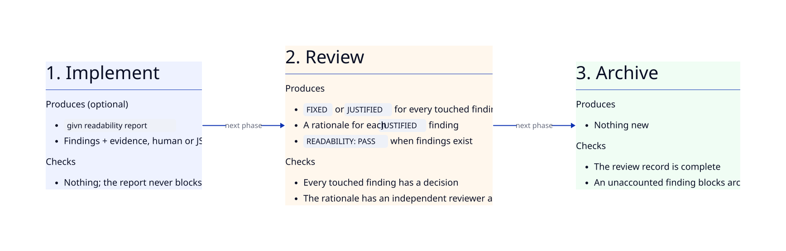

# Readability addon

**TL;DR:** The `readability` addon is an optional, default-off experiment for
production Rust. Its core idea is outline comprehension: read the outline of a
type or module — method declarations, signatures, and calls, without bodies — and
check that it explains the unit's responsibility and call order. It also
produces an advisory report of structural debt and, when enabled, a
change-relative review gate: every type or module the change touches, including
its methods, must be fixed or justified, and a justification needs a reviewer
who did not write it. It stores no baseline, ignores non-Rust code, and is not a
product guarantee: the schema, thresholds, classifications, and gate rules may
change.

## What it does

- **Report.** `givn readability report` prints each unit's outline first —
  method declarations, signatures, and internal calls — then the finding and
  the supporting metrics, as human text or JSON. It never blocks a change and
  stores no baseline.
- **Review gate.** With the addon enabled, `givn check review --change <id>`
  checks the types and modules the change touched, including their methods.
  Every touched finding must be fixed or justified. A justified finding needs a
  rationale accepted by a reviewer who did not write it.

## Outline comprehension — the core idea

The addon is not only a size counter. Its central rule is R1: a reader given
only a unit's outline should be able to state (a) what the unit is responsible
for and (b) why its internal calls happen in that order.

The outline lists the unit's method declarations and signatures, their order,
and the internal calls each method makes. Data — fields and enum variants — is
not part of the outline. It contains no method bodies and no comments.
`givn readability report` prints the outline for every unit; `--json` emits the
full outline under `units[].outline`, including call-resolution labels.

An example, abridged from the report:

```text
OUTLINE type:src/engine.rs::Engine
  method [public] fn build(&self) -> Engine
    calls: validate -> compile
  method [private] fn validate(&self) -> Result<()>
  method [private] fn compile(&self) -> Engine
  metrics (supporting): code lines 120; methods 3; public methods 1
```

The names and call order state the unit's job: build an `Engine` by validating,
then compiling. The metric line is support, not the point.

The outline is the semantic layer. The automated classifications (size,
cohesion, method length) find candidates; the outline is what a reviewer reads
to decide whether the names and call order communicate the unit's meaning. The
independent reviewer for a `JUSTIFIED` finding reads only the outline and must
be able to explain the responsibility and call order.

**Current limit.** Outline comprehension is not yet an automated finding rule:
a unit whose outline is hard to follow, but which is under the size and method
thresholds, does not create a finding by itself. The automated gate is
size/method-based; the outline is the primary review artifact and is used by
the reviewer. Treat that as an open experiment gap, not a completed rule.

## Workflow



Source: [`readability-workflow.d2`](readability-workflow.d2). Regenerate with
`d2 docs/readability-workflow.d2 docs/readability-workflow.svg`.

The report is advisory. The review gate is blocking. The report never stores a
baseline; the gate only looks at the units the change touched.

## What is produced and checked

| Phase | Produced by the addon | Checked by the addon |
|---|---|---|
| Proposal / design | Nothing automatic. You may run the report as evidence. | Nothing. |
| Implement | An optional report with each unit's outline first, then the finding and supporting metrics, as human text or JSON. | Nothing. The report never blocks a change. |
| Review | `READABILITY: FIXED` or `READABILITY: JUSTIFIED` for every touched finding; a rationale for each justified finding; `READABILITY: PASS` when findings exist. | Every touched finding has a decision. A justified finding's rationale names the finding and its evidence and has an independent reviewer's accept. |
| Archive | Nothing new. | The review record is complete. An unaccounted finding blocks archive. |

## What is checked in the source code exactly

The report and the gate share the same analysis:

- **Scope.** Only production `.rs` files under `src/` (or explicit `--path`
  roots). `tests/`, `benches/`, `examples/`, and `target/` are excluded;
  `#[cfg(test)]` items are excluded; `src/bin/**` is included.
- **Units.** A unit is a type (struct, enum, trait, union, or type alias) or a
  module. Its methods are checked with it.
- **Type size.** Over 500 code lines:
  - a trait or a type with more than 50 public methods is an `interface`;
  - a struct or enum with at most one method is `data-only` (size-exempt);
  - LCOM4 over 2 or TCC below 50% is a `god-type`;
  - otherwise it is a `cohesive-large-type`.
- **Module size.** Over 1,000 code lines is a `module`; 500–1,000 with at least
  two declared types is a `multi-type-module`; 500–1,000 otherwise is a
  `module`.
- **Methods.** A method over 100 code lines or over 50 flow complexity is a
  `method-length` finding.
- **Gate finding.** A unit is a finding when its classification is not
  `within-limits` and not `data-only`, or when it has a method finding.
  Data-only size is exempt unless a method finding exists. The gate compares
  the touched units at the change base and at committed `HEAD`: new, crossed,
  grown, not grown, removed, or fixed.
- **Decisions.** `FIXED` only if the unit is under threshold at head.
  `JUSTIFIED` only with a rationale that matches the unit and classification
  and passes the field checks: evidence, responsibility, a rejected
  alternative, a confirmed owner, no banned reason, a `Follow-up:` and
  `Expiry:` pair when temporary, and an independent reviewer's `accept`.
- **Markers and record.** `READABILITY: FIXED`, `JUSTIFIED`, `PASS`, and
  `FAIL`. Unknown or conflicting markers fail. A missing decision, a missing
  review record, or a missing `PASS` when findings exist fails. `FAIL` blocks.
- **Fail-closed guards.** No reachable change commit, a shallow clone, dirty
  production paths, a non-UTF8 or line-break path, a symlink, a submodule, an
  unreadable blob, or a changed `.rs` file the analyzer cannot analyze fails
  the gate.
- **Removed units.** A removed unit that was a finding still needs `FIXED`.
- **Accounting is unit-level.** A rationale for a type does not cover its
  module.

## Non-Rust code

The addon is Rust-only. The report discovers only `.rs` files; non-Rust files
under `src/` are ignored. The review gate applies the same scope and ignores
changed paths that do not end in `.rs`.

Non-Rust code is not “unsupported”: it is out of scope. A change that only
touches non-Rust files has nothing for the gate to check. A mixed-language
`src/` tree gets a Rust-only structural view.

| Input | Report | Review gate |
|---|---|---|
| Non-Rust file under `src/` | Ignored | Ignored |
| Changed non-Rust file | Not analyzed | No effect |
| Rust file with an unsupported construct | Named in `unsupported` | Reported; not a failure by itself |
| Rust file that cannot be parsed | Named as a parse failure | Fails closed if changed |
| Rust file the analyzer skips under a production root | Not analyzed | Fails closed if changed |
| Rust file under `tests/`, `benches/`, `examples/`, `target/` | Excluded | Not production scope |

A Rust file the analyzer cannot parse fails closed if changed. An unsupported
construct is named in the report's `unsupported` list; it is not automatically a
gate failure. Supporting another language would need a second adapter behind
the neutral `SourceAnalyzer` port (ADR-074); the Rust adapter does not pretend
to understand other syntax.

A `JUSTIFIED` decision is not an exemption: the unit is still a finding. The
rationale explains why the current shape is right, names a rejected
alternative, and records `Author:`, `Reviewed-by:`, and `Review verdict:
accept`. Put it at
`givn/changes/<id>/readability/rationales/<unit-slug>.md`. The reviewer must be
a fresh-context reviewer that did not write the rationale; the author must not
fill the reviewer fields. The gate checks the mechanical floor; it does not
prove the judgment is right.

## Expected outcome

- Structural debt in touched units becomes visible and is either fixed or
  explicitly justified.
- An independent reviewer checks the justification instead of accepting
  self-attestation.
- Refactors stay behavior-preserving; the report's evidence, not a score,
  drives the decision.
- The report remains useful for untouched code without blocking unrelated
  changes.

Success looks like fewer findings over time, rationales that survive independent
review, and fixes that change structure rather than only the measurement.

## What may hint at a problem due to this addon

Feedback on these signals is wanted. This is an experiment; if you see them,
say so.

- **The outline is ignored.** If reviews cite only line counts and never use
  the outline to explain responsibility and call order, the experiment has
  collapsed into a size gate.
- **Justify rate stays high.** A growing set of `JUSTIFIED` units means the
  gate is recording debt, not reducing it.
- **Rationales reject an alternative that a later change implements.** The
  archived rationales from the earlier gate change did exactly this: one said
  splitting the adapter would weaken ADR-074, and the follow-up split it inside
  the adapter directory. Old rationales are historical evidence, not active
  decisions; when they read as current, the process is confusing.
- **The reviewer accepts the claim without checking it.** A rationale that
  restates "the current shape is right" without citing the measurement or
  naming every responsibility of the unit is not evidence.
- **The measurement improves while the design does not.** Hiding literals,
  suppressing a lint, turning a long method into a long parameter list, or
  lowering a count without fixing the cause is gaming the gate.
- **The same unit recurs across changes.** Repeated findings on one unit mean
  the rationale is papering over a shape that should change.
- **Findings cluster in the analyzer or gate itself.** The experiment is
  self-referential; its own machinery is a large Rust surface. Treat that as
  evidence about the rules, not only about the code.
- **The addon stays disabled or the report is ignored.** An opt-in gate that
  nobody enables or acts on has no effect.
- **False positives or negatives dominate.** Macros, non-UTF8 files,
  conditional compilation, and braces inside string literals are known limits
  (risks R-105 and R-108); the report is a completeness-limited view, not a
  total-debt claim.
- **Cross-run comparisons are treated as trends.** No baseline is stored and the
  rules version can change; comparing two runs can compare two different rule
  sets.
- **Untouched debt is assumed absent.** The gate sees only touched units. A
  green gate does not mean the repository is clean.
- **A rationale can be complete and still wrong.** The gate checks the fields,
  not the judgment; independent review is a second opinion, not a proof.

## Enable and disable

```sh
givn addons enable readability
givn readability report
givn readability report --json --out readability.json
givn check review --change <id>
givn addons disable readability
```

`givn init` never enables it. When disabled, the report refuses with the named
reason, the review gate does not run, and the readability section is omitted
from the served review guidance.

## References

- Report specification: [`givn/specs/assess-code-structure/readability-report.feature`](../givn/specs/assess-code-structure/readability-report.feature)
- Gate specification: [`givn/specs/verify-change/readability-review-gate.feature`](../givn/specs/verify-change/readability-review-gate.feature)
- Applied independent review: [`givn/archive/apply-readability-independent-review/review.md`](../givn/archive/apply-readability-independent-review/review.md)
- Neutral analyzer port: [`docs/arc42/adr/ADR-074-neutral-source-analyzer-port.md`](arc42/adr/ADR-074-neutral-source-analyzer-port.md)
- Known risks: [`docs/arc42/11-risks-and-technical-debt.md`](arc42/11-risks-and-technical-debt.md) (R-105 to R-109, D-24)
- Reviewer rules: [`assets/instructions/review.md`](../assets/instructions/review.md) (`Readability review gate`)
