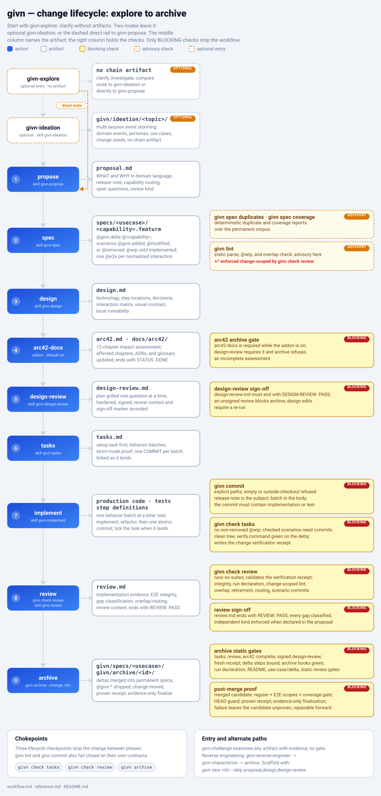

# Givn workflow

Givn is a spec-driven workflow. The `.feature` file is the executable
specification; its owning use case supplies the domain contract. A change moves
through planning, design review, implementation, review, and archive. State is
derived from files on disk, not stored separately.

This page is the orientation map. The exact command, configuration, skill,
runner, and recovery contracts live in [the reference](reference.md); the rules
an agent follows during a step are served by `givn instructions <id>` and belong
to the instruction assets, not to this overview.



```
givn-explore → [givn-ideation] → proposal → specs → design → [arc42-docs] → design-review → tasks → implement → review → archive
```

`givn-explore` may route directly to proposal when the change is concrete, or
through `givn-ideation` when the domain needs structured discovery first.
`arc42-docs` appears when the arc42 addon is enabled (the default). The graph is
configurable through `givn/config.yaml`; a project may add, remove, or reorder
artifacts.

## Phases

| Phase | Skill | Produces under `givn/changes/<id>/` | Leaves when |
|---|---|---|---|
| Propose | `givn-propose` | `proposal.md`: problem, observable solution, release note, capability placement, open questions | file exists |
| Spec | `givn-spec` | delta features under `specs/<usecase-slug>/`, tagged `@givn.delta`, `@givn.added/modified/removed`, with `@wip` while unimplemented | delta features exist |
| Design | `givn-design` | `design.md`: technology, step locations, decisions, interaction matrix, visual contract, local runnability | file exists |
| Architecture (addon) | served by the design step | `arc42.md` plus affected `docs/arc42/` chapters | assessment complete |
| Design review | `givn-design-review` | `design-review.md` ending in `DESIGN-REVIEW: PASS` | marker is the final non-empty line |
| Tasks | `givn-tasks` | `tasks.md`: setup task, behavior batches, evidence and commit fields | tasks written |
| Implement | `givn-implement` | production code, tests and step glue, ticked tasks, one batch commit | every scenario records a batch commit |
| Review | `givn-review` | `review.md` ending in `REVIEW: PASS` | marker is the final non-empty line |
| Archive | `givn-archive` (the command is `givn archive`) | merged permanent specs, archived change, proven receipt | archive proves |

Skills are the only generated invocation surface. How a harness invokes a skill
depends on the harness: Claude Code and OpenCode use their skill slash, OMP uses
`/skill:<name>`, the neutral `agents` target uses skill discovery, and Maki uses
an explicit request or an agent-selected skill. Givn generates no commands.
The exact rules for each step come from `givn instructions <id>`; do not copy
those obligations into a second local policy.

`givn-ideation` and `givn-explore` are optional pre-phases. Explore clarifies a
problem without producing lifecycle artifacts; it routes to proposal directly
or to ideation when the domain needs durable, structured discovery. Ideation
storms a domain into use cases and change seeds under `givn/ideation/<topic>/`;
it produces no manifest artifact and has no gate, and its change seeds are
inputs to `givn-propose`. `givn-challenge` examines a supplied proposal, test,
specification, design, implementation, or whole change with evidence; it is not
a lifecycle gate.

## Initial adoption and artifact ownership

For a fresh project, enter through explore and let the agent route to ideation
or proposal. The first useful product change establishes the runner, coverage
commands, and run declaration during its normal lifecycle. Setup failures such
as a missing binding, dependency, or result file are not the observed RED for a
new behavior: first make the adapter execute the selected features and write
valid results, then observe the behavior assertion fail before a production
edit.

For an existing project, use an initial formal change to establish a
project-wide documented baseline. Inventory existing architecture, domain, and
persona material; map it into the canonical owners below; reconcile
contradictions; retire or redirect superseded documents and links; and record
unknowns explicitly. This establishes durable understanding and working public-
boundary E2E testing; it does not require executable characterization of every
legacy behavior.

| Artifact | Owns | Must not become |
| --- | --- | --- |
| Proposal | Problem, intended outcome, scope, rationale | A second technical design |
| Use case | Actor goal, boundaries, system guarantees | Implementation details or copied scenarios |
| Feature | Executable examples of observable behavior | An implementation plan |
| Change design | Implementation approach, alternatives, consequential decisions | A copy of the architecture manual |
| Arc42 and ADRs | Durable architecture and lasting decisions | A chronological log of every change |
| Persona | Relevant user context, needs, goals, constraints | Another behavior specification |
| Tasks | Batches, execution evidence, revision references | A rewritten proposal or design |
| Review | Findings, dispositions, evidence references, verdict | A transcript or copy of every result |

Overlap is intentional when a use-case guarantee is illustrated by a feature or
a lasting design decision is promoted into an ADR. Each subject still has one
authoritative home. An affected/unaffected Arc42 assessment owns architecture
impact; design and review may summarize or link to it, but should not reproduce
competing checklists. Accurate unaffected architecture chapters, personas, and
glossary entries stay unchanged. Initial adoption cannot use no-impact claims to
excuse unpopulated scaffolds or an inaccurate baseline.

## Behavior batches

Related scenarios form one coherent behavior batch. The batch gets one test
phase, one implementation phase, one refactor phase, and one batch commit.

- Before a production edit, record an actual observed RED for the behavior:
  the test fails on its assertion, not on a missing binding, fixture, import, or
  environment failure.
- A new test that immediately passes is valid only as protection for an
  already-satisfied distinct requirement; it records that fact and makes no
  production edit for it.
- Never reconstruct RED or rewrite history. Record the actual command and short
  result in the batch task as it happens.
- Commit a completed batch with explicit paths. The release note is the message
  subject; the batch name and, for a single-scenario batch, the scenario title
  are in the body. Separate GREEN refactoring commits are allowed.
- Tick a scenario box when the batch tests pass and the batch commit is
  recorded. The commit must contain the scenario's implementation or its
  regression test.

The precise test-first and step-writing mechanics are served by
`givn instructions steps`; task sequencing is served by `givn instructions
tasks`. This overview deliberately does not restate them.

## Hard gates

Only the following commands stop the workflow; everything else is served
guidance or advisory reporting.

| Gate | Command | Stops |
|---|---|---|
| Change verification | `givn check tasks --change <id>` | non-removed `@wip`, missing or unreachable scenario commits, a dirty tree, a failing delta suite; writes the change verification receipt |
| Review | `givn check review --change <id>` | integrity failures, an unconfigured run declaration, change-scoped lint failures, undisclosed retirement, invalid capability placement, unresolved overlap dispositions, a missing or stale receipt, missing scenario commits |
| Archive | `givn archive --change <id>` | incomplete tasks/review/arc42-docs, an unsigned design-review, unbound delta step definitions, failed archive hooks, an unconfigured run declaration, incomplete README, invalid use-case or delta documents, a missing E2E runner when `@e2e` is in scope, merge conflicts and stale narrative bases, red regular or E2E scopes, a failing coverage gate, a tested tree that moved |
| Lint | `givn lint` | parse errors, duplicate titles, empty features, invalid use-case documents, interaction mismatches; review runs the change-scoped form |
| Commit path | `givn commit` | an empty path selection or a path outside the checkout |

`givn readme check` reports open placeholders and damaged managed blocks; the
archive completeness gate blocks on its findings when the readme addon is
enabled. The run-declaration gate in review and archive blocks an unconfigured
or invalid `run:` block. A configured `post` hook adds checks; it cannot weaken
a mandatory one, and built-in hook names cannot be marked `allow_failure`.

## Verification

- `givn check tasks --change <id>` runs the configured `verify.command` once
  against the change's delta features. The runner receives `GIVN_FEATURES`,
  `GIVN_RESULT_FILE`, and `GIVN_RESULT_SCOPE=change`, and must write a fresh,
  reconciling four-count result. The tested revision, features, command, and
  tested content are bound into the change verification receipt.
- A change that declares `Behavior change: none` with skipped specs and no
  delta features reports changed-scenario verification as not applicable. It
  stores an applicability result, not a fabricated green receipt.
- `givn check review` runs no tests. It validates the receipt. A later revision
  whose tested content is unchanged may reuse the proof; any tested-content
  change makes it stale and routes back to `givn check tasks`.
- `givn archive` publishes the merged candidate and runs the regular and E2E
  scopes once against it. The E2E scope is not applicable only when the merged
  corpus has no `@e2e` scenario. Successful scope evidence is persisted, so a
  later failure does not erase it; a retry reuses evidence only when its inputs
  match, and changed inputs conservatively invalidate both scopes.
- A missing, malformed, zero, failed, skipped, or non-reconciling result is a
  failure. A runner that ignores `GIVN_FEATURES` remains a project-runner
  limitation; the receipt records the feature path but cannot prove what the
  runner read.

The full runner and receipt contract is in
[the reference](reference.md#verification-and-recovery).

## Archive and recovery

Archive is forward-only and SCM-backed on Git or Fossil. It refuses a dirty
checkout, a project root below the checkout root, and an already proven archive.
The sequence is:

1. Static gates: artifact completeness, signed design review, review receipt
   freshness, delta step-definition binding, configured archive hooks, the run
   declaration, README completeness, use-case and delta prevalidation, and the
   E2E-runner configuration when `@e2e` is in scope. No suite runs here.
2. Publish the merged change as the archive candidate and write the pending
   receipt. The change directory moves to `givn/archive/<id>/` in one rename.
3. Run each verification scope once against the candidate; run the coverage
   gate when enabled.
4. Guard that `HEAD` is still the tested revision and that only declared
   evidence paths are dirty, write the proven receipt, and publish the
   evidence-only finalization revision.

A failure after the candidate publication leaves an unproven candidate in
place. Repair the committed state and rerun `givn archive --change <id>`; the
merge is idempotent, completed scopes may be reused, and the archive reports
honestly. Givn never rolls back the permanent corpus or rewrites history.

## Reverse engineering

For a codebase without baseline specs, the flow is
`givn-reverse-engineer` → `givn-characterize` → archive.

- Scaffold with `givn new <id> --skip proposal,design,design-review`.
- Write the black-box boundary and suspected bugs in the feature description;
  put the seam strategy in `tasks.md`.
- Characterization corrects the spec, never the code. Suspected bugs carry a
  `TODO: REVERSE-ENGINEERING NOTE:` marker.
- Once the baseline exists, normal changes proceed against it.

## What the gates do not check

- Design review ran in a genuinely fresh context; the marker is a self-report.
- A bound step body asserts something; the strict-mode proof covers undefined
  and pending steps, and review checks the implementation evidence.
- A commit touches production code; the task gate checks revision identity and
  reachability, not the diff.
- A screenshot shows the right thing; evidence presence is checked and the
  Persona judgment is a review marker.
- Planning artifacts are semantically complete; status treats an existing file
  as done.
- A runner honors `GIVN_FEATURES`; the project owns that contract.

## Where to go next

- [Reference](reference.md) — CLI, configuration authority, skills, addons,
  runner and receipt formats, recovery.
- [Use-case model](use-case-model.md) — identity, scoping, and review criteria.
- [Outline addon](outline.md) — advisory structure report and its limits.
- [Development record](development-report.md) — local record, report, analytics.
- [Architecture documentation](arc42/README.md) — current architecture, ADRs,
  and the post-1.0 backlog.
- [Manual 1.0 transition](migrations/README.md) — moving a pre-1.0 project.

*[Documentation index](INDEX.md)*
