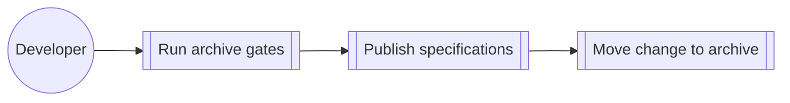

# Use case: archive-change

## Level

!

## Actors

- Developer

## Goal

Publish a completed change into the permanent specification corpus without
losing behavior or leaving a partial archive.

## Trigger

The developer archives a reviewed change.

## Preconditions

- The change has passed its required workflow gates.
- The permanent corpus is available for update.

## Main flow

1. Run the archive gates.
2. Merge the accepted behavior and use-case documents.
3. Verify the resulting permanent corpus.
4. Move the change into historical archive.

## Extensions

- A failed gate restores the permanent corpus.

## Rules

- A use-case replacement must match its recorded base revision.
- Feature behavior is never silently dropped.

## Examples

- A new capability is installed under its declared use case.

## Minimal guarantee

The pre-archive corpus remains intact when publication fails.

## Success guarantee

The permanent corpus and archive contain the accepted change.

## Personas

- none

## Capabilities

- grouped-merge-for-new-capabilities
- preserve-docstrings-on-archive
- extract-coverage-gate
- enforce-post-merge-e2e-gate

## Interactions

| Capability | Consumer action | E2E scenario |
|---|---|---|
| grouped-merge-for-new-capabilities | archive a new capability | Consumer archives a new capability and the merged spec lands in its declared use case |
| grouped-merge-for-new-capabilities | archive without routing | Archive is blocked when a new capability has no declared routing decision |
| grouped-merge-for-new-capabilities | archive a multi-file change | Nothing is merged when one delta file of a change has no routing decision |
| preserve-docstrings-on-archive | archive a modified scenario | Consumer archives a modified scenario and the permanent spec keeps the docstring |
| extract-coverage-gate | archive with coverage | Consumer archives a change with coverage enabled and the coverage summary appears in README |
| enforce-post-merge-e2e-gate | archive an E2E delta | Consumer archives a delta that adds e2e scenarios and is blocked without a configured runner |

## Includes

- usecase: verify-change
- fragment: support

## Extends

- none

## Out of scope

Reviewing implementation design or inventing new behavior during archive.

## Diagram

