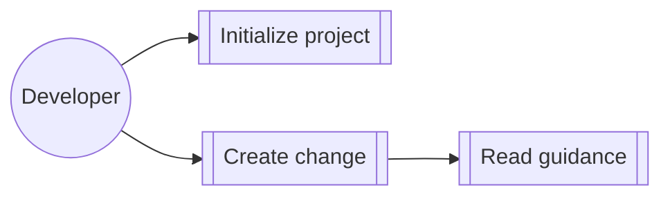

# Use case: author-change

## Level

!

## Actors

- Developer
- Authoring agent

## Goal

Create a valid change and the guidance needed to carry it from intent to
executable specification.

## Trigger

The developer starts a new change or initializes a project.

## Preconditions

- The project is in a location where Givn can manage its workflow.

## Main flow

1. Initialize the project and select agent targets.
2. Create a change with a valid identity.
3. Read the canonical artifact guidance.

## Extensions

- Optional addons are enabled or disabled by explicit user decision.

## Rules

- Change identities are stable kebab-case values.
- Generated guidance is synchronized from canonical source assets.

## Examples

- A developer creates a multi-word change without manual scaffolding.

## Minimal guarantee

The project remains unchanged when an invalid request is rejected.

## Success guarantee

The project has the requested change scaffold and generated guidance.

## Personas

- none

## Capabilities

- prose-consolidation
- new-command
- init-agent-target-selection
- install-extras

## Interactions

| Capability | Consumer action | E2E scenario |
|---|---|---|
| prose-consolidation | request canonical E2E guidance | Canonical E2E policy is emitted by specs instructions |
| prose-consolidation | inspect generated E2E guidance | Generated guidance points to the canonical E2E policy |
| init-agent-target-selection | select agent targets | Consumer selects agent targets during interactive init |
| init-agent-target-selection | initialize non-interactively | Consumer runs init non-interactively and gets opencode skills |
| init-agent-target-selection | resynchronize selected targets | Consumer re-syncs skills after init and the selection is honoured |

## Includes

- fragment: support

## Extends

- none

## Out of scope

Implementing the product behavior described by a change.

## Diagram

