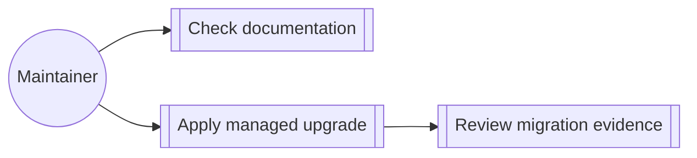

# Use case: maintain-project

## Level

!

## Actors

- Project maintainer

## Goal

Keep a project current, documented, and able to cross a release migration
without fabricated completion evidence.

## Trigger

The maintainer checks project documentation or upgrades Givn.

## Preconditions

- The project configuration and repository state are available.

## Main flow

1. Inspect documentation completeness.
2. Apply a managed upgrade when required.
3. Preserve a reviewable migration plan.

## Extensions

- An unclean repository blocks automatic migration commits.

## Rules

- Historical migration evidence remains reviewable.
- Open documentation placeholders block completion.

## Examples

- A clean project receives one managed upgrade commit.

## Minimal guarantee

The project is protected from partial automatic migration.

## Success guarantee

The project is documented and the upgrade work is explicit.

## Personas

- none

## Capabilities

- readme-enforcement
- release-0-3-0

## Interactions

| Capability | Consumer action | E2E scenario |
|---|---|---|
| readme-enforcement | scaffold README placeholders | Scaffolding marks the unfilled sections |
| readme-enforcement | check a complete README | The check passes on a complete README |
| readme-enforcement | archive and refresh documentation | Archiving refreshes the development block |
| readme-enforcement | record documentation impact | A recorded impact decision passes the review |
| readme-enforcement | request unfinished README guidance | Instructions surface an unfinished README |
| release-0-3-0 | plan a release migration | A clean 0.2.0 project receives a reviewable aggregate migration plan |
| release-0-3-0 | run a managed upgrade | A clean project without migration requirements receives one managed upgrade commit |
| release-0-3-0 | invoke a retired engine command | A consumer invoking a retired engine command is told it does not exist |
| release-0-3-0 | archive a maintenance migration | A completed maintenance migration can be archived without a product specification |

## Includes

- fragment: support

## Extends

- none

## Out of scope

Changing product specifications as part of routine project maintenance.

## Diagram

