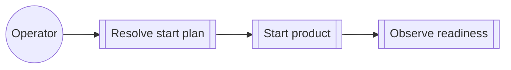

# Use case: operate-product

## Level

!

## Actors

- Product operator

## Goal

Start the declared product through its real boundary and observe readiness,
exit, and termination behavior.

## Trigger

The operator invokes the run command.

## Preconditions

- The project declares a valid product start plan.

## Main flow

1. Resolve the start plan.
2. Start the product.
3. Wait for the declared readiness signal.
4. Forward the product outcome.

## Extensions

- Invalid declarations are rejected before the product starts.

## Rules

- A server has exactly one port source.
- Readiness is confirmed through the declared boundary.

## Examples

- An operator starts a server and receives a ready line.

## Minimal guarantee

The product is not reported ready when its declaration or probe fails.

## Success guarantee

The operator can observe readiness and receives the product exit outcome.

## Personas

- none

## Capabilities

- run-execution
- run-command

## Interactions

| Capability | Consumer action | E2E scenario |
|---|---|---|
| run-execution | start a server | The started server reports readiness and forwards a clean exit |
| run-execution | hand over a caller port | A caller-provided port is handed to the product |
| run-execution | print the start plan | Print mode emits the start plan without starting |
| run-execution | interrupt a started product | An interrupt stops the started product |
| run-command | scaffold a run declaration | Scaffolding ships an unconfigured run declaration |
| run-command | check an unconfigured declaration | The review check reports an unconfigured run declaration |
| run-command | archive a configured project | Archive passes once the run declaration is complete |
| run-command | upgrade a project declaration | Upgrade backfills the run declaration into an existing project |
| run-command | inspect a damaged README block | The check names a damaged run managed block |
| run-command | invoke the sentinel command | The sentinel start command prints setup guidance |

## Includes

- fragment: support

## Extends

- none

## Out of scope

Choosing a product architecture or inventing a start command from repository
content.

## Diagram

