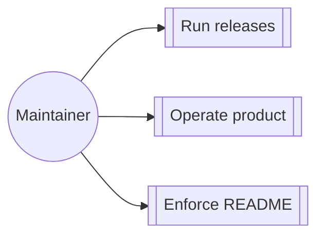

# Group: maintenance

## Actor

A maintainer operating the product over its lifetime.

## Goal

Keep the product running, current, and well-documented — release
checklists, the run command, execution wiring, and README enforcement.

## Main flow

1. Execute release steps with strict overrides where required
   (release-0-3-0).
2. Start and observe the product (`givn run`).
3. Enforce README completeness and managed blocks.

## Interactions

- Scaffolding marks the unfilled sections
- The check passes on a complete README
- Archiving refreshes the development block
- A recorded impact decision passes the review
- Instructions surface an unfinished README
- A clean 0.2.0 project receives a reviewable 0.4.0 migration plan
- A clean project without migration requirements receives one managed upgrade commit
- A completed maintenance migration can be archived without a product specification
- Scaffolding ships an unconfigured run declaration
- The review check reports an unconfigured run declaration
- Archive passes once the run declaration is complete
- Upgrade backfills the run declaration into an existing project
- The check names a damaged run managed block
- The sentinel start command prints setup guidance
- The started server reports readiness and forwards a clean exit
- A caller-provided port is handed to the product
- Print mode emits the start plan without starting
- An interrupt stops the started product

## Includes

- support (readme-coverage-badge)

## Extends

- none

## Out of scope

- Spec corpus changes; maintenance operates on the product, not the specs.

## Diagram

