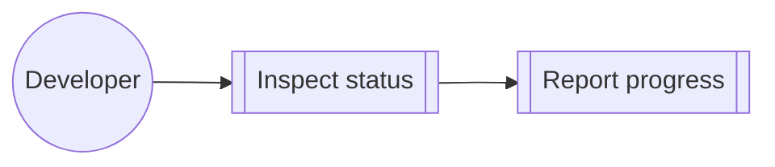

# Group: status

## Actor

A developer inspecting the current state of changes and artifacts.

## Goal

Answer "where am I?" — what changes are active, which artifacts are done,
and what the next step is — without reading files by hand.

## Main flow

1. Inspect change and artifact state (`givn status`).
2. Report task progress and pending work.

## Interactions

- Consumer runs givn status on a change with uppercase checkboxes
- Consumer runs givn status on a change with skipped artifacts and sees them correctly
- Consumer invokes givn status with a path traversal change id and gets a clear error

## Includes

- support (config-overlay)

## Extends

- none

## Out of scope

- Mutating any state; status is read-only.

## Diagram

