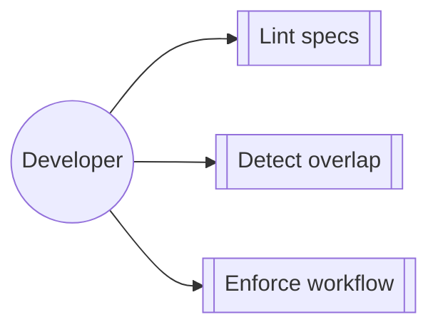

# Group: verification

## Actor

A developer (or agent) checking that a change's spec and implementation
are consistent, complete, and free of overlap.

## Goal

Run every deterministic gate over a change's artifacts — lint, overlap
detection, workflow enforcement, and input validation — so only sound
changes reach review and archive.

## Main flow

1. Lint the active tree or a change delta (`givn lint`).
2. Scan for overlapping scenarios and shape matches (spec-overlap-gates).
3. Enforce the workflow contract (change dirs, artifact ids, run
   declarations).

## Interactions

- Consumer runs the integrity check on a change inside givn/changes and the correct directory is detected
- Integrity check detects a placeholder COMMIT hash in tasks.md and fails
- Review passes when every shape match is disposed and reports the net-delta receipt
- A duplicate title across two permanent spec files is a hard error
- The json output reports duplicate-title findings machine-readably
- Consumer invokes givn check with an unknown artifact and gets a helpful error

## Includes

- support (config-overlay for gate configuration)

## Extends

- none

## Out of scope

- Semantic similarity scoring (retired).
- Running the test suite itself (run/maintenance).

## Diagram

