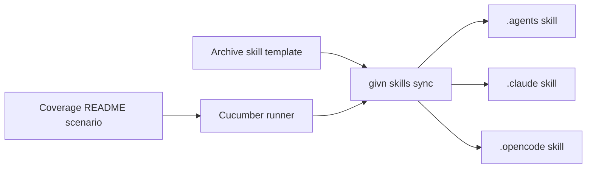

# Design: add-coverage-readme-example

## Technical Approach

Add the example to the embedded `givn-archive` skill template. The template is
the source of truth for the archive guidance; `givn skills sync` renders it to
the neutral, Claude Code, and opencode skill targets. The example will be
explicitly labelled as illustrative so its `watn` name, measured values, and
commands are not mistaken for generated values for the consuming project.

The example will sit under the existing post-archive README coverage rule and
will show:

- a `## Coverage` heading;
- a shields.io badge linked to the non-E2E Cobertura report;
- prose describing the non-E2E and E2E line totals and percentages; and
- a shell block that reproduces the non-E2E measurement.

The existing `<!-- givn:begin:coverage -->` and
`<!-- givn:end:coverage -->` ownership markers remain the rule for generated
coverage content. No coverage calculation or archive-gate behavior changes.

## Architecture Impact

Files and generated surfaces:

- `assets/skills/givn-archive/SKILL.md.tmpl` — add the canonical README example.
- `.agents/skills/givn-archive/SKILL.md` — generated neutral copy.
- `.claude/skills/givn-archive/SKILL.md` — generated Claude Code copy.
- `.opencode/skills/givn-archive/SKILL.md` — generated opencode copy.
- `givn/changes/add-coverage-readme-example/specs/coverage-readme-example/coverage-readme-example.feature` — executable scenario.
- `tests/steps/coverage_readme_example_steps.rs` — one capability-specific
  end-to-end step module that reads the generated archive guidance.
- `tests/steps/mod.rs` — registers the capability-specific step module.

No Rust production module, persisted data, configuration schema, or public CLI
interface changes.



## Test Design

### Runner

The executable specification uses the repository's `cucumber-rs` runner:

```sh
cargo test --test features_runner
```

The runner reads the `.feature` files from `GIVN_FEATURES`; givn's artifact
hooks set that variable to the active change's `specs/` directory, and archive
verification sets it to `givn/specs/` after merge. The feature scenario is
therefore executed by the same Gherkin runner rather than by a parallel test.

### Strict Mode

`tests/features_runner.rs` calls `.fail_on_skipped()` on the Cucumber builder.
The new step definitions must contain real assertions and must not use empty
or pending bodies. This makes an undefined or skipped README-guidance step
fail the runner instead of reporting a false pass.

### Single-Scenario Command

Run the scenario in the active change with:

```sh
GIVN_FEATURES=givn/changes/add-coverage-readme-example/specs \
  cargo test --test features_runner -- \
  --name "Coverage-enabled project receives a complete README coverage example"
```

### E2E Infrastructure

The scenario is a CLI end-to-end test. It creates an isolated temporary
project, initializes it through the real `givn` subprocess, runs
`givn skills sync` through the real CLI, and reads the generated archive skill
as the user-facing result. No browser, server, database, queue, or external
service is involved. Consequently there are no digital twins or network
dependencies, and the temporary directory is the complete local test
environment.

The E2E command, filtered to the scenario tag, is:

```sh
GIVN_FEATURES=givn/changes/add-coverage-readme-example/specs \
  cargo test --test features_runner -- --tags @e2e
```

The same `.fail_on_skipped()` configuration applies to this E2E run.

### Interaction Coverage Matrix

| Inventory entry | @e2e scenario title | Real interface | Driving mechanism |
|---|---|---|---|
| synchronize the project's generated skills after enabling coverage | Coverage-enabled project receives a complete README coverage example | CLI | Run `givn skills sync` as a real subprocess in an isolated project and inspect the generated archive guidance |

## Implementation Constraints

- Keep the sample values and commands visibly illustrative; do not make them
  part of coverage calculation or generated runtime statistics.
- Preserve the existing managed coverage markers and the surrounding README
  update rules.
- Regenerate all three tracked skill targets from the embedded template rather
  than maintaining divergent hand-written copies.
