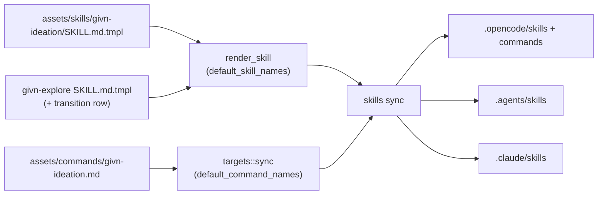

# Design: add-ideation-skill

## Technical Approach

This change adds one embedded skill asset plus two registration lines. No
renderer, cascade, archive, gate, or data-model changes are needed. The
existing `givn skills sync` regeneration path delivers the new skill to every
configured agent target; the existing frontmatter validation applies
unchanged.



## New and Changed Assets

| Asset | New/Changed | Content |
|---|---|---|
| `assets/skills/givn-ideation/SKILL.md.tmpl` | new | The facilitation skill (see Skill Content below) |
| `assets/commands/givn-ideation.md` | new | Slash command: description frontmatter, argument note, pointer into the skill, givn awareness (`givn status`), guardrails summary |
| `assets/skills/givn-explore/SKILL.md.tmpl` | changed | One row in the "Transitioning out" table: structured domain work with artifacts and multiple changes → `/givn-ideation` |
| `assets/commands/givn-explore.md` | changed | One line in "When no change exists": offer `/givn-ideation` when the user wants artifacts and multiple changes (covered by the explore scenario's `givn-explore command contains "givn-ideation"` pin) |
| `src/skills/render.rs` | changed | `default_skill_names()`: add `"givn-ideation"` |
| `src/skills/targets.rs` | changed | `default_command_names()`: add `"givn-ideation"` |

Registration as a default skill means always-on delivery: `sync()` renders
default skills for every target regardless of addon flags, and
`reconcile_addon_artifacts` never touches non-addon skills — no addon
conditional is introduced, which is what the spec's always-on scenario
proves.

## Skill Content (`assets/skills/givn-ideation/SKILL.md.tmpl`)

Static template: no `{{#if}}` conditional sections, no interpolation slots.
Frontmatter: `name: givn-ideation` (must match directory name) and a
one-sentence `description:`. Target length 200–250 lines — dense, imperative,
repo tone.

Section plan:

1. **When to use** — positioning against `givn-explore` (explore compares
   approaches without artifacts; ideation works a domain out until it is
   change-ready). One selection criterion table.
2. **Context** — `givn status`, `givn spec tree` / `givn spec find` for
   existing projects; README, durable architecture chapters, and the
   durable term list reading; topic state root.
3. **Topic state layout** under `givn/ideation/<topic-id>/`:
   `session.md` (resume), `frame.md`, `eventstorming.md`,
   `use-case-definitions.md`, `use-cases/<uc-id>.md`,
   `personas/<type>--<segment>.md`, `questions.md` (open question log),
   `domain-terms.md`, `changes/<uc-id>.md` (change seeds).
4. **Interaction rules** — one question at a time; unclear outcome → record
   an open question in `questions.md` and continue; never debate opinions.
5. **Resume** — read `session.md` first; report phase, progress, and open
   questions; continue where left off.
6. **Phase: Frame** — existing project (research protocol: commands, docs,
   durable term list) vs. greenfield (problem, vision, stakeholders with interests —
   distilled Wiegers questions: problem-first, 5-whys, stakeholder
   discovery including non-actors).
7. **Personas** — created after Frame; one or more persona segments per
   stakeholder type; the user confirms every persona file and every update;
   each file carries a running record (decisions, needs, open demands);
   cap: ~3 segments per type, ~10 total. Personas review every artifact
   that affects their stakeholder type — light reaction at Event Storming,
   value ranking at Use Case Definition, critique at Use Case Elaboration.
8. **Phase: Event Storming** — past-tense domain events; actor, command,
   policy, read model per event; reverse narrative
   ("which events must have happened to make this one possible?"); term
   collisions feed `domain-terms.md`; unresolvable points become
   open questions.
9. **Phase: Use Case Definition** — a sequence of events culminating in
   value is a use case; size it (user-goal `!` = change-sized, summary `+` =
   grouping, subfunction `-` = step inside a scenario); name boundaries;
   tag affected stakeholder types.
10. **Phase: Use Case Elaboration** — per defined use case: acceptance
    rules and concrete examples first (example mapping: rules, examples,
    questions), then the use-case contract (trigger, preconditions, main
    flow, extensions, guarantees); scenario skeletons follow last —
    Given ← preconditions, When ← trigger/actor action, Then ← guarantees.
11. **Quality reviews** — a fresh-context `quality review` subagent per
     phase boundary (frame, event storming, use case definition, use case
     elaboration) with a one-line rubric each (analyst / event-storming
     moderator / DDD architect / requirements auditor); findings advisory,
     user arbitrates.
12. **Handoff** — publish readable `docs/ideation/<topic-id>.md`; propose
    term merges into the durable term list (user decides);
    offer persona promotion into `givn/personas/` (user decides per file;
    repeated promotion of the same segment merges); write one change seed
    per use case into `changes/<uc-id>.md` with a suggested start order.
    Handoff never starts a change — the user runs the normal proposal flow
    per use case.
13. **What you must NOT do** — no givn change artifacts, no code, no
    automatic `givn new`, no term-list writes without an explicit user
    decision, no persona content the user has not confirmed, no batched
    questions.

### Contract phrases (traceability to the delta spec)

The delta scenarios assert these verbatim. Template phrases must appear
exactly; the delivery stdout row pins the CLI's sync output:

| Scenario (title abbreviated) | Phrase |
|---|---|
| delivery `@e2e`, phase ladder | `Frame` |
| delivery `@e2e` (stdout) | `Syncing skills and agent commands...`, `synced skill: givn-ideation` |
| phase ladder | `Event Storming`, `Use Case Definition`, `Use Case Elaboration`, `Handoff`, `one question at a time`, `quality review` |
| persona binding | `stakeholder type`, `persona segment`, `persona promotion`, `every artifact that affects` |
| state + safety | `givn/ideation/`, `session.md`, `docs/ideation/`, `open question`, `change seed`, `Handoff never starts a change` |
| explore wiring | `givn-ideation` (explore skill transition row; explore command "When no change exists" line) |
| always-on | `Frame` — a content assertion through the generated-guidance step, which reads the real targets list and asserts in the opencode target |

## Step Definitions

No new step files; every scenario in the delta binds to existing steps. One
shared step helper changes in this change: `target_skill_paths` in
`tests/steps/prose_consolidation_steps.rs` now resolves targets through the
production `load_skills_targets` (the real `skills:` `targets:` list in
`givn/config.yaml`) instead of substring-matching the whole config text —
the scaffold's comments mention every target name, so the old discovery
demanded `.agents/`/`.claude/` files that a no-addons init never creates.
Real parsing keeps the no-addons fixture compatible and target discovery
future-proof.

| Step | Defined in |
|---|---|
| `a givn project with all agent skill targets enabled` | `tests/steps/prose_consolidation_steps.rs` |
| `a project root with givn/ initialised without addons` | `tests/steps/mod.rs` |
| `the user runs \`givn skills sync\`` | `tests/steps/mod.rs` |
| `stdout contains "..."` | `tests/steps/mod.rs` |
| `the generated givn-<skill> guidance contains "..."` | `tests/steps/prose_consolidation_steps.rs` |
| `the generated givn-<skill> command contains "..."` | `tests/steps/prose_consolidation_steps.rs` |

Justification: the change ships asset content, not new CLI surface; the
`@e2e` scenario drives the same real CLI subprocess infrastructure as the
`skill-rewrites` precedent, whose `@e2e` scenario also binds these shared
CLI-driver steps. The generated-guidance step reads every configured
target's `SKILL.md` and panics on a missing file, so delivery to all three
targets is asserted by one step.

## Runner and Strict Mode

Existing contract, unchanged:

```text
./run-tests.sh          # unit/integration + permanent specs
./run-tests.sh --e2e    # @e2e-filtered
```

Strict mode is `.fail_on_skipped()` in `tests/features_runner.rs` —
undefined or pending steps fail the run. No new Rust step stubs are needed
(this change adds none); the not-implemented marker for any future Rust
stub is `unimplemented!()`.

Known overlap: the phase-ladder, persona-binding, and state scenarios
share the same Given/When and guidance-contains assertion sequences, so
their masked fingerprints are near-identical. `givn lint` reports a SHAPE
finding between the phase-ladder and state scenarios and SUBSET findings
with persona-binding under both (verified); these may surface as
delta-to-delta semantic candidates — a known unsupported remediation path
(R-19). Planned disposition: keep them as separate one-behavior scenarios;
at review time classify the pairs as VALID-BOUNDARY, the observable
distinction being the differing assertion sets (phase-ladder vocabulary vs
persona vocabulary vs state paths and handoff safety).

Single-scenario command:

```text
GIVN_FEATURES=givn/changes/add-ideation-skill/specs cargo test --test features_runner -- --name '^<scenario title>$'
```

## Local Runnability and E2E

The real interface is the CLI. The runner launches the compiled `givn`
subprocess in a temporary initialized project; generated files are the
observable effect. No server, browser, database, queue, third-party
service, or network dependency exists — no digital twins required.

Interface obstacle (named fix): agent-target selection — fixed in this
change. The step helper `target_skill_paths` now reads the real `skills:`
`targets:` list from `givn/config.yaml`, so the no-addons init fixture
(targets `[opencode]`) selects only the opencode target and the always-on
scenario's guidance step asserts content in `.opencode/`; the delivery
fixture's explicit `opencode`, `.agents`, `.claude` selection still makes
the same step cover all three target roots.

RED anchors: the pairing unit test `all_command_templates_are_embedded`
(`src/skills/targets.rs`) fails until `assets/commands/givn-ideation.md`
exists; every delta scenario fails until the template contains its
phrases and the registration lists include `givn-ideation`. With the
fixed target discovery the guidance steps fail on the content assertion
itself while the asset is absent — including in the no-addons project —
instead of panicking on files no configured target owns.

## Interaction Coverage Matrix

| Inventory entry | @e2e scenario title | Real interface | Driving mechanism |
|---|---|---|---|
| A consumer synchronizes skills and every agent target receives the ideation facilitation skill | A consumer synchronizes skills and every agent target receives the ideation facilitation skill | CLI | Real `givn skills sync` subprocess; assert stdout, generated skill in each configured target, and the opencode command file |

The five regular scenarios are variants of the same synchronize action
(contract facets and one different precondition) and add no inventory
actions.

## Coverage

| Process | Started by | Instrumented artifact | Profile output | Merge step | Non-zero production probe |
|---|---|---|---|---|---|
| Gherkin runner and givn subprocesses | `./measure-coverage.sh` | cargo coverage build | separate non-E2E/E2E Cobertura reports | `./merge-coverages.sh` | `givn::skills::render::render_skill` (renders `givn-ideation`) |

The existing project coverage scripts remain unchanged.

## Version Freshness

No new dependency, tool, runtime, or container is introduced; the existing
Rust toolchain and cucumber runner apply unchanged. No version-bearing
decision in this change.

## Amendment: generated-content marker ban (final-verification finding)

The permanent `template-conditional-rendering` scenarios scan every generated
skill and command for disabled-addon markers — `arc42`, `glossary`,
`ubiquitous`, `domain-modeling` (case-insensitive) plus the coverage marker
strings. Addon-gated skills are removed when their addon is disabled and
therefore exempt; an always-on skill is generated in every state and must
never contain these markers in rendered text.

Consequence for this design: the ideation template and command must not name
the arc42 docs path, the glossary, or the domain-modeling skill. The topic
state file for candidate terms is renamed `glossary-candidates.md` →
`domain-terms.md`, and Handoff/Frame wording routes to "the durable term
list". The durable term list itself remains the addon-owned glossary; ideation
captures candidates and the user decides merges at handoff, without the
always-on guidance naming the addon-owned artifact. The spec delta asserts no
banned marker and no renamed state file, so the delta is unchanged.
