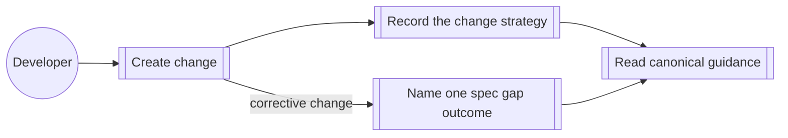

<!-- givn:base-sha256:1223677f1a7615e0fe91ad76a73af5ff071a798b3c4b7ff74fc75088bee9d9c1 -->
# Use case: create-change

## Level

!

## Actors

- Developer
- Supporting: Authoring agent

## Goal

Create a change ready to carry from intent to executable specification.

The delta: every change records one `Change strategy` with its `Ise Test` mode
when it rebuilds, and a corrective change names exactly one `Spec gap` outcome
before any fix.

## Trigger

The developer starts a new change.

## Preconditions

- The project is initialized as a Givn project.
- For a corrective change, an observed difference between the frozen `End-to-end (E2E) test` result and the declared `Specification` exists and is available for classification.

## Main flow

1. The developer creates a change; the system writes the scaffold with a stable identity and records the effective add-on set with the change.
2. The developer records the change's authoring decisions: the change strategy, and, when the change responds to an observed difference, exactly one `Spec gap` outcome before any fix; the system requires the strategy as the design's decision-ledger entry and keeps the classification with the corrective change.
3. The developer reads the artifact guidance; the system keeps one canonical policy per topic and points derived guidance at it.

## Extensions

- 1: the requested identity is invalid → the system rejects it and leaves the project unchanged; protects the minimal guarantee.
- 2: the `Spec gap` outcome is `implementation defect` → the change's proposal carries no corpus or E2E suite edit and the difference returns to the builder inside the Ise Test; recovers the classification without a corpus edit.

## Rules

- Change identities are stable kebab-case values.
- Generated thin skills are synchronized from canonical source assets; detailed rules have one served owner per topic, with no separately generated command surface.
- Managed bootstrap owns loading the effective dialog policy before the first user-facing question once per context, independently of optional addons and named workflows; reload it if lost. Skills contain no repeated policy-loading, handoff, or delegation boilerplate.
- Before the first question of an indexed type in a context, read its companion regression examples: scope approval, target selection, behavior choice, persistent-format commitment, or discoverable diagnosis. Ask one question at a time; retained policy and examples need not be reread for every question.
- Project-owned skill replacements stay authoritative without injected policy text; user-owned legacy command files are neither generated nor mutated.
- Dialog supplies decision-critical facts, concrete consequences, material revision costs, and proportional clarification; discoverable facts are researched rather than delegated to the user as questions.
- A change proposal carries one release note. Plan coherent named behavior batches with scenarios, validation, and intended commit boundaries; each completed batch's explicit-path revision uses the release note as subject and identifies the batch in the body, or the scenario title for a single-scenario batch.
- Actual behavioral RED runs before production edits; actual GREEN and REFACTOR checks are recorded compactly. Existing-behavior regressions may pass immediately without a production edit for that requirement; skipped RED is admitted, never reconstructed. Record the actual completed batch revision before checking off its scenario tasks.
- Regular and E2E executions select scope explicitly, including a shared command using GIVN_RESULT_SCOPE. Equal counts or command strings do not invalidate honest isolation; required executions still require zero failures and skips without an extra isolation run.
- Justified E2E reclassification aligns inventory, tasks, and review reasons and retains exactly one smoke for each real action; tags are never removed merely to evade verification.
- Evidence matches the actual product interface: a real browser may render static content without invented state changes; a library's public API may be called in-process; CLI uses the binary and services their public protocol. Isolation, twins, and full-stack infrastructure are required only for dependencies that exist. Preserve applicable visual contracts, baselines, screenshots or transcripts, and honest obstacle reporting.
- The scaffold records the effective add-on set with the change, so a change started while `ise` is off carries `ise: false` and no `ise` gate appears halfway through.
- Every change records one `Change strategy`: `incremental modification`, `Constant Ise`, or a whole-product rebuild.
- A rebuilding change records its `Ise Test` mode beside the strategy: `Dry-Run Ise` or `Full replacement`.
- The strategy is the design's existing `Decides D<n>` entry; it names the affected consumers, the persisted state, and the rebuild boundary, and it adds no mandatory design field.
- An unresolved or unrecorded change strategy, or a rebuild with no recorded mode, is a design-review finding, not a missing artifact.
- Prose writes `change strategy` in full; a bare `strategy` names no domain decision.
- A `Spec gap` record holds exactly one of `E2E test defect`, `implementation defect`, `specification defect`, or `acceptable undocumented change`, recorded before any fix.
- The record names the artifact that is wrong, not who found it.
- Only `specification defect` is a gap in the Specification; an `E2E test defect` is a gap in the test, an `implementation defect` is a gap in the build, and an `acceptable undocumented change` is no gap at all.
- A corrective proposal names the record and its outcome: an outcome of `specification defect` or `E2E test defect` carries the corpus or E2E suite edit in that change; `implementation defect` returns to the builder inside the Ise Test; `acceptable undocumented change` is recorded in the corpus.
- A `Spec gap` of `E2E test defect` recorded during an `Ise Test` stops that trial, and the trial restarts after the E2E test is corrected. The `e2e` package is part of the Specification, so the corrected test is a Specification correction, not an exception to the freeze.
- No difference is closed as silent drift.

## Examples

- A formatting fix records `Decides D2` with `change strategy incremental modification`; tasks 2 and 3 realize it, and no `Ise Test` runs.
- A key-parser swap records `Decides D4` with `change strategy Constant Ise; Ise Test mode Dry-Run Ise`; tasks 3 to 5 realize it, and neighboring consumer contracts keep their wording.
- A whole-product rewrite records `Decides D1` with `change strategy whole-product rebuild; Ise Test mode Full replacement`; tasks 2 to 9 realize it.
- An `Ise Test` reports a missing exit code that the contract never named: the record reads `Spec gap: specification defect`, and the corrective change adds the rule to the corpus. If the contract named the exit code, the record reads `Spec gap: implementation defect`, and the builder fixes it inside the trial with no corpus edit.
- An undocumented column-spacing change that no consumer depends on records `Spec gap: acceptable undocumented change` and is added to the corpus.
- A change started while `ise` is off records `ise: false`; enabling `ise` during that change is refused as an add-on change until the change ends.
- A developer creates a multi-word change without manual scaffolding.
- An author entering through a skill relies on managed bootstrap to load dialog once before the first question and reads the relevant indexed companion examples; the skill does not carry a duplicate policy block.
- Two scenarios in one behavior batch share its actual implementation or regression-test revision; a maintenance batch with no behavior change does not invent delta scenarios.
- A static browser page is verified in a real browser, while a library without a service is exercised through real public API calls without inventing server infrastructure.

## Minimal guarantee

The project remains unchanged when an invalid identity is rejected.

## Success guarantee

The project has the requested change, ready to carry from intent to
executable specification; the change's authoring contract requires one change
strategy in the design ledger, and a corrective change names one `Spec gap`
outcome.

## Personas

- developer--primary-user
- agent--technical-role
- givn-maintainer--owner

## Capabilities

- change-release-note
- change-strategy
- create-a-change
- prose-consolidation
- spec-gap
- visual-design-contract

## Interactions

| Capability | Consumer action | E2E scenario |
|---|---|---|
| prose-consolidation | request canonical E2E guidance | Canonical E2E policy is emitted by specs instructions |
| prose-consolidation | synchronize and inspect generated E2E guidance | Generated guidance points to the canonical E2E policy |
| visual-design-contract | request the design guidance for a visual interface | Author requests the visual design contract guidance |
| visual-design-contract | read the synchronized design and step guidance | Synchronized guidance defines the contract approval and capture mechanics |
| change-release-note | create a change | A new change's proposal carries the release-note field |
| change-release-note | read the proposal guidance | The proposal guidance requires a release note |
| change-release-note | read the generated implementation guidance | The generated implementation guidance shares the release note |
| change-strategy | read the design guidance for a rebuilding change (design-review guidance and the three strategy values are variants) | The design guidance requires one recorded change strategy |
| spec-gap | read the review guidance after an Ise Test (the proposal guidance and the four outcomes are variants) | The review guidance requires one spec gap outcome before any fix |

## Includes

- fragment: support

## Extends

- none

## Out of scope

Implementing the change's product behavior; archiving the change
(`archive-change`); managed upgrade (`maintain-project`); the `@e2e` boundary
gate and the verification receipt (`verify-change`); declaring the
Specification roles (`declare-the-specification`).

## Diagram

