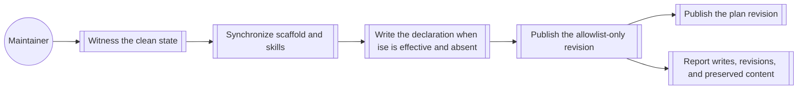

<!-- givn:base-sha256:702620584abb373014b4d66e2b174a9b563556d71d32bed283305f21a6029f27 -->
# Use case: upgrade-a-project

## Level

!

## Actors

- Project maintainer
- Supporting: Authoring agent

## Goal

Cross a supported release gap with reviewable managed revisions, preserving user-owned content and accurately reporting recovery from a committed checkpoint.

The delta: the upgrade writes the declaration of the Specification when `ise` is
effective and the project has none, and it never rewrites a project-edited
declaration.

## Trigger

The maintainer upgrades Givn.

## Preconditions

- The project configuration and repository state are available.
- Git or Fossil is selected, with a clean-state witness and a committed version-control checkpoint.
- The project's effective addon set is readable; it may or may not make `ise` effective.
- The declaration file is either absent or project-owned content.
- 1.0 is the supported migration baseline; configuration format is a separate concern. During 0.9.10 preparation a manually current-format 0.x project can receive a migration-free managed refresh. Older configurations may require manual repair before managed writes.

## Main flow

1. The maintainer requests an upgrade; the system records the committed checkpoint and refuses before writes for dirty projects or missing version control.
2. The system detects the project version and validates configuration ownership. Pre-1.0 projects receive manual transition guidance, not embedded old migration bundles or compatibility aliases; unsupported old keys refuse before writes.
3. For a supported project, the system synchronizes the managed scaffold and thin skills, removes only recognizable generated legacy commands, and leaves project-owned content authoritative. When `ise` is effective and the declaration file is absent, the system writes the documented declaration scaffold and reports the write; an existing declaration is left byte-for-byte and reported as project-owned.
4. The system publishes the calculated allowlist-only managed revision, excluding project extensions and custom replacements; improved built-in rules are available at the next instruction request. The revision contains the declaration this upgrade wrote and never an existing one.
5. An applicable future supported migration route produces a reviewable plan recording the actual managed upgrade revision. An existing plan is preserved and reported.
6. The system reports completed writes and revisions, pending work, and any removed commands or manual transitions accurately, naming whether the declaration was written or preserved.

## Extensions

- 1: uncommitted changes exist → refuse before writes, naming dirty paths and preserving user work; protects the minimal guarantee.
- 1: no supported version-control system or committed checkpoint exists → refuse before writes and name the checkpoint requirement; protects the minimal guarantee.
- 2: unsupported old configuration exists → name offending keys and applicable manual communication_policy, challenge, and skills-only transitions without converting them; protects the minimal guarantee.
- 3: the project is already current and no managed file differs → report state and publish no revision; protects the success guarantee.
- 3: the project is already current and an effective `ise` has no declaration → the scaffold is written and published as the one managed revision; protects the success guarantee.
- 3: the declaration already exists → preserve it byte-for-byte, stage nothing for it, and report it as project-owned; protects the minimal guarantee.
- 3: `ise` is not effective → write no declaration and touch none; a declaration left in the tree is preserved and no `ise` gate reads it; protects the success guarantee.
- 3: the declaration scaffold cannot be written → exit nonzero, name the path and the writes already completed, and offer checkpoint-based recovery without a rollback claim; protects the minimal guarantee.
- 3: a project-owned replacement, extension, or customized legacy command exists → preserve it byte-for-byte and report any manual transition; protects the minimal guarantee.
- 4: writing or publication fails after some work completed → exit nonzero and identify the failed operation, checkpoint, completed writes (including a written declaration), actual published revisions, and pending work; offer operator restoration or fix-forward without automatic reset or clean; protects the minimal guarantee.
- 5: a migration plan already exists → preserve and identify its proposal and design; protects the success guarantee.
- 6: a consumer invokes a removed command → report it unavailable rather than silently substituting another action; protects the success guarantee.

## Rules

- 1.0 is the supported migration baseline. Embedded pre-1.0 bundles and catalog routes are removed; 0.x configurations may break and need manual repair, not automatic conversion or compatibility aliases.
- Version detection and the future migration mechanism remain available for applicable supported routes; historical migration rationale remains reviewable.
- Managed upgrades use a clean committed checkpoint on both Git and Fossil. Ignored managed paths are staged only through the calculated allowlist.
- The managed revision refreshes thin skills and managed integration only; it never stages, merges, rewrites, or injects into project extensions or custom replacements and never destroys specifications or user-owned files.
- The declaration is written only when `ise` is effective and the file is absent. Its content is the documented shape, not a project decision; the next declaration edit owns the content.
- An existing declaration is project-owned: byte-for-byte, never rewritten, never staged as a modification, and reported as project-owned. A declaration left behind after `ise` was disabled is preserved and never read.
- The write and the staged set extend together. A declaration this upgrade wrote joins the calculated allowlist and the failure snapshot, so the published revision and the failure report both name it; an existing declaration joins neither. The revision is never empty of a file the upgrade wrote.
- The upgrade reads the effective addon set and changes no addon state. A configuration holding `ise` on with `architecture_principles` off is not repaired here; the addon commands own that refusal.
- Declaration findings are advisory at upgrade time. A declared path that does not exist yet is reported by `givn lint` and never refuses the upgrade; the change check remains the blocking gate for a change.
- The declaration is not a migration plan: it adds no change, no plan revision, and no migration bundle. A repeated upgrade on an unchanged project produces no diff and no revision.
- Recognizable generated legacy commands may be removed, but no new command surface is generated. Custom commands stay byte-for-byte and are reported for manual transition.
- Improved built-in rules are served at the next request without another rule-content synchronization revision.
- A future supported migration plan records the actual managed upgrade revision. A migration-free supported upgrade publishes exactly one allowlist-only revision and no plan revision.
- Local-only upgrades can remove generated guidance from tracking while keeping refreshed local skills, without modifying committed human-authored AGENTS.md.
- A failure can leave partial writes or published revisions. Report actual state and recovery from the checkpoint, distinguishing pending from completed work; never perform automatic reset/clean or promise complete rollback.
- Operator-controlled restoration or fix-forward is the recovery contract; no expanded transaction or history-rewrite subsystem is implied.

## Examples

- Absent declaration, `ise: true`: `givn upgrade` writes `givn/specification.yaml` with the five roles (`behavior`, `structure`, `contracts`, `limits`, `e2e`) and one `source:` list, then publishes one allowlist-only revision containing it; `givn lint` afterwards reports any declared path missing from the tree as advisory.
- Edited declaration: a project that added `docs/reference.md` to `contracts` and its crate roots to `source` receives a revision with no diff for `givn/specification.yaml`, and the report calls it project-owned.
- Declaration deleted on a current project: the upgrade writes and publishes it as the one managed revision; running the upgrade again produces no diff and no revision.
- `ise` disabled with a leftover declaration: the upgrade preserves the file untouched and writes nothing; `givn addons enable ise` is the next step and also preserves it.
- Dirty project: the upgrade refuses before writes and an existing declaration stays byte-for-byte.
- Publication failure after the declaration was written: the report names the written path, the completed writes, the checkpoint, and any revision actually published; the operator restores or repairs forward.
- A clean Git project at the supported baseline receives one managed revision containing only allowlisted integration changes; a Fossil project receives the corresponding check-in shape.
- A 0.7 project receives 1.0-baseline and manual key/skills transition guidance, not an aggregate embedded 0.x plan.
- A future supported route adds a reviewable migration plan naming the actual upgrade revision; an existing proposal and design are never overwritten.
- A custom legacy command and an extension saying "Keep proposals under 500 words" remain byte-for-byte unchanged.

## Minimal guarantee

Preflight refusal preserves project files, including an existing declaration.
Later failures preserve user-owned specifications, extensions, and replacements
and report actual partial state and checkpoint-based operator recovery without
claiming rollback; an upgrade never writes a declaration when `ise` is not
effective and never rewrites one that exists.

## Success guarantee

Supported upgrade work is explicit in version history, future migration plans
are reviewable and revision-bound, and thin skills reach current effective
rules while user-owned content remains unchanged; the project receives the
declaration of the Specification when `ise` is effective and it was absent, with
an existing declaration unchanged; pre-1.0 transitions are explicitly manual.

## Personas

- developer--primary-user
- givn-maintainer--owner

## Capabilities

- apply-a-managed-upgrade

## Interactions

| Capability | Consumer action | E2E scenario |
|---|---|---|
| apply-a-managed-upgrade | run a managed upgrade (an absent, an edited, and a `ise`-disabled declaration are precondition variants) | A clean project without migration requirements receives one managed upgrade commit |
| apply-a-managed-upgrade | invoke a retired engine command | A consumer invoking a retired engine command is told it does not exist |
| apply-a-managed-upgrade | invoke the retired history rewrite command | A consumer invoking the retired history rewrite command is told it does not exist |
| apply-a-managed-upgrade | archive a maintenance migration | A completed maintenance migration can be archived without a product specification |

## Includes

- fragment: support

## Extends

- none

## Out of scope

Changing product specifications during an upgrade; publishing releases
(`publish-a-release`); the declaration's content and validation
(`declare-the-specification`); the first enable that scaffolds the declaration
(`initialize-project`); repairing an addon prerequisite relation (the addon
commands).

## Diagram

